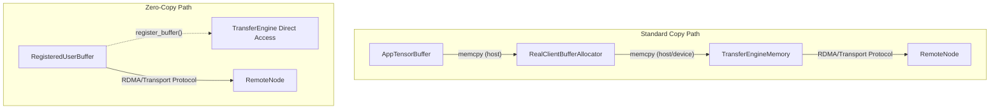
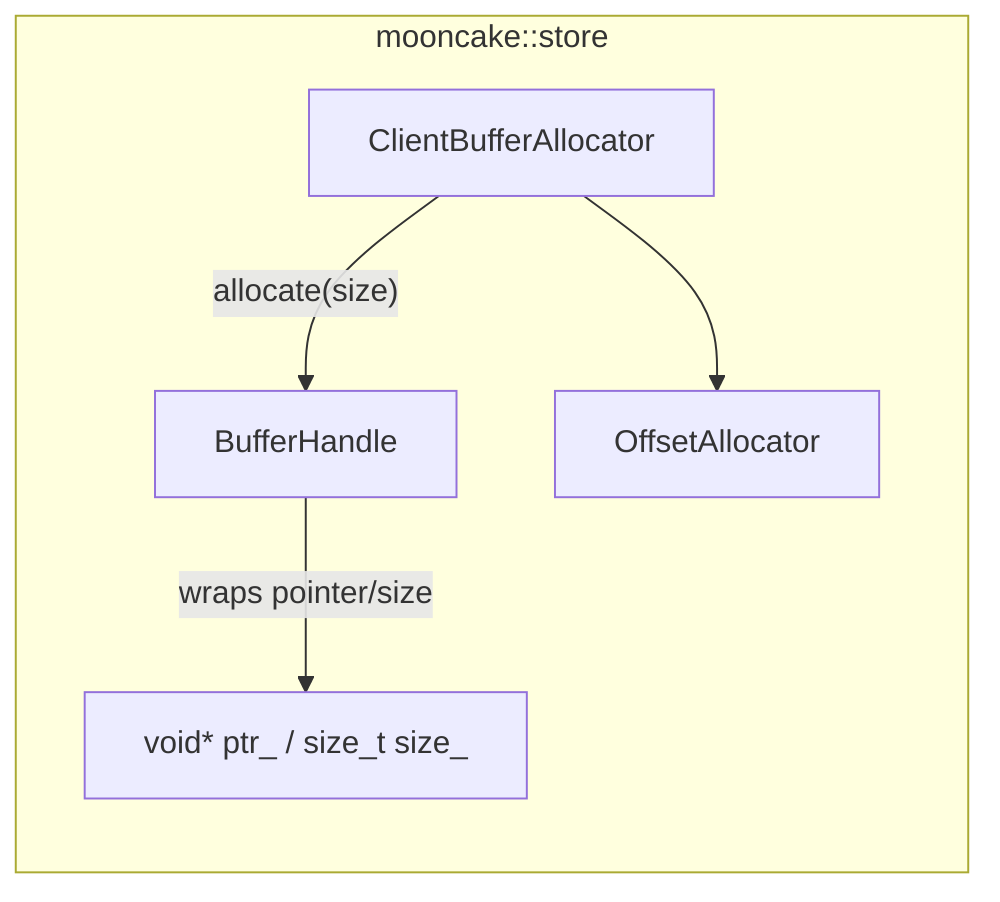
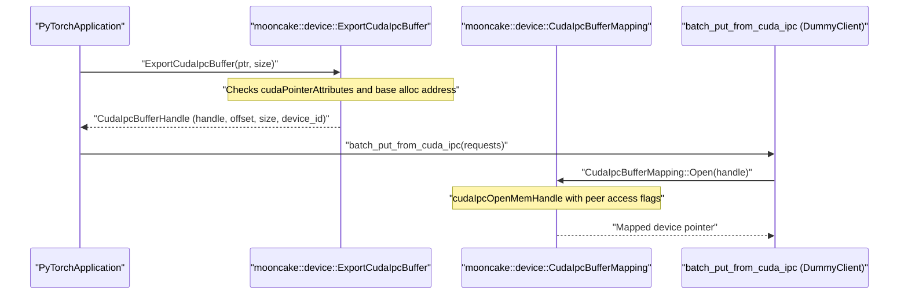

<!-- source: DeepWiki mcp.deepwiki.com · repo kvcache-ai/Mooncake · page 3.4 Zero-Copy Operations · fetched 2026-10-21 -->

# Zero-Copy Operations

<details>
<summary>Relevant source files</summary>

The following files were used as context for generating this wiki page:

- [mooncake-store/include/common/client_buffer_allocation.h](mooncake-store/include/common/client_buffer_allocation.h)
- [mooncake-store/src/client_buffer.cpp](mooncake-store/src/client_buffer.cpp)
- [mooncake-store/src/common/client_buffer_allocation.cpp](mooncake-store/src/common/client_buffer_allocation.cpp)
- [mooncake-store/src/common/mmap_buffer.cpp](mooncake-store/src/common/mmap_buffer.cpp)
- [mooncake-store/src/config/hugepage_config.cpp](mooncake-store/src/config/hugepage_config.cpp)
- [mooncake-store/src/config/hugepage_config.h](mooncake-store/src/config/hugepage_config.h)
- [mooncake-store/src/config/mmap_arena_config.cpp](mooncake-store/src/config/mmap_arena_config.cpp)
- [mooncake-store/tests/client_buffer_test.cpp](mooncake-store/tests/client_buffer_test.cpp)
- [mooncake-store/tests/hugepage_size_env_test.cpp](mooncake-store/tests/hugepage_size_env_test.cpp)
- [mooncake-store/tests/mmap_arena_fallback_test.cpp](mooncake-store/tests/mmap_arena_fallback_test.cpp)

</details>


## Purpose and Scope

This page details Mooncake's zero-copy buffer operations, which allow direct data transfers between user-allocated memory regions and the storage or transfer layers without intermediate staging copies. Zero-copy operations reduce CPU overhead, latency, and improve throughput for large tensor and block data transfers by leveraging pinned memory, hardware DMA, and interprocess communication primitives like CUDA IPC.

Topics covered include:
- Memory registration requirements and the `register_buffer` API.
- Store zero-copy APIs: `put_from`, `get_into`.
- The `BufferHandle` class protocol for managing registered buffers.
- GPU tensor zero-copy integration using CUDA IPC.
- Underlying implementation considerations and data flow.

For general tensor operations, see [3.3 Tensor Operations](). For the broader client API, see [3.2 MooncakeStorePyWrapper API]().

---

## Zero-Copy vs. Standard Operations

Typical store operations allocate internal buffers and perform explicit memory copies (`memcpy`) to and from user buffers, adding CPU overhead and latency.

Zero-copy operations bypass these extra copies by allowing user buffers to be registered once for zero-copy access by the transfer engine or network device. The storage client can then initiate transfers directly from/to these buffers, leveraging hardware RDMA or CUDA IPC capabilities.

### Data Flow Comparison Diagram



**Sources:**  
[mooncake-store/src/client_buffer.cpp:32-66](),  
[mooncake-store/src/common/client_buffer_allocation.cpp:95-137]()

---

## Memory Registration Requirements

Zero-copy transports such as RDMA require memory regions to be pinned in physical memory to allow DMA without page faults. Mooncake provides mechanisms to allocate and register memory buffers using `ClientBufferAllocator` and track them via `BufferHandle` wrappers.

### ClientBufferAllocator and BufferHandle Relationship



- The `ClientBufferAllocator` either maps hugepage-backed memory or uses other platform-specific allocators to create large buffer pools [mooncake-store/src/client_buffer.cpp:19-30]().
    - Memory allocation can use `mmap` for hugepages [mooncake-store/src/client_buffer.cpp:48-48](), or specialized allocators for protocols like `sunrise_link`, `ascend`, `ubshmem`, `ub`, or SPDK DMA [mooncake-store/src/client_buffer.cpp:51-58](), [mooncake-store/src/common/client_buffer_allocation.cpp:104-134]().
    - Hugepage configuration is determined by environment variables like `MC_STORE_USE_HUGEPAGE` and `MC_STORE_HUGEPAGE_SIZE` [mooncake-store/src/common/client_buffer_allocation.cpp:61-62](), [mooncake-store/src/config/hugepage_config.cpp:20-47]().
    - The `MmapArena` can be enabled for mmap buffers, providing a lock-free allocator [mooncake-store/src/common/mmap_buffer.cpp:31-66]().
- It then carves subregions using an `OffsetAllocator` and returns `BufferHandle` instances representing these pinned memory slices [mooncake-store/src/client_buffer.cpp:64-65](), [mooncake-store/src/client_buffer.cpp:88-99]().
- Python or user buffers must be explicitly registered with the client through `register_buffer` before zero-copy operations can safely use them [mooncake-store/include/real_client.h:117]().

**Sources:**  
[mooncake-store/src/client_buffer.cpp:19-123](),  
[mooncake-store/src/common/client_buffer_allocation.cpp:61-62](),  
[mooncake-store/src/common/client_buffer_allocation.cpp:104-134](),  
[mooncake-store/src/config/hugepage_config.cpp:20-47](),  
[mooncake-store/src/common/mmap_buffer.cpp:31-66]()

---

## Store Zero-Copy Operations (`register_buffer`, `put_from`, `get_into`)

### `register_buffer`

Allows registration of a user-allocated memory region for zero-copy operations.

```cpp
int register_buffer(void *buffer, size_t size);
int unregister_buffer(void *buffer);
```

- **`register_buffer`** pins the memory and prepares it for direct device access.
- The buffer must remain valid and unmodified for the duration of registration.
- `unregister_buffer` deregisters and releases any pinned resources.

### `put_from`

Uploads bytes to the store directly from a registered buffer.

```cpp
int put_from(const std::string &key, void *buffer, size_t size,
             const ReplicateConfig &config = ReplicateConfig{});

std::vector<int> batch_put_from(const std::vector<std::string> &keys,
                                const std::vector<void *> &buffers,
                                const std::vector<size_t> &sizes,
                                const ReplicateConfig &config = ReplicateConfig{});
```

- The `buffer` must be pre-registered by `register_buffer`.
- Transfers avoid any host staging copies.
- Batching versions enable multiple zero-copy puts in a single call.
- Underlying RPC implementations for the dummy client expose methods like `batch_put_from_dummy_helper` [mooncake-store/src/real_client_main.cpp:49-52]().

### `get_into`

Downloads bytes from the store directly into a registered buffer.

```cpp
int64_t get_into(const std::string &key, void *buffer, size_t size);

std::vector<int64_t> batch_get_into(const std::string &key,
                                    const std::vector<void *> &buffers,
                                    const std::vector<size_t> &sizes);
```

- The `buffer` must be pre-registered.
- Data is transferred from the store directly into user memory.
- Batch operations similarly optimize bulk zero-copy reads.
- RPC handlers include `batch_get_into_dummy_helper` in `RealClient` [mooncake-store/src/real_client_main.cpp:70-71]().

**Sources:**  
[mooncake-store/src/real_client_main.cpp:49-71]()

---

## BufferHandle Protocol

The `BufferHandle` C++ class wraps a registered memory pointer with lifetime management semantics.

- Constructed either from `ClientBufferAllocator` (managed allocations) or external memory views (with lambda "deleters") [mooncake-store/src/client_buffer.cpp:101-108]().
- Provides `ptr()` (raw memory pointer) and `size()` accessors [mooncake-store/src/client_buffer.cpp:117-123]().
- Move-only to enforce unique ownership and prevent double-frees by deleting copy operations [mooncake-store/src/client_buffer.cpp:101-123]().
- The `split_into_slices` utility function can divide a `BufferHandle` into multiple `Slice` objects, which are used for managing chunks of data, especially for disk-based or memory-based replicas [mooncake-store/src/client_buffer.cpp:126-143](), [mooncake-store/src/client_buffer.cpp:162-187]().

This handle is passed across layers and optionally exposed to Python bindings for efficient memory operations.

**Sources:**  
[mooncake-store/src/client_buffer.cpp:101-123](),  
[mooncake-store/src/client_buffer.cpp:126-143](),  
[mooncake-store/src/client_buffer.cpp:162-187]()

---

## Shared Memory and CUDA IPC Zero-Copy

For GPU tensors and multi-process environments, zero-copy transfers use CUDA IPC buffer handles to share device memory pointers safely.

### CUDA IPC Zero-Copy Flow



- `ExportCudaIpcBuffer` obtains CUDA IPC handles by querying pointer attributes and underlying CUDA allocation ranges to handle suballocated pointers correctly [mooncake-store/src/device/cuda_ipc_buffer.cpp:60-123]().
- `CudaIpcBufferMapping::Open` maps these handles into the current process's address space [mooncake-store/src/device/cuda_ipc_buffer.cpp:175-198]().
- Before IPC transfers, `SynchronizeCudaStream` ensures memory consistency on the CUDA device [mooncake-store/src/device/cuda_ipc_buffer.cpp:124-154]().
- The `DummyClient` exposes specialized methods for these zero-copy CUDA IPC operations:
  - `batch_put_from_cuda_ipc` for putting from CUDA IPC buffers [mooncake-store/include/dummy_client.h:118-120]().
  - `batch_upsert_from_cuda_ipc` for upsert with IPC buffers [mooncake-store/include/dummy_client.h:122-124]().
  - `batch_get_into_cuda_ipc` for get-into zero-copy to IPC buffers [mooncake-store/include/dummy_client.h:90-92]().

These smooth GPU inter-process data flows with minimal CPU involvement.

**Sources:**  
[mooncake-store/include/dummy_client.h:90-124](),  
[mooncake-store/src/real_client_main.cpp:53-54](),  
[mooncake-store/src/real_client_main.cpp:72-73](),  
[mooncake-store/src/device/cuda_ipc_buffer.cpp:60-123](),  
[mooncake-store/src/device/cuda_ipc_buffer.cpp:175-198]()

---

## Summary Table: Zero-Copy Interfaces

| Component          | Function / Class                           | Description                                                  |
|--------------------|------------------------------------------|--------------------------------------------------------------|
| **Allocator**      | `ClientBufferAllocator`                    | Hugepage or allocator-based pinned memory buffers [mooncake-store/src/client_buffer.cpp] |
| **Handle**         | `BufferHandle`                             | Wraps buffer pointer, size, and cleanup [mooncake-store/src/client_buffer.cpp]   |
| **Registration**   | `register_buffer(void *buffer, size_t)`    | Marks user memory as registered for zero-copy use [mooncake-store/include/real_client.h]  |
| **Put Operation**  | `put_from` / `batch_put_from`              | Writes from registered buffers to store [mooncake-store/include/dummy_client.h]      |
| **Get Operation**  | `get_into` / `batch_get_into`              | Reads from store into registered buffers [mooncake-store/include/real_client.h]      |
| **CUDA IPC Export**| `ExportCudaIpcBuffer`                       | Exports GPU pointer IPC handles [mooncake-store/src/device/cuda_ipc_buffer.cpp]         |
| **CUDA IPC Mapping**| `CudaIpcBufferMapping::Open`                | Opens and manages CUDA IPC mapped memory [mooncake-store/src/device/cuda_ipc_buffer.cpp]|

**Sources:**  
[mooncake-store/src/client_buffer.cpp:19-123](),  
[mooncake-store/include/real_client.h:117-141](),  
[mooncake-store/include/dummy_client.h:90-124](),  
[mooncake-store/src/real_client_main.cpp:49-73](),  
[mooncake-store/src/device/cuda_ipc_buffer.cpp:60-198](),  
[mooncake-store/src/common/client_buffer_allocation.cpp:95-137]()

---

