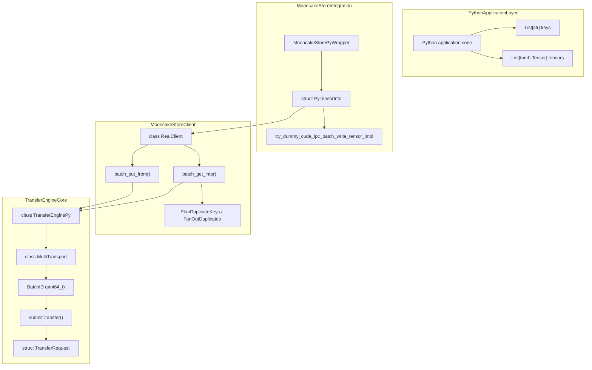
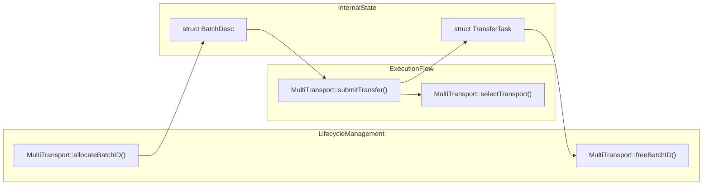
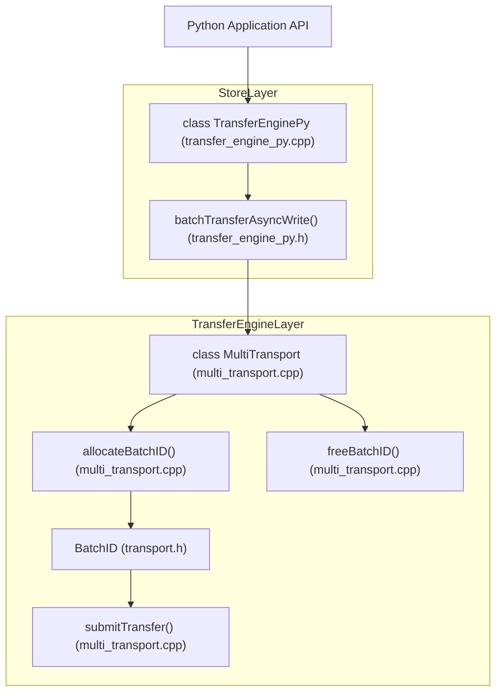

<!-- source: DeepWiki mcp.deepwiki.com · repo kvcache-ai/Mooncake · page 3.5 Batch Operations · fetched 2026-10-21 -->

# Batch Operations

<details>
<summary>Relevant source files</summary>

The following files were used as context for generating this wiki page:

- [docs/source/api-reference/cpp/transfer-engine.md](docs/source/api-reference/cpp/transfer-engine.md)
- [mooncake-integration/integration_utils.h](mooncake-integration/integration_utils.h)
- [mooncake-integration/store/store_py_internal.h](mooncake-integration/store/store_py_internal.h)
- [mooncake-integration/store/store_py_parallel_read.h](mooncake-integration/store/store_py_parallel_read.h)
- [mooncake-integration/store/store_py_parallel_write.h](mooncake-integration/store/store_py_parallel_write.h)
- [mooncake-integration/transfer_engine/transfer_engine_py.cpp](mooncake-integration/transfer_engine/transfer_engine_py.cpp)
- [mooncake-integration/transfer_engine/transfer_engine_py.h](mooncake-integration/transfer_engine/transfer_engine_py.h)
- [mooncake-store/include/device/cuda_ipc_buffer.h](mooncake-store/include/device/cuda_ipc_buffer.h)
- [mooncake-store/include/device/cuda_ipc_buffer_handle.h](mooncake-store/include/device/cuda_ipc_buffer_handle.h)
- [mooncake-store/src/device/cuda_ipc_buffer.cpp](mooncake-store/src/device/cuda_ipc_buffer.cpp)
- [mooncake-transfer-engine/include/multi_transport.h](mooncake-transfer-engine/include/multi_transport.h)
- [mooncake-transfer-engine/include/transfer_engine.h](mooncake-transfer-engine/include/transfer_engine.h)
- [mooncake-transfer-engine/include/transfer_engine_c.h](mooncake-transfer-engine/include/transfer_engine_c.h)
- [mooncake-transfer-engine/include/transfer_engine_impl.h](mooncake-transfer-engine/include/transfer_engine_impl.h)
- [mooncake-transfer-engine/include/transport/transport.h](mooncake-transfer-engine/include/transport/transport.h)
- [mooncake-transfer-engine/src/multi_transport.cpp](mooncake-transfer-engine/src/multi_transport.cpp)
- [mooncake-transfer-engine/src/transfer_engine.cpp](mooncake-transfer-engine/src/transfer_engine.cpp)
- [mooncake-transfer-engine/src/transfer_engine_c.cpp](mooncake-transfer-engine/src/transfer_engine_c.cpp)
- [mooncake-transfer-engine/src/transfer_engine_impl.cpp](mooncake-transfer-engine/src/transfer_engine_impl.cpp)
- [mooncake-transfer-engine/tests/shm_transport_test.cpp](mooncake-transfer-engine/tests/shm_transport_test.cpp)
- [mooncake-transfer-engine/tests/transport_uint_test.cpp](mooncake-transfer-engine/tests/transport_uint_test.cpp)
- [mooncake-wheel/tests/test_dummy_client.py](mooncake-wheel/tests/test_dummy_client.py)

</details>


## Purpose and Scope

Batch operations enable submitting multiple Put, Get, or Transfer requests in a single API call, significantly reducing per-operation overhead and improving throughput. This page covers batch APIs exposed through the Python bindings and C++ core for both Mooncake Store and Transfer Engine, explaining their implementation, duplicate key handling, CUDA IPC acceleration, and performance characteristics.

For single-operation Put/Get APIs, see [Tensor Operations](3.3)(). For zero-copy single operations, see [Zero-Copy Operations](3.4)(). For Transfer Engine architecture details, see [Core Architecture](4.1)().

Sources: `[mooncake-integration/transfer_engine/transfer_engine_py.cpp:1-204]()`, `[mooncake-transfer-engine/src/transfer_engine.cpp:1-203]()`

---

## Overview of Batch API Design

Mooncake provides two categories of batch operations:

1.  **Store Batch Operations**: High-level APIs for batching tensor and buffer storage operations, handling of duplicate keys, CUDA IPC batch writing, and metadata queries.
2.  **Transfer Engine Batch Operations**: Low-level APIs for batching raw data transfers across network endpoints using various transport protocols.

### Batch Operation Data Flow

The following diagram bridges the high-level Python application concepts to internal C++ code entities for batch data flows.


Sources: `[mooncake-integration/transfer_engine/transfer_engine_py.cpp:50-130]`, `[mooncake-transfer-engine/src/transfer_engine.cpp:168-171]()`, `[mooncake-transfer-engine/src/multi_transport.cpp:107-120]()`

---

## Store Batch Operations

The Mooncake Store provides batch capabilities for existence checks, metadata queries, and data retrieval, optimized for high-concurrency LLM serving environments.

### API: `batch_get_into` and Duplicate Key Fanout

`batch_get_into` allows a client to retrieve multiple objects into pre-allocated, registered buffers in a single call. This minimizes master round-trips and transfer initialization overhead.

- **Duplicate Key Handling**: Within a batch, duplicate keys are managed by identifying unique primary keys and their duplicates, so that each unique key is requested once.
- **Fan-Out Optimization**: After a successful retrieval of a unique primary key, device-aware copy operations replicate the data into the buffers for duplicates, preserving success or error states.

This approach ensures efficient bandwidth use and consistency across replicated key requests.

Sources: `[mooncake-transfer-engine/include/transport/transport.h:121-123]()`


### API: `batch_put_from` and CUDA IPC Acceleration

For batch storage operations, Mooncake supports efficient tensor placement and GPU-to-GPU transfer acceleration with CUDA IPC.

- **CUDA IPC Batch Writing**: When using dummy or IPC-backed clients, tensors across multiple CUDA devices are synchronized, and memory handles are exported collectively to enable zero-copy batch writes.
- **Staging and Metadata Packaging**: The batch metadata buffer is allocated and filled with tensor metadata headers (`TensorMetadata`), bundled into write request structures to avoid redundant host staging and reduce latency.

These mechanisms provide high throughput for batch tensor writes without expensive host-device memory copies.

Sources: `[mooncake-transfer-engine/src/transfer_engine.cpp:188-194]()`

### Metadata Batch Operations

Mooncake supports batch-only operations for metadata queries crucial for cache coherence and management:

- **Batch Query**: Returns vector results including replica locations and lease timeouts for given key lists.
- **Batch Replica Clear**: Removes attribute replicas of keys from specified segments.
- **IP Batch Query**: Retrieves IP addresses for a batch of client UUIDs.

These batch metadata operations improve efficiency by reducing master service communication overhead.

Sources: `[mooncake-transfer-engine/include/transfer_engine.h:165-180]()`


---

## Transfer Engine Batch Operations

The Transfer Engine and `MultiTransport` layers provide the core interface for high-performance batch data movement.

### Batch Submission APIs

- **`submitTransfer`** (C++ Core): Submits a batch of `TransferRequest` entries for network transfer via `MultiTransport` `[mooncake-transfer-engine/src/multi_transport.cpp:62-64]()` and `[mooncake-transfer-engine/include/transfer_engine_impl.h:128-143]()`.

- **`submitTransferWithNotify`** (C++ Core): Submits a batch with an additional notification message for out-of-band signaling `[mooncake-transfer-engine/include/transfer_engine_impl.h:162-191]`.

- **`batchTransferAsync`** (Python API): Asynchronously submits a batch transfer using the `TransferEnginePy` binding, returning a batch ID for status tracking `[mooncake-integration/transfer_engine/transfer_engine_py.h:126-131]`.

All batch operations require allocating a `BatchID` beforehand to group transfer requests using `allocateBatchID` `[mooncake-transfer-engine/include/multi_transport.h:56-56]`.

### Batch Lifecycle Management

The diagram below illustrates the key batch operation flow and related code entities for transfer submissions.



Sources: `[mooncake-transfer-engine/src/multi_transport.cpp:107-120]()`, `[mooncake-transfer-engine/src/multi_transport.cpp:125-155]()`

---

## Performance and Implementation Details

### Scatter/Gather and Slice Copy Optimizations

The fragment building and scatter logic optimize batch transfers for layer-wise LLM workloads:

- `submitScatter` and associated structures manage batched copies across host and accelerator memories, handling chunking when caller and callee slice configurations differ `[mooncake-transfer-engine/include/multi_transport.h:65-66]()`.

This coordinated slicing approach reduces overhead and synchronizes transfers across device boundaries.

Sources: `[mooncake-transfer-engine/include/multi_transport.h:65-66]()`, `[mooncake-transfer-engine/src/multi_transport.cpp:146-160]()`

### Transport Selection and Batching

The `MultiTransport` layer orchestrates request grouping by:

- Iterating all transfer entries in a batch,
- Using `selectTransport` or `selectTransports` for each entry to decide protocol and endpoint `[mooncake-transfer-engine/include/multi_transport.h:109-119]()`,
- Submitting transfer tasks to the selected transport `[mooncake-transfer-engine/src/multi_transport.cpp:62-64]()`.

This layered selection and batching enable multiprotocol support and efficient transport utilization.

Sources: `[mooncake-transfer-engine/src/multi_transport.cpp:109-119]()`, `[mooncake-transfer-engine/include/multi_transport.h:109-119]()`

### RDMA Specific Optimizations

RDMA transport uses slice length calculators on batch entries to:

- Cap slice lengths at Memory Region boundaries,
- Prevent creating Work Requests spanning multiple MRs,
- Improve performance by avoiding multi-MR WR inefficiencies.

Sources: `[mooncake-transfer-engine/src/transfer_engine.cpp:188-198]()`

### Batch ID Conversion

For ultra-low latency in transfer submission hot paths, `BatchID` is implemented as a direct cast of a pointer to `BatchDesc`, bypassing map lookups.

```cpp
static inline BatchDesc &toBatchDesc(BatchID id) {
    return *reinterpret_cast<BatchDesc *>(id);
}
```

Sources: `[mooncake-transfer-engine/include/transport/transport.h:121-123]()`

### Event-Driven Completion

With event-driven completion mechanisms enabled:

- The batch task submission is sealed after slice submission,
- The completion worker awaits completion events,
- Ensuring safe state transitions and no race hazards during finish callbacks `[mooncake-transfer-engine/tests/transport_uint_test.cpp:176-191]()`, `[mooncake-transfer-engine/src/multi_transport.cpp:183-189]()`.

This model improves scalability and latency for high-concurrency batch transfers.

Sources: `[mooncake-transfer-engine/tests/transport_uint_test.cpp:176-191]()`, `[mooncake-transfer-engine/src/multi_transport.cpp:183-189]()`

---

# Summary

Batch operations in Mooncake combine high-level storage batch semantics and low-level transfer batching to optimize throughput and resource utilization. The design supports advanced scenarios such as duplicate key fanout, CUDA IPC acceleration, and multi-protocol transport batching, while offering robust lifecycle management via stable batch IDs. These APIs and internal mechanisms target the demanding concurrency and low latency needs of large-scale LLM KVCache stores.

---

# Appendix: Batch API Key Classes and Functions Mapping



Sources: `[mooncake-integration/transfer_engine/transfer_engine_py.cpp:50-130]()`, `[mooncake-integration/transfer_engine/transfer_engine_py.h:126-138]()`, `[mooncake-transfer-engine/src/multi_transport.cpp:107-160]()`, `[mooncake-transfer-engine/include/transport/transport.h:53-53]()`

---

