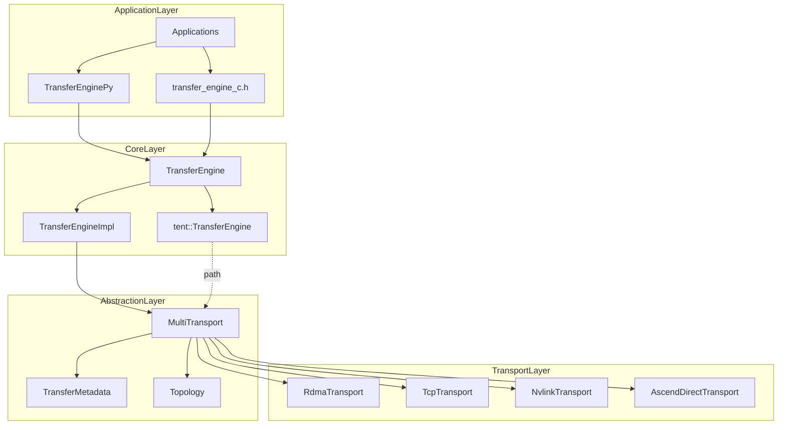
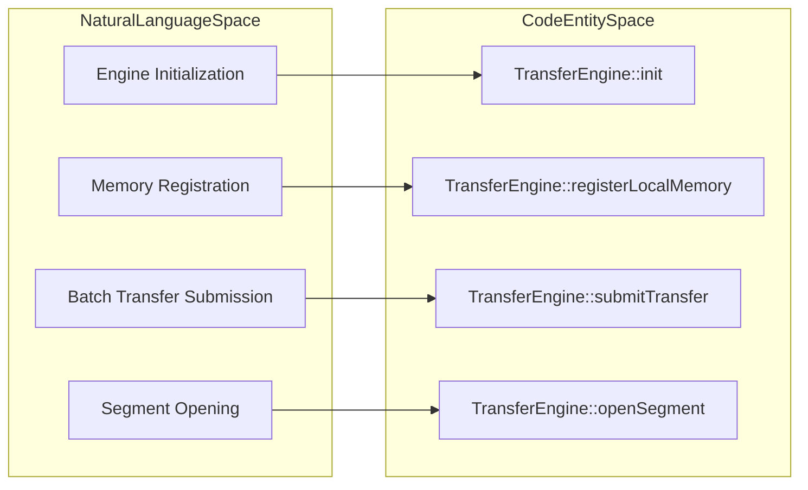
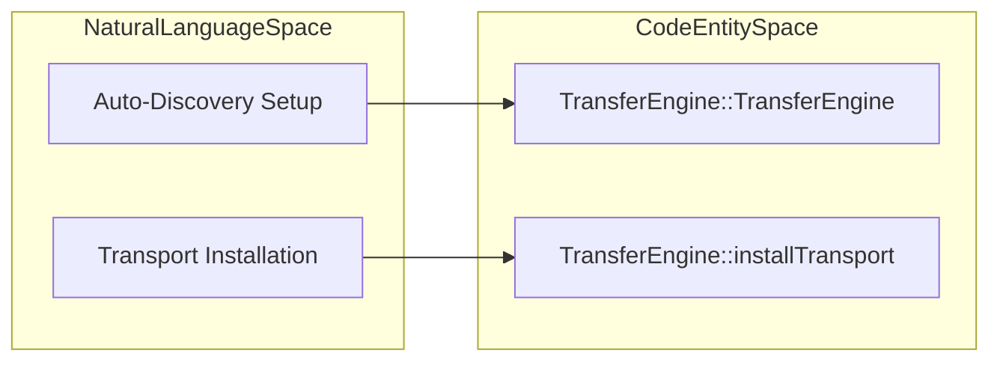

<!-- source: DeepWiki mcp.deepwiki.com · repo kvcache-ai/Mooncake · page 4 Transfer Engine · fetched 2026-10-21 -->

# Transfer Engine

Relevant source files

The following files were used as context for generating this wiki page:

- [docs/source/api-reference/cpp/transfer-engine.md](docs/source/api-reference/cpp/transfer-engine.md)
- [mooncake-integration/transfer_engine/transfer_engine_py.cpp](mooncake-integration/transfer_engine/transfer_engine_py.cpp)
- [mooncake-integration/transfer_engine/transfer_engine_py.h](mooncake-integration/transfer_engine/transfer_engine_py.h)
- [mooncake-transfer-engine/include/multi_transport.h](mooncake-transfer-engine/include/multi_transport.h)
- [mooncake-transfer-engine/include/transfer_engine.h](mooncake-transfer-engine/include/transfer_engine.h)
- [mooncake-transfer-engine/include/transfer_engine_c.h](mooncake-transfer-engine/include/transfer_engine_c.h)
- [mooncake-transfer-engine/include/transfer_engine_impl.h](mooncake-transfer-engine/include/transfer_engine_impl.h)
- [mooncake-transfer-engine/include/transport/transport.h](mooncake-transfer-engine/include/transport/transport.h)
- [mooncake-transfer-engine/src/multi_transport.cpp](mooncake-transfer-engine/src/multi_transport.cpp)
- [mooncake-transfer-engine/src/transfer_engine.cpp](mooncake-transfer-engine/src/transfer_engine.cpp)
- [mooncake-transfer-engine/src/transfer_engine_c.cpp](mooncake-transfer-engine/src/transfer_engine_c.cpp)
- [mooncake-transfer-engine/src/transfer_engine_impl.cpp](mooncake-transfer-engine/src/transfer_engine_impl.cpp)
- [mooncake-transfer-engine/tests/shm_transport_test.cpp](mooncake-transfer-engine/tests/shm_transport_test.cpp)
- [mooncake-transfer-engine/tests/transport_uint_test.cpp](mooncake-transfer-engine/tests/transport_uint_test.cpp)

The Transfer Engine is Mooncake's high-performance data movement subsystem, providing a unified interface for batched and asynchronous data transfer across heterogeneous memory and storage devices, linked by a wide variety of transport protocols. It abstracts the underlying complexities of multiple transports such as TCP, RDMA, NVLink, CXL, and NVMe-oF, exposing a seamless API to move data between CPU memory, GPU memory, remote nodes, and persistent storage [mooncake-transfer-engine/include/transfer_engine.h:85-145]().

## Purpose and Scope

The Transfer Engine is primarily designed to accelerate fast and reliable data movement for AI workloads, particularly in large-scale LLM serving scenarios. It supports efficient KVCache transfers during prefill-to-decode stages, enabling distributed disaggregated model serving.

This page provides a high-level overview of the Transfer Engine subsystem, outlining its key abstractions, architecture, and how its various components cooperate. Detailed technical information and API documentation are available in dedicated child pages:
- [Core Architecture](#4.1) — Transfer Engine architecture: dual backend (standard vs TENT), MultiTransport dispatcher, transport selection, bridge pattern.
- [TENT (Transfer Engine Next)](#4.2) — TENT implementation: dynamic path selection, telemetry scheduling, failure handling, admission queues, proxy/progress workers, platform plugins.
- [C++ API Reference](#4.3) — C++ TransferEngine API: initialization, memory registration, segments, batch transfers, notifications, status tracking.
- [C API Reference](#4.4) — C language bindings: transfer_engine_c.h opaque pointer API, memory safety conventions, Rust and Go bindings.
- [Transport Layer Architecture](#4.5) — Pluggable transport architecture, installTransport, protocol selection in MultiTransport, Transport base class.
- [RDMA Transport](#4.6) — RDMA transport: memory registration, RdmaContext/RdmaEndpoint, worker pools, rail monitoring, NUMA-aware allocation; classic and TENT implementations.
- [NVLink and GPU Transports](#4.7) — NVLink/MNNVL transport, HIP for AMD, MUSA/MACA, IBGDA device transport, nvlink-allocator and ubshmem-allocator.
- [Ascend Direct Transport](#4.8) — Ascend Direct Transport: ADXL integration, local copy, async transfers, HCCS/HCCL, threading model, env configuration.
- [Other Transport Protocols](#4.9) — TCP, HP-TCP, EFA, CXL, NVMe-oF, GDS, io_uring, SHM, Barex, UBShmem, Kunpeng UB, heterogeneous transports.
- [Topology Discovery and Device Selection](#4.10) — Topology detection, device selection algorithms, NUMA-aware routing, topology dump utility.
- [Memory Registration](#4.11) — Memory registration APIs, batch registration, hugepage support, location auto-detection, wildcard location for NUMA affinity.
- [Metadata Services](#4.12) — Metadata service options: ETCD, Redis, HTTP, P2P handshake; transfer_metadata plugin architecture and etcd_wrapper.
- [Batch Operations and Slicing](#4.13) — Batch allocation, slice-based scheduling, transfer task hierarchy, completion tracking, event vs polling completion.
- [Configuration and Tuning](#4.14) — Environment variables, CMake options, tuning parameters, config.h/config.cpp global configuration, TENT JSON config.
- [Status Tracking and Error Handling](#4.15) — Transfer status enum, error code taxonomy, status polling, event-driven completion, fault tolerance retries.
- [Notification System](#4.16) — Notification API: sendNotifyByID/Name, submitTransferWithNotify, getNotifies, NotifyDesc structure.
- [TENT Metrics and Observability](#4.17) — TENT metrics subsystem: counters/histograms, metrics config loader, HTTP metrics endpoint, QoS metrics, benchmark target metrics.

---

## 4.1 Core Architecture

The Transfer Engine employs a layered architecture that cleanly separates application-level interfaces from transport implementations and hardware abstraction. At the top, applications interface with `TransferEngine` objects, which internally delegate data movement operations to either the legacy backend (`TransferEngineImpl`) or the next-generation Transfer Engine (`tent::TransferEngine`), selectable via configuration [mooncake-transfer-engine/src/transfer_engine.cpp:89-124]().

The `MultiTransport` component dispatches transfer requests to installed protocol handlers based on topology, protocol, and memory locations involved.

Title: "TransferEngine Architecture Overview"

Sources: [mooncake-transfer-engine/include/transfer_engine.h:85-143](), [mooncake-transfer-engine/src/transfer_engine.cpp:89-124]()

For details, see [Core Architecture](#4.1).

---

## 4.2 TENT (Transfer Engine Next)

TENT is the advanced backend for the Transfer Engine, designed for enhanced scalability and performance in heterogeneous environments. It features telemetry-driven scheduling algorithms, dynamic NIC/QP path selection, declarative configuration, failure tolerance with admission and proxy queues, and platform-specific plugins [mooncake-integration/transfer_engine/transfer_engine_py.cpp:30-34]().

For details, see [TENT (Transfer Engine Next)](#4.2).

Sources: [mooncake-integration/transfer_engine/transfer_engine_py.cpp:30-34]()

---

## 4.3 C++ API Reference

The main C++ API for the Transfer Engine is provided by the `TransferEngine` class in `transfer_engine.h`. It exposes operations for engine initialization, memory registration, segment management, batch transfer submission, querying transfer statuses, and receiving asynchronous notifications [mooncake-transfer-engine/include/transfer_engine.h:117-190]().

Title: "C++ API Bridge to Code Entities"

Sources: [mooncake-transfer-engine/include/transfer_engine.h:117-190](), [mooncake-transfer-engine/src/transfer_engine.cpp:128-145]()

For details, see [C++ API Reference](#4.3).

---

## 4.4 C API Reference

The C API, defined in `transfer_engine_c.h`, offers a foreign-language-friendly bindings interface with opaque pointers to `TransferEngine` instances. It enables calling into the Transfer Engine from languages such as Python, Go, and Rust, respecting strict memory ownership and argument copying semantics [mooncake-transfer-engine/include/transfer_engine_c.h:29-170]().

For details, see [C API Reference](#4.4).

Sources: [mooncake-transfer-engine/include/transfer_engine_c.h:29-170]()

---

## 4.5 Transport Layer Architecture

The transport layer uses a modular and pluggable architecture. The base class `Transport` defines the core interface common to all transports. The `MultiTransport` component manages installed transport protocols, dispatching transfer requests to the appropriate transport instance based on topology, protocol matching, and memory locality [mooncake-transfer-engine/include/transport/transport.h:44-55](), [mooncake-transfer-engine/src/multi_transport.cpp:92-120]().

For details, see [Transport Layer Architecture](#4.5).

Sources: [mooncake-transfer-engine/include/transport/transport.h:44-55](), [mooncake-transfer-engine/src/multi_transport.cpp:92-120]()

---

## 4.6 RDMA Transport

RDMA Transport leverages InfiniBand or RoCE network adapters to provide low-latency, high-throughput remote memory access. It manages connection lifecycles via `RdmaContext` and individual endpoints via `RdmaEndpoint`, supporting GPU direct memory registration and NUMA-aware buffer allocation [mooncake-transfer-engine/tests/transport_uint_test.cpp:20-21]().

For details, see [RDMA Transport](#4.6).

Sources: [mooncake-transfer-engine/tests/transport_uint_test.cpp:20-21]()

---

## 4.7 NVLink and GPU Transports

The Transfer Engine supports GPU-centric transports to leverage fast intra- and inter-node GPU memory transfers. NVLink transports (including inter-node MNNVL and intra-node variants), HIP transport for AMD GPUs, and Moore Threads MUSA/MACA transports are supported using dedicated allocators and memory handle mechanisms [mooncake-integration/transfer_engine/transfer_engine_py.cpp:40-58]().

For details, see [NVLink and GPU Transports](#4.7).

Sources: [mooncake-integration/transfer_engine/transfer_engine_py.cpp:40-58]()

---

## 4.8 Ascend Direct Transport

The Ascend Direct Transport integrates Huawei's Ascend NPUs using the ADXL library and HCCS/HCCL protocols. It provides asynchronous zero-copy local data transfers and manages connection lifecycles optimized for Ascend hardware [mooncake-transfer-engine/src/multi_transport.cpp:39-44]().

For details, see [Ascend Direct Transport](#4.8).

Sources: [mooncake-transfer-engine/src/multi_transport.cpp:39-44]()

---

## 4.9 Other Transport Protocols

Beyond the core protocols, Mooncake supports a diverse set of transports like TCP, HP-TCP, Elastic Fabric Adapter (EFA), CXL, NVMe-oF, Barex, UBShmem, Kunpeng UB, and heterogeneous adapters configured via runtime options and environment variables [mooncake-transfer-engine/src/multi_transport.cpp:25-87]().

For details, see [Other Transport Protocols](#4.9).

Sources: [mooncake-transfer-engine/src/multi_transport.cpp:25-87]()

---

## 4.10 Topology Discovery and Device Selection

To optimize transfer paths, the Transfer Engine discovers system topology including CPU sockets, NICs, GPUs, and NUMA nodes. It builds and broadcasts a topology matrix to the cluster, enabling topology-aware scheduling and device selection [mooncake-transfer-engine/src/transfer_engine_impl.cpp:70-110]().

For details, see [Topology Discovery and Device Selection](#4.10).

Sources: [mooncake-transfer-engine/src/transfer_engine_impl.cpp:70-110]()

---

## 4.11 Memory Registration

Memory regions used in transfers require registration for RDMA or GPU direct access. The Transfer Engine API supports registering/unregistering buffers and batches thereof, with support for hugepage optimization and automatic NUMA location inference [mooncake-transfer-engine/include/transfer_engine.h:165-182](), [mooncake-integration/transfer_engine/transfer_engine_py.cpp:144-204]().

For details, see [Memory Registration](#4.11).

Sources: [mooncake-transfer-engine/include/transfer_engine.h:165-182](), [mooncake-integration/transfer_engine/transfer_engine_py.cpp:144-204]()

---

## 4.12 Metadata Services

The Transfer Engine relies on metadata services such as ETCD, Redis, HTTP, or peer-to-peer handshakes for cluster-wide segment discovery, connection bootstrapping, and state synchronization via the `TransferMetadata` class [mooncake-transfer-engine/include/transport/transport.h:34-40]().

For details, see [Metadata Services](#4.12).

Sources: [mooncake-transfer-engine/include/transport/transport.h:34-40]()

---

## 4.13 Batch Operations and Slicing

Transfers are submitted as batches (`BatchID`) that aggregate many requests into scatter/gather operations. Internally, batches are sliced into smaller `Slice` units to leverage hardware concurrency across multiple NIC queue pairs and threads [mooncake-transfer-engine/include/transport/transport.h:107-155](), [mooncake-transfer-engine/src/multi_transport.cpp:107-120]().

For details, see [Batch Operations and Slicing](#4.13).

Sources: [mooncake-transfer-engine/include/transport/transport.h:107-155](), [mooncake-transfer-engine/src/multi_transport.cpp:107-120]()

---

## 4.14 Configuration and Tuning

Global parameters for the Transfer Engine are configurable via environment variables, CMake build options, and runtime JSON or YAML config files for the TENT backend, implemented in `config.h/cpp` [mooncake-transfer-engine/src/transfer_engine_impl.cpp:121-130]().

Title: "Configuration and Tuning Mapping"

Sources: [mooncake-transfer-engine/src/transfer_engine.cpp:89-94](), [mooncake-transfer-engine/src/transfer_engine_impl.cpp:121-130]()

For details, see [Configuration and Tuning](#4.14).

---

## 4.15 Status Tracking and Error Handling

The Transfer Engine tracks transfer progress using an enumeration of `TransferStatusEnum` states including `WAITING`, `PENDING`, `COMPLETED`, `FAILED`, and others. APIs enable polling and event-driven status updates [mooncake-transfer-engine/include/transport/transport.h:86-99]().

For details, see [Status Tracking and Error Handling](#4.15).

Sources: [mooncake-transfer-engine/include/transport/transport.h:86-99]()

---

## 4.16 Notification System

The notification subsystem allows out-of-band signaling between endpoints using `NotifyDesc` structures transmitted via metadata overlays. Functions like `submitTransferWithNotify` facilitate asynchronous notifications for batch completions and errors [mooncake-transfer-engine/src/transfer_engine_impl.cpp:162-191]().

For details, see [Notification System](#4.16).

Sources: [mooncake-transfer-engine/src/transfer_engine_impl.cpp:162-191]()

---

## 4.17 TENT Metrics and Observability

The TENT backend includes a dedicated metrics subsystem for observability, collecting counters and histograms related to transfer performance, queueing, and resource utilization via metrics config loaders and HTTP endpoints [mooncake-transfer-engine/src/transfer_engine_impl.cpp:71-76]().

For details, see [TENT Metrics and Observability](#4.17).

Sources: [mooncake-transfer-engine/src/transfer_engine_impl.cpp:71-76]()

---

