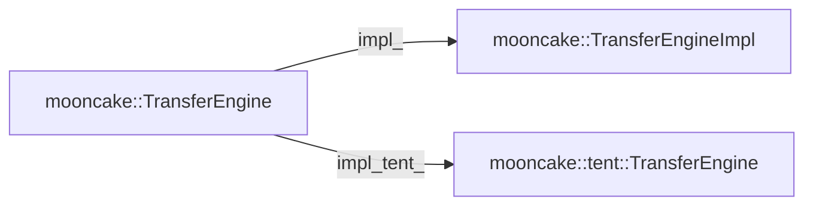
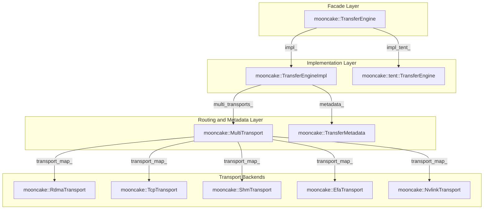
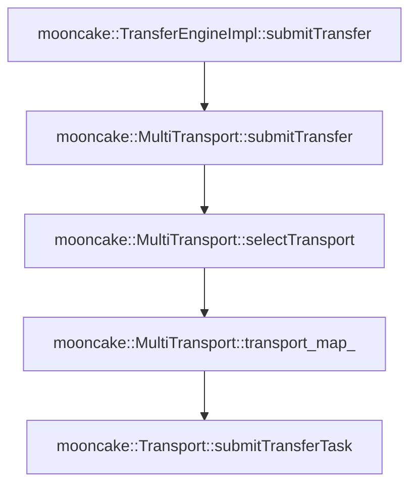
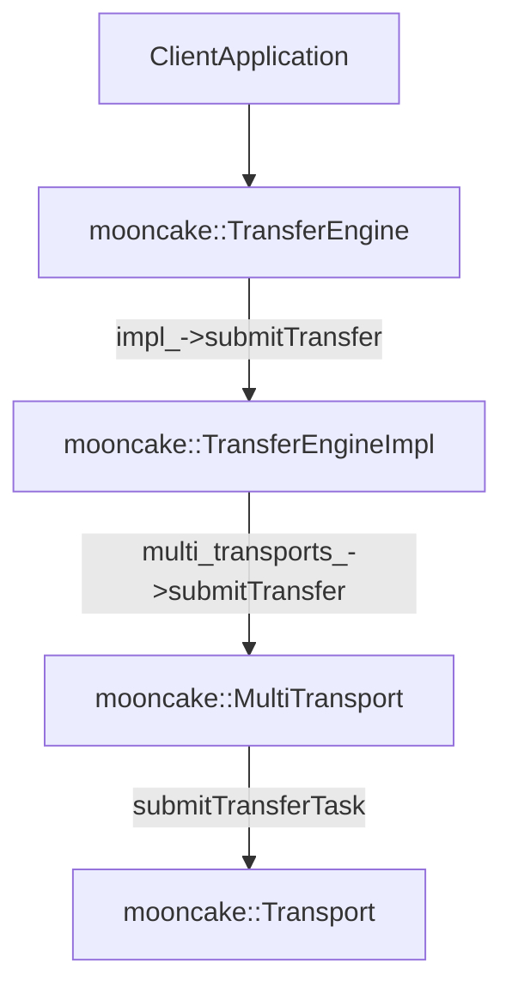

<!-- source: DeepWiki mcp.deepwiki.com · repo kvcache-ai/Mooncake · page 4.1 Core Architecture · fetched 2026-10-21 -->

# Core Architecture

Relevant source files

The following files were used as context for generating this wiki page:

- [docs/source/api-reference/cpp/transfer-engine.md](docs/source/api-reference/cpp/transfer-engine.md)
- [docs/source/design/tent/transport-selector.md](docs/source/design/tent/transport-selector.md)
- [mooncake-integration/transfer_engine/transfer_engine_py.cpp](mooncake-integration/transfer_engine/transfer_engine_py.cpp)
- [mooncake-integration/transfer_engine/transfer_engine_py.h](mooncake-integration/transfer_engine/transfer_engine_py.h)
- [mooncake-transfer-engine/include/multi_transport.h](mooncake-transfer-engine/include/multi_transport.h)
- [mooncake-transfer-engine/include/transfer_engine.h](mooncake-transfer-engine/include/transfer_engine.h)
- [mooncake-transfer-engine/include/transfer_engine_c.h](mooncake-transfer-engine/include/transfer_engine_c.h)
- [mooncake-transfer-engine/include/transfer_engine_impl.h](mooncake-transfer-engine/include/transfer_engine_impl.h)
- [mooncake-transfer-engine/include/transport/transport.h](mooncake-transfer-engine/include/transport/transport.h)
- [mooncake-transfer-engine/src/multi_transport.cpp](mooncake-transfer-engine/src/multi_transport.cpp)
- [mooncake-transfer-engine/src/transfer_engine.cpp](mooncake-transfer-engine/src/transfer_engine.cpp)
- [mooncake-transfer-engine/src/transfer_engine_c.cpp](mooncake-transfer-engine/src/transfer_engine_c.cpp)
- [mooncake-transfer-engine/src/transfer_engine_impl.cpp](mooncake-transfer-engine/src/transfer_engine_impl.cpp)
- [mooncake-transfer-engine/src/transport/rpc_communicator/CMakeLists.txt](mooncake-transfer-engine/src/transport/rpc_communicator/CMakeLists.txt)
- [mooncake-transfer-engine/tent/include/tent/common/types.h](mooncake-transfer-engine/tent/include/tent/common/types.h)
- [mooncake-transfer-engine/tent/include/tent/runtime/transport_selector.h](mooncake-transfer-engine/tent/include/tent/runtime/transport_selector.h)
- [mooncake-transfer-engine/tent/include/tent/transfer_engine.h](mooncake-transfer-engine/tent/include/tent/transfer_engine.h)
- [mooncake-transfer-engine/tent/src/CMakeLists.txt](mooncake-transfer-engine/tent/src/CMakeLists.txt)
- [mooncake-transfer-engine/tent/src/python/CMakeLists.txt](mooncake-transfer-engine/tent/src/python/CMakeLists.txt)
- [mooncake-transfer-engine/tent/src/python/pybind.cpp](mooncake-transfer-engine/tent/src/python/pybind.cpp)
- [mooncake-transfer-engine/tent/src/runtime/transport_loader.cpp](mooncake-transfer-engine/tent/src/runtime/transport_loader.cpp)
- [mooncake-transfer-engine/tent/src/runtime/transport_selector.cpp](mooncake-transfer-engine/tent/src/runtime/transport_selector.cpp)
- [mooncake-transfer-engine/tent/src/transfer_engine.cpp](mooncake-transfer-engine/tent/src/transfer_engine.cpp)
- [mooncake-transfer-engine/tent/src/transport/CMakeLists.txt](mooncake-transfer-engine/tent/src/transport/CMakeLists.txt)
- [mooncake-transfer-engine/tent/tests/test_python_guards.py](mooncake-transfer-engine/tent/tests/test_python_guards.py)
- [mooncake-transfer-engine/tent/tests/transport_selector_test.cpp](mooncake-transfer-engine/tent/tests/transport_selector_test.cpp)
- [mooncake-transfer-engine/tests/shm_transport_test.cpp](mooncake-transfer-engine/tests/shm_transport_test.cpp)
- [mooncake-transfer-engine/tests/transport_uint_test.cpp](mooncake-transfer-engine/tests/transport_uint_test.cpp)

## Purpose and Scope

The Transfer Engine is Mooncake’s core data movement subsystem, offering a unified, high-performance API for transferring data across heterogeneous devices such as CPUs, GPUs, NPUs, and over a variety of network protocols including RDMA, TCP, NVLink, EFA, and others. It manages memory registration, selects appropriate transport protocols, and optimizes topology-aware routing and batch processing behind a single C++ facade: `mooncake::TransferEngine` [mooncake-transfer-engine/include/transfer_engine.h:85-216]().

This page explains the Transfer Engine’s core architectural components:

- The dual-backend design with Classic (standard) and TENT implementations.
- The `MultiTransport` dispatcher responsible for multi-protocol transport management.
- The transport selection mechanism.
- The bridge pattern connecting the facade `TransferEngine` to its implementation layers.

Sources:
[mooncake-transfer-engine/include/transfer_engine.h:85-216]()

---

## Dual Implementation Strategy

The `TransferEngine` class implements a bridge pattern: it delegates actual transfer processing to one of two backends depending on configuration and compile-time flags:

Title: TransferEngine Bridge Pattern to Backend Implementations

- `impl_` is a shared pointer to `TransferEngineImpl` (Classic backend) [mooncake-transfer-engine/include/transfer_engine.h:107]() [mooncake-transfer-engine/src/transfer_engine.cpp:89-90]().
- `impl_tent_` is a shared pointer to `mooncake::tent::TransferEngine` (TENT backend) [mooncake-transfer-engine/include/transfer_engine.h:38]() [mooncake-transfer-engine/include/transfer_engine.h:141-143]().
- `use_tent_` boolean flag controls which backend is active at runtime [mooncake-transfer-engine/include/transfer_engine.h:137]().

### Classic Implementation (`TransferEngineImpl`)

- This is the standard, robust backend used if TENT is disabled or not selected.
- Manages a `MultiTransport` object internally, which holds all installed transport protocols [mooncake-transfer-engine/include/transfer_engine_impl.h:210]().
- Handles static topology discovery during initialization.
- Provides core APIs like memory registration, segment opening/closing, and transfer submission.
- Example transport installation and initialization happens inside `TransferEngineImpl::init` [mooncake-transfer-engine/src/transfer_engine_impl.cpp:108-191]().

### TENT (Transfer Engine Next) Implementation

- Activated with the `USE_TENT` compile option and runtime flag [mooncake-integration/transfer_engine/transfer_engine_py.cpp:30-34]().
- Designed for dynamic path selection, advanced telemetry, failure handling, and declarative transfer intents.
- Provides a next-generation transfer engine API surface with enhanced scheduling and adaptive transport selection mechanisms.

Sources:
[mooncake-transfer-engine/include/transfer_engine.h:34-144](), [mooncake-transfer-engine/src/transfer_engine.cpp:89-107](), [mooncake-transfer-engine/src/transfer_engine_impl.cpp:108-191](), [mooncake-integration/transfer_engine/transfer_engine_py.cpp:30-34]()

---

## System Architecture and Layering

### Overview

The Transfer Engine architecture is layered, with clearly defined roles for the facade, implementation, metadata and routing, and transport backends:

Title: Transfer Engine Layered System Architecture and Code Entities

### Description

- **Facade Layer (`TransferEngine`)**: Public API entrypoint; visible to client applications [mooncake-transfer-engine/include/transfer_engine.h:85-216]().
- **Implementation Layer**: Contains either the classic `TransferEngineImpl` [mooncake-transfer-engine/include/transfer_engine_impl.h:64-76]() or the TENT backend (`mooncake::tent::TransferEngine`) [mooncake-transfer-engine/include/transfer_engine.h:38]().
- **Routing and Metadata Layer**: `MultiTransport` manages multiple transport protocols and selects which to use per request [mooncake-transfer-engine/include/multi_transport.h:33-144](). `TransferMetadata` interfaces with metadata services.
- **Transport Backends**: Protocol-specific transport implementations handle actual data movement using RDMA, TCP, NVLink, and others [mooncake-transfer-engine/src/multi_transport.cpp:24-87]().

Sources:
[mooncake-transfer-engine/include/transfer_engine.h:38-120](), [mooncake-transfer-engine/include/transfer_engine_impl.h:64-76](), [mooncake-transfer-engine/include/multi_transport.h:33-144](), [mooncake-transfer-engine/src/multi_transport.cpp:24-87]()

---

## MultiTransport Dispatcher and Transport Selection

### MultiTransport Class

- `MultiTransport` holds all installed transport protocols in `transport_map_`, keyed by protocol name (e.g., `"rdma"`, `"tcp"`, `"nvlink"`) [mooncake-transfer-engine/include/multi_transport.h:134]().
- Provides allocation and management of batch IDs (`BatchID`) [mooncake-transfer-engine/src/multi_transport.cpp:107-120]().
- Responsible for submitting transfer requests to the appropriate transport instances [mooncake-transfer-engine/include/multi_transport.h:62-63]().
- Implements transport selection logic based on transfer requests [mooncake-transfer-engine/include/multi_transport.h:109-118]().
- Handles deferred cleanup of busy batches and batch lifecycle management [mooncake-transfer-engine/src/multi_transport.cpp:97-152]().

### Transport Selection

When a transfer request is submitted:

- `MultiTransport::submitTransfer()` dispatches requests for each transfer task [mooncake-transfer-engine/src/multi_transport.cpp:105-106]().
- It calls `selectTransport()` to find the appropriate transport instance based on segment characteristics, protocol affinity, and any provided hints [mooncake-transfer-engine/include/multi_transport.h:119-124]().
- `Transport` objects then execute the transfer asynchronously or synchronously [mooncake-transfer-engine/include/transport/transport.h:44-100]().

### Data Structures

- `TransferRequest` struct encapsulates opcode (READ/WRITE), source address, target segment ID, target offset, length, optional transport hint, intent type, priority, and task group ID [mooncake-transfer-engine/include/transport/transport.h:60-84]().

Title: Transfer Submission Flow

Sources:
[mooncake-transfer-engine/src/multi_transport.cpp:97-192](), [mooncake-transfer-engine/include/multi_transport.h:33-144](), [mooncake-transfer-engine/src/transfer_engine_impl.cpp:128-143](), [mooncake-transfer-engine/include/transport/transport.h:44-100]()

---

## Bridge Pattern and Delegation Flow

The `TransferEngine` class uses a bridge pattern to delegate calls to the actual implementation (`TransferEngineImpl` or TENT):

- The client interacts only with the `TransferEngine` facade [mooncake-transfer-engine/include/transfer_engine.h:85-216]().
- Calls internally forward to `impl_` or `impl_tent_` [mooncake-transfer-engine/src/transfer_engine.cpp:90-124]().
- `TransferEngineImpl` then calls into `MultiTransport` for dispatching [mooncake-transfer-engine/include/transfer_engine_impl.h:128-143]().
- Finally, each transport handles the actual data movement [mooncake-transfer-engine/include/transport/transport.h:44-100]().

Title: Bridge Delegation Flow

Sources:
[mooncake-transfer-engine/include/transfer_engine.h:85-216](), [mooncake-transfer-engine/src/transfer_engine.cpp:90-124](), [mooncake-transfer-engine/src/transfer_engine_impl.cpp:128-143](), [mooncake-transfer-engine/include/transport/transport.h:44-100]()

---

## Initialization and Lifecycle

The lifecycle of the Transfer Engine consists of the following key phases:

1.  **Construction:**
    -   `TransferEngine` instantiates its implementation (`TransferEngineImpl`) or TENT backend on creation [mooncake-transfer-engine/src/transfer_engine.cpp:89-94]().

2.  **Initialization:**
    -   `TransferEngineImpl::init()` sets file descriptor limits and parses local server configurations [mooncake-transfer-engine/src/transfer_engine_impl.cpp:108-149]().
    -   Establishes connections to metadata services [mooncake-transfer-engine/src/transfer_engine_impl.cpp:112]().

3.  **Transport Installation:**
    -   Installs default transports like SHM (for intra-host data copy), RDMA, TCP, NVLink, HIP, MUSA, Ascend, etc. [mooncake-transfer-engine/src/multi_transport.cpp:24-87]().
    -   `MultiTransport::installTransport()` creates and registers corresponding transport instances [mooncake-transfer-engine/include/multi_transport.h:83-84]().

4.  **Memory Registration:**
    -   Local buffers needing remote accessibility must be registered through `registerLocalMemory()` [mooncake-transfer-engine/include/transfer_engine.h:165-168]().

5.  **Transfer Submission:**
    -   Transfers are submitted in batches, each assigned a unique `BatchID` [mooncake-transfer-engine/include/transfer_engine.h:183-184]().

6.  **Shutdown:**
    -   Graceful shutdown coordination is managed via a `ShutdownToken` [mooncake-transfer-engine/src/transfer_engine.cpp:49-79]().

Sources:
[mooncake-transfer-engine/src/transfer_engine_impl.cpp:108-191](), [mooncake-transfer-engine/src/transfer_engine.cpp:49-94](), [mooncake-transfer-engine/src/multi_transport.cpp:24-87](), [mooncake-transfer-engine/include/multi_transport.h:83-84](), [mooncake-transfer-engine/include/transfer_engine.h:165-184]()

---

