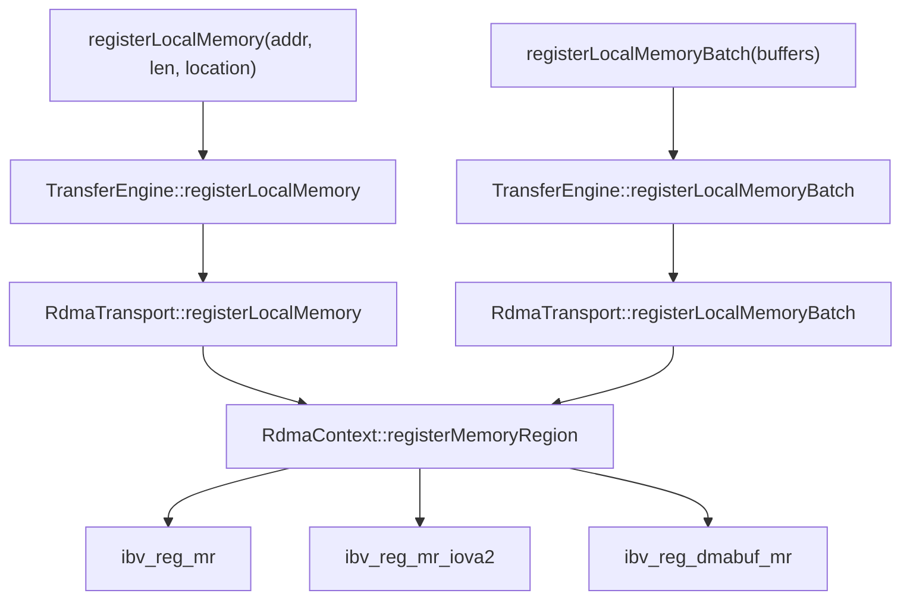

<!-- source: DeepWiki mcp.deepwiki.com · repo kvcache-ai/Mooncake · page 4.11 Memory Registration · fetched 2026-10-21 -->

# Memory Registration

<details>
<summary>Relevant source files</summary>

The following files were used as context for generating this wiki page:

- [mooncake-store/include/count_min_sketch.h](mooncake-store/include/count_min_sketch.h)
- [mooncake-store/include/local_hot_cache.h](mooncake-store/include/local_hot_cache.h)
- [mooncake-store/src/local_hot_cache.cpp](mooncake-store/src/local_hot_cache.cpp)
- [mooncake-store/tests/client_local_hot_cache_test.cpp](mooncake-store/tests/client_local_hot_cache_test.cpp)
- [mooncake-store/tests/real_client_hugepage_register_test.cpp](mooncake-store/tests/real_client_hugepage_register_test.cpp)
- [mooncake-store/tests/real_client_regular_page_register_test.cpp](mooncake-store/tests/real_client_regular_page_register_test.cpp)
- [mooncake-transfer-engine/include/memory_location.h](mooncake-transfer-engine/include/memory_location.h)
- [mooncake-transfer-engine/tent/include/tent/runtime/admission_queue.h](mooncake-transfer-engine/tent/include/tent/runtime/admission_queue.h)
- [mooncake-transfer-engine/tent/include/tent/runtime/transport.h](mooncake-transfer-engine/tent/include/tent/runtime/transport.h)
- [mooncake-transfer-engine/tent/include/tent/transport/shm/shm_transport.h](mooncake-transfer-engine/tent/include/tent/transport/shm/shm_transport.h)
- [mooncake-transfer-engine/tent/src/runtime/admission_queue.cpp](mooncake-transfer-engine/tent/src/runtime/admission_queue.cpp)
- [mooncake-transfer-engine/tent/src/transport/bufio/bufio_transport.cpp](mooncake-transfer-engine/tent/src/transport/bufio/bufio_transport.cpp)
- [mooncake-transfer-engine/tent/src/transport/io_uring/io_uring_transport.cpp](mooncake-transfer-engine/tent/src/transport/io_uring/io_uring_transport.cpp)
- [mooncake-transfer-engine/tent/src/transport/shm/shm_transport.cpp](mooncake-transfer-engine/tent/src/transport/shm/shm_transport.cpp)
- [mooncake-transfer-engine/tent/tests/admission_queue_test.cpp](mooncake-transfer-engine/tent/tests/admission_queue_test.cpp)
- [mooncake-transfer-engine/tent/tests/local_memory_lifecycle_test.cpp](mooncake-transfer-engine/tent/tests/local_memory_lifecycle_test.cpp)
- [mooncake-transfer-engine/tent/tests/shm_transport_test.cpp](mooncake-transfer-engine/tent/tests/shm_transport_test.cpp)
- [mooncake-transfer-engine/tests/memory_location_test.cpp](mooncake-transfer-engine/tests/memory_location_test.cpp)

</details>


## Purpose and Scope

Memory registration in Mooncake enables local memory buffers to be safely and efficiently used as sources or destinations for remote data transfers via the Transfer Engine. It involves pinning memory pages and preparing hardware-specific registration (e.g., RDMA memory regions) to facilitate zero-copy, low-latency transfers. This page details the APIs for memory registration, discusses batch registration techniques, hugepage handling, automatic location detection (CPU NUMA and GPU affinity), and the wildcard location mechanism for flexible affinity binding.

This page also covers internal details of RDMA registration, multi-transport coordination, and buffer segmentation schemes that support NUMA-aware transfers.

Sources: [mooncake-transfer-engine/src/transport/rdma_transport/rdma_transport.cpp:46-59](), [mooncake-transfer-engine/include/memory_location.h:27-77](), [mooncake-transfer-engine/src/memory_location.cpp:12-178]()

---

## Two-Level Registration Architecture

Mooncake separates memory registration into two layers:

- **TransferEngine API Layer:** Provides a unified, high-level interface (`TransferEngine`) to register memory buffers. It handles batching, location auto-detection, and interfaces with multiple underlying transports.

- **Transport Layer:** Each transport (RDMA, TCP, HIP, NVLink, etc.) implements transport-specific registration methods to pin and prepare memory for remote access.

This design enables Mooncake to support diverse hardware transports with a consistent registration API.

### Registration Data Flow and Key Classes



In the above flow:
- User calls `registerLocalMemory` or batch API on the `TransferEngine`.
- The `TransferEngine` delegates to the appropriate `Transport` backend.
- For RDMA transport, registration involves invoking `RdmaContext` APIs.
- `RdmaContext` calls the kernel Verbs APIs (`ibv_reg_mr` family) to register memory.

Sources: [mooncake-transfer-engine/include/transport/rdma_transport/rdma_context.h:120-134](), [mooncake-transfer-engine/src/transport/rdma_transport/rdma_transport.cpp:72-83](), [mooncake-transfer-engine/include/transport/rdma_transport/rdma_transport.h:169-175]()

---

## Memory Registration APIs

### TransferEngine C++ API

The fundamental registration APIs provided by `TransferEngine` are:

| Method | Description |
|---|---|
| `registerLocalMemory(void* addr, size_t len, const std::string& location)` | Register a single contiguous memory buffer with a specified location hint (e.g., `cpu:0` or `gpu:0`). |
| `registerLocalMemoryBatch(const std::vector<BufferEntry>& buffers)` | Register multiple buffers in batch for efficiency; each entry specifies address, length, and location. |
| `unregisterLocalMemory(void* addr)` | Unregister a previously registered buffer by address. |

Buffers must be registered before being used in transfer requests.

### Batch Registration

Batch registration reduces overhead when registering multiple buffers, such as large tensors split across segments or shards. The batch API takes a vector of `BufferEntry` structs:

```cpp
struct BufferEntry {
    void* ptr;
    size_t len;
    std::string location;
};
```

This batch passing enhances performance by minimizing the number of transport calls and system calls for memory pinning.

### Example Registration Call Flow (Single Buffer)

When you call `registerLocalMemory(addr, len, location)` on the `TransferEngine`, internally:

- `TransferEngine::registerLocalMemory` delegates to each installed transport's `registerLocalMemory`.
- The RDMA transport (`RdmaTransport::registerLocalMemory`) tries to register the memory region.
- This may result in multiple sub-registrations if the buffer size exceeds hardware limits (e.g., max MR size).
- `RdmaContext::registerMemoryRegion` invokes `ibv_reg_mr` or enhanced APIs (like `ibv_reg_mr_iova2`) to create the memory region(s).
- Registration metadata (lkey, rkey) is stored in internal maps for later lookup during transfers.

Sources: [mooncake-transfer-engine/include/transport/rdma_transport/rdma_transport.h:72-83](), [mooncake-transfer-engine/src/transport/rdma_transport/rdma_transport.cpp:72-83]()

---

## Hugepage and Arena Support for Registration

Mooncake supports allocating and registering memory using hugepages to reduce TLB misses and increase transfer throughput:

- The `ShmHelper` singleton abstracts shared memory segments, including HugeTLB backed memory.

- When registering buffers backed by hugepages, Mooncake aligns and widens registrations to hugepage boundaries to avoid kernel errors with `MADV_DONTFORK` and RDMA registration.

- The `RealClientHugepageRegisterTest` verifies that registering such hugepage-backed buffers works correctly by expanding registration to cover the entire physical hugepage segment, even if the requested logical size is smaller.
  [mooncake-store/tests/real_client_hugepage_register_test.cpp:38-170]()

- Partial registrations of hugepage-backed buffers are NOT silently widened if they are sub-ranges; such registrations are exact and rely on aligned input to avoid errors.

**Key Points from Testing:**

- Hugepage base segment registrations are widened to the full segment size automatically.
- Zero-length registrations are rejected to avoid implicit widening edge cases.
- Large segments (>4GiB) have page-aligned block splits for safe multi-threaded trial registration.

Sources: [mooncake-store/tests/real_client_hugepage_register_test.cpp:38-170]()

---

## Location Auto-Detection and Wildcard Mechanism

### Location Parameter in Registration

The `location` string passed during registration identifies the physical affinity of the buffer. It can be:

- `"cpu:N"` for NUMA node N
- `"gpu:N"` for GPU device N
- `"*"` (wildcard) to indicate no preference or unknown location

### Auto-Detection via `getMemoryLocation`

Mooncake provides `getMemoryLocation(void *start, size_t len, bool only_first_page)` to detect physical memory affinity:

- For GPU buffers, it uses `cudaPointerGetAttributes()` or HIP equivalents to detect the device.
- For CPU host buffers, it uses `numa_move_pages()` to determine the NUMA node of each page.
- The detection returns a vector of `MemoryLocationEntry` structs describing range start, length, and location.

### Example: `SegmentsLocationInfo` for NUMA-Affinity Buffers

Some buffers are physically segmented across multiple NUMA nodes. Mooncake encodes such buffers' location as a `"segments:<page_size>:<numa0>,<numa1>,..."` string:

```
segments:4096:1,3,5,7
```

- The buffer is divided into `N` equal regions.
- Each region `i` is assigned to NUMA node `numa[i]`.
- At runtime, the offset within the buffer determines the NUMA affinity for transfers.

Functions `buildSegmentsLocation()` and `parseSegmentsLocation()` handle this encoding and decoding.

### Wildcard and Affinity Resolution

If the location is `"*"`, Mooncake attempts to auto-detect or treat it as affinity-agnostic.

The Transport layer uses `resolveBufferLocation()` to map a `BufferDesc` and offset to a filtered location string for selecting the best NIC affinity. [mooncake-transfer-engine/src/transport/rdma_transport/rdma_transport.cpp:50-59]()

### Diagram: Location Auto-Detection and Affinity Resolution

```mermaid
graph LR
    Start["User calls registerLocalMemory(addr, len, location)"]
    DetectLoc["Call getMemoryLocation(addr, len) if location==\"*\""]
    BuildSegLoc["If multi-node buffer, build segments location string"]
    Register["Transport::registerLocalMemory with resolved location"]
    RdmaReg["RdmaTransport calls RdmaContext::registerMemoryRegion"]
    Completion["Memory pinned and rkeys cached"]

    Start -->|location == "*"| DetectLoc
    DetectLoc --> BuildSegLoc
    BuildSegLoc --> Register
    Start -->|location known| Register
    Register --> RdmaReg
    RdmaReg --> Completion
```

Sources: [mooncake-transfer-engine/include/memory_location.h:27-77](), [mooncake-transfer-engine/src/memory_location.cpp:10-180](), [mooncake-transfer-engine/src/transport/rdma_transport/rdma_transport.cpp:50-59]()

---

## Handling Large Buffers Beyond Max Memory Registration Size

RDMA hardware limits the maximum memory region size (`max_mr_size`, e.g., 2 GiB on some devices).

Mooncake automatically chunks buffers larger than `max_mr_size` into aligned sub-regions and registers each chunk separately, publishing multiple `BufferDesc` entries with appropriate `rkey`s. [mooncake-transfer-engine/include/transport/rdma_transport/rdma_transport.h:171-177]()

This prevents the historic bug where an oversized buffer was truncated to a smaller MR silently, causing remote access errors.

### Test Coverage: RDMALargeMrTest

- A buffer larger than `max_mr_size` is split during registration into multiple MRs.
- RDMA writes targeting addresses beyond `max_mr_size` succeed due to chunking.
- Edge cases like transfers straddling chunk boundaries are tested to ensure correctness.

Sources: [mooncake-transfer-engine/tests/rdma_large_mr_test.cpp:63-159]()

---

## RDMA Transport and Kernel Support Details

### Relaxed Ordering

- RDMA registration can use `ibv_reg_mr_iova2()` if supported (`has_ibv_reg_mr_iova2`), improving PCI relaxed ordering performance. [mooncake-transfer-engine/src/transport/rdma_transport/rdma_transport.cpp:165-167]()
- The mode is controlled by `ib_pci_relaxed_ordering_mode` in the `GlobalConfig`. [mooncake-transfer-engine/src/transport/rdma_transport/rdma_transport.cpp:154-160]()
- When present, the code prefers `ibv_reg_mr_iova2` over legacy methods. [mooncake-transfer-engine/src/transport/rdma_transport/rdma_transport.cpp:171-176]()

### DMABUF Export for GPU Direct RDMA (AMD/HIP)

- `RdmaContext` supports exporting memory as a `dmabuf` handle to share GPU buffers via RDMA. [mooncake-transfer-engine/include/transport/rdma_transport/rdma_context.h:162-166]()
- Kernel support is required (`CONFIG_PCI_P2PDMA` and `CONFIG_DMABUF_MOVE_NOTIFY`). [mooncake-transfer-engine/src/transport/rdma_transport/rdma_context.cpp:108-110]()
- If kernel features are missing, a fallback to `ibv_reg_mr()` is used with a warning. [mooncake-transfer-engine/src/transport/rdma_transport/rdma_context.cpp:175-183]()
- This reduces resource consumption by sharing a single BAR1 window for the buffer across NICs instead of one per NIC. [mooncake-transfer-engine/include/transport/rdma_transport/rdma_context.h:107-111]()

Sources: [mooncake-transfer-engine/src/transport/rdma_transport/rdma_context.cpp:113-186](), [mooncake-transfer-engine/src/transport/rdma_transport/rdma_transport.cpp:150-170](), [mooncake-transfer-engine/include/transport/rdma_transport/rdma_context.h:97-102]()

---

## Wildcard Location and NUMA Affinity in Transport Selection

Mooncake uses a special wildcard location string:

```cpp
const static std::string kWildcardLocation = "*";
```

This indicates that the location is unspecified or any location is acceptable. During device selection for RDMA transfers, the transport attempts to resolve the buffer location or assign a NIC that best matches the affinity.

When buffer locations specify `"segments:<page_size>:<numa_nodes>"`, the system resolves the particular device for an offset within that buffer, optimizing for NUMA locality. This is critical for balancing bandwidth and latency in multi-socket and multi-GPU nodes.

The `Topology` class and `WorkerPool` use this resolution to pick the optimal RDMA device for each transfer:

- If a buffer location is wildcard, devices are selected round-robin or by other heuristics.
- If specific affinity nodes are known, the NIC device that is local to that NUMA or GPU node is preferred.

Sources: [mooncake-transfer-engine/src/transport/rdma_transport/worker_pool.cpp:180-186]()

---

## Summary

- Memory registration is a prerequisite for zero-copy remote transfers in Mooncake.
- The `TransferEngine` API supports both single buffer and batch registration.
- Large buffers exceeding hardware limits are split into chunks and registered piecewise.
- Hugepage-backed memory is recognized and aligned for correct registration.
- Physical location (`location`) metadata enables NUMA and GPU-aware transfers.
- Automatic location detection uses system NUMA queries and GPU memory introspection.
- The wildcard location `"*"` lets Mooncake select devices automatically.
- RDMA transport supports advanced registration features: `ibv_reg_mr_iova2`, dmabuf export, relaxed ordering.
- Tests verify correct registration for normal, hugepage, and large multi-chunk buffers.

---

# References

- `TransferEngine::registerLocalMemory` & batch implementations  
  [mooncake-transfer-engine/src/transport/rdma_transport/rdma_transport.cpp:72-83]()

- Location encoding and detection in `memory_location.h` and `memory_location.cpp`  
  [mooncake-transfer-engine/include/memory_location.h:27-77]()  
  [mooncake-transfer-engine/src/memory_location.cpp:10-180]()

- Hugepage registration tests  
  [mooncake-store/tests/real_client_hugepage_register_test.cpp:38-170]()

- Large MR chunking and RDMA registration tests  
  [mooncake-transfer-engine/tests/rdma_large_mr_test.cpp:63-159]()

- RDMA context and transport registration internals  
  [mooncake-transfer-engine/include/transport/rdma_transport/rdma_context.h:113-134]()  
  [mooncake-transfer-engine/src/transport/rdma_transport/rdma_context.cpp:113-186]()

- Wildcard location and NUMA affinity selection in worker pools and topology  
  [mooncake-transfer-engine/src/transport/rdma_transport/worker_pool.cpp:180-186]()  
  [mooncake-transfer-engine/tests/topology_test.cpp:13-192]()

---

This page is a leaf and covers all details of memory registration in Mooncake. For related topics such as transport initialization, batch operations, and topology selection, see other subsections in the Transfer Engine documentation.

---

