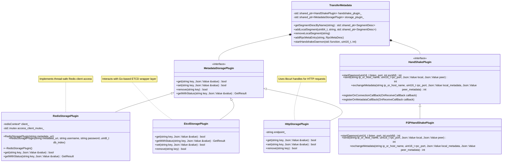
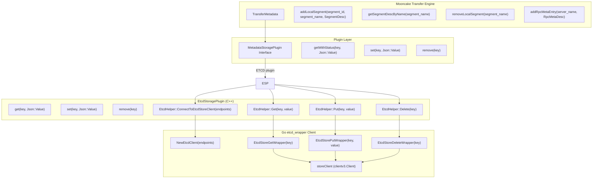

<!-- source: DeepWiki mcp.deepwiki.com · repo kvcache-ai/Mooncake · page 4.12 Metadata Services · fetched 2026-10-21 -->

# Metadata Services

Relevant source files

The following files were used as context for generating this wiki page:

- [mooncake-common/etcd/etcd_wrapper.go](mooncake-common/etcd/etcd_wrapper.go)
- [mooncake-store/include/etcd_helper.h](mooncake-store/include/etcd_helper.h)
- [mooncake-store/include/ha/leadership/backends/etcd/etcd_leader_coordinator.h](mooncake-store/include/ha/leadership/backends/etcd/etcd_leader_coordinator.h)
- [mooncake-store/include/ha/leadership/leader_coordinator.h](mooncake-store/include/ha/leadership/leader_coordinator.h)
- [mooncake-store/include/ha/leadership/master_service_supervisor.h](mooncake-store/include/ha/leadership/master_service_supervisor.h)
- [mooncake-store/src/etcd_helper.cpp](mooncake-store/src/etcd_helper.cpp)
- [mooncake-store/src/ha/leadership/backends/etcd/etcd_leader_coordinator.cpp](mooncake-store/src/ha/leadership/backends/etcd/etcd_leader_coordinator.cpp)
- [mooncake-store/tests/ha/leadership/high_availability_test.cpp](mooncake-store/tests/ha/leadership/high_availability_test.cpp)
- [mooncake-transfer-engine/include/common.h](mooncake-transfer-engine/include/common.h)
- [mooncake-transfer-engine/include/transfer_metadata.h](mooncake-transfer-engine/include/transfer_metadata.h)
- [mooncake-transfer-engine/include/transfer_metadata_plugin.h](mooncake-transfer-engine/include/transfer_metadata_plugin.h)
- [mooncake-transfer-engine/src/transfer_metadata.cpp](mooncake-transfer-engine/src/transfer_metadata.cpp)
- [mooncake-transfer-engine/src/transfer_metadata_plugin.cpp](mooncake-transfer-engine/src/transfer_metadata_plugin.cpp)
- [mooncake-transfer-engine/tent/include/tent/common/utils/os.h](mooncake-transfer-engine/tent/include/tent/common/utils/os.h)
- [mooncake-transfer-engine/tent/include/tent/rpc/rpc.h](mooncake-transfer-engine/tent/include/tent/rpc/rpc.h)
- [mooncake-transfer-engine/tent/include/tent/runtime/control_plane.h](mooncake-transfer-engine/tent/include/tent/runtime/control_plane.h)
- [mooncake-transfer-engine/tent/include/tent/runtime/segment.h](mooncake-transfer-engine/tent/include/tent/runtime/segment.h)
- [mooncake-transfer-engine/tent/src/rpc/rpc.cpp](mooncake-transfer-engine/tent/src/rpc/rpc.cpp)
- [mooncake-transfer-engine/tent/src/runtime/control_plane.cpp](mooncake-transfer-engine/tent/src/runtime/control_plane.cpp)
- [mooncake-transfer-engine/tent/tests/delegate_rpc_test.cpp](mooncake-transfer-engine/tent/tests/delegate_rpc_test.cpp)
- [mooncake-transfer-engine/tent/tests/rpc_handler_isolation_test.cpp](mooncake-transfer-engine/tent/tests/rpc_handler_isolation_test.cpp)
- [mooncake-transfer-engine/tent/tests/rpc_reconnect_test.cpp](mooncake-transfer-engine/tent/tests/rpc_reconnect_test.cpp)
- [mooncake-transfer-engine/tent/tests/segment_desc_retry.md](mooncake-transfer-engine/tent/tests/segment_desc_retry.md)
- [mooncake-transfer-engine/tent/tests/segment_desc_retry_test.cpp](mooncake-transfer-engine/tent/tests/segment_desc_retry_test.cpp)
- [mooncake-transfer-engine/tent/tests/tcp_datapath_roundtrip_test.cpp](mooncake-transfer-engine/tent/tests/tcp_datapath_roundtrip_test.cpp)
- [mooncake-transfer-engine/tests/common_test.cpp](mooncake-transfer-engine/tests/common_test.cpp)
- [mooncake-transfer-engine/tests/transfer_metadata_test.cpp](mooncake-transfer-engine/tests/transfer_metadata_test.cpp)

## Purpose and Scope

This document provides a technical deep dive into the metadata service integration layer of the Mooncake Transfer Engine and Mooncake Store. Metadata services play a critical role in distributed cluster discovery by enabling nodes to register, locate, and connect to remote memory segments distributed across a cluster. This page covers the metadata plugin architecture, supported backend implementations (`ETCD`, `Redis`, `HTTP`, and `P2P Handshake`), and the `etcd_wrapper` Go-based implementation facilitating performant and reliable coordination.

Sources: [mooncake-transfer-engine/include/transfer_metadata.h:1-57](), [mooncake-transfer-engine/src/transfer_metadata_plugin.cpp:1-45]()

---

## Plugin Architecture & Core Classes

### TransferMetadata Class

The central abstraction for metadata management in the Transfer Engine is the `TransferMetadata` class [mooncake-transfer-engine/include/transfer_metadata.h:58-60](). It acts as the façade for metadata operations and holds two main plugin references:

- `MetadataStoragePlugin`: Abstracts persistent key-value store operations for metadata.
- `HandShakePlugin`: Manages peer-to-peer direct handshake communication.

### Plugins

- **MetadataStoragePlugin**: This is an interface declaring essential operations: `get`, `set`, `remove`, and a status-aware `getWithStatus` for key-value metadata fetching [mooncake-transfer-engine/include/transfer_metadata_plugin.h:21-49]().

- **HandShakePlugin**: Provides a common interface for peer metadata exchange operation variants, including methods like `startDaemon()`, `send()`, and `exchangeMetadata()` [mooncake-transfer-engine/include/transfer_metadata_plugin.h:63-86]().

### Implementations

There are multiple concrete implementations of the `MetadataStoragePlugin` for different backend storage technologies:

- `RedisStoragePlugin`: A thread-safe Redis client wrapper using `hiredis`, supporting authentication and database selection [mooncake-transfer-engine/src/transfer_metadata_plugin.cpp:71-196]().

- `EtcdStoragePlugin`: Interfaces with a Go-based ETCD wrapper client (described in later sections), implementing all key-value operations for distributed metadata persistence [mooncake-transfer-engine/src/transfer_metadata_plugin.cpp:200-310]().

- `HttpStoragePlugin`: Uses libcurl-based HTTP client requests for RESTful GET/PUT/DELETE metadata operations, suitable for simple metadata servers [mooncake-transfer-engine/src/transfer_metadata_plugin.cpp:310-380]().

- `P2PHandShakePlugin`: Implements a direct TCP socket handshake protocol to exchange metadata without a centralized store [mooncake-transfer-engine/include/transfer_metadata_plugin.h:76-86]().

Sources: [mooncake-transfer-engine/include/transfer_metadata.h:58-60](), [mooncake-transfer-engine/include/transfer_metadata_plugin.h:21-90](), [mooncake-transfer-engine/src/transfer_metadata_plugin.cpp:29-200]()

---

## Supported Metadata Backends

### 1. ETCD (Default Production Backend)

ETCD serves as the primary strongly consistent, high-availability metadata backend in Mooncake.

- **Integration Layer:** The Mooncake Transfer Engine and Store invoke ETCD via a high-performance Go client wrapper (`libetcd_wrapper`) exposed through C function bindings [mooncake-common/etcd/etcd_wrapper.go:1-228]().

- **Key C++ Interface:** The `EtcdHelper` C++ helper class wraps calls like `ConnectToEtcdStoreClient`, `Get`, `Put`, and `Delete`, calling into the Go ETCD client via cgo [mooncake-store/include/etcd_helper.h:19-184](), [mooncake-store/src/etcd_helper.cpp:15-90]().

- **Maintenance Sessions:** ETCD client sessions maintain leases and perform keepalive renewals autonomously, ensuring metadata entries persist as long as needed [mooncake-common/etcd/etcd_wrapper.go:61-97]().

- **Client Isolation:** Separate ETCD clients are allocated for the transfer engine, store, and snapshotting functions to reduce coupling and enable independent configuration.

- **Robustness:** Watches and prefix subscriptions enable automatic metadata cache updates across cluster peers.

### 2. Redis

- **Client Library:** `RedisStoragePlugin` uses `hiredis` for connecting to Redis servers.

- **Thread Safety:** Uses mutex locking to serialize access to the shared `redisContext*`, preserving concurrency safety [mooncake-transfer-engine/src/transfer_metadata_plugin.cpp:71-140]().

- **Features:** Supports optional username/password authentication and database (DB) index selection.

- **Differentiated Get:** Implements `getWithStatus` to discriminate between missing keys (`kNotFound`) and connectivity errors (`kUnavailable`) so that transient Redis outages do not unconditionally invalidate caches [mooncake-transfer-engine/src/transfer_metadata_plugin.cpp:180-210]().

### 3. HTTP

- **RESTful Store:** The `HttpStoragePlugin` uses libcurl handles for HTTP GET/PUT/DELETE against configured metadata service endpoints.

- **Service Component:** The Mooncake Store implements an asynchronous HTTP metadata server servicing these requests with cached segment metadata and special logic for idempotent `PUT` of `rpc_meta` keys to avoid RPC metadata conflicts [mooncake-store/src/http_metadata_server.cpp:15-110]().

- **Health Endpoint:** Provides `/health` for readiness and liveness probing.

### 4. Peer-to-Peer Handshake (P2PHANDSHAKE)

- **Direct Metadata Exchange:** In environments without a centralized key-value store, Mooncake supports a P2P handshake mode where nodes exchange metadata directly via TCP socket connections.

- **Listening Server:** Each node runs a TCP server listening on an ephemeral port, discovered at runtime [mooncake-transfer-engine/tests/transfer_metadata_test.cpp:126-165]().

- **Custom Payloads:** Uses JSON-encoded handshake payloads comprising `SegmentDesc` and `RpcMetaDesc` serialization.

- **Request Types:** Includes various handshake message types (`Connection`, `Metadata`, `Notify`, `Probe`) as defined in `HandShakeRequestType` [mooncake-transfer-engine/include/common.h:65-72]().

Sources: [mooncake-transfer-engine/src/transfer_metadata_plugin.cpp:29-200](), [mooncake-transfer-engine/include/transfer_metadata_plugin.h:70-80](), [mooncake-transfer-engine/include/transfer_metadata.h:43-53](), [mooncake-store/src/http_metadata_server.cpp:15-110](), [mooncake-common/etcd/etcd_wrapper.go:10-128](), [mooncake-store/include/etcd_helper.h:40-184](), [mooncake-store/src/etcd_helper.cpp:15-90]()

---

## Data Flow and ETCD Wrapper Integration

This diagram bridges the abstract metadata operations in natural language with their concrete code entities spanning the Mooncake Transfer Engine, metadata plugin layer, ETCD plugin, and the Go ETCD wrapper client.

This multi-layered architecture encapsulates metadata management:

- Mooncake core invokes `TransferMetadata` APIs.
- `TransferMetadata` delegates to `MetadataStoragePlugin` interface.
- The ETCD plugin employs `EtcdHelper` to interact with the ETCD Go wrapper.
- The Go wrapper maintains reliable client connections, leases, and watches using native ETCD protocols.

Sources: [mooncake-transfer-engine/src/transfer_metadata.cpp:58-122](), [mooncake-transfer-engine/src/transfer_metadata_plugin.cpp:202-310](), [mooncake-store/include/etcd_helper.h:49-81](), [mooncake-store/src/etcd_helper.cpp:15-90](), [mooncake-common/etcd/etcd_wrapper.go:1-228]()

---

## Metadata Entity Structures

Mooncake defines several key C++ data structures central to metadata processing and transfer. These structures serialize to/from JSON for network and storage interchange.

| Entity | Description | File / Lines |
|--------|-------------|--------------|
| `SegmentDesc` | Describes a remote memory segment with all device buffers, topology, protocol info, and metadata versioning. | [mooncake-transfer-engine/include/transfer_metadata.h:120-178]() |
| `RpcMetaDesc` | Captures RPC endpoint properties: IP/hostname, port, and version, enabling client connections to segment servers. | [mooncake-transfer-engine/include/transfer_metadata.h:307-315]() |
| `HandShakeDesc` | Payload structure for handshake exchange, includes NIC paths, LID/GID, queue pairs for connection bootstrap. | [mooncake-transfer-engine/include/transfer_metadata.h:317-325]() |
| `BufferDesc` | Describes buffers within segments: memory address, length, device id, RDMA keys for direct transfers. | [mooncake-transfer-engine/include/transfer_metadata.h:69-93]() |

These entities support consistent and extensible metadata interchange across distributed components.

Sources: [mooncake-transfer-engine/include/transfer_metadata.h:40-325]()

---

## Versioning and Conflict Detection Logic

### Metadata Version Management

Every metadata structure (`SegmentDesc`, `RpcMetaDesc`) maintains a strictly increasing `metadata_version` field, represented as a timestamp in microseconds. This versioning supports distributed consistency by allowing nodes to determine metadata freshness.

### Conflict Rejection Functions

Two critical validation functions enforce version and content consistency when installing remotely fetched metadata:

- `shouldInstallFetchedRpcMetaDesc(server_name, old_desc, new_desc)` validates comparing the old and new `RpcMetaDesc` to reject stale (< old) or conflicting metadata without proper version bumps [mooncake-transfer-engine/src/transfer_metadata.cpp:89-121]().

- `shouldInstallFetchedSegmentDesc(segment_name, segment_id, old_desc, new_desc)` provides analogous logic for `SegmentDesc` [mooncake-transfer-engine/src/transfer_metadata.cpp:123-155]().

These functions log warnings or errors for version regressions or conflicting data and prevent installation of inconsistent metadata.

### Stale Segment Failure Threshold

The system tracks repeated metadata fetch failures/errors:

- Remote segment descriptors that fail to be retrieved continuously for more than `kStaleSegmentFailureThreshold = 2` sync attempts are considered stale and their cached metadata is invalidated locally, preventing oscillations in presence state due to intermittent backend failures [mooncake-transfer-engine/src/transfer_metadata.cpp:179-180]().

### GetResult Usage

The `GetResult` enum (values: `kFound`, `kNotFound`, `kUnavailable`) distinguishes between:

- Authoritative absence (`kNotFound`) where a metadata key was deleted.
- Service unavailability (`kUnavailable`) implying transient failure.

This differentiation drives cache validity decisions [mooncake-transfer-engine/include/transfer_metadata.h:43-53]().

Sources: [mooncake-transfer-engine/include/transfer_metadata.h:40-53](), [mooncake-transfer-engine/src/transfer_metadata.cpp:31-155]()

---

## High Availability and Leader Election via ETCD

Mooncake utilizes ETCD not only for metadata storage but also for high-availability and leader coordination:

- HA coordination components manage service leader election using ETCD leases, distributed locks, and watches [mooncake-store/src/ha/leadership/backends/etcd/etcd_leader_coordinator.cpp:1-188]().

- The ETCD client and its maintenance sessions handle lease renewal and keepalive robust enough to tolerate network/blip failures, ensuring that at most one node holds leadership at any time while providing failover.

- The modular ETCD wrapper layer exposes lease management APIs usable from C++ and Go sides [mooncake-common/etcd/etcd_wrapper.go:40-100](), integrating tightly into Mooncake's distributed metadata and service management layers.

Sources: [mooncake-store/src/ha/leadership/backends/etcd/etcd_leader_coordinator.cpp:1-188](), [mooncake-common/etcd/etcd_wrapper.go:40-110]()

---

# Summary

Mooncake’s Metadata Services provide a flexible, extensible architecture for distributed cluster metadata management integral to KVCache disaggregation and remote memory serving capabilities. The system abstracts metadata storage with a plugin layer supporting:

- Strongly consistent and HA-capable ETCD backend via a performant Go wrapper.
- Redis as an alternative fast key-value store.
- HTTP RESTful metadata querying and updates.
- Peer-to-peer handshake mode for decentralized metadata exchange.

Consistent versioning and conflict detection ensure robust metadata synchronization. The ETCD wrapper underpins both metadata persistence and high-availability leader coordination. This design enables Mooncake to reliably discover, manage, and monitor distributed memory segments necessary for large-scale, high-performance LLM serving.

---

# References

- `TransferMetadata` and data structures: [mooncake-transfer-engine/include/transfer_metadata.h:40-325]()
- Metadata plugin implementations and Redis client: [mooncake-transfer-engine/src/transfer_metadata_plugin.cpp:29-200]()
- ETCD C++ helper and Go wrapper code: [mooncake-store/include/etcd_helper.h:1-184](), [mooncake-store/src/etcd_helper.cpp:1-90](), [mooncake-common/etcd/etcd_wrapper.go:1-228]()
- HTTP metadata server implementation: [mooncake-store/src/http_metadata_server.cpp:1-110]()
- Version validation and metadata update guards: [mooncake-transfer-engine/src/transfer_metadata.cpp:31-155]()
- HA leader election via ETCD: [mooncake-store/src/ha/leadership/backends/etcd/etcd_leader_coordinator.cpp:1-188]()

---

