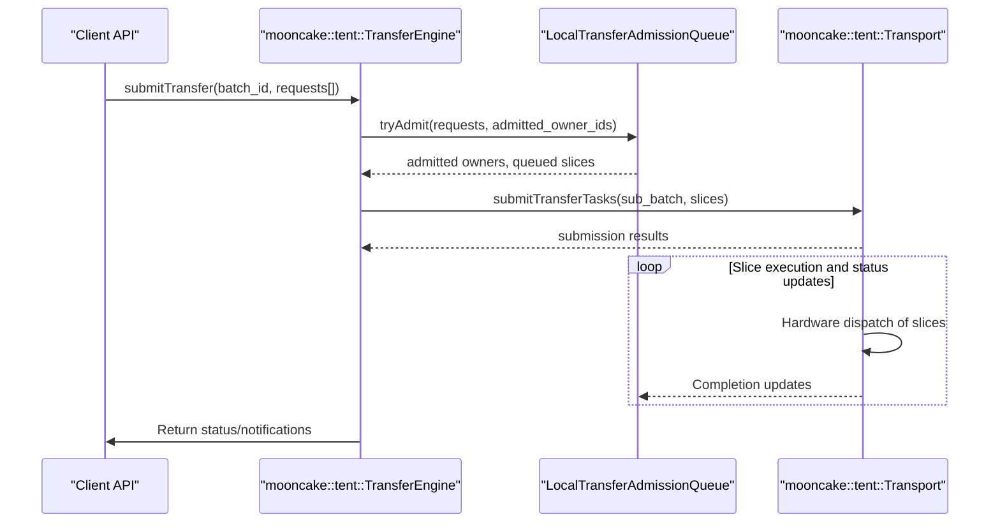
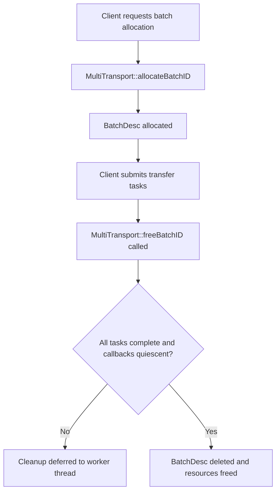
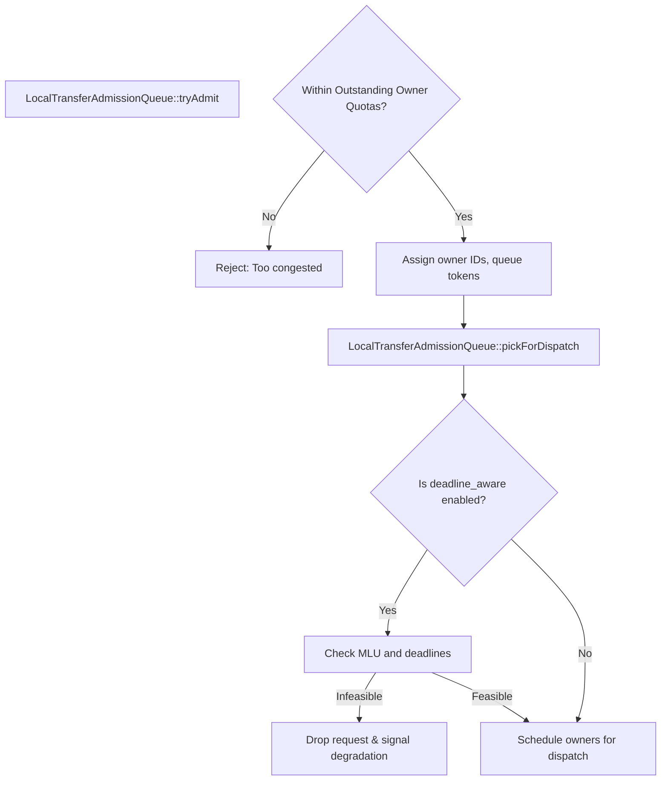
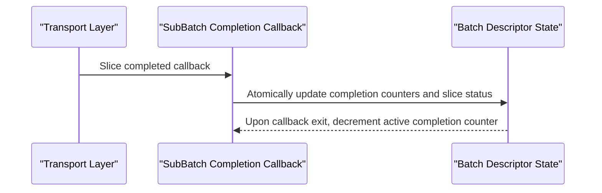

<!-- source: DeepWiki mcp.deepwiki.com · repo kvcache-ai/Mooncake · page 4.13 Batch Operations and Slicing · fetched 2026-10-21 -->

# Batch Operations and Slicing

<details>
<summary>Relevant source files</summary>

The following files were used as context for generating this wiki page:

- [docs/source/api-reference/cpp/transfer-engine.md](docs/source/api-reference/cpp/transfer-engine.md)
- [mooncake-integration/transfer_engine/transfer_engine_py.cpp](mooncake-integration/transfer_engine/transfer_engine_py.cpp)
- [mooncake-integration/transfer_engine/transfer_engine_py.h](mooncake-integration/transfer_engine/transfer_engine_py.h)
- [mooncake-transfer-engine/include/multi_transport.h](mooncake-transfer-engine/include/multi_transport.h)
- [mooncake-transfer-engine/include/transfer_engine.h](mooncake-transfer-engine/include/transfer_engine.h)
- [mooncake-transfer-engine/include/transfer_engine_c.h](mooncake-transfer-engine/include/transfer_engine_c.h)
- [mooncake-transfer-engine/include/transfer_engine_impl.h](mooncake-transfer-engine/include/transfer_engine_impl.h)
- [mooncake-transfer-engine/include/transport/transport.h](mooncake-transfer-engine/include/transport/transport.h)
- [mooncake-transfer-engine/src/multi_transport.cpp](mooncake-transfer-engine/src/multi_transport.cpp)
- [mooncake-transfer-engine/src/transfer_engine.cpp](mooncake-transfer-engine/src/transfer_engine.cpp)
- [mooncake-transfer-engine/src/transfer_engine_c.cpp](mooncake-transfer-engine/src/transfer_engine_c.cpp)
- [mooncake-transfer-engine/src/transfer_engine_impl.cpp](mooncake-transfer-engine/src/transfer_engine_impl.cpp)
- [mooncake-transfer-engine/tent/include/tent/runtime/transfer_engine_impl.h](mooncake-transfer-engine/tent/include/tent/runtime/transfer_engine_impl.h)
- [mooncake-transfer-engine/tent/src/runtime/transfer_engine_impl.cpp](mooncake-transfer-engine/tent/src/runtime/transfer_engine_impl.cpp)
- [mooncake-transfer-engine/tent/tests/CMakeLists.txt](mooncake-transfer-engine/tent/tests/CMakeLists.txt)
- [mooncake-transfer-engine/tent/tests/engine_failover_e2e_test.cpp](mooncake-transfer-engine/tent/tests/engine_failover_e2e_test.cpp)
- [mooncake-transfer-engine/tests/shm_transport_test.cpp](mooncake-transfer-engine/tests/shm_transport_test.cpp)
- [mooncake-transfer-engine/tests/transport_uint_test.cpp](mooncake-transfer-engine/tests/transport_uint_test.cpp)

</details>


## Purpose and Scope
This page thoroughly documents the internal batch transfer lifecycle of Mooncake’s Transfer Engine, describing both the legacy MultiTransport mode and the newer TENT (Transfer Engine Next) subsystem. It details:

- How opaque batch handles (`BatchID`) are allocated, referenced, and reclaimed.
- The hierarchical decomposition of logical transfer requests into transport-executable slices.
- The admission queue design and its role in fairness, concurrency limits, and deadline-aware scheduling.
- Transfer task and slice tracking including policies for retry and failover.
- Completion notification mechanisms contrasting event-driven callbacks versus polling-based status queries.

This page is intended for engineers working on the Transfer Engine’s scheduling layer, transport driver integration, or performance optimizations.

Sources:  
[mooncake-transfer-engine/tent/include/tent/runtime/transfer_engine_impl.h:73-164](),  
[mooncake-transfer-engine/tent/include/tent/runtime/admission_queue.h:36-85,115-160](),  
[mooncake-transfer-engine/transfer_engine_py.cpp:69-127](),  
[mooncake-transfer-engine/src/multi_transport.cpp:90-192](),  
[mooncake-transfer-engine/include/transfer_engine.h:83-200]()

---

## Concepts and Data Structures

| Term / Class           | Code Entity                         | Description                                                                                   |
|-----------------------|-----------------------------------|-----------------------------------------------------------------------------------------------|
| **BatchID**            | `using BatchID = uint64_t`        | Opaque 64-bit handle representing a grouped batch of transfer tasks; internally a pointer to a `BatchDesc` structure for fast access. [include/transfer_engine.h:53-65]() |
| **Request**            | `struct Request`                  | Logical transfer request describing operation (READ/WRITE), source/destination, length, and policies like deadline and transport hints. [tent/include/tent/common/types.h:140-164]() |
| **QueueOwnerInput**    | `struct QueueOwnerInput`          | Internal admission control input which associates request IDs, slices, and owner kind for concurrency and quota management. [tent/include/tent/runtime/admission_queue.h:36-85]() |
| **Slice**              | `Transport::Slice`                | Smallest unit dispatched to hardware transports. Contains pointers to memory, status, retry counters, device affinity info, and completion callback support. [include/transport/transport.h:123-211]() |
| **SubBatch**           | `Transport::SubBatch`             | Transport-level grouping of slices for batch submission and completion notification, with device mask and queue pool metadata. [tent/include/tent/runtime/transport.h:47-118]() |
| **Batch**              | `struct Batch`                   | In TENT, a container of sub-batches per transport type, with task list, completion hooks, reclaim tracking, and concurrency control. [tent/src/runtime/transfer_engine_impl.cpp:62-89]() |
| **TaskInfo**           | `struct TaskInfo`                  | Records metadata of a single sub-task including type, scheduling policy, device mask, timestamps, and status flags for failover and retries. [tent/include/tent/runtime/transfer_engine_impl.h:73-164]() |

Sources:  
[mooncake-transfer-engine/tent/include/tent/common/types.h:29-164](),  
[mooncake-transfer-engine/tent/include/tent/runtime/admission_queue.h:36-85](),  
[mooncake-transfer-engine/include/transport/transport.h:123-211](),  
[mooncake-transfer-engine/tent/include/tent/runtime/transport.h:47-118](),  
[mooncake-transfer-engine/tent/src/runtime/transfer_engine_impl.cpp:62-89](),  
[mooncake-transfer-engine/tent/include/tent/runtime/transfer_engine_impl.h:73-164]()

---

## Batch Transfer Lifecycle Overview

Mooncake's batch transfer architecture enables efficient mapping of high-level requests into smaller hardware-friendly units, tracked cohesively for completion and resource management.



*Diagram 1: Overview of batch transfer flow from client submission to transport-layer execution.*

This interaction applies similarly for legacy MultiTransport, though internal queueing and scheduling are simpler compared to TENT’s rich admission logic.

Sources:  
[mooncake-transfer-engine/tent/include/tent/runtime/admission_queue.h:128-140](),  
[mooncake-transfer-engine/tent/include/tent/runtime/transport.h:107-111](),  
[mooncake-transfer-engine/tent/src/runtime/admission_queue.cpp:77-172]()

---

## Batch Allocation and Handle Lifecycle

### BatchID and BatchDesc

- `BatchID` is an opaque alias for a 64-bit unsigned integer that internally stores a pointer to a `BatchDesc` object.
- `BatchDesc` holds all metadata for the batch including a list of tasks (`TaskInfo`), sub-batches by transport type, completion state, and reclamation status.
- This pointer casting avoids expensive lookups in hot paths for status queries or cleanup [include/transport/transport.h:110-121]().

### Allocation Process

- Batches are allocated via `MultiTransport::allocateBatchID(size_t batch_size)`. This creates a fresh `BatchDesc` and reserves capacity for the expected number of transfer tasks.
- The new `BatchDesc` pointer is cast and returned as a `BatchID` handle to callers initiating transfer batches [src/multi_transport.cpp:107-120]().

### Deferred Batch Deallocation

- The release of batch resources is managed by `MultiTransport::freeBatchID()`.
- It checks if all tasks are completed and all event-driven completion callbacks have quiesced.
- If the batch is still active (tasks incomplete or outstanding callbacks), the cleanup is deferred asynchronously by a background thread to avoid unsafe premature frees.
- The deferred cleanup mechanism logs warnings and ensures eventual reclamation without blocking client threads [src/multi_transport.cpp:121-152]().



*Diagram 2: Batch allocation and deallocation with deferred cleanup strategy.*

Sources:  
[mooncake-transfer-engine/src/multi_transport.cpp:107-152](),  
[mooncake-transfer-engine/include/transport/transport.h:106-121]()

---

## TENT Admission Control and Scheduling

### Admission Control

The TENT engine employs a sophisticated admission queue (`LocalTransferAdmissionQueue`) that manages:

- **User and Internal Owners**: Differentiation allows reserving quota headroom for internal and background operations.
- **Quota Enforcement**: Caps on concurrent outstanding owners and bytes prevent overload.
- **Admission Decision**: New requests (encapsulated in `QueueOwnerInput`) are evaluated for capacity, congested states, or deadline feasibility, returning admitted owners or rejects for backpressure [tent/include/tent/runtime/admission_queue.h:36-70]().

### Deadline-Aware Scheduling

- When enabled (`deadline_aware` flag), requests are evaluated for predicted minimum latency utilization (MLU).
- Requests with infeasible deadlines (exceeding configured MLU threshold) are dropped early.
- Degradation callbacks notify the application or upper layers for fallback (e.g., local decode).
- Admitted owners are then scheduled for dispatch by a priority scheduler [tent/src/runtime/admission_queue.cpp:77-172]().



*Diagram 3: Admission queue control with deadline-aware scheduling.*

Sources:  
[mooncake-transfer-engine/tent/include/tent/runtime/admission_queue.h:36-70](),  
[mooncake-transfer-engine/tent/src/runtime/admission_queue.cpp:77-172]()

---

## Task Hierarchy and Slice-Based Scheduling

### Logical Requests and Owners

- Clients submit batches consisting of logical requests aggregated into `QueueOwnerInput` entities.
- Each owner corresponds to a task group admitted to the transfer engine internally.

### Transfer Tasks and Slices

- Each logical task is decomposed into **slices** (`Transport::Slice`), each representing the smallest unit of a transfer that hardware can execute.
- Slices hold pointers to source buffers, target segment IDs and offsets, and control data such as retry counts, device-specific keys (rkeys), and completion status.
- Slices are dispatched concurrently over multiple endpoints (NICs, GPU peers, NVLink paths) for maximal throughput.

### SubBatch Container

- Internally, the transport allocates a `SubBatch` object to group concurrent slices.
- `SubBatch` tracks device masks, queue pools, and owns callbacks invoked on slice completion [tent/include/tent/runtime/transport.h:47-118]().

### Large Buffer Handling

- For hardware transports like RDMA, the engine transparently subdivides buffers that exceed the device's maximum memory region size into multiple slices with distinct memory regions and keys.
- This chunking prevents access errors (`IBV_WC_REM_ACCESS_ERR`) while presenting a simple single-buffer interface at the API level to callers [tests/rdma_large_mr_test.cpp:15-32]().

```mermaid
classDiagram
    class LocalTransferAdmissionQueue {
        +tryAdmit(requests[], admitted_owner_ids)
        +pickForDispatch(max_owners, max_bytes)
        +complete(owner_id, terminal_status)
    }
    class Transport {
        +allocateSubBatch(batch, max_size)
        +submitTransferTasks(sub_batch, slice_list)
        +getTransferStatus(sub_batch, task_id)
    }
    class SubBatch {
        +uint64_t device_mask
        +std::string qp_pool
        +BatchID progress_batch_id
        +notifyProgress()
    }
    LocalTransferAdmissionQueue --> Transport : feeds admitted transfer tasks
    Transport --> SubBatch : creates and manages concurrent slices
    SubBatch --> Transport::Slice : contains multiple slices
```

*Diagram 4: Core code entities for admission, transport task execution, sub-batching, and slice management.*

Sources:  
[mooncake-transfer-engine/tent/include/tent/runtime/admission_queue.h:117-150](),  
[mooncake-transfer-engine/tent/include/tent/runtime/transport.h:47-118](),  
[mooncake-transfer-engine/tests/rdma_large_mr_test.cpp:15-32]()

---

## Completion Tracking Modes

Mooncake supports two primary methods for determining completion of transfer tasks and batches:

### 1. Polling Mode

- Periodic polling queries the transfer status through `Transport::getTransferStatus(batch_id, task_id, status)` which examines hardware completion queues or transport ring buffers.
- Tasks transition through states: `PENDING` → terminal states (`COMPLETED`, `FAILED`, `TIMEOUT`).
- To avoid excessive CPU usage, the `waitBeforeNextPoll()` function implements exponential backoff with yield and sleep phases.
- This mode is compatible with transports and situations lacking asynchronous event support [include/transport/transport.h:86-94](), [tent/include/tent/runtime/transfer_engine_impl.h:55-65]().

### 2. Event-Driven Completion (Preferred)

- Completion callbacks are registered on submission and invoked asynchronously on slice success or failure.
- Callbacks update slice, task, and batch completion counters atomically through `SubBatch::notifyProgress`.
- A concurrency-safe quiescence tracking field (`BatchDesc::active_completion_callbacks`) ensures batch destruction does not occur during ongoing event unwinding.
- This approach provides lower latency, better resource utilization, and improved responsiveness for high-throughput workloads [src/multi_transport.cpp:180-190](), [tent/include/tent/runtime/transport.h:49-64]().

### Additional Completion Details

- Event-driven completion callbacks guarantee that slices mark themselves as success or failure exactly once.
- Callback invocations increment and decrement the batch's active completion reference counter, ensuring that pending callbacks prevent premature batch cleanup.
- In asynchronous operation states such as MemcpyOperationState or SPDK-NVMF backing store operations, completion is signaled by `set_completed()` which triggers condition variable notifications and atomic flag updates [mooncake-store/include/transfer_task.h:162-169](), [mooncake-store/include/transfer_task.h:191-198]().



*Diagram 5: Event-driven completion callback sequence.*

Sources:  
[mooncake-transfer-engine/tent/include/tent/runtime/transport.h:47-118](),  
[mooncake-transfer-engine/src/multi_transport.cpp:180-190](),  
[mooncake-transfer-engine/tent/include/tent/runtime/transfer_engine_impl.h:55-65](),  
[mooncake-store/include/transfer_task.h:162-169](),  
[mooncake-store/include/transfer_task.h:191-198]()

---

# Summary

Batch operations and slicing in the Mooncake Transfer Engine enable scalable and efficient execution of multi-task parallel data transfers. Opaque batch handles encapsulate coarse-grained logical requests, which admission control rigorously filters and schedules with deadline awareness in the TENT backend. Tasks decompose into multiple concurrent slices dispatched over diverse hardware transport endpoints with fine-grained concurrency.

Flexible completion tracking supports both polling and asynchronous event-driven modes. Deferred cleanup mechanisms safeguard resource reclamation even under outstanding asynchronous callbacks.

This design yields high throughput, predicable latency, fairness, and robustness needed for KVCache disaggregation and LLM serving workloads.

---

Sources:  
- [mooncake-transfer-engine/tent/include/tent/common/types.h:29-164]()  
- [mooncake-transfer-engine/tent/include/tent/runtime/admission_queue.h:36-85,115-160]()  
- [mooncake-transfer-engine/tent/include/tent/runtime/transport.h:47-118]()  
- [mooncake-transfer-engine/tent/src/runtime/admission_queue.cpp:77-172]()  
- [mooncake-transfer-engine/src/multi_transport.cpp:90-192]()  
- [mooncake-transfer-engine/include/transfer_engine.h:83-200]()  
- [mooncake-integration/transfer_engine/transfer_engine_py.cpp:69-127]()  
- [mooncake-transfer-engine/tent/include/tent/runtime/transfer_engine_impl.h:55-65]()  
- [mooncake-store/include/transfer_task.h:162-169]()  
- [mooncake-store/include/transfer_task.h:191-198]()  
- [mooncake-transfer-engine/tests/rdma_large_mr_test.cpp:15-32]()

---

