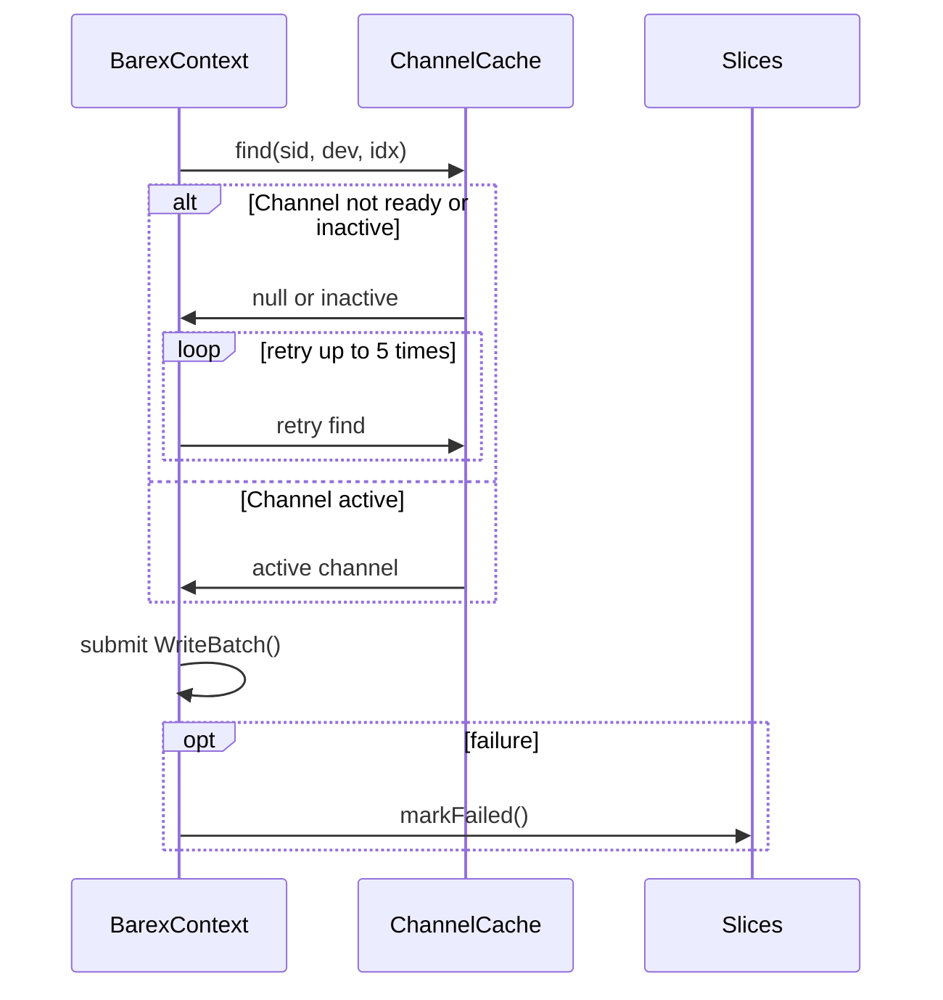
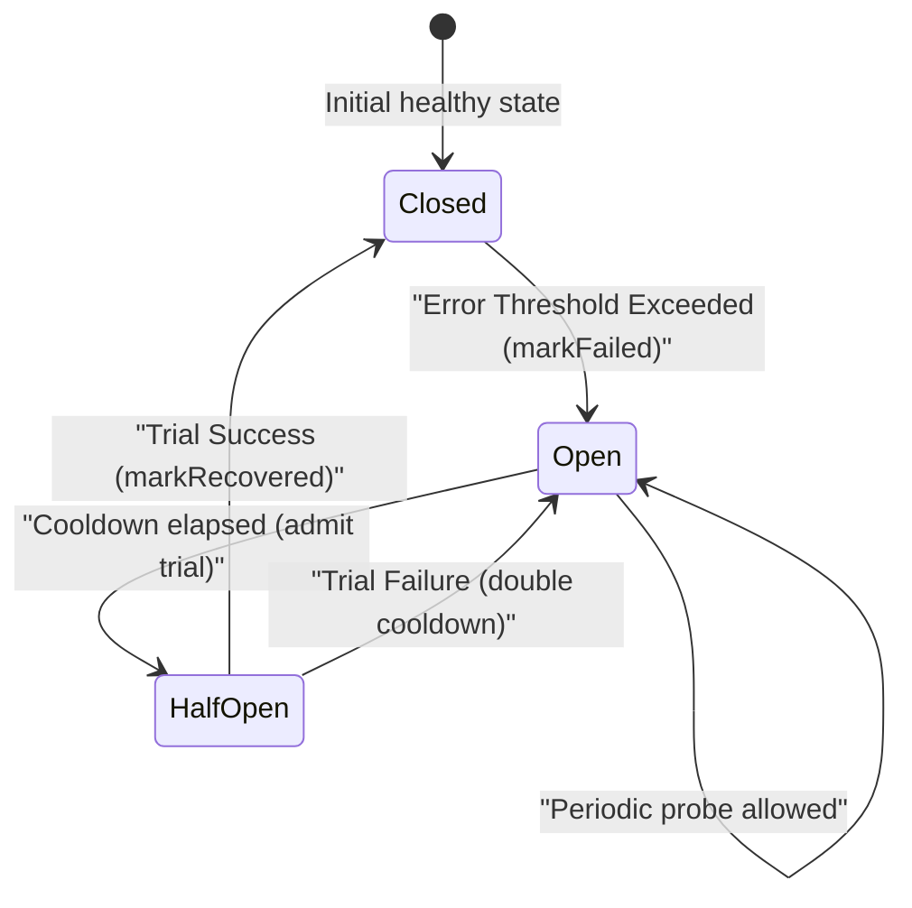
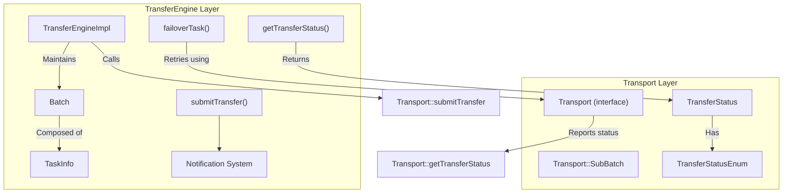

<!-- source: DeepWiki mcp.deepwiki.com · repo kvcache-ai/Mooncake · page 4.15 Status Tracking and Error Handling · fetched 2026-10-21 -->

# Status Tracking and Error Handling

<details>
<summary>Relevant source files</summary>

The following files were used as context for generating this wiki page:

- [mooncake-transfer-engine/include/common/base/status.h](mooncake-transfer-engine/include/common/base/status.h)
- [mooncake-transfer-engine/include/error.h](mooncake-transfer-engine/include/error.h)
- [mooncake-transfer-engine/include/transport/barex_transport/barex_transport.h](mooncake-transfer-engine/include/transport/barex_transport/barex_transport.h)
- [mooncake-transfer-engine/src/common/base/status.cpp](mooncake-transfer-engine/src/common/base/status.cpp)
- [mooncake-transfer-engine/src/transport/barex_transport/barex_context.cpp](mooncake-transfer-engine/src/transport/barex_transport/barex_context.cpp)
- [mooncake-transfer-engine/src/transport/barex_transport/barex_transport.cpp](mooncake-transfer-engine/src/transport/barex_transport/barex_transport.cpp)
- [mooncake-transfer-engine/src/transport/kunpeng_transport/ub_transport.cpp](mooncake-transfer-engine/src/transport/kunpeng_transport/ub_transport.cpp)
- [mooncake-transfer-engine/tent/include/tent/runtime/transfer_engine_impl.h](mooncake-transfer-engine/tent/include/tent/runtime/transfer_engine_impl.h)
- [mooncake-transfer-engine/tent/src/runtime/transfer_engine_impl.cpp](mooncake-transfer-engine/tent/src/runtime/transfer_engine_impl.cpp)
- [mooncake-transfer-engine/tent/tests/CMakeLists.txt](mooncake-transfer-engine/tent/tests/CMakeLists.txt)
- [mooncake-transfer-engine/tent/tests/engine_failover_e2e_test.cpp](mooncake-transfer-engine/tent/tests/engine_failover_e2e_test.cpp)

</details>


## Purpose and Scope

This page presents the detailed implementation of status tracking and error handling in Mooncake's Transfer Engine subsystem. It covers the transfer state enumeration, error code taxonomy, interfaces for querying transfer status, event-driven transfer completion notifications, and fault tolerance mechanisms including retries and failover. Emphasis is on internal data structures, task state flows, polling versus notification completion, and robust handling of transient and permanent failures during KVCache data transfers.

Sources: [mooncake-transfer-engine/tent/include/tent/runtime/transfer_engine_impl.h:66-140](), [mooncake-transfer-engine/include/common/base/status.h:30-88](), [mooncake-transfer-engine/src/common/base/status.cpp:27-96](), [mooncake-transfer-engine/include/error.h:15-40](), [mooncake-transfer-engine/tent/src/runtime/transfer_engine_impl.cpp:50-90](), [mooncake-transfer-engine/src/transport/barex_transport/barex_context.cpp:50-132](), [mooncake-transfer-engine/tests/engine_failover_e2e_test.cpp:80-176]()

---

## Transfer Status and Error Codes

### TransferStatusEnum

The transfer status enumeration `TransferStatusEnum`, defined in the `Transport` interface, encapsulates the lifecycle states of individual transfer tasks:

| Status          | Description                                                                                 |
|-----------------|---------------------------------------------------------------------------------------------|
| `WAITING`       | Task has been submitted but not dispatched to any transport yet.                            |
| `PENDING`       | Task is actively in-flight or being processed by a transport.                              |
| `INVALID`       | The task reference or BatchID provided is invalid or stale.                                |
| `CANCELED`      | Task was explicitly canceled by caller or internal logic before completion.                 |
| `COMPLETED`     | Task finished successfully and all data was transferred.                                   |
| `TIMEOUT`       | Task exceeded its specified deadline or timeout window.                                    |
| `FAILED`        | Transfer failed due to transport errors, network faults, or hardware issues.               |

This enum is used throughout the transfer engine layers to describe task completion conditions and error states.

---

### TransferStatus

The `TransferStatus` struct combines the status enum with progress metadata such as the number of bytes successfully transferred. This struct is returned by `getTransferStatus()` functions:

```cpp
struct TransferStatus {
    TransferStatusEnum s;    // current transfer task state
    size_t transferred_bytes; // bytes successfully transferred so far
};
```

This allows clients to observe partial progress even before completion, supporting both polling and event-driven query models.

---

### Status: Error Code Taxonomy

Mooncake uses the `Status` class as a rich error reporting mechanism across both transfer engine operations and internal runtime:

- Encapsulates error codes (`Code` enum) and string messages.
- Covers generic errors (`kInvalidArgument`, `kTooManyRequests`), transport-specific errors (e.g., `kDeviceNotFound`), and system-level issues (`kMemory`, `kMetadata`).
- Provides boolean helper methods such as `IsInvalidArgument()`, `IsDeviceNotFound()`.
- Static constructors for convenience, e.g. `Status::InvalidArgument(msg)`.

The range and meaning of error codes include but are not limited to:

| Code                   | Description                                         |
|------------------------|-----------------------------------------------------|
| `kOk`                  | Operation succeeded.                                |
| `kInvalidArgument`     | Caller provided invalid or inconsistent parameters.|
| `kTooManyRequests`     | Rate limiting triggered, client should back off.   |
| `kAddressNotRegistered`| Address used for transfer was not properly registered.|
| `kBatchBusy`           | Transfer batch is currently busy or locked.        |
| `kDeviceNotFound`      | Target device or resource unavailable.              |
| `kDns`, `kSocket`      | Network communication errors.                        |
| `kMalformedJson`       | Metadata or config JSON parsing failed.             |
| `kRejectHandshake`     | Peer rejected handshake connection.                 |
| `kMemory`              | Memory allocation or registration failed.           |
| `kNotImplemented`      | Requested feature not implemented.                   |

This taxonomy allows the system to communicate precise failure causes through the API and logs.

Sources: [mooncake-transfer-engine/include/common/base/status.h:33-55](), [mooncake-transfer-engine/src/common/base/status.cpp:27-96](), [mooncake-transfer-engine/include/error.h:15-40]()

---

## Status Tracking Implementation

### Batch and Task Data Structures

Transfers are scheduled and tracked in units called *batches*, represented internally by the `Batch` struct which contains:

- An array of `SubBatch` references to per-transport transfer groups.
- A vector of `TaskInfo` entries describing each logical transfer sub-task.
- Counters for size, runtime references, and cleanup state.
- State tracking for reclaim attempts and abandon detection.
- Lists of submit hooks with notification payloads and involved segment IDs for deferred notification on completion.

Each transfer *task* within a batch is described by `TaskInfo`, containing fields such as:

- Transport type and sub-task IDs.
- Failover and retry counts.
- Runtime policy flags.
- The original and current request parameters.
- Status variables for both logical and staging states.
- Time points for submit, dispatch, and posting events.
- Failure attribution stages for debugging and metrics.

Together, batches and tasks form the low-level plumbing for transfer state management and lifecycle.

### Functions & Classes

Key classes and functions involved:

- **`TransferEngineImpl`**: Main runtime class managing batches, tasks, transport dispatch, status polling, and failover.
- `allocateBatchID(batch_size)`: Allocates and tracks a new batch of transfers.
- `submitTransfer(batch_id, requests)`: Submits transfer requests to transports asynchronously.
- `getTransferStatus(batch_id, task_id, &status)`: Polls or queries transfer task completion status.
- `failoverTask(task_id)`: Invoked on failures to attempt resubmission via alternate transports.
- Internal polling loops throttle frequency and detect permanently failed batches for cleanup.

These implement a concurrency-safe state machine to track transfer progress and errors.

Sources: [mooncake-transfer-engine/tent/src/runtime/transfer_engine_impl.cpp:50-90](), [mooncake-transfer-engine/tent/include/tent/runtime/transfer_engine_impl.h:62-164]()

---

## Transfer Task State Machine and Failover Flow

Transfer tasks pass through the following lifecycle states managed inside `TransferEngineImpl` and reported by transport layers:

```mermaid
stateDiagram-v2
    [*] --> WAITING: "submitTransfer()"
    WAITING --> PENDING: "dispatchTransport::submitTransfer()"
    PENDING --> COMPLETED: "pollTransport::getTransferStatus() => COMPLETED"
    PENDING --> FAILED: "pollTransport::getTransferStatus() => FAILED"
    
    state Retry_Failover {
        FAILED --> failover: "retry count < max attempts"
        failover --> PENDING: "resubmit on alternative transport"
        FAILED --> terminal_fail: "retry count exceeded"
    }
    terminal_fail --> [*]
    COMPLETED --> [*]
```

**Details:**

- Newly submitted tasks start in `WAITING`.
- Upon transport submission, they progress to `PENDING`.
- Success leads to `COMPLETED`.
- Failures invoke failover logic if configured and retry count permits.
- Failover resubmits tasks on the next transport in priority order.
- If retries exhaust, tasks transition to a terminal `FAILED` state.

This flow ensures resiliency against transient transport errors.

Sources: [mooncake-transfer-engine/tests/engine_failover_e2e_test.cpp:25-45](), [mooncake-transfer-engine/tent/src/runtime/transfer_engine_impl.cpp:62-90]()

---

## Event-Driven Completion and Notification System

Besides explicit status polling, Mooncake provides event-driven transfer completion via notifications:

- `submitTransferWithNotify()` allows attaching a `NotifyDesc` payload to batches.
- On transfer completion, the engine sends notifications out-of-band to registered clients.
- Notification records are maintained in maps inside `TransferEngineImpl`, tracking which hooks to fire post completion.
- Notify API functions include `sendNotifyByID` and `getNotifies()`.

This model reduces busy-waiting and improves efficiency for clients dependent on transfer completion callbacks.

Sources: [mooncake-transfer-engine/src/transport/barex_transport/barex_context.cpp:160-170]()

---

## Fault Tolerance and Retry Mechanisms

### Transport-Level Retries

Some transport implementations embed retry logic. For instance, the Barex transport attempts to find active RDMA channels for submission with multiple retries (up to 5), failing and marking slices as failed only after exhausting attempts. This protects against transient channel disruptions.



This logic is implemented inside `BarexContext::submitPostSend()`.

### RDMA Rail Monitoring and Backoff

RDMA transport employs a fine-grained rail monitor system tracking health per (local NIC, remote NIC) transport rail:

- On errors, rails are paused (opened), and a cooldown timer starts with exponential backoff capped at 300 seconds.
- After cooldown, a half-open trial admission tests if the rail recovered.
- Successful trials reset errors to closed (healthy) state.
- Failed trials double cooldown and restart rail pause.
- Rail admission controls flow by selectively allowing or blocking attempts.



This state machine keeps transfer reliability high while adapting dynamically to faulty RDMA links.

Sources: [mooncake-transfer-engine/src/transport/barex_transport/barex_context.cpp:50-132](), [mooncake-transfer-engine/tent/src/runtime/transfer_engine_impl.cpp:50-90]()

---

## Code Entity Relationship Diagram: Status Tracking and Transfers

This diagram maps key components managing transfers, their statuses, and error handling in Mooncake Transfer Engine, showing communication flow between layers.



This clarifies the modular roles of `TransferEngineImpl`, `Transport`, and how status and event notifications integrate.

Sources: [mooncake-transfer-engine/tent/include/tent/runtime/transfer_engine_impl.h:60-140](), [mooncake-transfer-engine/tent/src/runtime/transfer_engine_impl.cpp:50-90](), [mooncake-transfer-engine/src/transport/barex_transport/barex_context.cpp:50-132]()

---

## Summary

Mooncake's status tracking and error handling subsystem provides:

- A comprehensive transfer status enumeration and detailed task progress reporting.
- Rich error status codes categorized into client, transport, and infrastructure domains.
- Data structures (`Batch`, `TaskInfo`) to track concurrent transfers and their states robustly.
- APIs for polling transfer task status agnostic of transport protocol.
- Event-driven notifications for efficient asynchronous transfer completion signaling.
- Fault tolerance mechanisms including transport-specific retries, transport failovers, and RDMA rail health monitoring with exponential backoff.
- Integration points for notification and retry behaviors providing resiliency in heterogeneous distributed transfer environments.

This subsystem is crucial to maintain high throughput and reliability when performing KVCache data transfers under diverse transports, network conditions, and failure scenarios.

---

## References

- Transfer Engine Implementation : [mooncake-transfer-engine/tent/src/runtime/transfer_engine_impl.cpp:50-90]()
- Transfer Engine Header : [mooncake-transfer-engine/tent/include/tent/runtime/transfer_engine_impl.h:62-164]()
- Status Class : [mooncake-transfer-engine/include/common/base/status.h:30-88](), [mooncake-transfer-engine/src/common/base/status.cpp:27-96]()
- Error Code Definitions : [mooncake-transfer-engine/include/error.h:15-40]()
- Barex Transport Context (retry logic) : [mooncake-transfer-engine/src/transport/barex_transport/barex_context.cpp:50-132]()
- Engine Failover Tests (failover flow) : [mooncake-transfer-engine/tests/engine_failover_e2e_test.cpp:80-176]()

---

