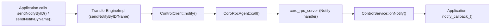
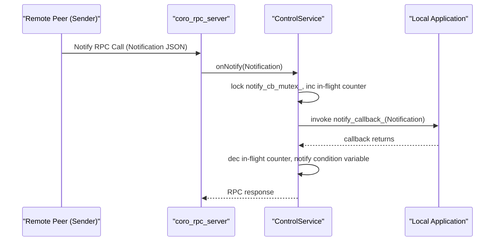
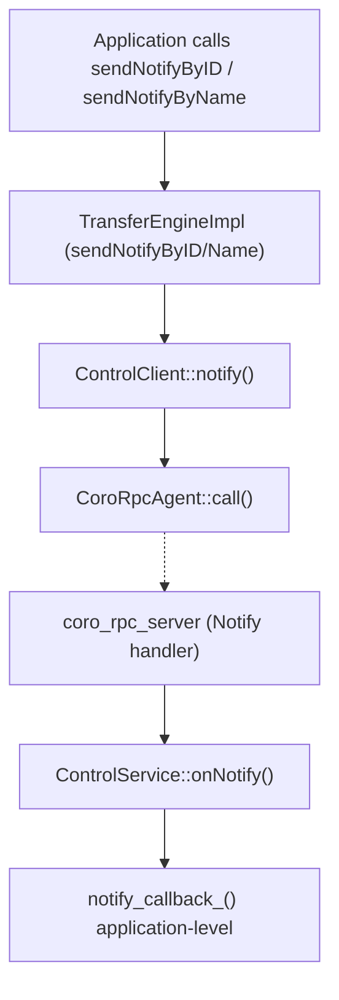
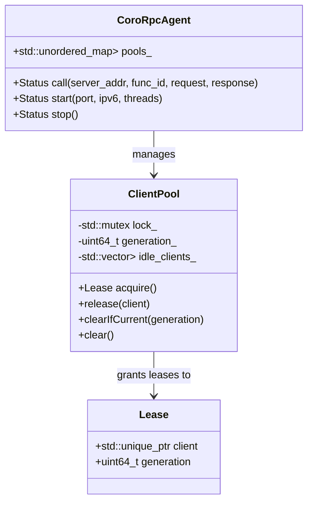

<!-- source: DeepWiki mcp.deepwiki.com · repo kvcache-ai/Mooncake · page 4.16 Notification System · fetched 2026-10-21 -->

# Notification System

<details>
<summary>Relevant source files</summary>

The following files were used as context for generating this wiki page:

- [docs/source/api-reference/python/transfer-engine.md](docs/source/api-reference/python/transfer-engine.md)
- [mooncake-transfer-engine/example/transfer_engine_bench.cpp](mooncake-transfer-engine/example/transfer_engine_bench.cpp)
- [mooncake-transfer-engine/example/transfer_engine_bench_with_notify.cpp](mooncake-transfer-engine/example/transfer_engine_bench_with_notify.cpp)
- [mooncake-transfer-engine/example/transfer_engine_bench_with_retry.cpp](mooncake-transfer-engine/example/transfer_engine_bench_with_retry.cpp)
- [mooncake-transfer-engine/example/transfer_engine_validator.cpp](mooncake-transfer-engine/example/transfer_engine_validator.cpp)
- [mooncake-transfer-engine/include/topology.h](mooncake-transfer-engine/include/topology.h)
- [mooncake-transfer-engine/src/memory_location.cpp](mooncake-transfer-engine/src/memory_location.cpp)
- [mooncake-transfer-engine/src/topology.cpp](mooncake-transfer-engine/src/topology.cpp)
- [mooncake-transfer-engine/tent/include/tent/common/config.h](mooncake-transfer-engine/tent/include/tent/common/config.h)
- [mooncake-transfer-engine/tent/src/common/config.cpp](mooncake-transfer-engine/tent/src/common/config.cpp)
- [mooncake-transfer-engine/tent/src/transfer_engine_c.cpp](mooncake-transfer-engine/tent/src/transfer_engine_c.cpp)
- [mooncake-transfer-engine/tent/tests/local_notification_test.cpp](mooncake-transfer-engine/tent/tests/local_notification_test.cpp)
- [mooncake-transfer-engine/tent/tests/transfer_engine_config_override_test.cpp](mooncake-transfer-engine/tent/tests/transfer_engine_config_override_test.cpp)
- [mooncake-transfer-engine/tests/rdma_transport_submit_task_test.cpp](mooncake-transfer-engine/tests/rdma_transport_submit_task_test.cpp)
- [mooncake-transfer-engine/tests/rdma_transport_test.cpp](mooncake-transfer-engine/tests/rdma_transport_test.cpp)
- [mooncake-transfer-engine/tests/tcp_transport_test.cpp](mooncake-transfer-engine/tests/tcp_transport_test.cpp)
- [mooncake-transfer-engine/tests/topology_test.cpp](mooncake-transfer-engine/tests/topology_test.cpp)

</details>


The Notification System in Mooncake's Transfer Engine provides a mechanism for asynchronous event signaling and control messages between distributed nodes, complementing bulk data transfers in the KVCache-centric LLM serving platform. It enables both attached notifications on transfer batches and explicit standalone notifications sent to remote nodes by segment ID or name.

This page covers all relevant notification APIs including `sendNotifyByID`, `sendNotifyByName`, `submitTransferWithNotify`, and `getNotifies`. It describes data structures such as `NotifyDesc` used in the classic engine and the `Notification` structure in the TENT runtime, the data flow through the RPC-based control plane, and the interaction with application-level callbacks.

---

## Purpose and Scope

Mooncake employs notifications primarily to support two workflows:

1. **Transfer-Attached Notifications**: Notifications can be attached to transfer batches so that upon completion, the engine automatically sends out a notify message. This enables synchronization and coordination closely tied to data transfer events.

2. **Standalone Notifications**: Independent notifications can be sent on demand to specified remote nodes by ID (`sendNotifyByID`) or by name (`sendNotifyByName`). This flexibility supports asynchronous control or coordination signals apart from transfers.

This page details the API interfaces, underlying data structures, control plane RPC message flow, and methods for receiving and polling notifications.

---

## Notification Data Structures

### Classic Notification Structure: `NotifyDesc`

Legacy Mooncake Transfer Engine APIs represent notification messages with the `NotifyDesc` structure, which contains:

| Field       | Type           | Description                                   |
|-------------|----------------|-----------------------------------------------|
| `name`      | `std::string`  | Identifier or topic name of the notification  |
| `notify_msg`| `std::string`  | Notification payload message content           |

This structure is the core message unit passed to APIs like `sendNotifyByID` and is also used in batch-attached notifications.

```cpp
struct NotifyDesc {
    std::string name;
    std::string notify_msg;
};
```

Sources: [mooncake-transfer-engine/tent/include/tent/transfer_engine.h:83-86]()

### TENT Runtime Notification Structure: `Notification`

In the modern TENT (Transfer Engine Next) runtime, notifications use a similar structure named `Notification`:

| Field  | Type          | Description                        |
|--------|---------------|----------------------------------|
| `name` | `std::string` | Notification identifier / label  |
| `msg`  | `std::string` | Notification message payload     |

This structure is serialized into JSON internally for RPC communication.

Sources: [mooncake-transfer-engine/tent/include/tent/transfer_engine.h:88-91]()

---

## API Overview

### Notification APIs in Transfer Engine

| API Function                    | Description                                            | Location Reference                                            |
|--------------------------------|--------------------------------------------------------|---------------------------------------------------------------|
| `sendNotifyByID(segmentID, NotifyDesc)`  | Sends a notification message to a remote node by segment ID   | [mooncake-transfer-engine/tent/include/tent/runtime/transfer_engine_impl.h:82]()      |
| `sendNotifyByName(name, NotifyDesc)`     | Sends notification to a remote node identified by segment name | [mooncake-transfer-engine/tent/include/tent/runtime/transfer_engine_impl.h:85]()      |
| `submitTransferWithNotify(batchID, reqs, NotifyDesc)` | Submits transfer requests batch with an attached notification  | [mooncake-transfer-engine/tent/include/tent/transfer_engine.h:168-170]()               |
| `getNotifies()`                  | Polls the engine for pending notifications                   | [mooncake-transfer-engine/tent/include/tent/transfer_engine.h:175-177]()               |

These APIs support flexible notification delivery tied to asynchronous transfer completion or independent out-of-band signaling.

### Python API Exposure

The Python `TransferEnginePy` binding supports attaching notification messages to transfer API calls like `transferSync` and `batchTransferSync` through the `TransferNotify` construct. This internally uses `submitTransferWithNotify` to submit the batch transfer along with a notification.

Sources: [docs/source/api-reference/python/transfer-engine.md]()

---

## Notification Sending Workflow and Data Flow

### Sending Standalone Notifications (By ID or Name)

The following diagram illustrates the flow of sending notifications using `sendNotifyByID` or `sendNotifyByName`:



- The app calls `sendNotifyByID` or `sendNotifyByName` on its local `TransferEngineImpl` instance.
- `TransferEngineImpl` invokes `ControlClient::notify()`, which uses a coroutine RPC client agent (`CoroRpcAgent`) to send the serialized `Notification` over the network.
- The remote node's RPC server dispatches to `ControlService::onNotify()` which triggers the application-level notify callback.
- Responses and errors are sent back through the call chain, enabling synchronous or asynchronous notification delivery.

Sources:  
- [mooncake-transfer-engine/tent/include/tent/runtime/transfer_engine_impl.h:75-85]()  
- [mooncake-transfer-engine/tent/src/runtime/control_plane.cpp:170-180]()

---

### Transfer-Attached Notification Submission

When submitting data transfers, notifications can be attached to notify interested parties on completion.

The `SubmitHook` structure manages the notification state for a batch:

```cpp
struct SubmitHook {
    size_t start_task_id{0};
    size_t end_task_id{0};
    Notification notifi;
    bool fired{false};
    std::unordered_set<SegmentID> targets; // unique remote segments to notify
};
```

- The `start_task_id` and `end_task_id` mark the range of transfer tasks to monitor.
- When all transfers in the range complete, the `SubmitHook` sends the attached notification exactly once to each remote target segment.
- This mechanism is used internally in `submitTransferWithNotify()` to automate notification sending coupled with transfer progress.

Sources: [mooncake-transfer-engine/tent/src/runtime/transfer_engine_impl.cpp:80-89]()

---

## Receiving and Polling Notifications

### Notification RPC Reception Flow

The server-side reception of notification messages uses the coroutine RPC server pipeline:



- Upon receiving a notification RPC, `ControlService::onNotify()` acquires a mutex and tracks in-flight notification calls.
- It synchronously invokes the registered `notify_callback_` handler with the deserialized notification payload.
- After callback completion, the RPC reply is sent signaling success or failure.
- This thread-safe callback mechanism ensures orderly notification processing within the TENT runtime.

Sources: [mooncake-transfer-engine/tent/src/runtime/control_plane.cpp:160-180]()

---

### Polling vs Callback Models

- **Polling (Classic TE)**: The legacy API exposes `getNotifies()` which returns batches of pending `NotifyDesc` messages buffered in the engine. Applications must poll and manage memory for these arrays explicitly.

- **Callback (TENT)**: The modern runtime uses a registered callback function (`notify_callback_`) invoked immediately when notifications arrive via RPC, avoiding polling overhead and providing a reactive model.

Application code uses `ControlService::setNotifyCallback(OnNotify cb)` to register handlers:

```cpp
using OnNotify = std::function<int(const Notification&)>;
void setNotifyCallback(OnNotify cb);
```

Sources:  
- [mooncake-transfer-engine/tent/include/tent/transfer_engine.h:175-177]()  
- [mooncake-transfer-engine/tent/include/tent/runtime/control_plane.h:142-143]()

---

## Implementation Details

### RPC Client Pooling in `CoroRpcAgent`

The core RPC agent managing coroutine clients maintains a pool keyed by server address:

- Each pool has a generation count representing the current cluster node lifecycle.
- Lease objects wrap individual coroutine RPC clients with their generation.
- When a remote restart is detected, a pool flush discards old clients atomically using generation checks.
- This prevents retry storms and reuses clients efficiently.

The client pool exposes:

```cpp
class ClientPool {
public:
    struct Lease {
        std::unique_ptr<coro_rpc_client> client;
        uint64_t generation;
    };

    Lease acquire();
    void release(std::unique_ptr<coro_rpc_client>);
    void clearIfCurrent(uint64_t generation);
    void clear();
};
```

Sources: [mooncake-transfer-engine/tent/src/rpc/rpc.cpp:46-95]()

---

### Notification Serialization

Notifications (`NotifyDesc` or TENT `Notification`) are serialized to JSON strings for network transfer using `nlohmann::json`. The fields `name` and `msg` (or `notify_msg`) are converted to JSON key-value pairs.

The RPC call sends the serialized string, and the receiver deserializes it back to the `Notification` struct for callback invocation.

---

## Summary Table of Notification API

| API Function                      | Description                                              | Usage Scenario                                             | Source Location                                             |
|----------------------------------|----------------------------------------------------------|------------------------------------------------------------|-------------------------------------------------------------|
| `sendNotifyByID(segmentID, NotifyDesc)`        | Sends a notification to a remote node by segment ID       | Explicit out-of-band notification signaling                 | [transfer_engine_impl.h:82]()                                |
| `sendNotifyByName(name, NotifyDesc)`           | Sends notification by named segment, resolving to ID      | Notifications addressed by human-readable segment names     | [transfer_engine_impl.h:85]()                                |
| `submitTransferWithNotify(batchID, reqs, NotifyDesc)` | Transfer batch submission with attached notify message    | Synchronization/notification on transfer completion         | [transfer_engine.h:168-170]()                                |
| `getNotifies()`                    | Polls engine for pending notification messages           | Classic polling model for notifications                      | [transfer_engine.h:175-177]()                                |
| `setNotifyCallback(OnNotify cb)` | Registers callback invoked on notification reception      | TENT runtime reactive notification handling                  | [control_plane.h:142-143]()                                  |

---

## Technical Mermaid Diagrams Bridging Natural Language and Code Entities

### Diagram: Sending a Notification Overview



Sources:  
- [mooncake-transfer-engine/tent/src/runtime/control_plane.cpp:173-180]()  
- [mooncake-transfer-engine/tent/include/tent/runtime/transfer_engine_impl.h:82]()

---

### Diagram: Notification RPC Client Pool Behavior



Sources: [mooncake-transfer-engine/tent/src/rpc/rpc.cpp:46-95]()

---

## References and Sources

- Notification struct definitions: [mooncake-transfer-engine/tent/include/tent/transfer_engine.h:83-91,168-177]()  
- Control plane RPC and notification logic: [mooncake-transfer-engine/tent/src/runtime/control_plane.cpp:160-180]()  
- TransferEngineImpl notification methods: [mooncake-transfer-engine/tent/include/tent/runtime/transfer_engine_impl.h:75-90]()  
- RPC client pooling: [mooncake-transfer-engine/tent/src/rpc/rpc.cpp:46-95]()  
- Notification callback registration: [mooncake-transfer-engine/tent/include/tent/runtime/control_plane.h:142-143]()  
- Local notification tests: [mooncake-transfer-engine/tent/tests/local_notification_test.cpp:40-120]()

---

This page documents the detailed technical design and API usage of the Notification System in the Mooncake Transfer Engine. The system supports both legacy and modern notification workflows using coroutine RPC for efficient asynchronous signaling integrated with data transfer operations and standalone control messages.

---

