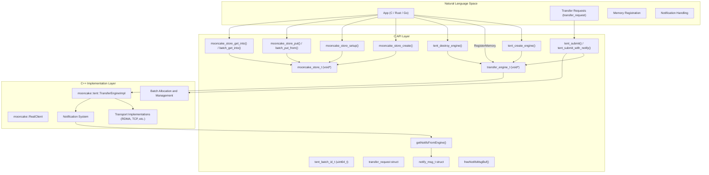
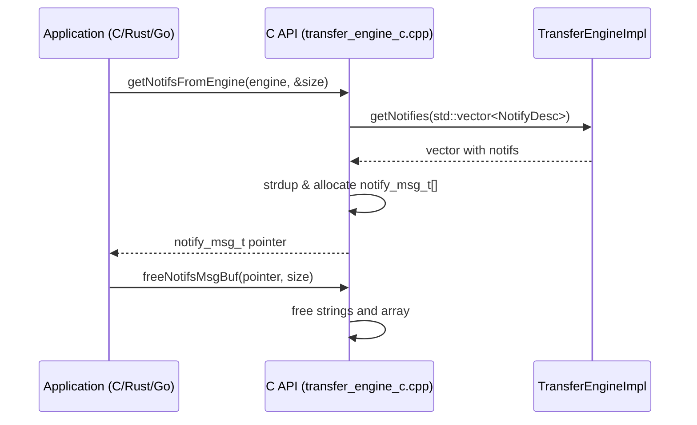

<!-- source: DeepWiki mcp.deepwiki.com · repo kvcache-ai/Mooncake · page 4.4 C API Reference · fetched 2026-10-21 -->

# C API Reference

<details>
<summary>Relevant source files</summary>

The following files were used as context for generating this wiki page:

- [mooncake-store/go/examples/basic/main.go](mooncake-store/go/examples/basic/main.go)
- [mooncake-store/go/go.mod](mooncake-store/go/go.mod)
- [mooncake-store/go/mooncakestore/config.go](mooncake-store/go/mooncakestore/config.go)
- [mooncake-store/go/mooncakestore/errors.go](mooncake-store/go/mooncakestore/errors.go)
- [mooncake-store/go/mooncakestore/store.go](mooncake-store/go/mooncakestore/store.go)
- [mooncake-store/go/tests/integration_test.go](mooncake-store/go/tests/integration_test.go)
- [mooncake-store/include/store_c.h](mooncake-store/include/store_c.h)
- [mooncake-store/rust/CMakeLists.txt](mooncake-store/rust/CMakeLists.txt)
- [mooncake-store/rust/Cargo.lock](mooncake-store/rust/Cargo.lock)
- [mooncake-store/rust/Cargo.toml](mooncake-store/rust/Cargo.toml)
- [mooncake-store/rust/build.rs](mooncake-store/rust/build.rs)
- [mooncake-store/rust/examples/basic_usage.rs](mooncake-store/rust/examples/basic_usage.rs)
- [mooncake-store/rust/src/error.rs](mooncake-store/rust/src/error.rs)
- [mooncake-store/rust/src/generated/ffi_dlopen_bindings.rs](mooncake-store/rust/src/generated/ffi_dlopen_bindings.rs)
- [mooncake-store/rust/src/lib.rs](mooncake-store/rust/src/lib.rs)
- [mooncake-store/rust/src/store.rs](mooncake-store/rust/src/store.rs)
- [mooncake-store/src/store_c.cpp](mooncake-store/src/store_c.cpp)
- [mooncake-transfer-engine/tent/include/tent/common/config.h](mooncake-transfer-engine/tent/include/tent/common/config.h)
- [mooncake-transfer-engine/tent/src/common/config.cpp](mooncake-transfer-engine/tent/src/common/config.cpp)
- [mooncake-transfer-engine/tent/src/transfer_engine_c.cpp](mooncake-transfer-engine/tent/src/transfer_engine_c.cpp)
- [mooncake-transfer-engine/tent/tests/local_notification_test.cpp](mooncake-transfer-engine/tent/tests/local_notification_test.cpp)
- [mooncake-transfer-engine/tent/tests/transfer_engine_config_override_test.cpp](mooncake-transfer-engine/tent/tests/transfer_engine_config_override_test.cpp)
- [mooncake-wheel/tests/test_replicated_distributed_object_store.py](mooncake-wheel/tests/test_replicated_distributed_object_store.py)

</details>


This page documents the C language bindings for the Mooncake Transfer Engine and Store subsystems, defined primarily in the headers [transfer_engine_c.h](mooncake-transfer-engine/include/transfer_engine_c.h) and [store_c.h](mooncake-store/include/store_c.h), and implemented in [transfer_engine_c.cpp](mooncake-transfer-engine/tent/src/transfer_engine_c.cpp) and [store_c.cpp](mooncake-store/src/store_c.cpp). The C API is an `extern "C"` ABI surface that wraps internal C++ classes (`TransferEngine`, `TransferEngineImpl`, and `RealClient`), enabling language-agnostic FFI usage, notably from Rust and Go.

---

## Design Overview

The Transfer Engine and Store C APIs expose opaque pointer handles for managing lifetimes and resources guarded inside the C++ implementation. This encapsulation preserves ABI stability and hides complex internal details from clients.

- `transfer_engine_t` - an opaque handle to a `mooncake::tent::TransferEngineImpl` instance.
- `mooncake_store_t` - an opaque handle to a `mooncake::RealClient` instance for the distributed key-value store.

The C API handles:

- Engine lifecycle: creation, destruction.
- Segment management: open/close remote segments.
- Memory registration for zero-copy RDMA or GPU buffers.
- Batch transfer submission and completion notification.
- Transport protocol installation and topology discovery.
- Notifications delivery and polling.

Configuration can be specified via thread-local variables before engine creation or by passing JSON/YAML strings.

---

### Data Flow and Entity Mapping



**Sources:**  
[mooncake-transfer-engine/include/transfer_engine_c.h:10-170](),  
[mooncake-transfer-engine/tent/src/transfer_engine_c.cpp:15-190](),  
[mooncake-store/include/store_c.h:15-152](),  
[mooncake-store/src/store_c.cpp:10-196]()  

---

## Opaque Handle Types

| C Typedef           | Underlying C++ Type                             | Description                         |
|---------------------|------------------------------------------------|-------------------------------------|
| `transfer_engine_t`  | `mooncake::tent::TransferEngineImpl*`          | Transfer Engine instance handle     |
| `transport_t`        | `mooncake::Transport*`                          | Transport protocol instance handle  |
| `mooncake_store_t`   | `std::shared_ptr<mooncake::RealClient>`        | Distributed KVCache Store client    |

These opaque pointers abstract away the underlying memory ownership and internal implementation from the caller, ensuring ABI and linkage safety.

**Sources:** [mooncake-transfer-engine/include/transfer_engine_c.h:90-93](), [mooncake-store/rust/src/store.rs:145-147]()

---

## Data Structures and Constants

### Transfer Request

```c
struct transfer_request {
    int          opcode;         // OPCODE_READ=0, OPCODE_WRITE=1
    void        *src;            // Local buffer pointer
    segment_id_t segment_id;     // Remote segment handle
    uint64_t     segment_offset; // Offset within remote segment
    uint64_t     length;         // Transfer size in bytes
};
```

### Transfer Status Codes

| Code             | Value | Meaning                                      |
|------------------|-------|----------------------------------------------|
| `OPCODE_READ`    | 0     | Transfer pull from remote to local           |
| `OPCODE_WRITE`   | 1     | Transfer push from local to remote            |
| `STATUS_WAITING` | 0     | Request queued, processing not started         |
| `STATUS_PENDING` | 1     | Transfer actively in progress                   |
| `STATUS_COMPLETED`| 4    | Transfer finished successfully                  |
| `STATUS_FAILED`  | 6     | Transfer failed with an error                    |

### Notification Message

```c
typedef struct notify_msg {
    char *name;    // Notification name (owned, strdup'ed)
    char *msg;     // Notification message payload (owned, strdup'ed)
} notify_msg_t;
```

Callers must free both strings and the array pointer to avoid leaks.

**Sources:** [mooncake-transfer-engine/include/transfer_engine_c.h:25-60]()

---

## Function Reference

### Transfer Engine Core API

#### `tent_create_engine`

```c
transfer_engine_t tent_create_engine();
```

- Creates and initializes a new `TransferEngineImpl` instance.
- Configures from environment, thread-local settings, or supplied config files prior to call.
- Returns an opaque `transfer_engine_t` handle or `nullptr` on failure.

#### `tent_destroy_engine`

```c
void tent_destroy_engine(transfer_engine_t engine);
```

- Shuts down and frees all resources associated with the engine.
- Must be called to clean up.

**Sources:** [mooncake-transfer-engine/tent/src/transfer_engine_c.cpp:29-59]()

---

### Segments and Memory Management

#### `tent_open_segment`

```c
int tent_open_segment(tent_engine_t engine, tent_segment_id_t* handle, const char* segment_name);
```

- Opens or references a remote segment by name.
- Returns 0 on success; handle updated with segment ID.

#### `tent_close_segment`

```c
int tent_close_segment(tent_engine_t engine, tent_segment_id_t handle);
```

- Closes a previously opened segment, freeing associated resources.

#### `tent_register_memory`

```c
int tent_register_memory(transfer_engine_t engine, void* addr, size_t size);
```

- Registers a local memory buffer with the engine for zero-copy RDMA or GPU access.
- Required before such memory can be used for transfers.

#### `tent_unregister_memory`

```c
int tent_unregister_memory(transfer_engine_t engine, void* addr, size_t size);
```

- Unregisters previously registered memory.

**Sources:** [mooncake-transfer-engine/tent/src/transfer_engine_c.cpp:81-189]()

---

### Batch Transfers and Notifications

#### `tent_allocate_batch`

```c
tent_batch_id_t tent_allocate_batch(transfer_engine_t engine, size_t batch_size);
```

- Allocates a batch ID handle to group multiple requests logically.
- `batch_size` sets the expected number of transfers.

#### `tent_free_batch`

```c
int tent_free_batch(transfer_engine_t engine, tent_batch_id_t batch_id);
```

- Frees batch resources.
- Returns 0 on success or special codes on deferred cleanup.

#### `tent_submit`

```c
int tent_submit(transfer_engine_t engine, tent_batch_id_t batch_id, struct transfer_request* entries, size_t count);
```

- Submits transfers asynchronously.
- `entries` points to an array of transfer requests.

#### `tent_submit_with_notify`

```c
int tent_submit_with_notify(transfer_engine_t engine, tent_batch_id_t batch_id, struct transfer_request* entries, size_t count, notify_msg_t notify_msg);
```

- Submits transfers with a notification message triggered on completion.

#### `getNotifsFromEngine`

```c
notify_msg_t* getNotifsFromEngine(transfer_engine_t engine, int* size);
```

- Retrieves buffered notifications awaiting client processing.
- Allocates memory for output; caller must free.

#### `freeNotifsMsgBuf`

```c
int freeNotifsMsgBuf(notify_msg_t* msg, int size);
```

- Frees memory allocated by `getNotifsFromEngine`.

**Notification Retrieval Flow:**



**Sources:** [mooncake-transfer-engine/include/transfer_engine_c.h:150-160](), [mooncake-transfer-engine/tent/src/transfer_engine_c.cpp:150-210]()

---

### Topology and Transport

#### `discoverTopology`

```c
int discoverTopology(transfer_engine_t engine);
```

- Discovers local hardware and transport topology for path selection and transport installation.

#### `getLocalIpAndPort`

```c
int getLocalIpAndPort(transfer_engine_t engine, char* buf_out, size_t buf_len);
```

- Retrieves current local IP address and RPC port.

#### `installTransport`

```c
transport_t installTransport(transfer_engine_t engine, const char* proto, void** args);
```

- Installs a specific transport protocol like RDMA or TCP.

#### `uninstallTransport`

```c
int uninstallTransport(transfer_engine_t engine, const char* proto);
```

- Removes a previously installed transport.

**Sources:** [mooncake-transfer-engine/tent/src/transfer_engine_c.cpp:40-66]()

---

## Mooncake Store C API

The Store C API provides a C interface to the Mooncake distributed KVCache store, with:

- Handle creation and destruction (`mooncake_store_create`, `mooncake_store_destroy`).
- Client setup and initialization (`mooncake_store_setup`, `mooncake_store_init_all`).
- Put/get operations (`mooncake_store_put`, `mooncake_store_get_into`, batch variants).
- Object existence, size queries, and remove operations.
- Zero-copy buffer registration APIs.

The API uses opaque `mooncake_store_t` handles and a replication config structure `mooncake_replicate_config_t` to specify replication, pinning, and segment preferences.

Typical usage pattern:
```c
mooncake_store_t store = mooncake_store_create();
mooncake_store_setup(store, ...);
mooncake_store_put(store, "key", value_buffer, size, NULL);
mooncake_store_get_into(store, "key", read_buffer, size);
mooncake_store_destroy(store);
```

**Sources:**  
[mooncake-store/include/store_c.h:15-152](),  
[mooncake-store/src/store_c.cpp:10-196](),  
[mooncake-store/rust/src/store.rs:30-150]()

---

## Memory Safety Conventions

1. **String parameters** passed to C API functions (`const char*` keys, config strings) are copied internally or only referenced transiently. Callers may freely free or reuse memory immediately after the call returns.

2. **Opaque handles** (`transfer_engine_t`, `mooncake_store_t`) must be explicitly destroyed by the caller to avoid leaks using the provided destroy functions.

3. **Notification buffers** returned via `getNotifsFromEngine` are allocated on the heap. The caller owns the array and its contained strings, and must invoke `freeNotifsMsgBuf` to release them.

4. **Batch IDs** allocated via `tent_allocate_batch` own internal resources and must be freed with `tent_free_batch` when no longer needed.

These conventions ensure safe interoperability across languages and runtimes.

**Sources:** [mooncake-transfer-engine/include/transfer_engine_c.h:90-110](), [mooncake-transfer-engine/tent/src/transfer_engine_c.cpp:20-70](), [mooncake-store/include/store_c.h:50-58]()

---

## Foreign Language Bindings: Rust and Go

The C API forms the basis for Mooncake's bindings to Rust and Go, offering idiomatic and safe wrappers over the low-level interface.

---

### Go Bindings

- Located in `mooncake-p2p-store/src/p2pstore/transfer_engine.go`.
- Use cgo to wrap C API calls of the Transfer Engine.
- Manage memory registration, batch submission, notifications.
- Build orchestrated in `mooncake-p2p-store/build.sh` linking required libraries (CUDA, RDMA, etc).
  
**Go Transfer Engine Wrapper Diagram:**

```mermaid
classDiagram
    class "C.transfer_engine_t" {
        <<opaque pointer>>
    }
    class TransferEngine {
        -engine C.transfer_engine_t
        +NewTransferEngine(...)
        +Close()
        +installTransport(...)
        +registerLocalMemory(...)
        +submitTransfer(...)
        +getTransferStatus(...)
    }
    class P2PStore {
        -transfer TransferEngine
        -memory RegisteredMemory
        +NewP2PStore(...)
        +Register(...)
        +Unregister(...)
    }
    class RegisteredMemory {
        -engine LocalMemoryTransport
        +Add(...)
        +Remove(...)
    }
    interface transferEngine {
        batchTransport
        Close()
        GetLocalIpAndPort()
        registerLocalMemory()
        unregisterLocalMemory()
    }
    interface localMemoryTransport {
        registerLocalMemory()
        unregisterLocalMemory()
    }

    TransferEngine "1" -- "1" C.transfer_engine_t : wraps
    P2PStore "1" -- "1" transferEngine : uses
    P2PStore "1" -- "1" RegisteredMemory : uses
    RegisteredMemory "1" -- "1" localMemoryTransport : uses
    TransferEngine ..|> transferEngine
    TransferEngine ..|> localMemoryTransport
```

**Sources:** [mooncake-p2p-store/src/p2pstore/transfer_engine.go:30-180](), [mooncake-p2p-store/build.sh:20-80]()

---

### Rust Bindings

- The `mooncake_store` Rust crate (in `mooncake-store/rust/src/store.rs`) wraps the store C API in safe Rust abstractions like `MooncakeStore` and `ReplicateConfig`.
- Supports static linking via bindgen (`link` feature) or dynamic runtime loading (`dlopen`).
- The build script in `rust/build.rs` configures compiler linker options and library search paths for seamless integration.
- Example usage demonstrates creating a store handle, setting up the client, and performing put/get operations.

**Rust Usage Example:**

```rust
let store = MooncakeStore::new()?;
store.setup(
    "localhost",
    "http://127.0.0.1:8080/metadata",
    512 << 20,   // Segment size 512 MiB
    128 << 20,   // Local buffer 128 MiB
    "tcp",
    "",
    "127.0.0.1:50051",
)?;
store.put("key", b"value", None)?;
let value = store.get("key")?;
println!("Got value: {:?}", std::str::from_utf8(&value));
```

**Sources:** [mooncake-store/rust/src/store.rs:40-150](), [mooncake-store/rust/build.rs:110-130](), [mooncake-store/rust/examples/basic_usage.rs:20-160]()

---

# Summary

The C API exposed by Mooncake provides critical language-agnostic plumbing between the core C++ distributed KVCache system and external clients written in C, Rust, Go, or other languages. This interface empowers:

- Transfer Engine lifecycle management and runtime configuration.
- Memory registration and segment opening for efficient zero-copy transfers.
- Batch transfer submission with asynchronous completion notifications.
- Transport and topology management enabling heterogeneous network hardware support.
- Distributed Mooncake Store access with data replication and buffer registration.
- Safe interoperability guarded by clear conventions on ownership and memory management.

Together with corresponding Rust and Go wrappers, the C API forms the foundation for Mooncake's integration into LLM serving, HPC, and distributed inference applications.

---

### References

- [mooncake-transfer-engine/include/transfer_engine_c.h:10-170]()  
- [mooncake-transfer-engine/tent/src/transfer_engine_c.cpp:15-210]()  
- [mooncake-store/include/store_c.h:15-152]()  
- [mooncake-store/src/store_c.cpp:10-196]()  
- [mooncake-store/rust/src/store.rs:30-150]()  
- [mooncake-store/rust/build.rs:110-130]()  
- [mooncake-p2p-store/src/p2pstore/transfer_engine.go:30-180]()

---

