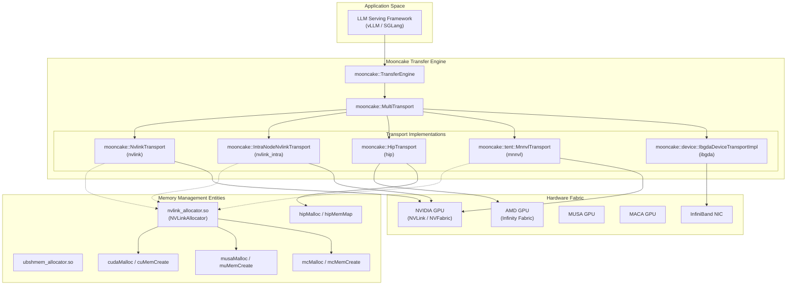
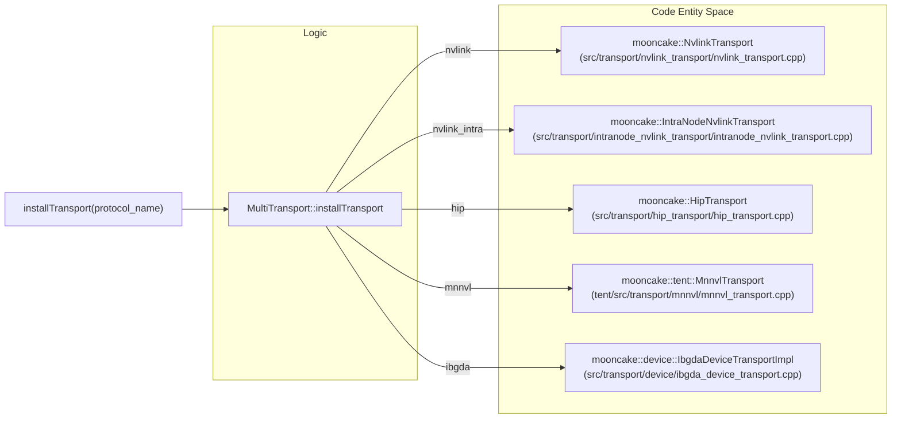

<!-- source: DeepWiki mcp.deepwiki.com · repo kvcache-ai/Mooncake · page 4.7 NVLink and GPU Transports · fetched 2026-10-21 -->

# NVLink and GPU Transports

<details>
<summary>Relevant source files</summary>

The following files were used as context for generating this wiki page:

- [.github/actions/run-ctest/action.yml](.github/actions/run-ctest/action.yml)
- [.github/actions/run-ctest/run.sh](.github/actions/run-ctest/run.sh)
- [mooncake-integration/allocator.py](mooncake-integration/allocator.py)
- [mooncake-integration/allocator_ascend_npu.py](mooncake-integration/allocator_ascend_npu.py)
- [mooncake-integration/fabric_allocator_utils.py](mooncake-integration/fabric_allocator_utils.py)
- [mooncake-transfer-engine/fabric_allocator.cmake](mooncake-transfer-engine/fabric_allocator.cmake)
- [mooncake-transfer-engine/include/common/hash_utils.h](mooncake-transfer-engine/include/common/hash_utils.h)
- [mooncake-transfer-engine/include/common/serialization.h](mooncake-transfer-engine/include/common/serialization.h)
- [mooncake-transfer-engine/include/gpu_vendor/hip.h](mooncake-transfer-engine/include/gpu_vendor/hip.h)
- [mooncake-transfer-engine/include/gpu_vendor/intra_nvlink.h](mooncake-transfer-engine/include/gpu_vendor/intra_nvlink.h)
- [mooncake-transfer-engine/include/transport/hip_transport/event_pool.h](mooncake-transfer-engine/include/transport/hip_transport/event_pool.h)
- [mooncake-transfer-engine/include/transport/hip_transport/hip_transport.h](mooncake-transfer-engine/include/transport/hip_transport/hip_transport.h)
- [mooncake-transfer-engine/include/transport/hip_transport/stream_pool.h](mooncake-transfer-engine/include/transport/hip_transport/stream_pool.h)
- [mooncake-transfer-engine/include/transport/intranode_nvlink_transport/intranode_nvlink_transport.h](mooncake-transfer-engine/include/transport/intranode_nvlink_transport/intranode_nvlink_transport.h)
- [mooncake-transfer-engine/include/transport/nvlink_transport/nvlink_host_numa_allocation.h](mooncake-transfer-engine/include/transport/nvlink_transport/nvlink_host_numa_allocation.h)
- [mooncake-transfer-engine/include/transport/nvlink_transport/nvlink_transport.h](mooncake-transfer-engine/include/transport/nvlink_transport/nvlink_transport.h)
- [mooncake-transfer-engine/nvlink-allocator/CMakeLists.txt](mooncake-transfer-engine/nvlink-allocator/CMakeLists.txt)
- [mooncake-transfer-engine/nvlink-allocator/build.sh](mooncake-transfer-engine/nvlink-allocator/build.sh)
- [mooncake-transfer-engine/nvlink-allocator/nvlink_allocator.cpp](mooncake-transfer-engine/nvlink-allocator/nvlink_allocator.cpp)
- [mooncake-transfer-engine/scripts/allocator_build_common.sh](mooncake-transfer-engine/scripts/allocator_build_common.sh)
- [mooncake-transfer-engine/src/transport/hip_transport/event_pool.cpp](mooncake-transfer-engine/src/transport/hip_transport/event_pool.cpp)
- [mooncake-transfer-engine/src/transport/hip_transport/hip_transport.cpp](mooncake-transfer-engine/src/transport/hip_transport/hip_transport.cpp)
- [mooncake-transfer-engine/src/transport/hip_transport/stream_pool.cpp](mooncake-transfer-engine/src/transport/hip_transport/stream_pool.cpp)
- [mooncake-transfer-engine/src/transport/intranode_nvlink_transport/intranode_nvlink_transport.cpp](mooncake-transfer-engine/src/transport/intranode_nvlink_transport/intranode_nvlink_transport.cpp)
- [mooncake-transfer-engine/src/transport/nvlink_transport/nvlink_host_numa_allocation.cpp](mooncake-transfer-engine/src/transport/nvlink_transport/nvlink_host_numa_allocation.cpp)
- [mooncake-transfer-engine/src/transport/nvlink_transport/nvlink_transport.cpp](mooncake-transfer-engine/src/transport/nvlink_transport/nvlink_transport.cpp)
- [mooncake-transfer-engine/tent/include/tent/common/status.h](mooncake-transfer-engine/tent/include/tent/common/status.h)
- [mooncake-transfer-engine/tent/include/tent/transport/mnnvl/mnnvl_transport.h](mooncake-transfer-engine/tent/include/tent/transport/mnnvl/mnnvl_transport.h)
- [mooncake-transfer-engine/tent/include/tent/transport/nvlink/nvlink_transport.h](mooncake-transfer-engine/tent/include/tent/transport/nvlink/nvlink_transport.h)
- [mooncake-transfer-engine/tent/src/common/status.cpp](mooncake-transfer-engine/tent/src/common/status.cpp)
- [mooncake-transfer-engine/tent/src/transport/mnnvl/mnnvl_transport.cpp](mooncake-transfer-engine/tent/src/transport/mnnvl/mnnvl_transport.cpp)
- [mooncake-transfer-engine/tent/src/transport/nvlink/nvlink_transport.cpp](mooncake-transfer-engine/tent/src/transport/nvlink/nvlink_transport.cpp)
- [mooncake-transfer-engine/tent/tests/nvlink_ipc_handle_sharing_test.cpp](mooncake-transfer-engine/tent/tests/nvlink_ipc_handle_sharing_test.cpp)
- [mooncake-transfer-engine/tent/tests/nvlink_transport_test.cpp](mooncake-transfer-engine/tent/tests/nvlink_transport_test.cpp)
- [mooncake-transfer-engine/tests/nvlink_host_numa_allocation_test.cpp](mooncake-transfer-engine/tests/nvlink_host_numa_allocation_test.cpp)
- [mooncake-transfer-engine/tests/nvlink_transport_test.cpp](mooncake-transfer-engine/tests/nvlink_transport_test.cpp)
- [mooncake-transfer-engine/ubshmem-allocator/CMakeLists.txt](mooncake-transfer-engine/ubshmem-allocator/CMakeLists.txt)
- [mooncake-transfer-engine/ubshmem-allocator/build.sh](mooncake-transfer-engine/ubshmem-allocator/build.sh)
- [mooncake-transfer-engine/ubshmem-allocator/ubshmem_fabric_allocator.cpp](mooncake-transfer-engine/ubshmem-allocator/ubshmem_fabric_allocator.cpp)

</details>


## Purpose and Scope

This document covers GPU-specific transport implementations in Mooncake's Transfer Engine, including:

- **Multi-Node NVLink (MNNVL)** for NVIDIA GPU inter-node communication via `NVLinkTransport` and `tent::MnnvlTransport`
- **Intra-Node NVLink** for NVIDIA GPU single-node communication via `IntraNodeNvlinkTransport`
- **HIP Transport** for AMD GPUs using ROCm with `HipTransport`
- **MUSA and MACA** support for Moore Threads and MACA GPUs through vendor adapter layers
- **IBGDA Device Transport** for InfiniBand GPU Direct Async (IBGDA) integration
- The **nvlink-allocator** and **ubshmem-allocator** components for specialized GPU memory management supporting CUDA, HIP, MUSA, and MACA backends

These transports enable efficient direct GPU-to-GPU data movement by leveraging hardware fabric technologies such as NVLink, Infinity Fabric, and HCCS, integral to Mooncake's high-throughput KVCache serving architecture.

Sources:  
[mooncake-transfer-engine/src/transport/nvlink_transport/nvlink_transport.cpp:1-49](),  
[mooncake-transfer-engine/tent/src/transport/mnnvl/mnnvl_transport.cpp:36-142](),  
[mooncake-transfer-engine/src/transport/intranode_nvlink_transport/intranode_nvlink_transport.cpp:45-105](),  
[mooncake-transfer-engine/src/transport/hip_transport/hip_transport.cpp:34-75](),  
[mooncake-transfer-engine/nvlink-allocator/build.sh:8-60](),  
[mooncake-integration/allocator.py:24-90]()

---

## Architecture Overview

GPU transports conform to the Transfer Engine’s pluggable multi-transport design. The `MultiTransport` dispatcher selects between multiple protocols based on the system architecture and runtime configuration.

### High-Level Architecture Diagram



Sources:  
[mooncake-transfer-engine/src/transport/nvlink_transport/nvlink_transport.cpp:115-117](),  
[mooncake-transfer-engine/src/transport/hip_transport/hip_transport.cpp:164-191](),  
[mooncake-transfer-engine/nvlink-allocator/build.sh:41-60](),  
[mooncake-transfer-engine/tent/src/transport/mnnvl/mnnvl_transport.cpp:90-129]()

---

### Protocol Selection Flow & Code Entities

The `installTransport(protocol_name)` API call in `MultiTransport` determines which transport class to instantiate, mapping natural language protocol identifiers to specific C++ classes implementing the `Transport` interface.



Sources:  
[mooncake-transfer-engine/src/transport/nvlink_transport/nvlink_transport.cpp:1-49](),  
[mooncake-transfer-engine/src/transport/hip_transport/hip_transport.cpp:34-50](),  
[mooncake-transfer-engine/src/transport/intranode_nvlink_transport/intranode_nvlink_transport.cpp:45-75](),  
[mooncake-transfer-engine/tent/src/transport/mnnvl/mnnvl_transport.cpp:144-187]()

---

## Multi-Node NVLink Transport (MNNVL)

### Overview

Mooncake provides two major implementations for multi-node GPU NVLink communication:

- **`NvlinkTransport`**: the legacy CUDA IPC-based transport supporting multi-node transfers using CUDA IPC handles and peer-to-peer (P2P) capabilities. This transport uses `cudaIpcMemHandle_t` for inter-process communication [mooncake-transfer-engine/include/transport/nvlink_transport/nvlink_transport.h:130-135]().
- **`tent::MnnvlTransport`**: a TENT subsystem implementation using CUDA VMM/fabric memory APIs for improved multi-node NVLink device memory sharing and optimized transfer paths. This transport leverages `CUmemAllocationHandleType` for fabric memory [mooncake-transfer-engine/tent/include/tent/transport/mnnvl/mnnvl_transport.h:135]().

Both support GPU-to-GPU transfers over NVIDIA's NVLink fabric spanning cluster nodes, exposing a shared memory abstraction for direct memory access.

### Key Structures and Classes

- `NVLinkTask` / `MnnvlTask`: Encapsulates each transfer request, tracking status, transferred bytes, target memory address, and associated CUDA completion events [mooncake-transfer-engine/tent/include/tent/transport/nvlink/nvlink_transport.h:38-45](), [mooncake-transfer-engine/tent/include/tent/transport/mnnvl/mnnvl_transport.h:37-43]().
- `NVLinkSubBatch` / `MnnvlSubBatch`: Implements a batch of GPU transfers grouped for efficient submission, containing CUDA streams for synchronous and asynchronous execution [mooncake-transfer-engine/tent/include/tent/transport/nvlink/nvlink_transport.h:47-62](), [mooncake-transfer-engine/tent/include/tent/transport/mnnvl/mnnvl_transport.h:45-59]().

### Memory Management and Fabric Support

- Both versions incorporate fabric memory where available, enabling direct device memory sharing via `cuMemCreate` and `cuMemImportFromShareableHandle` [mooncake-transfer-engine/tent/src/transport/mnnvl/mnnvl_transport.cpp:41-54]().
- The fabric memory availability is checked by querying all CUDA devices for `CU_DEVICE_ATTRIBUTE_HANDLE_TYPE_FABRIC_SUPPORTED` [mooncake-transfer-engine/tent/src/transport/mnnvl/mnnvl_transport.cpp:121-122]().
- When fabric memory is unsupported or disabled, the transports fallback to traditional `cudaIpcMemHandle_t`-based IPC [mooncake-transfer-engine/src/transport/nvlink_transport/nvlink_transport.cpp:130-135]().

### Important Implementations

- `supportFabricMem()` in `mnnvl_transport.cpp` scans CUDA devices for fabric support and logs accordingly [mooncake-transfer-engine/tent/src/transport/mnnvl/mnnvl_transport.cpp:109-129]().
- Memory allocation granularity and properties are carefully managed to ensure compatibility with device-specific requirements [mooncake-transfer-engine/tent/src/transport/mnnvl/mnnvl_transport.cpp:56-62]().

Sources:  
[mooncake-transfer-engine/tent/src/transport/mnnvl/mnnvl_transport.cpp:39-85](),  
[mooncake-transfer-engine/include/transport/nvlink_transport/nvlink_transport.h:32-90](),  
[mooncake-transfer-engine/tent/include/tent/transport/nvlink/nvlink_transport.h:38-45](),  
[mooncake-transfer-engine/tent/include/tent/transport/mnnvl/mnnvl_transport.h:37-43](),  
[mooncake-transfer-engine/tent/include/tent/transport/nvlink/nvlink_transport.h:47-62](),  
[mooncake-transfer-engine/tent/include/tent/transport/mnnvl/mnnvl_transport.h:45-59](),  
[mooncake-transfer-engine/tent/src/transport/mnnvl/mnnvl_transport.cpp:41-54](),  
[mooncake-transfer-engine/tent/src/transport/mnnvl/mnnvl_transport.cpp:121-122](),  
[mooncake-transfer-engine/src/transport/nvlink_transport/nvlink_transport.cpp:130-135](),  
[mooncake-transfer-engine/tent/src/transport/mnnvl/mnnvl_transport.cpp:109-129](),  
[mooncake-transfer-engine/tent/src/transport/mnnvl/mnnvl_transport.cpp:56-62]()

---

## Intra-Node NVLink Transport

The `IntraNodeNvlinkTransport` provides optimized GPU-to-GPU transfers within a single server node, suitable for multi-GPU systems interconnected with NVLink.

### Design Details

- Uses CUDA runtime APIs (`cudaMemcpyAsync`) with peer access enabled to perform intra-node device-to-device copies [mooncake-transfer-engine/src/transport/intranode_nvlink_transport/intranode_nvlink_transport.cpp:180-187]().
- Maintains thread-local pools of CUDA streams and CUDA events (`PerDeviceStreamPool` and `PerDeviceEventPool`) keyed by device ID to minimize overhead and improve concurrency [mooncake-transfer-engine/src/transport/intranode_nvlink_transport/intranode_nvlink_transport.cpp:49-151]().
- Synchronizes with the caller’s CUDA stream by inserting CUDA events and synchronizing them before device copies to ensure correctness [mooncake-transfer-engine/src/transport/intranode_nvlink_transport/intranode_nvlink_transport.cpp:147-151]().

### Thread Local Pools

- `PerDeviceStreamPool`: Lazily creates one CUDA stream per device per thread for non-blocking copies [mooncake-transfer-engine/src/transport/intranode_nvlink_transport/intranode_nvlink_transport.cpp:56-89]().
- `PerDeviceEventPool`: Caches one CUDA event per device per thread for synchronization purposes [mooncake-transfer-engine/src/transport/intranode_nvlink_transport/intranode_nvlink_transport.cpp:111-142]().

Sources:  
[mooncake-transfer-engine/src/transport/intranode_nvlink_transport/intranode_nvlink_transport.cpp:49-151](),  
[mooncake-transfer-engine/src/transport/intranode_nvlink_transport/intranode_nvlink_transport.cpp:180-187](),  
[mooncake-transfer-engine/src/transport/intranode_nvlink_transport/intranode_nvlink_transport.cpp:147-151](),  
[mooncake-transfer-engine/src/transport/intranode_nvlink_transport/intranode_nvlink_transport.cpp:56-89](),  
[mooncake-transfer-engine/src/transport/intranode_nvlink_transport/intranode_nvlink_transport.cpp:111-142]()

---

## HIP Transport (AMD GPUs)

### Overview

The `HipTransport` supports AMD GPUs using ROCm stack, enabling similar GPU fabric-level transfers to NVIDIA NVLink.

### Core Features

- Utilizes HIP runtime APIs analogous to CUDA for device memory management and data transfers [mooncake-transfer-engine/src/transport/hip_transport/hip_transport.cpp:164-191]().
- Implements fabric handle import semantics with `hipMemImportFromShareableHandle` [mooncake-transfer-engine/src/transport/hip_transport/hip_transport.cpp:91-102]().
- Supports safe handle acquisition via Linux syscalls `pidfd_open` and `pidfd_getfd` to correctly open file descriptors passed from the exporting process [mooncake-transfer-engine/src/transport/hip_transport/hip_transport.cpp:109-126]().
- Supports configurable pools of HIP streams and events, optimized for asynchronous operations. These pools are managed by `StreamPool` and `EventPool` classes [mooncake-transfer-engine/include/transport/hip_transport/stream_pool.h](), [mooncake-transfer-engine/include/transport/hip_transport/event_pool.h]().

### Version Compatibility Handling

- At runtime, queries HIP/ROCm runtime version [mooncake-transfer-engine/src/transport/hip_transport/hip_transport.cpp:84-89]().
- Conditionally uses different versions of `hipMemImportFromShareableHandle` based on ROCm version for correct argument passing semantics [mooncake-transfer-engine/src/transport/hip_transport/hip_transport.cpp:91-102]().

Sources:  
[mooncake-transfer-engine/src/transport/hip_transport/hip_transport.cpp:36-126](),  
[mooncake-transfer-engine/src/transport/hip_transport/hip_transport.cpp:164-191](),  
[mooncake-transfer-engine/src/transport/hip_transport/hip_transport.cpp:91-102](),  
[mooncake-transfer-engine/src/transport/hip_transport/hip_transport.cpp:109-126](),  
[mooncake-transfer-engine/include/transport/hip_transport/stream_pool.h](),  
[mooncake-transfer-engine/include/transport/hip_transport/event_pool.h](),  
[mooncake-transfer-engine/src/transport/hip_transport/hip_transport.cpp:84-89]()

---

## MUSA and MACA Support

Mooncake extends GPU support to additional hardware platforms via specialized backends using:

- **MUSA**: Moore Threads GPU platform adaptation using `musa.h` CUDA-alike API macros and linking against the MUSA runtime.
- **MACA**: MACA GPU platform adaptation implemented with `maca.h` providing CUDA-like interface wrappers and linking against `libmcruntime`.

### Build Integration

- The `nvlink-allocator` build script selects compiler and link options based on platform flags [mooncake-transfer-engine/nvlink-allocator/build.sh:41-60]():

```bash
# MUSA build snippet from build.sh
if [ "$USE_MCC" = true ]; then
    mcc "$CPP_FILE" -o "$OUTPUT_DIR/nvlink_allocator.so" --shared -fPIC -lmusa -I/usr/local/musa/include ${INCLUDE_FLAGS} -DUSE_MUSA=1
fi

# MACA build snippet
elif [ "$USE_MACA" = true ]; then
    MACA_ROOT=${MACA_HOME:-/opt/maca}
    g++ "$CPP_FILE" -o "$OUTPUT_DIR/nvlink_allocator.so" --shared -fPIC \
        -I"${MACA_ROOT}/include" ${INCLUDE_FLAGS} \
        -L"${MACA_ROOT}/lib64" -L"${MACA_ROOT}/lib" -lmcruntime -DUSE_MACA=1
fi
```

### Runtime API Wrappers

- `cuda_alike.h` header remaps CUDA API symbols to MUSA equivalents, enabling transparent code reuse for MUSA devices.
- Similarly, `cuda_alike.h` maps CUDA calls to MACA runtime calls for compatibility.

Sources:  
[mooncake-transfer-engine/nvlink-allocator/build.sh:41-60]()

---

## IBGDA Device Transport

The `IBGDADeviceTransport` facilitates GPU Direct RDMA over InfiniBand devices using the mlx5gda kernel driver stack. The implementation is provided by `IbgdaDeviceTransportImpl`.

### Capabilities

- Integrates with Mellanox ConnectX-5 and newer NICs, wrapping QP lifecycle management.
- Uses the Mooncake Transfer Engine Topology subsystem for NIC auto-detection if no device is specified.
- Provides various control memory modes (GPU DMABUF, GPU VA, host mapped) to optimize performance according to platform capabilities.

### Implementation Details

- Uses `ibv_open_device()` and `ibv_alloc_pd()` for RDMA resource management.
- Attempts to locate the best NIC based on GPU NIC affinity using topology queries.

Sources:  
[mooncake-transfer-engine/src/transport/device/ibgda_device_transport.cpp:1-45]()

---

## GPU Memory Allocators

### NVLink Allocator & UBShmem Allocator

- The **nvlink-allocator** component builds a shared library (`nvlink_allocator.so`) providing PyTorch-compatible `CUDAPluggableAllocator` hooks (`mc_allocator_malloc` and `mc_allocator_free`) for fabric memory allocation [mooncake-integration/allocator.py:86-87]().
- The **ubshmem-allocator** similarly provides allocator support for shared virtual memory fabrics (`ubshmem`) [mooncake-transfer-engine/ubshmem-allocator/ubshmem_fabric_allocator.cpp]().
- Build support covers multiple backends (CUDA, HIP, MUSA, MACA) with conditional compilation and linking [mooncake-transfer-engine/nvlink-allocator/build.sh:15-26]().

### Build Script Excerpt

```bash
# CUDA build (via nvcc)
if [ "$USE_NVCC" = true ]; then
    nvcc "$CPP_FILE" -o "$OUTPUT_DIR/nvlink_allocator.so" -shared -Xcompiler -fPIC -lcuda -I/usr/local/cuda/include ${INCLUDE_FLAGS} -DUSE_CUDA=1
fi

# HIP build (via hipcc)
elif [ "$USE_HIPCC" = true ]; then
    HIPCC_DEFINES="-DUSE_HIP=1"
    [ "$WITH_HYLINK" = true ] && HIPCC_DEFINES="$HIPCC_DEFINES -DUSE_HYLINK=1"
    hipify-perl "$CPP_FILE" > "${OUTPUT_DIR}/nvlink_allocator.cpp"
    hipcc "$OUTPUT_DIR/nvlink_allocator.cpp" -o "$OUTPUT_DIR/nvlink_allocator.so" -shared -fPIC -lamdhip64 -I/opt/rocm/include ${INCLUDE_FLAGS} ${HIPCC_DEFINES}
fi

# MUSA build
elif [ "$USE_MCC" = true ]; then
    mcc "$CPP_FILE" -o "$OUTPUT_DIR/nvlink_allocator.so" --shared -fPIC -lmusa -I/usr/local/musa/include ${INCLUDE_FLAGS} -DUSE_MUSA=1
fi

# MACA build
elif [ "$USE_MACA" = true ]; then
    MACA_ROOT=${MACA_HOME:-/opt/maca}
    g++ "$CPP_FILE" -o "$OUTPUT_DIR/nvlink_allocator.so" --shared -fPIC \
        -I"${MACA_ROOT}/include" ${INCLUDE_FLAGS} \
        -L"${MACA_ROOT}/lib64" -L"${MACA_ROOT}/lib" -lmcruntime -DUSE_MACA=1
fi
```

### Python API Integration

- The Python `NVLinkAllocator` class (`mooncake-integration/allocator.py`) probes the shared library at runtime to detect fabric memory support; it returns an enum indicating backend type [mooncake-integration/allocator.py:39-79]():
  - `MemoryBackend.USE_CUMEMCREATE` for fabric-supporting allocator [mooncake-integration/allocator.py:53]()
  - `MemoryBackend.USE_CUDAMALLOC` for standard CUDA malloc fallback [mooncake-integration/allocator.py:51]()
  - `MemoryBackend.UNSUPPORTED` if probing fails [mooncake-integration/allocator.py:55]()

- Caching of allocator instances keyed by device is handled for thread safety [mooncake-integration/allocator.py:83-90]().

Sources:  
[mooncake-transfer-engine/nvlink-allocator/build.sh:41-60](),  
[mooncake-integration/allocator.py:24-90](),  
[mooncake-transfer-engine/ubshmem-allocator/ubshmem_fabric_allocator.cpp](),  
[mooncake-transfer-engine/nvlink-allocator/build.sh:15-26](),  
[mooncake-integration/allocator.py:86-87](),  
[mooncake-integration/allocator.py:39-79](),  
[mooncake-integration/allocator.py:53](),  
[mooncake-integration/allocator.py:51](),  
[mooncake-integration/allocator.py:55](),  
[mooncake-integration/allocator.py:83-90]()

---

# Summary

Mooncake's Transfer Engine integrates multiple GPU transport protocols to support diverse GPU hardware fabric interconnects, including NVLink (single and multi-node), ROCm HIP for AMD GPUs, MUSA/MACA architectures, and RDMA-based IBGDA devices. The system utilizes specialized allocators to facilitate fabric memory management and efficient zero-copy data movement crucial for high-throughput KVCache serving workloads.

This layered design allows the system to dynamically choose and configure the optimal transport based on deployment hardware, ensuring scalable and performant GPU-to-GPU data transfers critical for large language model acceleration.

---

# Mermaid Diagrams Summary

- **Architecture Overview**: Shows Mooncake layers, transports, and hardware relations.
- **Protocol Selection Flow**: Maps protocol strings to transport C++ implementations for clarity.

Sources:  
Complete list as given per section above.

---

