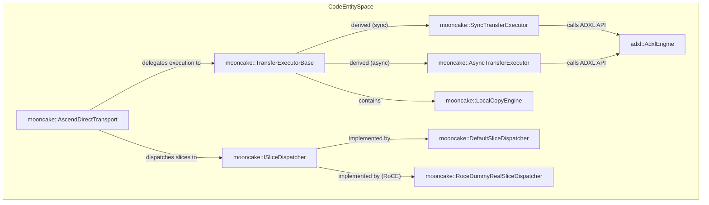
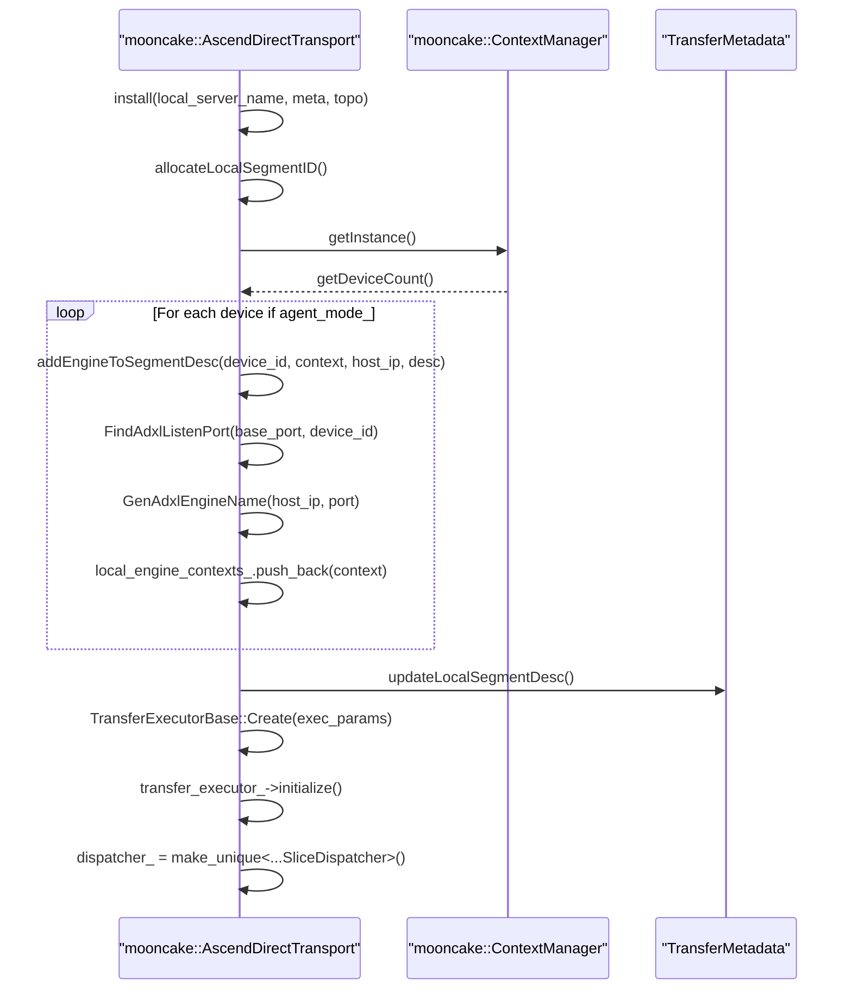
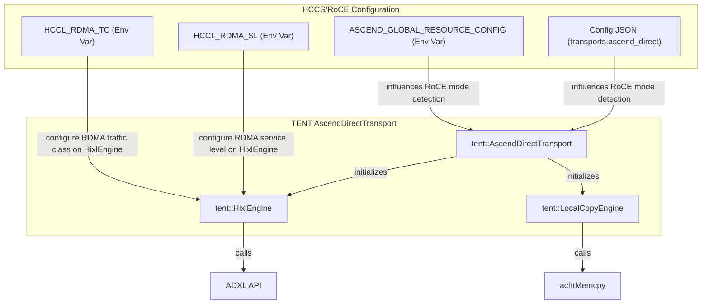

<!-- source: DeepWiki mcp.deepwiki.com · repo kvcache-ai/Mooncake · page 4.8 Ascend Direct Transport · fetched 2026-10-21 -->

# Ascend Direct Transport

Relevant source files

The following files were used as context for generating this wiki page:

- [docs/source/zh_archive/ascend_direct_transport.md](docs/source/zh_archive/ascend_direct_transport.md)
- [mooncake-common/FindMpi.cmake](mooncake-common/FindMpi.cmake)
- [mooncake-transfer-engine/example/CMakeLists.txt](mooncake-transfer-engine/example/CMakeLists.txt)
- [mooncake-transfer-engine/example/transfer_engine_ascend_one_sided.cpp](mooncake-transfer-engine/example/transfer_engine_ascend_one_sided.cpp)
- [mooncake-transfer-engine/example/transfer_engine_ascend_perf.cpp](mooncake-transfer-engine/example/transfer_engine_ascend_perf.cpp)
- [mooncake-transfer-engine/include/ascend_allocator.h](mooncake-transfer-engine/include/ascend_allocator.h)
- [mooncake-transfer-engine/include/transport/ascend_transport/ascend_direct_transport/adxl_compat.h](mooncake-transfer-engine/include/transport/ascend_transport/ascend_direct_transport/adxl_compat.h)
- [mooncake-transfer-engine/include/transport/ascend_transport/ascend_direct_transport/ascend_direct_transport.h](mooncake-transfer-engine/include/transport/ascend_transport/ascend_direct_transport/ascend_direct_transport.h)
- [mooncake-transfer-engine/include/transport/ascend_transport/ascend_direct_transport/async_transfer_executor.h](mooncake-transfer-engine/include/transport/ascend_transport/ascend_direct_transport/async_transfer_executor.h)
- [mooncake-transfer-engine/include/transport/ascend_transport/ascend_direct_transport/transfer_executor_base.h](mooncake-transfer-engine/include/transport/ascend_transport/ascend_direct_transport/transfer_executor_base.h)
- [mooncake-transfer-engine/include/transport/ascend_transport/ascend_direct_transport/utils.h](mooncake-transfer-engine/include/transport/ascend_transport/ascend_direct_transport/utils.h)
- [mooncake-transfer-engine/include/transport/ascend_transport/hccl_transport/hccl_transport.h](mooncake-transfer-engine/include/transport/ascend_transport/hccl_transport/hccl_transport.h)
- [mooncake-transfer-engine/include/transport/ascend_transport/hccl_transport/hccl_transport_mem_c.h](mooncake-transfer-engine/include/transport/ascend_transport/hccl_transport/hccl_transport_mem_c.h)
- [mooncake-transfer-engine/src/transport/ascend_transport/CMakeLists.txt](mooncake-transfer-engine/src/transport/ascend_transport/CMakeLists.txt)
- [mooncake-transfer-engine/src/transport/ascend_transport/ascend_allocator.cpp](mooncake-transfer-engine/src/transport/ascend_transport/ascend_allocator.cpp)
- [mooncake-transfer-engine/src/transport/ascend_transport/ascend_direct_transport/ascend_direct_transport.cpp](mooncake-transfer-engine/src/transport/ascend_transport/ascend_direct_transport/ascend_direct_transport.cpp)
- [mooncake-transfer-engine/src/transport/ascend_transport/ascend_direct_transport/async_transfer_executor.cpp](mooncake-transfer-engine/src/transport/ascend_transport/ascend_direct_transport/async_transfer_executor.cpp)
- [mooncake-transfer-engine/src/transport/ascend_transport/ascend_direct_transport/sync_transfer_executor.cpp](mooncake-transfer-engine/src/transport/ascend_transport/ascend_direct_transport/sync_transfer_executor.cpp)
- [mooncake-transfer-engine/src/transport/ascend_transport/ascend_direct_transport/transfer_executor_base.cpp](mooncake-transfer-engine/src/transport/ascend_transport/ascend_direct_transport/transfer_executor_base.cpp)
- [mooncake-transfer-engine/src/transport/ascend_transport/ascend_direct_transport/utils.cpp](mooncake-transfer-engine/src/transport/ascend_transport/ascend_direct_transport/utils.cpp)
- [mooncake-transfer-engine/src/transport/ascend_transport/hccl_transport/ascend_transport_c/CMakeLists.txt](mooncake-transfer-engine/src/transport/ascend_transport/hccl_transport/ascend_transport_c/CMakeLists.txt)
- [mooncake-transfer-engine/src/transport/ascend_transport/hccl_transport/ascend_transport_c/hccl_transport_mem_c.cpp](mooncake-transfer-engine/src/transport/ascend_transport/hccl_transport/ascend_transport_c/hccl_transport_mem_c.cpp)
- [mooncake-transfer-engine/src/transport/ascend_transport/hccl_transport/hccl_transport.cpp](mooncake-transfer-engine/src/transport/ascend_transport/hccl_transport/hccl_transport.cpp)
- [mooncake-transfer-engine/tent/include/tent/transport/ascend/ascend_direct_transport.h](mooncake-transfer-engine/tent/include/tent/transport/ascend/ascend_direct_transport.h)
- [mooncake-transfer-engine/tent/include/tent/transport/ascend/hixl_engine.h](mooncake-transfer-engine/tent/include/tent/transport/ascend/hixl_engine.h)
- [mooncake-transfer-engine/tent/include/tent/transport/ascend/local_copy_engine.h](mooncake-transfer-engine/tent/include/tent/transport/ascend/local_copy_engine.h)
- [mooncake-transfer-engine/tent/include/tent/transport/ascend/resource_config.h](mooncake-transfer-engine/tent/include/tent/transport/ascend/resource_config.h)
- [mooncake-transfer-engine/tent/src/platform/ascend/CMakeLists.txt](mooncake-transfer-engine/tent/src/platform/ascend/CMakeLists.txt)
- [mooncake-transfer-engine/tent/src/platform/ascend/ascend_allocator.cpp](mooncake-transfer-engine/tent/src/platform/ascend/ascend_allocator.cpp)
- [mooncake-transfer-engine/tent/src/platform/ascend/ascend_probe.cpp](mooncake-transfer-engine/tent/src/platform/ascend/ascend_probe.cpp)
- [mooncake-transfer-engine/tent/src/transport/ascend/ascend_direct_transport.cpp](mooncake-transfer-engine/tent/src/transport/ascend/ascend_direct_transport.cpp)
- [mooncake-transfer-engine/tests/ascend_direct_transport_test.cpp](mooncake-transfer-engine/tests/ascend_direct_transport_test.cpp)

Ascend Direct Transport (`AscendDirectTransport`) is a high-performance transport implementation tailored specifically for Huawei Ascend NPUs. It leverages the CANN Ascend Direct eXchange Library (ADXL) and HCCS (Huawei Cache Coherence System) to enable low-latency, high-throughput data transfers between host and devices (Host-to-Device, Device-to-Host, Device-to-Device). This transport seamlessly integrates with Mooncake's `TransferEngine`, supporting direct memory transfers for AI workloads requiring KVCache disaggregation.

---

## 1. Architecture and Core Components

### Overview

`AscendDirectTransport` implements the abstract `Transport` interface and manages low-level device context, memory registration, and transfer execution [mooncake-transfer-engine/include/transport/ascend_transport/ascend_direct_transport/ascend_direct_transport.h:34-100]().

Its core design comprises:

- **TransferExecutorBase**: Base class managing ADXL engines, connection state, and memory registration.
- **SyncTransferExecutor** / **AsyncTransferExecutor**: Concrete subclasses implementing synchronous and asynchronous transfer execution.
- **LocalCopyEngine**: Optimized local memcpy for device and host memory transfers.
- **ISliceDispatcher** + implementations: Dispatches transfer slices to executors, with variants for RoCE and standard modes.

This layered design isolates transport control, execution, and scheduling allowing flexibility and performance tuning.

### Class Relationships

**Key Classes:**

- `AscendDirectTransport`: Implements transport API (`submitTransfer`, `registerLocalMemory`, `install`) to configure engines, dispatcher, and memory registration [mooncake-transfer-engine/include/transport/ascend_transport/ascend_direct_transport/ascend_direct_transport.h:34-71]().
- `TransferExecutorBase`: Manages one or more ADXL engines, memory registrations, connections, and transfers [mooncake-transfer-engine/include/transport/ascend_transport/ascend_direct_transport/transfer_executor_base.h:42-129]().
- `SyncTransferExecutor`: Executes blocking ADXL transfer operations.
- `AsyncTransferExecutor`: Manages asynchronous transfers with polling and thread pool [mooncake-transfer-engine/src/transport/ascend_transport/ascend_direct_transport/transfer_executor_base.cpp:103-111]().
- `LocalCopyEngine`: Implements intra-node local copy using `aclrtMemcpy` optimized for Ascend memory.
- `ISliceDispatcher`: Interface for dispatching transfer "slices" (small units of work).
- `DefaultSliceDispatcher`: Default dispatcher for regular use.
- `RoceDummyRealSliceDispatcher`: Specialized dispatcher for RoCE mode in agent contexts.

Sources:
[mooncake-transfer-engine/include/transport/ascend_transport/ascend_direct_transport/ascend_direct_transport.h:34-100](),
[mooncake-transfer-engine/src/transport/ascend_transport/ascend_direct_transport/ascend_direct_transport.cpp:101-163](),
[mooncake-transfer-engine/include/transport/ascend_transport/ascend_direct_transport/transfer_executor_base.h:42-129](),
[mooncake-transfer-engine/src/transport/ascend_transport/ascend_direct_transport/transfer_executor_base.cpp:103-111](),
[mooncake-transfer-engine/src/transport/ascend_transport/ascend_direct_transport/ascend_direct_transport.cpp:157-161]()

---

## 2. Connection Lifecycle and Port Allocation

### Installation Workflow

`AscendDirectTransport::install()` is called to configure the transport:

1. Calls base `Transport::install()` method [mooncake-transfer-engine/src/transport/ascend_transport/ascend_direct_transport/ascend_direct_transport.cpp:119-124]().
2. Allocates a local segment descriptor ID, determining device contexts and mode flags (`agent_mode_`, `roce_mode_`, `use_fabric_mem_`) [mooncake-transfer-engine/src/transport/ascend_transport/ascend_direct_transport/ascend_direct_transport.cpp:125-145]().
3. Enumerates devices:
   - In **agent mode**, it enumerates all local NPUs via `ContextManager` [mooncake-transfer-engine/src/transport/ascend_transport/ascend_direct_transport/ascend_direct_transport.cpp:38-48]().
   - Otherwise, queries the current device context only.
4. For each device:
   - Finds an available ADXL listen port with `FindAdxlListenPort(base_port_, device_id)` [mooncake-transfer-engine/src/transport/ascend_transport/ascend_direct_transport/ascend_direct_transport.cpp:170-172]().
   - Generates engine names with `GenAdxlEngineName(host_ip, port)` [mooncake-transfer-engine/src/transport/ascend_transport/ascend_direct_transport/ascend_direct_transport.cpp:175]().
   - Stores the device context for use in execution [mooncake-transfer-engine/src/transport/ascend_transport/ascend_direct_transport/ascend_direct_transport.cpp:174]().
5. Publishes the local segment description to metadata [mooncake-transfer-engine/src/transport/ascend_transport/ascend_direct_transport/ascend_direct_transport.cpp:132-138]().
6. Creates and initializes a `TransferExecutorBase` instance (sync or async based on environment) [mooncake-transfer-engine/src/transport/ascend_transport/ascend_direct_transport/ascend_direct_transport.cpp:147-154]().
7. Instantiates the `ISliceDispatcher` implementation: RoCE-specific or default slice dispatcher [mooncake-transfer-engine/src/transport/ascend_transport/ascend_direct_transport/ascend_direct_transport.cpp:156-161]().

### Connection Management

- A connection is lazily established when required unless `ASCEND_AUTO_CONNECT` is set to force eager connection establishment by `TransferExecutorBase`.
- Connections and segment endpoints are managed per device context, tracked in `connected_segments_` [mooncake-transfer-engine/include/transport/ascend_transport/ascend_direct_transport/transfer_executor_base.h:117]().
- The base class provides synchronization and rollback mechanisms to ensure consistency during memory registration and execution [mooncake-transfer-engine/include/transport/ascend_transport/ascend_direct_transport/transfer_executor_base.h:95-119]().

Sources:
[mooncake-transfer-engine/src/transport/ascend_transport/ascend_direct_transport/ascend_direct_transport.cpp:115-195](),
[mooncake-transfer-engine/include/transport/ascend_transport/ascend_direct_transport/transfer_executor_base.h:95-129]()

---

## 3. Local Copy Mechanisms and Transfer Execution

### Local Copy Engine

For transfers where source and destination buffers exist within the same host/device memory domain and do not require network transport, the system uses `LocalCopyEngine`. It leverages the Ascend runtime API `aclrtMemcpy` or the asynchronous variant using streams:

- `ResolveAscendMemType()` detects the memory type (host vs. device) based on `location` strings or pointer attributes returned by the Ascend runtime [mooncake-transfer-engine/src/transport/ascend_transport/ascend_direct_transport/ascend_direct_transport.cpp:50-76]().
- `LocalCopyEngine` executes efficient intra-node memcpy operations, avoiding overhead of ADXL transport.

### Transfer Executors

`TransferExecutorBase` creates either a `SyncTransferExecutor` (blocking transfers) or `AsyncTransferExecutor`:

- **SyncTransferExecutor** submits ADXL transfer requests and blocks until completion.
- **AsyncTransferExecutor** submits non-blocking ADXL requests and manages completion polling on background worker threads (`AscendThreadPool`) without blocking calling threads [mooncake-transfer-engine/src/transport/ascend_transport/ascend_direct_transport/transfer_executor_base.cpp:103-111](), [mooncake-transfer-engine/src/transport/ascend_transport/ascend_direct_transport/utils.cpp:173-185]().

The async variant enables higher throughput and concurrency, especially on multi-device platforms.

Sources:
[mooncake-transfer-engine/src/transport/ascend_transport/ascend_direct_transport/transfer_executor_base.cpp:96-182](),
[mooncake-transfer-engine/include/transport/ascend_transport/ascend_direct_transport/transfer_executor_base.h:42-77](),
[mooncake-transfer-engine/src/transport/ascend_transport/ascend_direct_transport/ascend_direct_transport.cpp:50-76](),
[mooncake-transfer-engine/src/transport/ascend_transport/ascend_direct_transport/utils.cpp:173-185]()

---

## 4. HCCS Protocol and TENT Integration

### TENT Ascend Direct Transport

There is an alternative implementation of `AscendDirectTransport` in the TENT (Transfer Engine Next) codebase under `tent::AscendDirectTransport` which integrates with Huawei's `Hixl` interconnect and uses the HCCS protocol stack. This implementation supports advanced features such as:

- Extensive multi-engine management, including per-device `HixlEngine` and `LocalCopyEngine` instances.
- Configuration of RoCE mode and RDMA traffic class & service level via environment variables `HCCL_RDMA_TC` and `HCCL_RDMA_SL`.
- Translation of Hixl engine transfer states to Mooncake transfer statuses.
- JSON-configurable protocol descriptors affecting RoCE enablement.

- The RoCE mode flag is controlled based on environment detection logic in both standard and TENT modes [mooncake-transfer-engine/src/transport/ascend_transport/ascend_direct_transport/utils.cpp:142-171](), leveraging `ASCEND_GLOBAL_RESOURCE_CONFIG` and compatibility features exposed by ADXL [mooncake-transfer-engine/tent/src/transport/ascend/ascend_direct_transport.cpp:37-193]().
- TENT's Hixl engine supports detailed initialization sequencing including listen port management and device context handling.

Sources:
[mooncake-transfer-engine/tent/src/transport/ascend/ascend_direct_transport.cpp:37-193](),
[mooncake-transfer-engine/tent/include/tent/transport/ascend/ascend_direct_transport.h:31-46](),
[mooncake-transfer-engine/src/transport/ascend_transport/ascend_direct_transport/utils.cpp:143-171]()

---

## 5. Threading Model and Memory Allocation

### Threading Model

Ascend runtime APIs (`aclrt*`) demand careful thread-local context management, as device and stream bindings are inherently thread-specific. The transport ensures:

- Each worker thread sets the appropriate device context using `aclrtSetDevice` and caches local contexts in `local_engine_contexts_` [mooncake-transfer-engine/src/transport/ascend_transport/ascend_direct_transport/ascend_direct_transport.cpp:38-48]().
- The `AscendThreadPool` utility creates worker threads with descriptive names and queues tasks, used by `AsyncTransferExecutor` for polling completions asynchronously [mooncake-transfer-engine/src/transport/ascend_transport/ascend_direct_transport/utils.cpp:173-185]().

### Memory Allocation and Fabric Memory

Memory management supports both typical host/device buffers and high-performance fabric memory (pinned hugepages) specific to Ascend hardware:

- The allocator (`ascend_allocator`) performs NUMA-aware large page aligned allocations and, on A3 platforms, uses the Ascend Fabric Memory APIs (`aclrtMallocPhysical` with `ACL_MEM_P2P_HUGE1G`) [mooncake-transfer-engine/src/transport/ascend_transport/ascend_allocator.cpp:73-136]().
- Allocations may fallback to standard host memory if fabric memory is unavailable [mooncake-transfer-engine/src/transport/ascend_transport/ascend_allocator.cpp:117-136]().
- The `ASCEND_SUPPORT_FABRIC_MEM` macro (defined during the CMake build after probing Ascend runtime headers) enables fabric memory support and affects runtime behavior [mooncake-transfer-engine/src/transport/ascend_transport/CMakeLists.txt:16-18]().
- Memory registration tracks physical device handles and manages access rights using `aclrtMemSetAccess` for proper SDMA/HCCS operation [mooncake-transfer-engine/src/transport/ascend_transport/ascend_allocator.cpp:145-175]().

Sources:
[mooncake-transfer-engine/src/transport/ascend_transport/ascend_allocator.cpp:73-204](),
[mooncake-transfer-engine/src/transport/ascend_transport/ascend_direct_transport/ascend_direct_transport.cpp:38-48](),
[mooncake-transfer-engine/include/ascend_allocator.h:19-24](),
[mooncake-transfer-engine/src/transport/ascend_transport/CMakeLists.txt:16-18]()

---

## 6. Environment Variable Configuration

Ascend Direct Transport supports multiple environment variables for runtime customization, mainly parsed in `TransferExecutorBase::ParseExecutorEnvIntoInitParams()`:

| Environment Variable | Description | Default / Notes |
| :------------------- | :----------------------------------------------------------- | :---------------------------------------------------- |
| `ASCEND_CONNECT_TIMEOUT` | Connection establishment timeout in milliseconds | 10000 ms by default |
| `ASCEND_TRANSFER_TIMEOUT` | Timeout for data transfer operations in milliseconds | 10000 ms by default |
| `ASCEND_USE_ASYNC_TRANSFER` | Enables use of asynchronous transfers via `AsyncTransferExecutor` | Disabled by default |
| `ASCEND_AUTO_CONNECT` | Automatically open connections lazily or eagerly | Enabled if ADXL supports, else disabled |
| `ASCEND_BUFFER_POOL` | Enables ADXL buffer pool allocation mode | Disabled by default ("0:0") |
| `ASCEND_USE_SHORT_CONNECTION` | Use short-lived connections for transfer | Disabled by default |
| `HCCL_INTRA_ROCE_ENABLE` | Enables RoCE mode for intra-node communication | Disabled by default (`0`) |
| `ASCEND_GLOBAL_RESOURCE_CONFIG` | JSON string to describe global resource config (affects RoCE) | Empty string by default |
| `HCCL_RDMA_TC` | Sets RDMA traffic class for HCCS | 132 (default) |
| `HCCL_RDMA_SL` | Sets RDMA service level for HCCS | 4 (default) |

Environment variables influence device connection timeouts, transfer timeouts, transport modes (sync/async), buffer management, and advanced HCCS/RoCE transport features [mooncake-transfer-engine/src/transport/ascend_transport/ascend_direct_transport/transfer_executor_base.cpp:113-167](), [mooncake-transfer-engine/src/transport/ascend_transport/ascend_direct_transport/utils.cpp:142-171](), [mooncake-transfer-engine/src/transport/ascend_transport/hccl_transport/hccl_transport_mem_c.cpp:80-88]().

### Example: RoCE Mode Enablement

- `HCCL_INTRA_ROCE_ENABLE=1` forces RoCE mode [mooncake-transfer-engine/src/transport/ascend_transport/ascend_direct_transport/utils.cpp:149-154]().
- Alternatively, the presence of RoCE protocol descriptors in `ASCEND_GLOBAL_RESOURCE_CONFIG` JSON enables RoCE [mooncake-transfer-engine/src/transport/ascend_transport/ascend_direct_transport/utils.cpp:160-169]().
- The system logs detailed info about the detected transport modes during initialization [mooncake-transfer-engine/src/transport/ascend_transport/ascend_direct_transport/utils.cpp:143-148]().

Sources:
[mooncake-transfer-engine/src/transport/ascend_transport/ascend_direct_transport/transfer_executor_base.cpp:113-167](),
[mooncake-transfer-engine/include/transport/ascend_transport/ascend_direct_transport/transfer_executor_base.h:50-64](),
[mooncake-transfer-engine/src/transport/ascend_transport/ascend_direct_transport/utils.cpp:142-171](),
[mooncake-transfer-engine/src/transport/ascend_transport/hccl_transport/hccl_transport_mem_c.cpp:80-88]()

---

# Summary

`AscendDirectTransport` provides a direct, high-throughput transport for Huawei Ascend AI accelerators by tightly integrating with ADXL/HCCS protocols. It supports both agent and standalone modes with flexible connection management and buffer registration. Local copies are optimized via dedicated engines. Async concurrency is handled through thread pools. RoCE and fabric memory support are controlled via environment-driven policies and JSON config introspection. This transport serves as a critical component enabling KVCache data movement and LLM serving acceleration on Ascend platforms.

---

# References to Code Files and Lines

- [mooncake-transfer-engine/include/transport/ascend_transport/ascend_direct_transport/ascend_direct_transport.h:34-100]()
- [mooncake-transfer-engine/src/transport/ascend_transport/ascend_direct_transport/ascend_direct_transport.cpp:38-163]()
- [mooncake-transfer-engine/include/transport/ascend_transport/ascend_direct_transport/transfer_executor_base.h:42-129]()
- [mooncake-transfer-engine/src/transport/ascend_transport/ascend_direct_transport/transfer_executor_base.cpp:103-111]()
- [mooncake-transfer-engine/src/transport/ascend_transport/ascend_direct_transport/transfer_executor_base.cpp:113-167]()
- [mooncake-transfer-engine/src/transport/ascend_transport/ascend_direct_transport/transfer_executor_base.cpp:96-182]()
- [mooncake-transfer-engine/src/transport/ascend_transport/ascend_direct_transport/ascend_direct_transport.cpp:157-161]()
- [mooncake-transfer-engine/src/transport/ascend_transport/ascend_direct_transport/ascend_direct_transport.cpp:119-124]()
- [mooncake-transfer-engine/src/transport/ascend_transport/ascend_direct_transport/ascend_direct_transport.cpp:125-145]()
- [mooncake-transfer-engine/src/transport/ascend_transport/ascend_direct_transport/ascend_direct_transport.cpp:170-172]()
- [mooncake-transfer-engine/src/transport/ascend_transport/ascend_direct_transport/ascend_direct_transport.cpp:175]()
- [mooncake-transfer-engine/src/transport/ascend_transport/ascend_direct_transport/ascend_direct_transport.cpp:174]()
- [mooncake-transfer-engine/src/transport/ascend_transport/ascend_direct_transport/ascend_direct_transport.cpp:132-138]()
- [mooncake-transfer-engine/src/transport/ascend_transport/ascend_direct_transport/ascend_direct_transport.cpp:147-154]()
- [mooncake-transfer-engine/src/transport/ascend_transport/ascend_direct_transport/ascend_direct_transport.cpp:156-161]()
- [mooncake-transfer-engine/include/transport/ascend_transport/ascend_direct_transport/transfer_executor_base.h:117]()
- [mooncake-transfer-engine/include/transport/ascend_transport/ascend_direct_transport/transfer_executor_base.h:95-119]()
- [mooncake-transfer-engine/src/transport/ascend_transport/ascend_direct_transport/ascend_direct_transport.cpp:50-76]()
- [mooncake-transfer-engine/src/transport/ascend_transport/ascend_direct_transport/utils.cpp:173-185]()
- [mooncake-transfer-engine/tent/src/transport/ascend/ascend_direct_transport.cpp:37-193]()
- [mooncake-transfer-engine/src/transport/ascend_transport/ascend_direct_transport/utils.cpp:142-171]()
- [mooncake-transfer-engine/tent/include/tent/transport/ascend/ascend_direct_transport.h:31-46]()
- [mooncake-transfer-engine/src/transport/ascend_transport/ascend_allocator.cpp:73-136]()
- [mooncake-transfer-engine/src/transport/ascend_transport/ascend_allocator.cpp:117-136]()
- [mooncake-transfer-engine/src/transport/ascend_transport/CMakeLists.txt:16-18]()
- [mooncake-transfer-engine/src/transport/ascend_transport/ascend_allocator.cpp:145-175]()
- [mooncake-transfer-engine/include/ascend_allocator.h:19-24]()
- [mooncake-transfer-engine/src/transport/ascend_transport/hccl_transport/hccl_transport_mem_c.cpp:80-88]()
- [mooncake-transfer-engine/include/transport/ascend_transport/ascend_direct_transport/transfer_executor_base.h:50-64]()
- [mooncake-transfer-engine/src/transport/ascend_transport/ascend_direct_transport/utils.cpp:149-154]()
- [mooncake-transfer-engine/src/transport/ascend_transport/ascend_direct_transport/utils.cpp:160-169]()
- [mooncake-transfer-engine/src/transport/ascend_transport/ascend_direct_transport/utils.cpp:143-148]()

---

