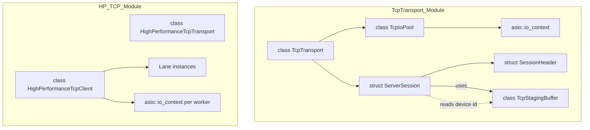
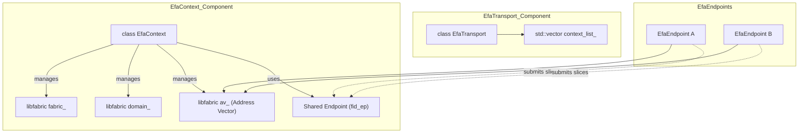
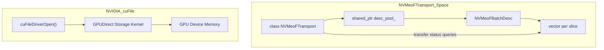
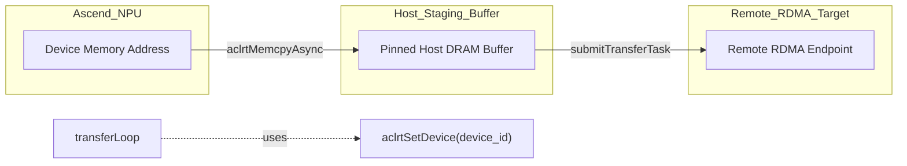

<!-- source: DeepWiki mcp.deepwiki.com · repo kvcache-ai/Mooncake · page 4.9 Other Transport Protocols · fetched 2026-10-21 -->

# Other Transport Protocols

<details>
<summary>Relevant source files</summary>

The following files were used as context for generating this wiki page:

- [docs/source/api-reference/cpp/tent.md](docs/source/api-reference/cpp/tent.md)
- [docs/source/design/tent/hp-tcp.md](docs/source/design/tent/hp-tcp.md)
- [mooncake-transfer-engine/include/common/base/status.h](mooncake-transfer-engine/include/common/base/status.h)
- [mooncake-transfer-engine/include/error.h](mooncake-transfer-engine/include/error.h)
- [mooncake-transfer-engine/include/transport/barex_transport/barex_transport.h](mooncake-transfer-engine/include/transport/barex_transport/barex_transport.h)
- [mooncake-transfer-engine/include/transport/cxl_transport/cxl_transport.h](mooncake-transfer-engine/include/transport/cxl_transport/cxl_transport.h)
- [mooncake-transfer-engine/include/transport/efa_transport/efa_context.h](mooncake-transfer-engine/include/transport/efa_transport/efa_context.h)
- [mooncake-transfer-engine/include/transport/efa_transport/efa_endpoint.h](mooncake-transfer-engine/include/transport/efa_transport/efa_endpoint.h)
- [mooncake-transfer-engine/include/transport/efa_transport/efa_transport.h](mooncake-transfer-engine/include/transport/efa_transport/efa_transport.h)
- [mooncake-transfer-engine/include/transport/nvmeof_transport/cufile_desc_pool.h](mooncake-transfer-engine/include/transport/nvmeof_transport/cufile_desc_pool.h)
- [mooncake-transfer-engine/include/transport/nvmeof_transport/nvmeof_transport.h](mooncake-transfer-engine/include/transport/nvmeof_transport/nvmeof_transport.h)
- [mooncake-transfer-engine/include/transport/tcp_transport/tcp_transport.h](mooncake-transfer-engine/include/transport/tcp_transport/tcp_transport.h)
- [mooncake-transfer-engine/src/common/base/status.cpp](mooncake-transfer-engine/src/common/base/status.cpp)
- [mooncake-transfer-engine/src/transfer_metadata_dump.cpp](mooncake-transfer-engine/src/transfer_metadata_dump.cpp)
- [mooncake-transfer-engine/src/transport/barex_transport/barex_context.cpp](mooncake-transfer-engine/src/transport/barex_transport/barex_context.cpp)
- [mooncake-transfer-engine/src/transport/barex_transport/barex_transport.cpp](mooncake-transfer-engine/src/transport/barex_transport/barex_transport.cpp)
- [mooncake-transfer-engine/src/transport/efa_transport/efa_context.cpp](mooncake-transfer-engine/src/transport/efa_transport/efa_context.cpp)
- [mooncake-transfer-engine/src/transport/efa_transport/efa_endpoint.cpp](mooncake-transfer-engine/src/transport/efa_transport/efa_endpoint.cpp)
- [mooncake-transfer-engine/src/transport/efa_transport/efa_transport.cpp](mooncake-transfer-engine/src/transport/efa_transport/efa_transport.cpp)
- [mooncake-transfer-engine/src/transport/kunpeng_transport/ub_transport.cpp](mooncake-transfer-engine/src/transport/kunpeng_transport/ub_transport.cpp)
- [mooncake-transfer-engine/src/transport/nvmeof_transport/cufile_desc_pool.cpp](mooncake-transfer-engine/src/transport/nvmeof_transport/cufile_desc_pool.cpp)
- [mooncake-transfer-engine/src/transport/nvmeof_transport/nvmeof_transport.cpp](mooncake-transfer-engine/src/transport/nvmeof_transport/nvmeof_transport.cpp)
- [mooncake-transfer-engine/src/transport/tcp_transport/tcp_transport.cpp](mooncake-transfer-engine/src/transport/tcp_transport/tcp_transport.cpp)
- [mooncake-transfer-engine/src/transport/tcp_transport/tcp_transport_lane_impl.h](mooncake-transfer-engine/src/transport/tcp_transport/tcp_transport_lane_impl.h)
- [mooncake-transfer-engine/src/transport/tcp_transport/tcp_transport_session_impl.h](mooncake-transfer-engine/src/transport/tcp_transport/tcp_transport_session_impl.h)
- [mooncake-transfer-engine/tent/include/tent/runtime/hp_tcp_transport_config.h](mooncake-transfer-engine/tent/include/tent/runtime/hp_tcp_transport_config.h)
- [mooncake-transfer-engine/tent/include/tent/runtime/topology.h](mooncake-transfer-engine/tent/include/tent/runtime/topology.h)
- [mooncake-transfer-engine/tent/include/tent/transport/gds/gds_transport.h](mooncake-transfer-engine/tent/include/tent/transport/gds/gds_transport.h)
- [mooncake-transfer-engine/tent/include/tent/transport/hp_tcp/hp_tcp_client.h](mooncake-transfer-engine/tent/include/tent/transport/hp_tcp/hp_tcp_client.h)
- [mooncake-transfer-engine/tent/include/tent/transport/hp_tcp/hp_tcp_protocol.h](mooncake-transfer-engine/tent/include/tent/transport/hp_tcp/hp_tcp_protocol.h)
- [mooncake-transfer-engine/tent/include/tent/transport/hp_tcp/hp_tcp_task.h](mooncake-transfer-engine/tent/include/tent/transport/hp_tcp/hp_tcp_task.h)
- [mooncake-transfer-engine/tent/include/tent/transport/hp_tcp/hp_tcp_transport.h](mooncake-transfer-engine/tent/include/tent/transport/hp_tcp/hp_tcp_transport.h)
- [mooncake-transfer-engine/tent/include/tent/transport/tcp/tcp_transport.h](mooncake-transfer-engine/tent/include/tent/transport/tcp/tcp_transport.h)
- [mooncake-transfer-engine/tent/src/runtime/hp_tcp_transport_config.cpp](mooncake-transfer-engine/tent/src/runtime/hp_tcp_transport_config.cpp)
- [mooncake-transfer-engine/tent/src/runtime/topology.cpp](mooncake-transfer-engine/tent/src/runtime/topology.cpp)
- [mooncake-transfer-engine/tent/src/transport/gds/gds_transport.cpp](mooncake-transfer-engine/tent/src/transport/gds/gds_transport.cpp)
- [mooncake-transfer-engine/tent/src/transport/hp_tcp/hp_tcp_client.cpp](mooncake-transfer-engine/tent/src/transport/hp_tcp/hp_tcp_client.cpp)
- [mooncake-transfer-engine/tent/src/transport/hp_tcp/hp_tcp_protocol.cpp](mooncake-transfer-engine/tent/src/transport/hp_tcp/hp_tcp_protocol.cpp)
- [mooncake-transfer-engine/tent/src/transport/hp_tcp/hp_tcp_server.cpp](mooncake-transfer-engine/tent/src/transport/hp_tcp/hp_tcp_server.cpp)
- [mooncake-transfer-engine/tent/src/transport/hp_tcp/hp_tcp_task.cpp](mooncake-transfer-engine/tent/src/transport/hp_tcp/hp_tcp_task.cpp)
- [mooncake-transfer-engine/tent/src/transport/hp_tcp/hp_tcp_transport.cpp](mooncake-transfer-engine/tent/src/transport/hp_tcp/hp_tcp_transport.cpp)
- [mooncake-transfer-engine/tent/src/transport/hp_tcp/hp_tcp_workers.cpp](mooncake-transfer-engine/tent/src/transport/hp_tcp/hp_tcp_workers.cpp)
- [mooncake-transfer-engine/tent/src/transport/tcp/tcp_transport.cpp](mooncake-transfer-engine/tent/src/transport/tcp/tcp_transport.cpp)
- [mooncake-transfer-engine/tent/tests/gds_transport_status_test.cpp](mooncake-transfer-engine/tent/tests/gds_transport_status_test.cpp)
- [mooncake-transfer-engine/tent/tests/hp_tcp_e2e_test.cpp](mooncake-transfer-engine/tent/tests/hp_tcp_e2e_test.cpp)
- [mooncake-transfer-engine/tent/tests/hp_tcp_socket_test.cpp](mooncake-transfer-engine/tent/tests/hp_tcp_socket_test.cpp)
- [mooncake-transfer-engine/tent/tests/hp_tcp_transport_config_test.cpp](mooncake-transfer-engine/tent/tests/hp_tcp_transport_config_test.cpp)
- [mooncake-transfer-engine/tent/tests/hp_tcp_transport_test.cpp](mooncake-transfer-engine/tent/tests/hp_tcp_transport_test.cpp)
- [mooncake-transfer-engine/tent/tests/hp_tcp_workers_test.cpp](mooncake-transfer-engine/tent/tests/hp_tcp_workers_test.cpp)
- [mooncake-transfer-engine/tent/tests/request_merge_test.cpp](mooncake-transfer-engine/tent/tests/request_merge_test.cpp)
- [mooncake-transfer-engine/tent/tests/runtime_queue_dispatch_test.cpp](mooncake-transfer-engine/tent/tests/runtime_queue_dispatch_test.cpp)
- [mooncake-transfer-engine/tent/tests/tcp_transport_test.cpp](mooncake-transfer-engine/tent/tests/tcp_transport_test.cpp)
- [mooncake-transfer-engine/tent/tests/topology_priority_matrix_test.cpp](mooncake-transfer-engine/tent/tests/topology_priority_matrix_test.cpp)
- [mooncake-transfer-engine/tests/efa_gpu_loopback_test.cpp](mooncake-transfer-engine/tests/efa_gpu_loopback_test.cpp)
- [mooncake-transfer-engine/tests/efa_transport_test.cpp](mooncake-transfer-engine/tests/efa_transport_test.cpp)
- [mooncake-transfer-engine/tests/nvmeof_status_test.cpp](mooncake-transfer-engine/tests/nvmeof_status_test.cpp)
- [mooncake-transfer-engine/tests/tcp_write_visibility_test.cpp](mooncake-transfer-engine/tests/tcp_write_visibility_test.cpp)

</details>


This page documents the additional transport protocols supported by the Mooncake Transfer Engine beyond the core RDMA and NVLink transports. These protocols provide fallback connectivity, cloud-specific optimizations, specialized communication paths for hardware configurations (including CXL, EFA, TCP, HP-TCP, NVMe-oF, GDS, io_uring, SHM, Barex, UBShmem, Kunpeng UB, and heterogeneous NPU-RDMA transports), along with their use cases, configuration, key implementation details, and limitations.

---

## 1. Transport Overview & Compatibility Matrix

The Mooncake Transfer Engine uses a modular, pluggable transport architecture where data transfer functions and device bindings are implemented through the `Transport` base class [mooncake-transfer-engine/include/transport/tcp_transport/tcp_transport.h:152-175]().

| Transport                  | CMake Option / Backend | Default | Primary Use Case                               | Dependencies & Key Limitations                                                                           |
|----------------------------|-----------------------|---------|-----------------------------------------------|----------------------------------------------------------------------------------------------------------|
| **TCP**                    | `USE_TCP`             | ON      | Fallback protocol, heterogeneous networks     | Uses `asio` & `ylt/coro_io` for async networking [mooncake-transfer-engine/include/transport/tcp_transport/tcp_transport.h:38-40](); higher latency. |
| **HP-TCP (High-Perf TCP)** | TENT sub-transport    | OFF     | High-performance CPU DRAM transfers over TCP | `asio` and TENT runtime [docs/source/design/tent/hp-tcp.md:3-8](); v1 excludes GPU support.                 |
| **EFA**                    | `USE_EFA`             | OFF     | AWS Elastic Fabric Adapter NICs                | Uses `libfabric` [mooncake-transfer-engine/src/transport/efa_transport/efa_context.cpp:67-135](); limited PTEs (22M default) [mooncake-transfer-engine/src/transport/efa_transport/efa_transport.cpp:45-49](). |
| **CXL**                    | CXL Memory Tiering    | OFF     | Compute Express Link disaggregated memory      | Requires CXL hardware and kernel drivers; multi-host coherence varies by vendor support.                   |
| **NVMe-oF / GDS**          | `USE_NVMF` / GDS      | OFF     | GPU-to-storage direct I/O                       | NVIDIA cuFile SDK, GPUDirect Storage capable storage needed [mooncake-transfer-engine/src/transport/nvmeof_transport/nvmeof_transport.cpp:37-44](). |
| **UB (Kunpeng)**           | `USE_UB`              | OFF     | Huawei Kunpeng/Ascend UB/URMA fabrics          | Vendor-specific infrastructure, uses `liburma` [mooncake-transfer-engine/src/transport/kunpeng_transport/ub_transport.cpp:25-26](). |
| **UBShmem**                | `USE_UBSHMEM`         | OFF     | Ascend NPU intra-node shared memory IPC        | Uses Ascend ACL shared memory IPC [mooncake-transfer-engine/src/transport/ascend_transport/ubshmem_transport/ubshmem_transport.cpp:20-60](); intra-node only. |
| **Heterogeneous RDMA**     | `USE_ASCEND`           | OFF     | NPU-to-Remote RDMA via host DRAM staging       | Requires Ascend ACL, RDMA adapters; memory staging overhead [mooncake-transfer-engine/src/transport/ascend_transport/heterogeneous_rdma_transport/heterogeneous_rdma_transport.cpp:33-100](). |
| **Barex**                  | `USE_BAREX`            | OFF     | ACCL Barex specialized RDMA acceleration        | Uses vendor-specific `libbarex` [mooncake-transfer-engine/src/transport/barex_transport/barex_transport.cpp:42-45](). |
| **IO Uring**               | `USE_IO_URING`         | OFF     | Linux asynchronous file I/O for TENT            | Uses `liburing` [mooncake-transfer-engine/tent/src/transport/io_uring/io_uring_transport.cpp:68-93](); Linux kernel 5.1+ required. |
| **SHM**                    | TENT sub-transport    | OFF     | Intra-node shared memory IPC                     | Uses POSIX shm/mmap [mooncake-transfer-engine/tent/src/transport/shm/shm_transport.cpp:1-40](); local only. |

---

## 2. Standard TCP and High-Performance TCP (HP-TCP)

### 2.1. Standard TCP Transport (`TcpTransport`)

The standard `TcpTransport` provides reliable, robust TCP connectivity leveraging the `asio` library for asynchronous event-driven networking [mooncake-transfer-engine/include/transport/tcp_transport/tcp_transport.h:38-40]().

- **Concurrency & IO Sharding:** Utilizes the `TcpIoPool` class which manages a bounded pool of `asio::io_context` shards each run on a dedicated thread. TCP lanes and accepted connections are distributed round-robin across shards for concurrency and better CPU utilization [mooncake-transfer-engine/include/transport/tcp_transport/tcp_transport.h:61-100]().

- **Memory Support:** Supports local and remote DRAM buffers; GPU buffers use staging via pinned host memory intermediates to ensure visibility and correctness during transfers [mooncake-transfer-engine/src/transport/tcp_transport/tcp_transport_session_impl.h:57-82]().

- **Session and Protocol:** Maintains persistent per-connection state through `ServerSession` instances. These handle framed protocol state machines, including flow control, retransmission, and memory safety checks.

#### Protocol Versions

- **v1 (Legacy):** Unacknowledged framing where completion is signaled when the last WRITE chunk reaches the sender kernel socket buffer, without guarantee of remote application or failure awareness. Potential visibility and data consistency issues were discovered and addressed [mooncake-transfer-engine/tests/tcp_write_visibility_test.cpp:15-26]().

- **v2 (Acknowledged):** Sets the high bit in the opcode (`kOpcodeV2Flag`) to switch to an acknowledged framing. The server produces 8-byte explicit status frames (`kStatusMagic`) after bytes are fully applied. This enables initiators to detect acceptance, rejections, and failures with certainty [mooncake-transfer-engine/src/transport/tcp_transport/tcp_transport_session_impl.h:107-131]().

---

### 2.2. High-Performance TCP Transport (`hp_tcp`)

The `hp_tcp` transport is a standalone TENT transport designed for low-latency, high-throughput CPU DRAM transfers over data-center TCP, avoiding the overhead of RPC and general TCP server session logic [docs/source/design/tent/hp-tcp.md:3-8]().

- **Worker and Lanes Model:** Each worker thread owns an `asio::io_context` handling a set of persistent lanes. Lanes are assigned to peers and multiplex operations in FIFO order. Request IDs are globally unique and sequence per peer-lane to maintain ordering and avoid head-of-line blocking [docs/source/design/tent/hp-tcp.md:10-21]().

- **Multi-Rail Support:** Supports static multi-rail routing where each lane binds specific local addresses (`rail_addresses`). Large READ operations (≥ 2 MiB) are sliced across rails for parallel bandwidth utilization [docs/source/design/tent/hp-tcp.md:28-36]().

- **Memory Safety:** Each buffer registration has a secure ID combining random namespaces and monotonic sequences preventing stale or unauthorized remote accesses. Permissions and address/size checks are enforced on the server, and leases guarantee that registered buffers are not freed during outstanding operations [docs/source/design/tent/hp-tcp.md:46-61]().

- **Timeouts & Lifecycle:** Implements connect and progress timeouts, idle connection cleanup, and graceful shutdown with bounded teardown to prevent resource leaks or hanging connections.

---

### 2.3. TCP & HP-TCP Transport Code Entity Mapping



This diagram shows the core class relationships for the Mooncake TCP transport—`TcpTransport` uses `TcpIoPool` to shard IO contexts and manages `ServerSession`s per connection that handle framing and staging buffers. The `hp_tcp` transport operates differently with dedicated workers, persistent lanes, and a simplified protocol for high performance.

Sources:  
- [mooncake-transfer-engine/include/transport/tcp_transport/tcp_transport.h:61-146]()  
- [mooncake-transfer-engine/src/transport/tcp_transport/tcp_transport_session_impl.h:146-163]()  
- [docs/source/design/tent/hp-tcp.md:3-121]()

---

## 3. AWS Elastic Fabric Adapter (EFA) Transport

### 3.1. Implementation Highlights

EFA transport leverages Amazon EFA NICs with the `libfabric` library to deliver high-performance RDMA capabilities on AWS cloud instances [mooncake-transfer-engine/src/transport/efa_transport/efa_context.cpp:67-135]().

- **Shared Endpoint Model:** Implements a shared reliable datagram (SRD) endpoint model where exactly one endpoint (`fid_ep`) per NIC is shared for all peer communications. This conserves limited hardware resources and supports large-scale concurrency.

- **Address Vector Management:** An address vector (`av_`) holds all remote peer addresses, enabling quick address translation during sends [mooncake-transfer-engine/src/transport/efa_transport/efa_context.cpp:163-185](), [mooncake-transfer-engine/src/transport/efa_transport/efa_transport.cpp:63-123]().

- **Worker Threads:** Multiple worker threads poll completion queues (CQs) across contexts for high throughput event processing [mooncake-transfer-engine/src/transport/efa_transport/efa_transport.cpp:62-123]().

### 3.2. Memory Registration and Optimization

- PTE registration limit is roughly 22 million entries per NIC, limiting total registered memory size (22M × 4KB ≈ 88GB conservatively). Mooncake caps registrations to avoid exhaustion [mooncake-transfer-engine/src/transport/efa_transport/efa_transport.cpp:45-49]().

- When GPU support is enabled, the EFA provider advertises `FI_HMEM` capability, allowing hardware-assisted memory copying (e.g., `cudaMemcpy`) for device buffers to prevent segmentation faults and improve intra-node copy performance [mooncake-transfer-engine/src/transport/efa_transport/efa_context.cpp:78-87]().

- The transport installs a handshake daemon for connectivity and updates metadata with local segment descriptors [mooncake-transfer-engine/src/transport/efa_transport/efa_transport.cpp:143-160]().

---

### 3.3. EFA Transport Architecture Diagram



This structural diagram illustrates:

- `EfaTransport` owns multiple `EfaContext`s, each representing device/NIC contexts.
- Each `EfaContext` opens fabric and domain handles and manages an address vector plus a shared endpoint.
- `EfaEndpoint`s represent peer connections registered in the address vector and use the shared endpoint for sending.

Sources:  
- [mooncake-transfer-engine/src/transport/efa_transport/efa_context.cpp:160-185]()  
- [mooncake-transfer-engine/src/transport/efa_transport/efa_transport.cpp:62-164]()

---

## 4. CXL (Compute Express Link) and Memory-Tiering Transports

Mooncake incorporates CXL devices as a memory tier accessible by the CPU, enabling disaggregated memory pools with load/store semantics and hardware-managed coherence [mooncake-transfer-engine/tent/src/runtime/segment_manager.cpp:1-45]().

- The Segment Manager mounts CXL region file descriptors and treats them as CXL segments.
- These CXL segments are mapped via mmap to host virtual addresses or accessed as DAX device files.
- These buffers integrate transparently into the transfer engine's segment placement and scheduling.

**Limitations:**

- Multi-host CXL coherence is heavily hardware-dependent, requiring vendor support for `cxl.cache` and `cxl.mem` coherence protocols.
- Latency is higher than local DRAM or GPU NVLink but significantly lower than network transports such as RDMA or TCP.

---

### 4.1. CXL Memory Tiering Architecture

```mermaid
graph TD
    subgraph "SegmentManager"
        SegmentManager["SegmentManager"] --> CxlSegment["Mounted CXL Segment Region"]
        SegmentManager --> SegmentTracker["Segment Tracker"]
    end

    subgraph "CXL_Device"
        CxlSegment -->|mmap/DAX| CxlDeviceMemory["CXL Memory Expander"]
        CxlDeviceMemory -->|load/store| HostCPU["Host CPU / Inference engine"]
    end
```

This diagram depicts how the segment manager interacts with CXL memory regions, providing a memory tier abstraction accessible by the host CPU and the Mooncake transfer engine.

Sources:  
- [mooncake-transfer-engine/tent/src/runtime/segment_manager.cpp:1-45]()

---

## 5. NVMe-oF and GPUDirect Storage (GDS)

The NVMe over Fabrics (NVMe-oF) transport integrates NVIDIA GPUDirect Storage (GDS) to move data directly between GPU device memory and NVMe SSD storage efficiently, bypassing intermediate copies [mooncake-transfer-engine/src/transport/nvmeof_transport/nvmeof_transport.cpp:37-44]().

- At construction, the transport calls `cuFileDriverOpen()` to initialize the GDS driver [mooncake-transfer-engine/src/transport/nvmeof_transport/nvmeof_transport.cpp:38-38]().

- Maintains a pool of asynchronous CUDA file descriptors (`CUFileDescPool`) which track ongoing file I/O operations.

- Supports slice-level transfer status aggregation to report combined completion states and initiates cancellations and cleanup on failures or timeouts [mooncake-transfer-engine/src/transport/nvmeof_transport/nvmeof_transport.cpp:143-185]().

- Does not currently support TENT multi-transfer batches; it returns `NotImplemented` for such operations.

---

### 5.1. NVMe-oF and GDS Transport Data Flow



This diagram shows the integration of the NVMe-oF transport with the NVIDIA cuFile GDS driver, managing asynchronous file I/O descriptors and GPU memory buffers for efficient storage transfers.

Sources:  
- [mooncake-transfer-engine/src/transport/nvmeof_transport/nvmeof_transport.cpp:37-129]()  
- [mooncake-transfer-engine/include/transport/nvmeof_transport/cufile_desc_pool.h:1-25]()

---

## 6. Huawei Kunpeng UB, UBShmem, and Heterogeneous RDMA Transports

### 6.1. UB Transport (Kunpeng)

The UB transport provides access to Kunpeng User Bus (UB) fabric and Huawei Ascend URMA fabrics:

- Implements multiple `UbContext` instances managing device resources and peer communication.

- Runs a handshake daemon to perform peer discovery and coordinate remote segment states [mooncake-transfer-engine/src/transport/kunpeng_transport/ub_transport.cpp:37-80]().

### 6.2. UBShmem Transport

UBShmem transport offers intra-node shared memory IPC optimized for Ascend NPUs:

- Utilizes Ascend ACL shared memory infrastructure to achieve ultra-low latency communication between processes on the same node [mooncake-transfer-engine/src/transport/ascend_transport/ubshmem_transport/ubshmem_transport.cpp:20-60]().

- Not suitable for cross-node communication.

### 6.3. Heterogeneous RDMA Transport

Facilitates communication between Ascend NPUs (whose memory is not directly RDMA accessible) and remote hosts:

- Implements a two-stage transfer pipeline where:

  1. Data is asynchronously copied from Ascend device memory to a host-registered staging buffer using `aclrtMemcpyAsync` [mooncake-transfer-engine/src/transport/ascend_transport/heterogeneous_rdma_transport/heterogeneous_rdma_transport.cpp:33-100]().
  
  2. The staging host buffer is submitted over an RDMA transport to the remote endpoint.

- Manages device affinity with explicit `aclrtSetDevice` calls to avoid cross-device memory errors.

---

### 6.4. Heterogeneous RDMA Data Flow



This diagram displays the asynchronous data path: first copying from NPU device memory to host DRAM staging, then submitting that buffer's transfer via RDMA.

Sources:  
- [mooncake-transfer-engine/src/transport/ascend_transport/heterogeneous_rdma_transport/heterogeneous_rdma_transport.cpp:33-100]()  
- [mooncake-transfer-engine/include/transport/ascend_transport/heterogeneous_rdma_transport.h:1-20]()

---

## 7. IO Uring, SHM, and Specialized Transports (Barex)

### 7.1. IO Uring Transport

`IOUringTransport` offers asynchronous Linux file I/O via io_uring interface for TENT:

- Probes for Linux kernel support by instantiating a small ring during installation [mooncake-transfer-engine/tent/src/transport/io_uring/io_uring_transport.cpp:96-106]().

- Uses `IOUringSubBatch` to batch requests and submit multiple file operations efficiently.

- Supports both direct (O_DIRECT) and buffered I/O fallback modes.

### 7.2. Shared Memory (SHM) Transport

Designed for intra-node IPC using POSIX shared memory and `mmap`:

- Supports batch-based data transfers between processes on the same host, facilitating zero-copy where possible [mooncake-transfer-engine/tent/src/transport/shm/shm_transport.cpp:1-40]().

- Transfers use local memory copies mediated by CPU and platform abstraction layers.

- Applicability is limited to intra-host communication.

### 7.3. Barex Transport

The Barex transport integrates ACCL Barex hardware-accelerated RDMA fabrics:

- Employs `libbarex` for RDMA capabilities over vendor-specific bare-metal, FPGA, or ASIC fabrics [mooncake-transfer-engine/src/transport/barex_transport/barex_transport.cpp:40-75]().

- Provides low-latency, hardware-accelerated data transfers targeting specialized KVCache deployments.

---

## Summary

Mooncake Transfer Engine supports a rich ecosystem of transport protocols beyond RDMA and NVLink to address heterogeneous hardware, deployment environments, and use case requirements:

- Standard TCP ensures fallback connectivity on general-purpose networks with evolving protocol reliability.

- HP-TCP offers a high-performance TCP path focused on CPU DRAM in tightly coupled data-center topologies.

- AWS EFA leverages cloud-grade NIC acceleration through `libfabric` and shared endpoint designs.

- CXL extends memory tiering into load/store-attached disaggregated memory hardware.

- NVMe-oF together with GPUDirect Storage allows direct GPU-to-storage data movement for embedding and cache layers.

- Vendor-specific UB and UBShmem transports optimize Ascend and Kunpeng platform IPC and distributed memory.

- Heterogeneous RDMA provides staged transfers bridging NPUs and traditional RDMA fabric.

- IO Uring and SHM transports deliver fast file I/O and intra-host shared memory IPC for TENT workloads.

- Barex targets specialized hardware with ACCL Barex fabrics.

This broad transport portfolio underpins Mooncake’s flexibility and scalability for large-scale KVCache disaggregation and LLM serving.

---

## References and Sources

- `TcpTransport`: [mooncake-transfer-engine/include/transport/tcp_transport/tcp_transport.h:61-146](), [mooncake-transfer-engine/src/transport/tcp_transport/tcp_transport_session_impl.h:146-165]()  
- `HighPerformanceTcpTransport`: [docs/source/design/tent/hp-tcp.md:3-121]()  
- `EfaTransport` & `EfaContext`: [mooncake-transfer-engine/src/transport/efa_transport/efa_context.cpp:67-135](), [mooncake-transfer-engine/src/transport/efa_transport/efa_transport.cpp:40-160]()  
- `NVMeoFTransport`: [mooncake-transfer-engine/src/transport/nvmeof_transport/nvmeof_transport.cpp:37-190]()  
- `ShmTransport`: [mooncake-transfer-engine/tent/src/transport/shm/shm_transport.cpp:1-179]()  
- `IOUringTransport`: [mooncake-transfer-engine/tent/src/transport/io_uring/io_uring_transport.cpp:1-193]()  
- `BarexTransport`: [mooncake-transfer-engine/src/transport/barex_transport/barex_transport.cpp:40-75]()  
- `UBTransport`: [mooncake-transfer-engine/src/transport/kunpeng_transport/ub_transport.cpp:37-80]()  
- `UBShmemTransport`: [mooncake-transfer-engine/src/transport/ascend_transport/ubshmem_transport/ubshmem_transport.cpp:20-60]()  
- `HeterogeneousRdmaTransport`: [mooncake-transfer-engine/src/transport/ascend_transport/heterogeneous_rdma_transport/heterogeneous_rdma_transport.cpp:33-100]()

Sources: All cited files above

---

