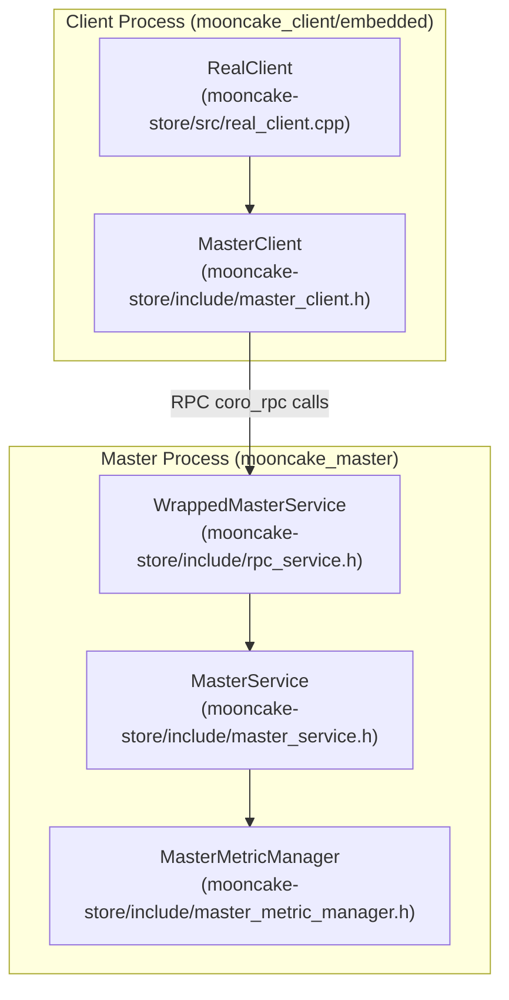
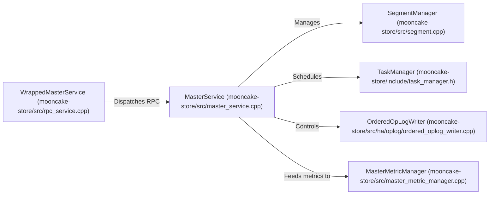
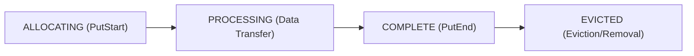
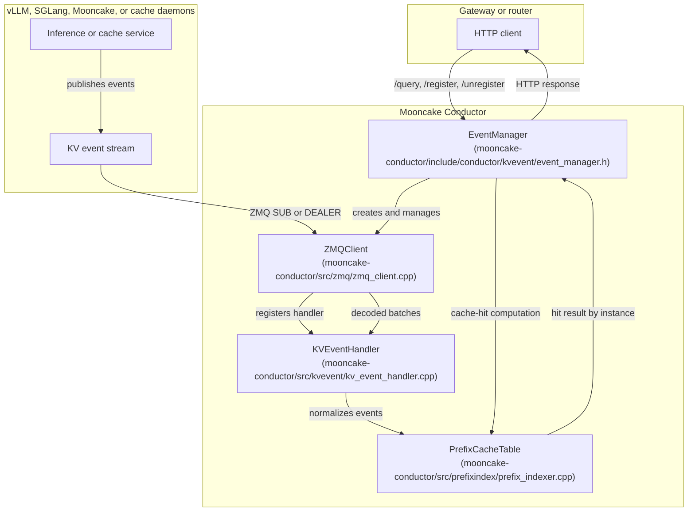

<!-- source: DeepWiki mcp.deepwiki.com · repo kvcache-ai/Mooncake · page 5 Mooncake Store · fetched 2026-10-21 -->

# Mooncake Store

Relevant source files

The following files were used as context for generating this wiki page:

- [docs/source/design/conductor/conductor-architecture-design.md](docs/source/design/conductor/conductor-architecture-design.md)
- [docs/source/design/store/metadata-management.md](docs/source/design/store/metadata-management.md)
- [docs/source/design/store/mooncake-store.md](docs/source/design/store/mooncake-store.md)
- [mooncake-conductor/include/conductor/kvevent/config.h](mooncake-conductor/include/conductor/kvevent/config.h)
- [mooncake-conductor/include/conductor/kvevent/event_manager.h](mooncake-conductor/include/conductor/kvevent/event_manager.h)
- [mooncake-conductor/include/conductor/prefixindex/prefix_indexer.h](mooncake-conductor/include/conductor/prefixindex/prefix_indexer.h)
- [mooncake-conductor/src/kvevent/config.cpp](mooncake-conductor/src/kvevent/config.cpp)
- [mooncake-conductor/src/kvevent/event_manager.cpp](mooncake-conductor/src/kvevent/event_manager.cpp)
- [mooncake-conductor/src/main.cpp](mooncake-conductor/src/main.cpp)
- [mooncake-conductor/src/prefixindex/prefix_indexer.cpp](mooncake-conductor/src/prefixindex/prefix_indexer.cpp)
- [mooncake-conductor/tests/prefix_indexer_test.cpp](mooncake-conductor/tests/prefix_indexer_test.cpp)
- [mooncake-conductor/tests/prefix_indexer_test_peer.h](mooncake-conductor/tests/prefix_indexer_test_peer.h)

## Purpose and Scope

Mooncake Store is a high-performance distributed key-value (KV) cache storage engine specifically designed for large language model (LLM) inference workloads. It delivers sub-millisecond metadata operations, zero-copy data transfers powered by the Transfer Engine, and supports a multi-tier storage hierarchy that spans DRAM, GPU VRAM, CXL memory, and local or distributed SSDs. Multi-tenancy and quota management are integral to its design, ensuring fair resource sharing across users.

This page serves as a parent documentation hub, providing a broad overview of Mooncake Store's architecture and component ecosystem. Detailed technical explanations and implementation specifics are available in the linked child pages.

Sources: [docs/source/design/store/mooncake-store.md:1-51](), [mooncake-store/include/master_config.h:95-185](), [mooncake-store/include/types.h:134-152]()

---

## 5.1 Architecture Overview

Mooncake Store utilizes a distributed master-client architecture optimized for elastic scaling and heterogeneous storage hardware [docs/source/design/store/mooncake-store.md:22-51](). The two primary components are:

- **Master Service**: A central metadata coordinator orchestrating cluster state, metadata shards, object lifecycle, memory segments, and client membership. It runs as an independent process exposing RPC services. It does not include the metadata service required by the Transfer Engine (such as etcd or Redis), which must be provisioned separately.

- **Client Nodes**: Each client both serves as a requestor (issuing Put, Get, Remove operations) and a storage node by contributing memory or disk segments back to the distributed cache pool. Data transfers bypass the master and occur peer-to-peer between clients using zero-copy RDMA and related hardware capabilities. The client can be configured in:
  - **Pure Client Mode** (no allocated memory segment contribution),
  - **Pure Server Mode** (no request operations),
  - or a combined mode embedding both functionalities.

Three client usage modes are supported:
1. Embedded clients co-located in the inference process.
2. Dummy clients forwarding requests to a single “real” client per inference instance, permitting zero-copy IPC between them.
3. Standalone Mooncake Store services running as dedicated resource-owning store nodes.

Two master deployment modes exist:
- **Default mode**: a single master node (simple but single point of failure).
- **High availability mode**: a multi-master cluster using etcd for leader election and failover.

Client health and membership are continuously monitored via heartbeat pings.

**Mooncake Store System Overview & Code Entity Mapping**

Sources: [docs/source/design/store/mooncake-store.md:22-51](), [mooncake-store/include/master_service.h:127-148](), [mooncake-store/include/rpc_service.h:22-23](), [mooncake-store/include/master_client.h:98-109]()

For detailed architectural explanation including metadata sharding, storage tiers, and object lifecycle, see [Architecture Overview](#5.1).

---

## 5.2 Master Service

The Master Service is the authoritative control plane managing cluster state, metadata shards, resource allocation, and concurrency control [mooncake-store/src/master_service.cpp:1-182](). It partitions metadata into 1024 shards, each with its own shared mutex to enable concurrent read/write operations on object metadata [docs/source/design/store/metadata-management.md:10-141]().

Background threads perform tasks such as memory eviction, snapshot creation, high availability leader election coordination (using etcd), and asynchronous task scheduling, including replication and promotion.

**Master Service Internal Structure and Interactions**

Sources: [mooncake-store/include/master_service.h:30-31](), [mooncake-store/src/master_service.cpp:30-52](), [mooncake-store/src/rpc_service.cpp:79-83](), [mooncake-store/include/task_manager.h:1-10](), [mooncake-store/src/master_metric_manager.cpp:19-20]()

For full details about metadata shards, locking, concurrency, snapshot subsystem, and admin controls, see [Master Service](#5.2).

---

## 5.3 Client Operations

Clients implement both request issuance and resource serving. The core implementation is the `RealClient` class, which manages local memory segments, buffer lifecycle, and data transfers using zero-copy RDMA facilitated by the Transfer Engine. The `MasterClient` provides RPC communication to the master [mooncake-store/include/master_client.h:98-109]().

System supports dummy-real client pairing for multi-rank LLM inference, where dummy clients forward metadata operations via IPC to a single real client owning local resources. This design enables efficient zero-copy data paths without redundant copies.

Clients also handle connection pooling, request batching, and maintain hot caches for frequently accessed objects.

Sources: [mooncake-store/include/master_client.h:98-109](), [docs/source/design/store/mooncake-store.md:32-44]()

For full details on client initialization, RPC setup, IPC mechanisms, and buffer management, see [Client Operations](#5.3).

---

## 5.4 Object Lifecycle and State Management

Objects in Mooncake Store progress through a multi-stage lifecycle managed by metadata state machines to ensure strong consistency and safe concurrent access [mooncake-store/include/types.h:130-168]():

- `ALLOCATING`: Initial reservation of buffers and metadata insertion.
- `PROCESSING`: Client actively writing payload data.
- `COMPLETE`: Object fully written and readable; lease granted to protect from eviction.
- `EVICTED`: Object removed from cache memory.

Leases and soft pins regulate eviction eligibility preventing premature removal during ongoing reads. Metadata keys are tenant-scoped; optional grouping enables shared TTL semantics for related objects.

Sources: [mooncake-store/include/types.h:130-168]()

For in-depth details on lease management, soft pin semantics, object index/entry structures, and lifecycle transitions, see [Object Lifecycle and State Management](#5.4).

---

## 5.5 Memory Management and Eviction

Memory management relies on multiple buffer allocators including CacheLib and offset-based schemes. When memory usage crosses configured high-watermarks, eviction threads reclaim space by applying tenant-aware policies that respect soft pins and quotas [mooncake-store/tests/master_service_test.cpp:137-142]().

Eviction can also offload cold object data to SSD storage transparently, balancing cost and performance. Eviction statistics inform autoscaling, alerting, and capacity planning via monitoring subsystems.

Sources: [mooncake-store/tests/master_service_test.cpp:137-142]()

For allocator designs, eviction policies, offload mechanisms, and threading model, see [Memory Management and Eviction](#5.5).

---

## 5.6 Segment Management

Segments are the fundamental units of physical storage contributed by clients, spanning DRAM, GPU VRAM, CXL memory, and filesystems [docs/source/design/store/mooncake-store.md:28-31](), [mooncake-store/tests/master_service_test.cpp:178-183]().

Segment mounting/unmounting is orchestrated by the master via RPC calls. Placement policies consider NUMA affinity, device locality, and capacity to optimize throughput and resource utilization.

Region drivers and placement indexes provide efficient mapping from logical object offsets to physical memory regions.

Sources: [docs/source/design/store/mooncake-store.md:28-31](), [mooncake-store/tests/master_service_test.cpp:178-183]()

For detailed segment types, allocation strategies, NUMA-aware placement, and lifecycle operations, see [Segment Management](#5.6).

---

## 5.7 Replication and Async Tasks

Replication and asynchronous maintenance tasks are managed by the `TaskManager` subsystem, which tracks task queues, worker thread pools, and lifecycle states [mooncake-store/include/task_manager.h:1-10]().

Tasks encompass copy and move operations (CopyStart/End, MoveStart/End) to implement replica consistency and hotspot mitigation. Cleanup threads handle retired replicas and orphaned tasks.

Sources: [mooncake-store/include/task_manager.h:1-10]()

For replication APIs, worker management, and async lifecycle orchestration, see [Replication and Async Tasks](#5.7).

---

## 5.8 Transfer Task System

`TransferSubmitter` module selects and executes data movement strategies including local memcpy, Transfer Engine zero-copy RDMA, file system reads, or SPDK-based NVMe-oF reads [mooncake-store/src/master_service.cpp:135-147]().

It manages transfer states, operation completion, error recovery, and integrates tightly with the Transfer Engine to maximize bandwidth utilization while minimizing CPU overhead.

Sources: [mooncake-store/src/master_service.cpp:135-147]()

For details of transfer execution paths, state machines, and Transfer Engine integration, see [Transfer Task System](#5.8).

---

## 5.9 Types and Error Handling

Mooncake Store defines core types foundational for storage operations such as `ObjectKey`, `Version`, `Segment`, `Slice`, and `ObjectDataType` [mooncake-store/include/types.h:20-160]().

It implements robust error taxonomy covering storage, network, and protocol layer errors. Sequence IDs are handled with wrap-around safe comparisons. Cluster and tenant ID validations prevent keyspace corruption.

Sources: [mooncake-store/include/types.h:20-160]()

For comprehensive type definitions and error code taxonomy, see [Types and Error Handling](#5.9).

---

## 5.10 RPC Communication

RPC operations are implemented using `coro_rpc` for asynchronous, coroutine-based RPCs. `WrappedMasterService` wraps the master logic to serve RPC requests. `MasterClient` manages client-side RPC connections and retries with connection pools [mooncake-store/include/master_client.h:98-109](), [mooncake-store/src/rpc_service.cpp:79-83]().

The master exposes HTTP endpoints for health checks and Prometheus metrics. Timeouts, thread pool sizing, and connection options can be configured.

Sources: [mooncake-store/include/master_client.h:98-109](), [mooncake-store/src/rpc_service.cpp:79-83]()

For involved details on RPC architecture, endpoint implementations, and diagnostics, see [RPC Communication](#5.10).

---

## 5.11 High Availability

High availability is implemented via an etcd-backed leader election coordinated by `MasterServiceSupervisor`. Hot-standby replication of operation logs (oplogs), metadata snapshot persistence, and client reconnection logic ensure continuity [mooncake-store/src/master_service.cpp:44-52]().

Failover involves election, checkpoint synchronization, and validation before a node assumes leadership. This prevents serving stale or partial metadata.

Sources: [mooncake-store/src/master_service.cpp:44-52]()

For complete HA design, failover procedures, and snapshot management, see [High Availability](#5.11).

---

## 5.12 Client Monitoring and Lifecycle

Clients report liveness via heartbeats monitored by the master. The `ResourceTracker` singleton manages resource lifecycle on the client, supporting graceful shutdown, signal handling, and cleanup routines [mooncake-store/include/client_liveness.h:1-10]().

The client ping thread detects failures timely to trigger eviction or resource recovery actions in the master.

Sources: [mooncake-store/include/client_liveness.h:1-10]()

For client TTL monitoring, signal handling, and lifecycle management, see [Client Monitoring and Lifecycle](#5.12).

---

## 5.13 Metrics and Monitoring

Metrics are collected cluster-wide by `MasterMetricManager`, encompassing memory usage, object operations, transfer statistics, latencies, and snapshot durations. Metrics are exposed via Prometheus-compatible HTTP endpoints and visualized using Grafana dashboards located in the monitoring directory [mooncake-store/include/master_metric_manager.h:24-25](), [mooncake-store/src/master_metric_manager.cpp:23-105]().

This observability stack enables capacity planning, alerting, and troubleshooting.

Sources: [mooncake-store/include/master_metric_manager.h:24-25](), [mooncake-store/src/master_metric_manager.cpp:23-105]()

For schema, instrumentation details, and dashboard configuration, see [Metrics and Monitoring](#5.13).

---

## 5.14 Storage Backend and Disk Offloading

Persistent storage backends abstract local files, cloud storage (S3/OSS), distributed filesystems (DFS), and NVMe-oF targets [mooncake-store/src/master_service.cpp:57-59]().

Eviction-to-disk workflows transparently migrate cold objects from DRAM to SSD or other storage media. The `uring_file` async I/O subsystem facilitates high-performance background file operations with minimal impact on foreground usage.

Sources: [mooncake-store/src/master_service.cpp:57-59]()

For in-depth storage backend details, async I/O design, and disk offloading policies, see [Storage Backend and Disk Offloading](#5.14).

---

## 5.15 Conductor and KV Indexer

Mooncake Conductor is a tiered, prefix-based key-value indexer service that subscribes to KV event streams from inference engines and storage backends. It normalizes events, maintains a global prefix cache table, and provides low-latency HTTP query APIs optimized for cache-aware routing decisions [docs/source/design/conductor/conductor-architecture-design.md:5-44]().

This indexer supports dynamic service registration and cache locality computation, enabling routers to select the best caching node for a given request prefix.

**Conductor Architecture & Code Entity Relationships**

Sources: [docs/source/design/conductor/conductor-architecture-design.md:5-44](), [mooncake-conductor/include/conductor/kvevent/event_manager.h:39-147](), [mooncake-conductor/src/prefixindex/prefix_indexer.cpp:1-196]()

For complete indexer design, event handling, and inference integration, see [Conductor and KV Indexer](#5.15).

---

## 5.16 EngramStore Backend

EngramStore is a specialized embedding table backend integrated into Mooncake Store. It organizes per-head layouts, supports batched population/removal of embeddings, and enables efficient row-ID based lookups [mooncake-store/include/master_service.h:161-176]().

It exposes both C++ and Python APIs facilitating embedding caching aligned with LLM training and serving workflows.

Sources: [mooncake-store/include/master_service.h:161-176]()

For detailed EngramStore backend architecture and API usage, see [EngramStore Backend](#5.16).

---

## 5.17 Multi-Tenancy and KV Cache Isolation

Multi-tenancy enforcement is achieved using `TenantQuota` with per-tenant storage limits and usage accounting. This ensures that tenants cannot exhaust shared resources and supports fair eviction by enforcing tenant-aware watermarks [mooncake-store/include/master_service.h:149-159]().

Administrative APIs allow dynamic quota configuration. KV cache isolation policies govern how tenants share or partition the cache.

Sources: [mooncake-store/include/master_service.h:149-159]()

For quota mechanisms, isolation policy enforcement, and tenant-aware eviction, see [Multi-Tenancy and KV Cache Isolation](#5.17).

---

# Summary

Mooncake Store delivers an LLM-centric, scalable, and efficient distributed KV cache storage system featuring:

- A master service orchestrating metadata and resource allocation.
- Client nodes contributing heterogeneous storage tiers and enabling zero-copy RDMA transfers.
- Multi-layer storage, including DRAM, GPU, CXL, SSD, DFS.
- Strong consistency through leases and well-defined object lifecycle states.
- Robust multi-tenancy and fault tolerance with HA master clusters.
- Comprehensive metrics, monitoring, and RPC-based APIs.
- Integration with upstream conductors for cache-aware routing.

This parent page outlined key components, architectural patterns, and system interactions, guiding readers to child pages for thorough treatment of each subsystem.

Sources:  
[docs/source/design/store/mooncake-store.md](),  
[mooncake-store/include/master_service.h:1-160](),  
[mooncake-store/include/master_client.h:90-110](),  
[mooncake-store/include/master_config.h:90-185](),  
[mooncake-store/src/rpc_service.cpp:75-90](),  
[mooncake-store/include/task_manager.h:1-10](),  
[mooncake-store/src/master_service.cpp:1-182](),  
[mooncake-conductor/src/prefixindex/prefix_indexer.cpp:1-196](),  
[docs/source/design/conductor/conductor-architecture-design.md:5-44]()

---

