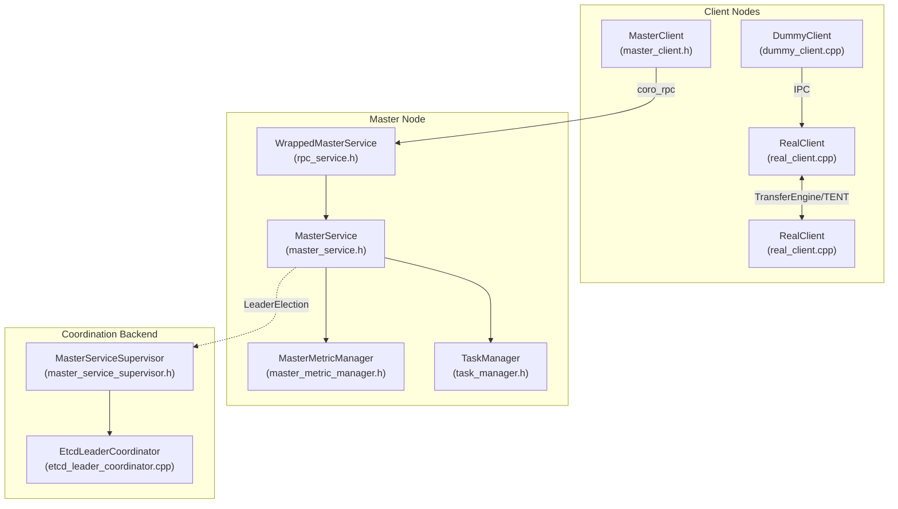
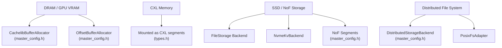
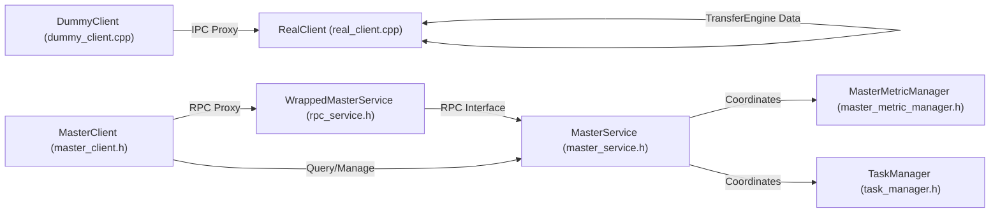

<!-- source: DeepWiki mcp.deepwiki.com · repo kvcache-ai/Mooncake · page 5.1 Architecture Overview · fetched 2026-10-21 -->

# Architecture Overview

<details>
<summary>Relevant source files</summary>

The following files were used as context for generating this wiki page:

- [docs/source/design/conductor/conductor-architecture-design.md](docs/source/design/conductor/conductor-architecture-design.md)
- [docs/source/design/store/metadata-management.md](docs/source/design/store/metadata-management.md)
- [docs/source/design/store/mooncake-store.md](docs/source/design/store/mooncake-store.md)
- [mooncake-conductor/include/conductor/kvevent/config.h](mooncake-conductor/include/conductor/kvevent/config.h)
- [mooncake-conductor/include/conductor/kvevent/event_manager.h](mooncake-conductor/include/conductor/kvevent/event_manager.h)
- [mooncake-conductor/include/conductor/prefixindex/prefix_indexer.h](mooncake-conductor/include/conductor/prefixindex/prefix_indexer.h)
- [mooncake-conductor/src/kvevent/config.cpp](mooncake-conductor/src/kvevent/config.cpp)
- [mooncake-conductor/src/kvevent/event_manager.cpp](mooncake-conductor/src/kvevent/event_manager.cpp)
- [mooncake-conductor/src/main.cpp](mooncake-conductor/src/main.cpp)
- [mooncake-conductor/src/prefixindex/prefix_indexer.cpp](mooncake-conductor/src/prefixindex/prefix_indexer.cpp)
- [mooncake-conductor/tests/prefix_indexer_test.cpp](mooncake-conductor/tests/prefix_indexer_test.cpp)
- [mooncake-conductor/tests/prefix_indexer_test_peer.h](mooncake-conductor/tests/prefix_indexer_test_peer.h)
- [mooncake-store/include/master_client.h](mooncake-store/include/master_client.h)
- [mooncake-store/include/master_metric_manager.h](mooncake-store/include/master_metric_manager.h)
- [mooncake-store/include/master_service.h](mooncake-store/include/master_service.h)
- [mooncake-store/include/rpc_service.h](mooncake-store/include/rpc_service.h)
- [mooncake-store/src/master_client.cpp](mooncake-store/src/master_client.cpp)
- [mooncake-store/src/master_metric_manager.cpp](mooncake-store/src/master_metric_manager.cpp)
- [mooncake-store/src/master_service.cpp](mooncake-store/src/master_service.cpp)
- [mooncake-store/src/rpc_service.cpp](mooncake-store/src/rpc_service.cpp)
- [mooncake-store/tests/master_metrics_test.cpp](mooncake-store/tests/master_metrics_test.cpp)
- [mooncake-store/tests/master_service_test.cpp](mooncake-store/tests/master_service_test.cpp)

</details>


## Purpose and Scope

This document details the distributed architecture of **Mooncake Store**, the distributed object storage subsystem of the Mooncake platform. Mooncake Store acts as a highly scalable and performant distributed key-value cache storage engine tailored to meet the demanding requirements of large language model (LLM) inference workloads. It exposes semantics and features specialized for KVCache disaggregation, including fine-grained replica management, hierarchical storage tiers, multi-tenant quota enforcement, and robust object lifecycle handling.

Mooncake Store is architected as a master-client system with metadata sharding, strong consistency guarantees across replicas, and decoupled data paths that leverage the Transfer Engine for efficient zero-copy peer-to-peer transfers. This page covers the overall architecture, metadata sharding mechanism, storage tiers, and object lifecycle with implementation details and data flow insights from key classes and modules.

Sources: [docs/source/design/store/mooncake-store.md:5-12]()

---

## Master-Client Architecture and Metadata Sharding

Mooncake Store is organized with a **centralized Master Service** managing cluster-wide metadata and control, and multiple **Clients** that serve as the distributed storage nodes exposing memory, SSD, and persistent segments.

### Master Service

The `MasterService` orchestrates the logical storage space pool cluster-wide, managing client registration, object key metadata, tenant quota policy enforcement, and segment lifecycle. It partitions its in-memory metadata into multiple **metadata shards** (the `metadata_shards_` array), each independently locked to enable high-concurrency concurrent access and updates. This sharding minimizes contention and allows parallel management of millions of cached objects.

The `MasterService` exposes a rich set of RPC APIs (via the `WrappedMasterService` facade) to clients for operations like object allocation start/end (`PutStart`/`PutEnd`), existence checks, replica listings, segment registration (`MountSegment`), and replica revocations.

### Clients

- **RealClient**: The store node process managing local memory segments (DRAM, GPU VRAM, SSD partitions) and serving as the data plane endpoint. RealClients host physical buffer segments backed by allocators such as CacheLib or OffsetAllocator. They process client requests by interacting with the metadata master for control and with peer clients for object data transfer.

- **DummyClient**: Lightweight proxies typically embedded within LLM inference ranks acting as local RPC forwarders to the corresponding RealClient. They do not own resources but forward operations efficiently using IPC shared memory and zero-copy semantics.

### Communication Flow

Clients communicate with the master service asynchronously using the `WrappedMasterService` interface, which implements coroutine-based RPC calls. Actual data payload transfers between clients bypass the master entirely and are performed peer-to-peer leveraging the Transfer Engine/NEXT (TENT) framework for high throughput and zero-copy semantics.

### Concurrency and Locking

Metadata shards are guarded by mutexes following a strict lock order to prevent deadlocks, spanning client management locks, quota policies, snapshotting locks, and per-shard locks for consistent state transitions. Batch background maintenance tasks such as eviction, handle cleanup of stale leases (`ClearStaleHandles`), and snapshot persistence operate across shards respecting these locks.

---

### Architecture Diagram: Master-Client Metadata and Control Flow



**Key Components:**

- `MasterService` [mooncake-store/include/master_service.h:127-185]()  
  Metadata shard management, object allocation, segment mount/unmount, tenant quotas, lease management, background eviction, snapshot coordination, and admin controls.

- `WrappedMasterService` [moonake-store/include/rpc_service.h:22-231]()  
  RPC facade implementing master APIs with tenant-aware dispatch and concurrency safety.

- `MasterClient` [mooncake-store/include/master_client.h:96-185]()  
  Client-side RPC proxy managing connection pools and asynchronous calls to master nodes.

- `RealClient` / `DummyClient`  
  Client data plane actors managing local memory and forwarding requests respectively.

- `MasterMetricManager` [mooncake-store/include/master_metric_manager.h:21-167]()  
  Centralized metrics collection and reporting for clients, operations, caches, and segments.

- `TaskManager`  
  Background asynchronous task worker pools for replication, cleaning, and maintenance.

- `MasterServiceSupervisor` / `EtcdLeaderCoordinator`  
  High-availability controller and leader election backend.

Sources: [docs/source/design/store/mooncake-store.md:25-44](), [mooncake-store/include/master_service.h:127-185](), [mooncake-store/include/rpc_service.h:22-231](), [mooncake-store/include/master_client.h:96-185](), [mooncake-store/include/master_metric_manager.h:21-167](), [mooncake-store/src/ha/leadership/master_service_supervisor.cpp:1-2]()

---

## Storage Tiers and Segment Management

Mooncake Store organizes its physical storage into multiple **storage tiers** that reflect distinct hardware capabilities and characteristics to optimize cost, capacity, and performance for KVCache workloads.

| Tier              | Backend / Implementation             | Description                                                   |
|-------------------|------------------------------------|---------------------------------------------------------------|
| **DRAM / GPU VRAM**| `CachelibBufferAllocator`, `OffsetBufferAllocator` | Primary in-memory cache tier for low-latency access [master_config.h:137-138]() |
| **CXL Memory**     | CXL-backed segments configured via env vars [types.h:114-116]() | High-capacity byte-addressable memory expansion               |
| **SSD / NoF**      | `FileStorage`, `NvmeKvBackend`, NoF segments | Persistent cache offload and checkpoint backing               |
| **Distributed FS** | `DistributedStorageBackend`, `PosixFsAdapter` | Multi-node shared persistent storage for checkpoints          |

Each client node **mounts segments** representing contiguous memory blocks or SSD filesystems. Segment registration occurs through `MountSegment` and related APIs on the `MasterService`, which tracks segment capacity, usage, and associates them with clients.

Metrics on segment usage (allocated vs total capacity) are reported by `MasterMetricManager` at both global and per-segment granularity to monitor cluster health and workload pressure.

Buffer allocators on clients manage these segments using appropriate strategies (NUMA-aware allocation, eviction overflows, etc.), and the slices of KVCache objects are balanced across multiple segments to increase parallelism and reduce hotspotting.

---

### Storage Tier to Segment Implementation Mapping Diagram



Sources: [mooncake-store/include/master_config.h:137-138](), [mooncake-store/include/types.h:114-116](), [docs/source/deployment/mooncake-store-deployment-guide.md:120]()

---

## Object Lifecycle and State Management

Mooncake Store organizes objects in a **well-defined lifecycle state machine**, ensuring rigorous consistency, concurrency safety, and proper release of resources across complex store operations.

### Object Lifecycle State Diagram

```mermaid
stateDiagram-v2
    [*] --> ALLOCATING : "WrappedMasterService::PutStart()"
    ALLOCATING --> PROCESSING : "Replica allocation succeeded"
    PROCESSING --> COMPLETE : "WrappedMasterService::PutEnd()"
    PROCESSING --> FAILED : "PutRevoke() or Timeout"
    COMPLETE --> EVICTED : "BatchEvict() or Watermark exceeded"
    EVICTED --> COMPLETE : "Promotion on Cache Hit"
    COMPLETE --> [*] : "WrappedMasterService::Remove()"
```

### State Descriptions

- **ALLOCATING**  
  Initiated by `PutStart` RPC. The master attempts to allocate replicas per the requested replication config and tenant quota. If allocation partially succeeds (e.g., best effort in memory-only configs), this is logged and exposed via metrics.

- **PROCESSING**  
  Replica handles allocated, client transfers data to the allocated replicas asynchronously via the Transfer Engine. `PutEnd` finalizes the state; failure or explicit revocation transitions to `FAILED`.

- **COMPLETE**  
  Object is fully committed and immutable. Clients may read or cache objects in this state. Access renews leases to prevent eviction.

- **EVICTED**  
  Object is evicted to release memory pressure. It can be promoted back on access if still valid.

- **FAILED**  
  Put operation failed; resources and replicas are cleaned up.

---

### Leases and Soft Pins

Mooncake Store maintains **leases** on objects, with short TTL (default 10 seconds) to prevent premature eviction of actively used keys. Lease renewal happens transparently via client heartbeats or Get calls preserving object residency.

**Soft pins** provide longer duration retention for objects needing extended caching, coordinated with tenant quota accounting to allow fair sharing of resources among tenants.

---

### Multi-Tenant Quota Enforcement

Tenant quotas are enforced at the MasterService level by tracking allocation across all tenants in a cluster-wide ledger. Attempted allocations that would breach the quota are rejected early. This prevents noisy neighbors and supports isolation of inference workloads.

Quota snapshots and policies can be updated dynamically, with metrics exposed for tenant-level usage.

Sources: [mooncake-store/include/types.h:86-89](), [mooncake-store/include/replica.h:63-68](), [mooncake-store/include/master_config.h:161-163]()

---

## Data Flow: Put and Get Operations

### Put (Write) Flow

1. The client invokes `PutStart` RPC via `WrappedMasterService`, specifying the object key, slice length, and replication policy.

2. `MasterService` checks tenant quota, allocates replicas across client segments, and returns replica descriptors including memory or NoF segment locations.

3. Client streams data **directly** to replicas using the Transfer Engine (e.g. RDMA-based zero-copy transfers). The transfer engine avoids CPU copies and maximizes memory bandwidth usage.

4. On successful data transfer, the client calls `PutEnd` to mark object as **COMPLETE** and ready for other clients to read.

Failure or timeouts trigger `PutRevoke` to clean partially allocated replicas.

### Get (Read) Flow

1. Client calls `GetReplicaList` RPC on `WrappedMasterService` to retrieve active replica descriptors for the requested key.

2. Client initiates zero-copy, high-throughput peer-to-peer data transfers from replica-holding clients directly using the Transfer Engine transport protocols.

3. Lease tokens are renewed implicitly to keep replicas pinned during active usage.

This design fully bypasses the master service for data payloads, thereby maximizing throughput and minimizing latency.

Sources: [docs/source/design/store/mooncake-store.md:16]()

---

# Architecture to Code Mapping Diagram: System to Key Classes



---

# Summary

Mooncake Store is a distributed KV cache storage system designed for high scale and low latency suitable for large language model inference. It splits control and data planes into a master service managing sharded, concurrent metadata state and client nodes hosting segmented multi-tier storage resources. Clients communicate asynchronously via RPC with the master and perform zero-copy peer-to-peer transfers for payload data using the Transfer Engine.

Key architectural features include:

- Sharded master metadata for scalable cluster-wide consistency and tenant quota enforcement.
- Multi-tier storage supporting DRAM, GPU VRAM, CXL memory, SSD/NoF offload, and distributed filesystem backends.
- Fine-grained object lifecycle state machine governing replica allocation, data transfer, promotion, eviction, and removal.
- Lease and soft pin tokens to enable safe eviction and resource reclaim for long-running inference pipelines.
- RPC facades for client-master interaction, master metric reporting, and background asynchronous control tasks.
- Designed for high availability with leader election via etcd and background supervisor control.

This architecture forms the backbone enabling Mooncake's high-performance KVCache disaggregation service for large distributed LLM deployments.

---

# References

- `MasterService` core metadata manager: [mooncake-store/include/master_service.h:127-185]()  
- `WrappedMasterService` RPC facade: [mooncake-store/include/rpc_service.h:22-231]()  
- `MasterClient` RPC client: [mooncake-store/include/master_client.h:96-185]()  
- `MasterMetricManager` metrics collector: [mooncake-store/include/master_metric_manager.h:21-167]()  
- Documentation overview: [docs/source/design/store/mooncake-store.md:5-44]()  
- Storage tiers in master config: [mooncake-store/include/master_config.h:137-138](), [mooncake-store/include/types.h:114-116]()  
- Object and lease handling: [mooncake-store/include/types.h:86-89](), [mooncake-store/include/replica.h:63-68]()  
- Transfer Engine data flow references: [docs/source/design/store/mooncake-store.md:16]()  
- High availability coordination: [mooncake-store/src/ha/leadership/master_service_supervisor.cpp:1-2]()  

**Sources:**
[docs/source/design/store/mooncake-store.md:5-44](),
[mooncake-store/include/master_service.h:127-185](),
[mooncake-store/include/rpc_service.h:22-231](),
[mooncake-store/include/master_client.h:96-185](),
[mooncake-store/include/master_metric_manager.h:21-167](),
[mooncake-store/include/master_config.h:137-138](),
[mooncake-store/include/types.h:114-116](),
[mooncake-store/include/types.h:86-89](),
[mooncake-store/include/replica.h:63-68](),
[docs/source/design/store/mooncake-store.md:16](),
[mooncake-store/include/master_config.h:161-163](),
[mooncake-store/include/replica.h:185-191](),
[mooncake-store/src/ha/leadership/master_service_supervisor.cpp:1-2]()

---

