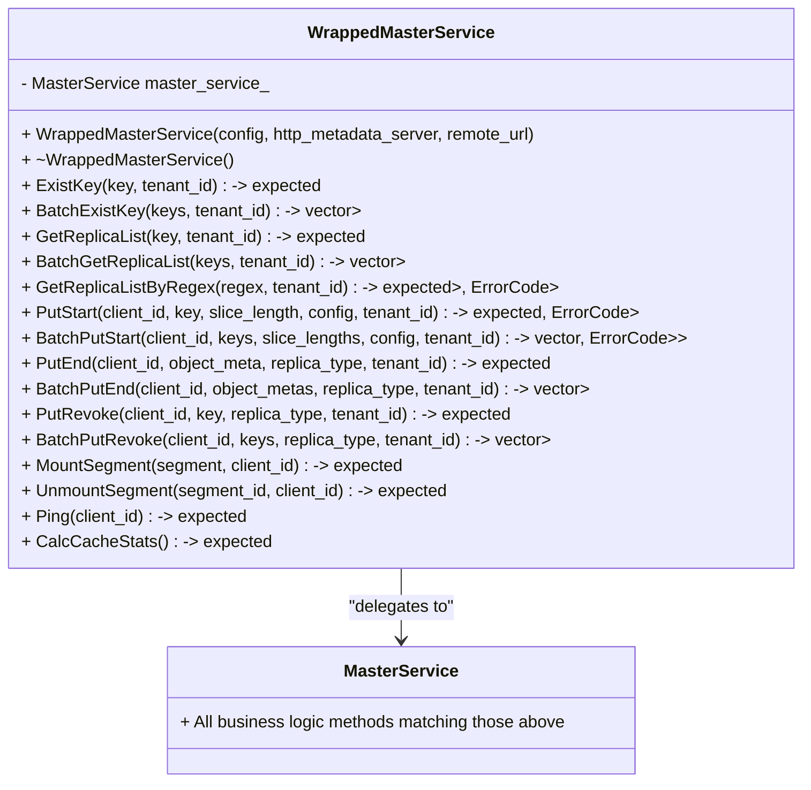
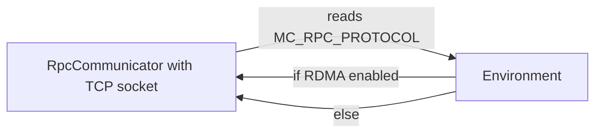
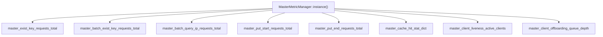

<!-- source: DeepWiki mcp.deepwiki.com · repo kvcache-ai/Mooncake · page 5.10 RPC Communication · fetched 2026-10-21 -->

# RPC Communication

<details>
<summary>Relevant source files</summary>

The following files were used as context for generating this wiki page:

- [mooncake-common/include/rpc_client_io_context.h](mooncake-common/include/rpc_client_io_context.h)
- [mooncake-common/src/CMakeLists.txt](mooncake-common/src/CMakeLists.txt)
- [mooncake-common/src/rpc_client_io_context.cpp](mooncake-common/src/rpc_client_io_context.cpp)
- [mooncake-common/tests/rpc_client_io_threads_test.cpp](mooncake-common/tests/rpc_client_io_threads_test.cpp)
- [mooncake-store/include/master_client.h](mooncake-store/include/master_client.h)
- [mooncake-store/include/master_metric_manager.h](mooncake-store/include/master_metric_manager.h)
- [mooncake-store/include/master_service.h](mooncake-store/include/master_service.h)
- [mooncake-store/include/rpc_service.h](mooncake-store/include/rpc_service.h)
- [mooncake-store/include/store_rpc_client_io_context.h](mooncake-store/include/store_rpc_client_io_context.h)
- [mooncake-store/src/master_client.cpp](mooncake-store/src/master_client.cpp)
- [mooncake-store/src/master_metric_manager.cpp](mooncake-store/src/master_metric_manager.cpp)
- [mooncake-store/src/master_service.cpp](mooncake-store/src/master_service.cpp)
- [mooncake-store/src/rpc_service.cpp](mooncake-store/src/rpc_service.cpp)
- [mooncake-store/tests/master_metrics_test.cpp](mooncake-store/tests/master_metrics_test.cpp)
- [mooncake-store/tests/master_service_test.cpp](mooncake-store/tests/master_service_test.cpp)
- [mooncake-store/tests/non_ha_reconnect_test.cpp](mooncake-store/tests/non_ha_reconnect_test.cpp)
- [mooncake-store/tests/test_server_helpers.h](mooncake-store/tests/test_server_helpers.h)
- [mooncake-transfer-engine/include/transfer_engine_rpc_client_io_context.h](mooncake-transfer-engine/include/transfer_engine_rpc_client_io_context.h)
- [mooncake-transfer-engine/src/transport/rpc_communicator/rpc_communicator.cpp](mooncake-transfer-engine/src/transport/rpc_communicator/rpc_communicator.cpp)

</details>


## Purpose and Scope

This page documents the RPC (Remote Procedure Call) architecture of the Mooncake Store. It describes how the core master service logic is exposed via RPC using the `WrappedMasterService` class and how clients interact with the master asynchronously via the `MasterClient`. It covers the internal design for connection pooling, timeout management, coroutine-based RPC calls (using **coro_rpc**), metrics collection, error handling, and HTTP endpoints for metrics and health checks.

For detailed information on the master service internals, refer to [Master Service](). For client lifecycle and operations, see [Client Operations](). For RPC type definitions and error codes, see [Types and Error Handling]().

Sources: [mooncake-store/include/rpc_service.h:8](), [mooncake-store/include/master_client.h:89](), [mooncake-store/src/rpc_service.cpp:3-178]()

---

## Architecture Overview

The Mooncake Store leverages the **yalantinglibs coro_rpc** coroutine-based RPC framework to enable asynchronous, high-throughput communication with the master service. The RPC functionality is split primarily between three layers:

- **MasterService**: Implements the core business logic and metadata management.
- **WrappedMasterService**: Serves as the RPC interface exposing MasterService methods, adding instrumentation, tenant resolution, and error handling.
- **MasterClient**: Client-side stub to invoke RPC calls asynchronously, managing connection pools and protocol configuration.

### High-Level Communication Flow

```mermaid
graph TB
    subgraph "MasterServiceLayer"
        MS[MasterService]
        WMS[WrappedMasterService]
        WMS -->|calls| MS
    end

    subgraph "ClientLayer"
        MC[MasterClient]
        MC -->|RPC calls| WMS
    end

    subgraph "ConnectionPooling"
        CP[RpcClientPool] 
        MC --> CP
        CP -.manages.->|connections| WMS
    end

    subgraph "TransportProtocols"
        TCP[TCP]
        RDMA[RDMA]
        CP -.selects.-> TCP
        CP -.selects.-> RDMA
    end
```

This architecture enables scalable master coordination and supports multiple transport protocols seamlessly.

Sources: [mooncake-store/include/master_client.h:66-90](), [mooncake-store/include/rpc_service.h:22-162]()

---

## WrappedMasterService: RPC Server Interface

The `WrappedMasterService` class exposes the functionality of the core `MasterService` over RPC. It handles tenant-specific resolution, logging, metrics, and error translation. It also integrates with an internal HTTP metadata server instance or a remote URL for metadata cleanup triggered on client timeout.

### Key Characteristics

- Wraps an instance of `MasterService`.
- Exposes RPC methods for:
  - Key existence checks (`ExistKey`, `BatchExistKey`).
  - Replica management (`GetReplicaList`, `BatchGetReplicaList`, `GetReplicaListByRegex`).
  - Object write coordination (`PutStart`, `PutEnd`, `PutRevoke`, batch variants).
  - Segment registration/deregistration (`MountSegment`, `UnmountSegment`, etc.).
  - High Availability related queries (`Ping`, `BatchQueryIp`).
  - Cache statistics (`CalcCacheStats`).
- Uses helper functions such as `WithRequestTenant` and `WithWriteTenant` to resolve tenant IDs safely for multi-tenant usage.
- Uses macros/functions like `execute_rpc` for standardized request telemetry, request logging, and error metrics.
- Optionally tied to an in-process or remote HTTP metadata server for client metadata cleanup, configurable via constructor parameters.

The `WrappedMasterService` thus acts as a robust facade layering multi-tenant logic, observability, and error mapping on top of `MasterService`.

### WrappedMasterService Class Structure



Sources: [mooncake-store/include/rpc_service.h:22-162](), [mooncake-store/src/rpc_service.cpp:44-150](), [mooncake-store/include/master_service.h:127-185]()

---

## MasterClient: RPC Client Interface

`MasterClient` is the client API for communicating with the Mooncake master RPC server. It maintains connection pools and handles all client-side RPC invocations asynchronously, supporting both TCP and RDMA transports depending on environment configurations.

### Features

- Internally maintains multiple `RpcClientPool` instances:
  - `client_accessor_` for standard RPC calls.
  - `ha_control_client_accessor_` and `ha_probe_client_accessor_` specifically for High Availability (HA) control and probing.
- Uses `GetStoreRpcClientIoContextPool()` to acquire the IO context pool shared among clients.
- Automatically applies RPC timeouts and connection retry policies configurable via environment variables in `RpcTimeoutConfig`.
- Supports tenant-scoped requests with a specified tenant ID (default is `"default"`).
- Drains in-flight RPCs gracefully upon destruction to avoid connection resets at shutdown.
- Maps each RPC method pointer to a string name via `RpcNameTraits` template specializations for logging and metric collection.

### Connection Pool Configuration

The pool configuration is created by the helper function `MakeMasterRpcClientPoolConfig(bool ha_enabled)` which:

- Disables connection retries and sets aggressive 1-second connect timeout when HA is enabled, to avoid blocking failover.
- Enables RDMA socket configuration if RDMA is enabled in environment config.
- Applies request and connect timeout overrides from environment variables.

### Architecture Overview of MasterClient

```mermaid
graph TB
    subgraph "MasterClient Internals"
        MC[MasterClient]
        CP1[RpcClientPool client_accessor_]
        CP2[RpcClientPool ha_control_client_accessor_]
        CP3[RpcClientPool ha_probe_client_accessor_]
    end

    subgraph "Connection Config"
        CCFG[MakeMasterRpcClientPoolConfig()]
    end

    MC --> CP1
    MC --> CP2
    MC --> CP3
    CP1 -.uses.-> CCFG
    CP2 -.uses.-> CCFG
    CP3 -.uses.-> CCFG

    subgraph "RPC Calls"
        IR["invoke_rpc helper"]
        CR["coro_rpc_client instance"]
        IR --> CR -.network call.-> WMS["WrappedMasterService"]
    end

    MC --> IR
    IR --> CP1
    IR --> CR
```

### Example RPC Call Flow

When a client calls `ExistKey()`, it invokes a coroutine RPC client obtained from the pool, sends the request asynchronously to the master RPC server, awaits the response, and returns the result wrapped in `tl::expected`.

Sources: [mooncake-store/include/master_client.h:66-110](), [mooncake-store/src/master_client.cpp:20-133]()

---

## RPC Method Name Mapping

To facilitate consistent logging and metrics, `RpcNameTraits` template specializations map each `WrappedMasterService` RPC method pointer to a string literal name. This mapping is centralized in `mooncake-store/src/master_client.cpp` and enumerates all RPC methods such as:

```cpp
template <>
struct RpcNameTraits<&WrappedMasterService::ExistKey> {
    static constexpr const char* value = "ExistKey";
};
```

This enables generic instrumentation functions to identify RPC methods by name at compile time and to generate corresponding metric counters.

Sources: [mooncake-store/src/master_client.cpp:20-133]()

---

## Coroutine-Based RPC Using coro_rpc

Mooncake's RPC communication leverages **yalantinglibs coro_rpc**, a coroutine-based asynchronous RPC library. This provides:

- Lightweight coroutine scheduling and RPC dispatch.
- Connection pooling on the client side (`coro_io::client_pool`).
- Transport abstraction allowing transparent use of TCP or RDMA sockets.
- Integration with async/await style APIs in C++20.

In Mooncake, `MasterClient` uses `coro_rpc::client` instances obtained from the pool to asynchronously send requests to the `WrappedMasterService` endpoint, which runs atop a coroutine-enabled RPC server.

Sources: [mooncake-store/include/master_client.h:11-12](), [mooncake-transfer-engine/src/transport/rpc_communicator/rpc_communicator.cpp:8-9]()

---

## Transport Protocols Support

The RPC system supports multiple transport protocols, configurable via environment settings:

- **TCP Protocol**: The default and general-purpose transport used for all normal RPC operations.
- **RDMA Protocol**: Enabled conditionally via environment flag (`MC_RPC_PROTOCOL` or `RpcProtocolConfig`). RDMA reduces latency and CPU load in high-performance clusters.

The `RpcCommunicator` in the transfer engine transport layer detects and supports these protocols, configuring socket instances accordingly.



Sources: [mooncake-store/include/master_client.h:45-85](), [mooncake-transfer-engine/src/transport/rpc_communicator/rpc_communicator.cpp:61-62]()

---

## Connection Pooling and Timeouts

`MasterClient` manages connection pools (`RpcClientPool`) to efficiently reuse RPC client connections to master service endpoints:

- Pools maintain a configurable number of persistent connections.
- Manages per-request timeouts and connection timeouts with fine-grained controls.
- When HA is enabled, retries on connect are disabled to allow fast failover detection.
- Timeouts are configured according to `RpcTimeoutConfig` derived from environment variables for dynamic control.

This connection pooling reduces overhead, improves throughput, and ensures low-latency RPC communication essential for distributed coordination in Mooncake.

Sources: [mooncake-store/include/master_client.h:62-89]()

---

## HTTP Endpoints for Metrics and Health Checks

The master service (`WrappedMasterService`) integrates with an internal or external HTTP metadata server to provide:

- **/metrics**: Prometheus-format metrics describing master service state and operation counts.
- **/metrics/summary**: Aggregated health summary for TLDR-checks.
- **/health**: Health check endpoint reporting service availability status.
- Additional endpoints for tenant quota, HA state, leader status, segment discovery, and administrative operations.

The HTTP metadata server can be co-located inside the master process or accessed via a remote URL. It supports asynchronous metadata cleanup triggered on client disconnect or timeout, enhancing cluster reliability.

Sources: [mooncake-store/src/rpc_service.cpp:79-92](), [mooncake-store/src/master_service.cpp:32](), [mooncake-store/include/master_metric_manager.h:11-14]()

---

## Metrics Collection and Management

The RPC layer is instrumented extensively by the singleton `MasterMetricManager`, which tracks metrics including:

- Request and failure counts per RPC method (e.g., exist key requests, put start failures).
- Batch operation metrics including total items, failed items, and partial success counts.
- Cache hit/miss statistics categorized by memory and SSD tiers.
- Client liveness state transitions and offboarding job statistics.
- Detailed memory and storage allocation metrics (bytes allocated, total capacity).
- Histogram metrics for value size distribution.

Metrics are exposed via HTTP endpoints so they can be scraped by Prometheus and visualized in Grafana dashboards.

### Key Metrics Relation Diagram



Sources: [mooncake-store/src/master_metric_manager.cpp:1-140](), [mooncake-store/include/master_metric_manager.h:20-180](), [mooncake-store/src/rpc_service.cpp:105-162](), [mooncake-store/tests/master_metrics_test.cpp:66-146]()

---

# Summary

Mooncake's RPC communication subsystem is a robust, coroutine-based asynchronous framework layered on top of the core `MasterService` business logic. The `WrappedMasterService` class provides RPC endpoints augmented with tenant management and metrics. The `MasterClient` supports pooled connections over TCP or RDMA transports, with configurable timeouts and HA-aware policies. HTTP endpoints expose detailed operational metrics and health checks. This architecture supports the distributed and high-performance coordination demands of the Mooncake KVCache system.

---

# References and Sources

- [mooncake-store/include/rpc_service.h:8-162]()
- [mooncake-store/include/master_client.h:66-110]()
- [mooncake-store/src/rpc_service.cpp:3-178]()
- [mooncake-store/src/master_client.cpp:20-133]()
- [mooncake-store/include/master_service.h:125-185]()
- [mooncake-store/include/master_metric_manager.h:20-180]()
- [mooncake-store/src/master_metric_manager.cpp:1-140]()
- [mooncake-transfer-engine/src/transport/rpc_communicator/rpc_communicator.cpp:8-9]()
- [mooncake-store/src/master_service.cpp:32]()
- [mooncake-store/tests/master_metrics_test.cpp:66-146]()

---

