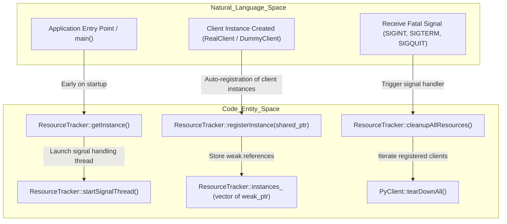
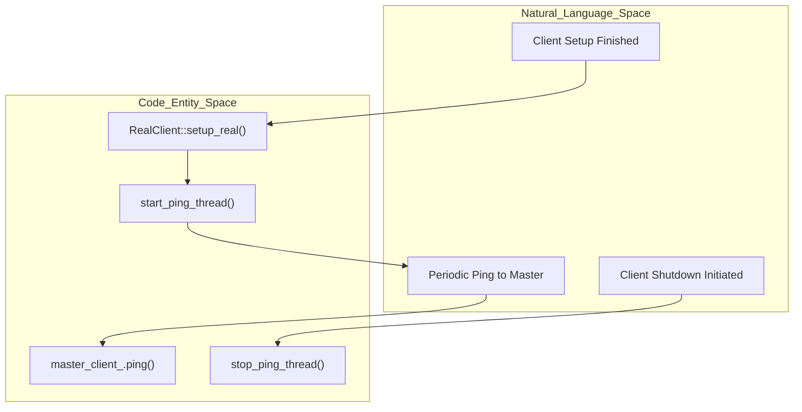

<!-- source: DeepWiki mcp.deepwiki.com · repo kvcache-ai/Mooncake · page 5.12 Client Monitoring and Lifecycle · fetched 2026-10-21 -->

# Client Monitoring and Lifecycle

<details>
<summary>Relevant source files</summary>

The following files were used as context for generating this wiki page:

- [docs/source/api-reference/python/mooncake-store.md](docs/source/api-reference/python/mooncake-store.md)
- [mooncake-integration/store/store_py.cpp](mooncake-integration/store/store_py.cpp)
- [mooncake-store/include/client_service.h](mooncake-store/include/client_service.h)
- [mooncake-store/include/dummy_client.h](mooncake-store/include/dummy_client.h)
- [mooncake-store/include/pyclient.h](mooncake-store/include/pyclient.h)
- [mooncake-store/include/real_client.h](mooncake-store/include/real_client.h)
- [mooncake-store/src/client_service.cpp](mooncake-store/src/client_service.cpp)
- [mooncake-store/src/dummy_client.cpp](mooncake-store/src/dummy_client.cpp)
- [mooncake-store/src/real_client.cpp](mooncake-store/src/real_client.cpp)
- [mooncake-store/src/real_client_main.cpp](mooncake-store/src/real_client_main.cpp)
- [mooncake-store/tests/e2e/CMakeLists.txt](mooncake-store/tests/e2e/CMakeLists.txt)
- [mooncake-store/tests/e2e/client_wrapper.cpp](mooncake-store/tests/e2e/client_wrapper.cpp)
- [mooncake-store/tests/e2e/client_wrapper.h](mooncake-store/tests/e2e/client_wrapper.h)
- [mooncake-store/tests/e2e/run_session_ranges_tcp_e2e.sh](mooncake-store/tests/e2e/run_session_ranges_tcp_e2e.sh)
- [mooncake-store/tests/e2e/session_ranges_tcp_e2e.py](mooncake-store/tests/e2e/session_ranges_tcp_e2e.py)
- [mooncake-store/tests/e2e/storage_backend_e2e_test.cpp](mooncake-store/tests/e2e/storage_backend_e2e_test.cpp)
- [mooncake-store/tests/pybind_client_test.cpp](mooncake-store/tests/pybind_client_test.cpp)
- [mooncake-store/tests/stress_workload_test.cpp](mooncake-store/tests/stress_workload_test.cpp)

</details>


## Purpose and Scope

This document elaborates on the client lifecycle management and monitoring mechanisms within Mooncake Store. It focuses on the implementation of client TTL monitoring, the global `ResourceTracker` singleton responsible for cleanup on abnormal termination, signal handling, and the dedicated ping thread that clients use to maintain heartbeats with the master service. Both `RealClient` and `DummyClient` implementations are covered, detailing how they maintain connection liveness and register for resource management.

Sources: [mooncake-store/include/pyclient.h:38-45](), [mooncake-store/include/real_client.h:42-77](), [mooncake-store/include/dummy_client.h:21-46](), [mooncake-store/src/real_client_main.cpp:114-121]()

---

## Client Lifecycle and Implementation Classes

Mooncake clients conform to the `PyClient` interface [mooncake-store/include/pyclient.h:14-17](), with primary implementations:

- **RealClient**: This is the full-featured client implementation managing local buffers, segment registration, communication with the master, and direct storage operations [mooncake-store/include/real_client.h:80-185]().

- **DummyClient**: Acts as a proxy client commonly used in subprocesses or workers, forwarding operations over IPC or RPC to a local `RealClient` process [mooncake-store/include/dummy_client.h:21-165]().

The client lifecycle is orchestrated through initialization, ongoing operation with master heartbeating, and cleanup phases. Clients start in an uninitialized state, perform setup (e.g., `RealClient::setup_real()` or `DummyClient::setup_dummy()`), register themselves with the singleton `ResourceTracker`, and launch a dedicated ping thread to keep their master TTL lease alive.

### Lifecycle State Machine

```mermaid
stateDiagram-v2
    direction TB
    Uninitialized["Uninitialized"] --> Initializing["Initializing: RealClient::setup_real() or DummyClient::setup_dummy()"]
    Initializing --> OperationalSetup["OperationalSetup: Register with ResourceTracker"]
    OperationalSetup --> OperationalPing["OperationalPing: Start Ping Thread & RPC Handlers"]
    OperationalPing --> Running["Running: HealthCheckStatus::HC_HEALTHY"]

    Running --> Running: "Periodic Ping (RealClient::ping)"
    Running --> Unhealthy["Unhealthy: HC_MASTER_UNREACHABLE"]
    Unhealthy --> Running: "Connection Restored"

    Running --> TearingDown["TearingDown: Signal / atexit triggered"]
    TearingDown --> Closed["Closed: Cleanup completed by ResourceTracker"]
    Closed --> [*]
```

Sources: [mooncake-store/include/pyclient.h:38-45](), [mooncake-store/include/real_client.h:80-100](), [mooncake-store/include/dummy_client.h:21-46](), [mooncake-store/src/real_client_main.cpp:114-121]()

---

## ResourceTracker and Signal Handling

The `ResourceTracker` is a singleton object central to client lifecycle management, ensuring that resource cleanup occurs during abnormal termination events or normal process shutdown.

### Overview

- **Singleton Pattern:** `ResourceTracker::getInstance()` provides access to the sole instance managing all tracked `PyClient` objects. It guarantees exactly one global tracker handling client resource cleanup [mooncake-store/include/real_client.h:43-58]().

- **Registration:** Clients register shared pointers to themselves through `registerInstance()` facilitating safe tracking without extending lifetimes unnecessarily by holding weak pointers internally [mooncake-store/include/real_client.h:49]().

- **Cleanup on Exit:** The tracker installs both OS signal handlers (for signals like `SIGINT`, `SIGTERM`, `SIGQUIT`) and an `atexit` hook, which triggers `cleanupAllResources()`. This function iterates over all weak pointers and calls the clients' `tearDownAll()` methods to clean resources [mooncake-store/include/real_client.h:60-67]().

- **Signal Handling Thread:** To handle signals asynchronously and outside the main thread context, a dedicated `std::jthread` is launched from `startSignalThread()`. This approach avoids blocking and missed signals by isolating signal processing to one thread. The `ResourceTracker` is instantiated very early in `main()` to apply the signal mask before other threads spawn, crucial for correct signal delivery [mooncake-store/include/real_client.h:74-77](), [mooncake-store/src/real_client_main.cpp:116-121]().

### Signal and Exit Handling Flow



Sources: [mooncake-store/include/real_client.h:42-77](), [mooncake-store/src/real_client_main.cpp:114-121]()

---

## Client Ping Thread and Master Heartbeating

To maintain client leases and inform the master service of liveness, clients run a ping thread responsible for periodic heartbeats.

### Mechanism

- **Ping Thread:** Upon successful client setup (e.g., `RealClient::setup_real()`), a dedicated ping thread is started. This thread periodically sends ping RPC calls to the master service to renew leases and indicate presence [mooncake-store/src/real_client_main.cpp:95](), [mooncake-store/include/real_client.h:80-100]().

- **RealClient Ping:** The ping method `RealClient::ping()` communicates directly with the master via RPC and updates internal health status accordingly [mooncake-store/src/real_client_main.cpp:90-95]().

- **DummyClient Ping:** The `DummyClient` acts as a proxy and forwards the ping call over its RPC or IPC connection to the RealClient, which then contacts the master [mooncake-store/src/dummy_client.cpp:165-182](). 

- **Health Monitoring:** The health status (`HealthCheckStatus`) cycles between healthy (`HC_HEALTHY`) and unreachable (`HC_MASTER_UNREACHABLE`) based on the success or failure of ping responses, affecting client usability and diagnostics [mooncake-store/include/pyclient.h:38-45]().

- **Thread Lifecycle:** This ping thread runs continuously until the client is destroyed or explicitly torn down, at which point the thread is stopped safely to avoid dangling resources [mooncake-store/include/real_client.h:74-100]().

### Ping Thread Workflow



Sources: [mooncake-store/include/pyclient.h:38-45](), [mooncake-store/include/real_client.h:80-100](), [mooncake-store/src/real_client_main.cpp:90-95]()

---

## Summary

The Mooncake Store client architecture integrates robust lifecycle and monitoring facilities geared towards high availability and reliable operation:

- Clients are implemented as either `RealClient` or `DummyClient` objects, each with full or proxy functionality respectively.
- A central `ResourceTracker` singleton systematically tracks active client instances and executes cleanup routines based on signal or exit events.
- Clients maintain continuous connection liveness with the master through a dedicated ping thread invoking timely heartbeats.
- Signal handlers and dedicated threads ensure cleanup logic in the presence of abnormal termination signals.
- This architecture minimizes resource leakage and guarantees graceful degradation with reliable master communication.

This design supports the KVCache-centric distributed object store semantics central to Mooncake, facilitating fault-tolerant distributed serving and metadata leasing mechanisms.

Sources:  
- [mooncake-store/include/pyclient.h:38-45]()  
- [mooncake-store/include/real_client.h:42-100]()  
- [mooncake-store/include/dummy_client.h:21-46]()  
- [mooncake-store/src/real_client_main.cpp:90-121]()

---

