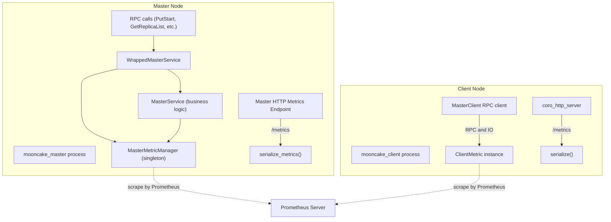

<!-- source: DeepWiki mcp.deepwiki.com · repo kvcache-ai/Mooncake · page 5.13 Metrics and Monitoring · fetched 2026-10-21 -->

# Metrics and Monitoring

<details>
<summary>Relevant source files</summary>

The following files were used as context for generating this wiki page:

- [docs/source/getting_started/observability.md](docs/source/getting_started/observability.md)
- [mooncake-store/include/allocator_metric.h](mooncake-store/include/allocator_metric.h)
- [mooncake-store/include/allocator_status.h](mooncake-store/include/allocator_status.h)
- [mooncake-store/include/client_metric.h](mooncake-store/include/client_metric.h)
- [mooncake-store/include/hybrid_metric.h](mooncake-store/include/hybrid_metric.h)
- [mooncake-store/include/master_client.h](mooncake-store/include/master_client.h)
- [mooncake-store/include/master_metric_manager.h](mooncake-store/include/master_metric_manager.h)
- [mooncake-store/include/master_service.h](mooncake-store/include/master_service.h)
- [mooncake-store/include/rpc_service.h](mooncake-store/include/rpc_service.h)
- [mooncake-store/src/allocator_metric.cpp](mooncake-store/src/allocator_metric.cpp)
- [mooncake-store/src/client_metric.cpp](mooncake-store/src/client_metric.cpp)
- [mooncake-store/src/master_client.cpp](mooncake-store/src/master_client.cpp)
- [mooncake-store/src/master_metric_manager.cpp](mooncake-store/src/master_metric_manager.cpp)
- [mooncake-store/src/master_service.cpp](mooncake-store/src/master_service.cpp)
- [mooncake-store/src/rpc_service.cpp](mooncake-store/src/rpc_service.cpp)
- [mooncake-store/tests/client_metrics_test.cpp](mooncake-store/tests/client_metrics_test.cpp)
- [mooncake-store/tests/master_metrics_test.cpp](mooncake-store/tests/master_metrics_test.cpp)
- [mooncake-store/tests/master_service_test.cpp](mooncake-store/tests/master_service_test.cpp)

</details>


This page covers the metrics collection, exposure, and debug endpoints implemented in the Mooncake Store master service, client metrics subsystem, and the TENT transfer engine. It documents the role and implementation of the `MasterMetricManager` singleton for centralized master statistics, the client-side `ClientMetric` telemetry, Prometheus integration, HTTP metrics endpoints, metrics bootstrap configuration, and the Grafana dashboard setup located in the `monitoring/` directory.

For details about the master service design, see [5.2. Master Service](), for client lifecycle and heartbeating see [5.12. Client Monitoring and Lifecycle](), and for TENT engine internals see [4.2. TENT (Transfer Engine Next)]().

---

## Architecture Overview

Mooncake's metrics are collected at multiple system levels:

- **Master Metric Aggregation**: The `MasterMetricManager` singleton inside the `mooncake_master` process collects global and granular metrics about the distributed store, client liveness, RPC requests, memory usage, cache hit rates, and so forth.

- **Client-side Telemetry**: Each client process (`mooncake_client`) instantiates a `ClientMetric` instance to measure local transfer throughput, RPC latencies, batch operation timings, and allocator statistics.

- **Transfer Engine Metrics (TENT)**: The transfer engine provides detailed throughput and latency histograms for read/write operations and batch transfers.

### Metrics Data Flow



Sources: [mooncake-store/src/master_metric_manager.cpp:17-21](), [mooncake-store/include/master_client.h:92-106](), [mooncake-store/src/rpc_service.cpp:105-108](), [mooncake-store/include/rpc_service.h:22-36]()

---

## MasterMetricManager

The `MasterMetricManager` class provides centralized, process-global metric tracking for master service operations. It is implemented as a singleton accessed via the static `MasterMetricManager::instance()` method [mooncake-store/include/master_metric_manager.h:21-24](), [mooncake-store/src/master_metric_manager.cpp:17-21]().

### Key Metric Types

| Metric Type        | Corresponding C++ Type             | Description                                    | Example Metric Name                   |
|--------------------|----------------------------------|-----------------------------------------------|-------------------------------------|
| Gauge              | `ylt::metric::gauge_t`            | Values that can increase or decrease           | `master_allocated_bytes`             |
| Dynamic Gauge      | `ylt::metric::dynamic_gauge_1t`  | Per-segment or labeled gauge values             | `segment_allocated_bytes`            |
| Counter            | `ylt::metric::counter_t`          | Monotonically increasing counters               | `master_put_start_requests_total`   |
| Histogram          | `ylt::metric::histogram_t`        | Distribution histograms, e.g., object size bins | `master_value_size_bytes`            |

The metrics track diverse resources and operations including memory and NoF (NVMe or SSD) usage, request counts, error counts, cache hit statistics, client liveness states, offboarding jobs, snapshot activities, and batch RPC statistics.

### Metric Updates and Incrementing

- The `WrappedMasterService` RPC wrapper increments counters for every RPC invocation and failure for metrics like `exist_key_requests` and `exist_key_failures` before and after forwarding to the `MasterService` [mooncake-store/src/rpc_service.cpp:110-126]().

- Batch RPCs increment metrics for total keys requested, successful and failed items, and partial successes, reflecting the proportion of successes within batch requests [mooncake-store/src/rpc_service.cpp:128-164]().

- Memory and storage segments contribute capacity and usage metrics updated on mount/unmount operations and reclaimed on segment removal to avoid stale metric labels [mooncake-store/include/master_metric_manager.h:108](), [mooncake-store/src/master_metric_manager.cpp:26-48]().

- Cache hits and misses are tracked and aggregated by the master to produce cache hit rate and reuse statistics [mooncake-store/include/master_metric_manager.h:72-93]().

### Important Functions and Features

- `calculate_cache_stats()` computes derived statistics like memory hit rate, SSD hit rate, overall hit rate, and valid get rate aggregating the underlying counters [mooncake-store/include/master_metric_manager.h:93]().

- Methods to increment (`inc_`) and decrement (`dec_`) all major metrics provide fine-grained control by the master and RPC layers.

- Serialization of all metrics to Prometheus text exposition format is implemented in `serialize_metrics()`, enabling HTTP scraping and export [mooncake-store/src/master_metric_manager.cpp:2889-2919]().

### Example Metric Categories

| Category                    | Examples                                         |
|-----------------------------|------------------------------------------------|
| Memory usage                | `master_allocated_bytes`, `segment_allocated_bytes` |
| NoF SSD usage               | `master_nof_allocated_bytes`, `nof_segment_allocated_bytes` |
| File storage allocation     | `master_allocated_file_size_bytes`              |
| Key counts                 | `master_key_count`, `master_soft_pin_key_count` |
| Client liveness and offboarding | `master_client_liveness_active_clients`, `master_client_offboarding_queue_depth` |
| RPC request and failure counters | `master_put_start_requests_total`, `master_get_replica_list_failures_total` |

Sources: [mooncake-store/include/master_metric_manager.h:21-166](), [mooncake-store/src/master_metric_manager.cpp:17-140](), [mooncake-store/src/rpc_service.cpp:110-164]()

---

## Client Metrics

The `ClientMetric` class collects real-time telemetry inside each client process (`mooncake_client`), focusing on transfer throughput, RPC latencies, batch operations, and allocator usage. It reports metrics at configured intervals and integrates with master RPC metrics when enabled [mooncake-store/include/client_metric.h:23-121](), [mooncake-store/src/client_metric.cpp:1-91]().

### Data Collected

- **Transfer Throughput Counters**: Total read and write byte counters.

- **Latency Histograms**: Fine-grained latency histograms for different operations like get, put, batch get, batch put, with buckets optimized for microsecond-level granularity and longer tail latencies up to tens of seconds [mooncake-store/include/client_metric.h:26-35]().

- **RPC Operation Metrics**: Counters and histograms that track per-RPC call times and counts, labeled with RPC names. This is enabled via a compile-time mapping (`RpcNameTraits`) from RPC member function pointers to string names for labels [mooncake-store/src/master_client.cpp:22-235]().

- **Allocator and Storage Metrics**: Summaries of memory allocators, SSD, DFS usage, and eviction statistics.

- **Build Info Metric**: A constant gauge metric exposing build version strings in labels for client binaries.

### Lifecycle

- `ClientMetric` instances are created conditionally based on environment variables at client startup, supporting toggles for bandwidth reporting and RPC metrics [mooncake-store/src/client_metric.cpp:70-90]().

- On construction, it starts a reporting thread if configured, which periodically serializes and exposes metrics via a local HTTP server for Prometheus scraping [mooncake-store/src/client_metric.cpp:170-176]().

- Metrics can be serialized into the Prometheus text format or output summarized human-readable reports useful for debugging or CLI inspection [mooncake-store/src/client_metric.cpp:92-128]().

### Example Metrics and Summaries

- Total bytes read/written with rate calculations.

- Latency percentiles (p50, p95, p99) for get, put, batch get, batch put.

- RPC call counts and latency histograms.

- Bandwidth reports on interval basis.

Sources: [mooncake-store/include/client_metric.h:23-121](), [mooncake-store/src/client_metric.cpp:1-91]()

---

## HTTP Metrics and Monitoring Endpoints

### Master Service HTTP Endpoints

The master service exposes an HTTP admin server (default port 9003) providing several key endpoints for observability and operational status [docs/source/getting_started/observability.md:112-128]():

| Endpoint             | Description                                        |
| -------------------- | ------------------------------------------------- |
| `/metrics`           | Prometheus-formatted key/value metrics for scraping |
| `/metrics/summary`   | Human-readable textual summary of collected metrics |
| `/health`            | JSON health status including master role and HA state |
| `/version`           | Current build version and display information     |
| `/role`              | HA role of master (leader, standby, etc.)         |
| `/ha_status`         | Detailed high-availability runtime state           |

These endpoints allow Prometheus to scrape key performance and health metrics securely and efficiently, facilitating monitoring dashboards and alerting.

### Metrics Bootstrap Configuration

Metrics exposure and bootstrap configuration is governed by `MetricsBootstrapConfig` structs, resolved from JSON or YAML with CLI overrides for bind addresses and ports [mooncake-store/src/config/metrics_bootstrap_config_loader.h:13-21](), [mooncake-store/tests/master_service_config_test.cpp:52-92]().

Sources: [docs/source/getting_started/observability.md:112-128](), [mooncake-store/src/config/metrics_bootstrap_config_loader.h:13-21]()

---

## Production Monitoring and Grafana Setup

Mooncake supplies a production-ready monitoring stack in the `monitoring/` directory composed of:

- **Docker Compose Setup** launching:
  - The `mooncake_master` service with metrics enabled.
  - A Prometheus server configured to scrape master and client endpoints.
  - A Grafana server pre-configured with dashboards.

- **Prometheus Scraping Targets**: Targets the master service HTTP metrics port (default 9003) and optionally client metric endpoints, polling at configured intervals.

- **Grafana Dashboards**: Include visualizations of cluster resource usage, RPC latencies, cache hit rates, transfer throughput, eviction metrics, and other key operational data.

This setup facilitates quick adoption of observability infrastructure and accelerates troubleshooting and performance optimization for deployments.

Sources: [docs/source/getting_started/observability.md:112-140]()

---

## Code Entity Mapping Diagram

This diagram maps natural language system components related to metrics and monitoring to their corresponding core code entities, classes, and functions, providing clear navigation landmarks for developers.

```mermaid
classDiagram
    class MasterMetricManager {
        <<Singleton>>
        +instance() MasterMetricManager
        +calculate_cache_stats() CacheHitStatDict
        +inc_put_start_requests()
        +inc_exist_key_requests()
        +inc_exist_key_failures()
        +inc_batch_exist_key_requests()
        +serialize_metrics()
    }
    class MasterClient {
        +client_accessor_ : RpcClientPool
        +ExistKey(object_key) : tl::expected<bool, ErrorCode>
        +BatchExistKey(object_keys) : vector<tl::expected<bool, ErrorCode>>
        +CalcCacheStats() : tl::expected<CacheHitStatDict, ErrorCode>
        +GetReplicaList(object_key) : tl::expected<vector<Replica::Descriptor>, ErrorCode>
    }
    class WrappedMasterService {
        +ExistKey(key, tenant_id)
        +BatchExistKey(keys, tenant_id)
        +CalcCacheStats()
        +PutStart(client_id, key, ...)
        +delegate_to_MasterService() 
        +update_MasterMetricManager()
    }
    class MasterService {
        +MountSegment(segment, client_id)
        +UnmountSegment(segment_id, client_id)
        +ExistKey(key, tenant_id)
        +BatchExistKey(keys, tenant_id)
        +PutStart(client_id, key, ...)
    }
    class ClientMetric {
        +serialize()
        +summary_metrics()
        +transfer_metric : TransferMetric
        +master_client_metric : RpcMetrics
    }
    
    WrappedMasterService ..> MasterMetricManager : "calls inc_/dec_ counters"
    MasterClient ..> WrappedMasterService : "calls RPC"
    WrappedMasterService *-- MasterService : "delegates to"
    MasterMetricManager ..> "ylt::metric" : "uses for storage"
    MasterClient ..> ClientMetric : "records client-side telemetry"
```

Sources: [mooncake-store/include/master_metric_manager.h:21-25](), [mooncake-store/include/master_client.h:92-106](), [mooncake-store/include/rpc_service.h:22-41](), [mooncake-store/src/master_service.cpp:179-184](), [mooncake-store/src/rpc_service.cpp:110-164](), [mooncake-store/src/client_metric.cpp:1-91]()

---

This concludes the detailed documentation for Mooncake's metrics and monitoring subsystem, covering central master metrics, client telemetry, HTTP metrics endpoints, and production monitoring setups with Prometheus and Grafana.

---

