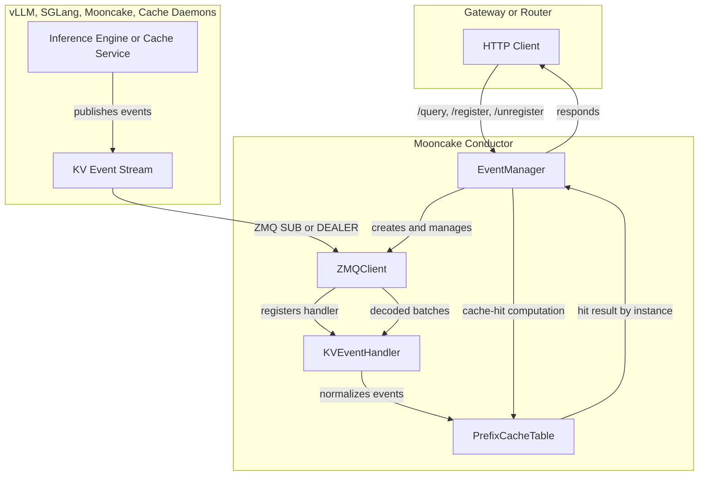
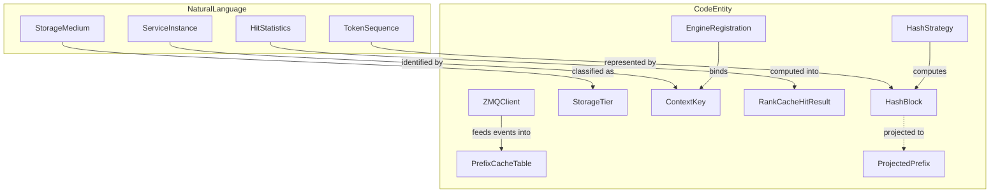
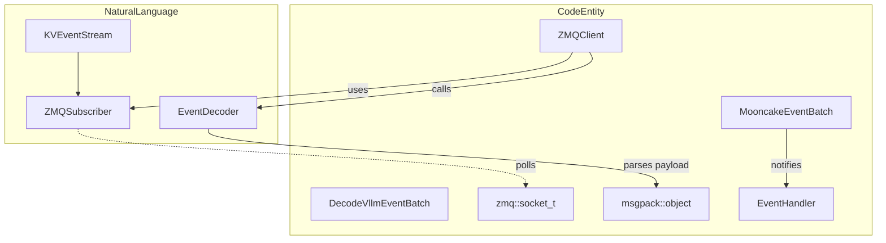
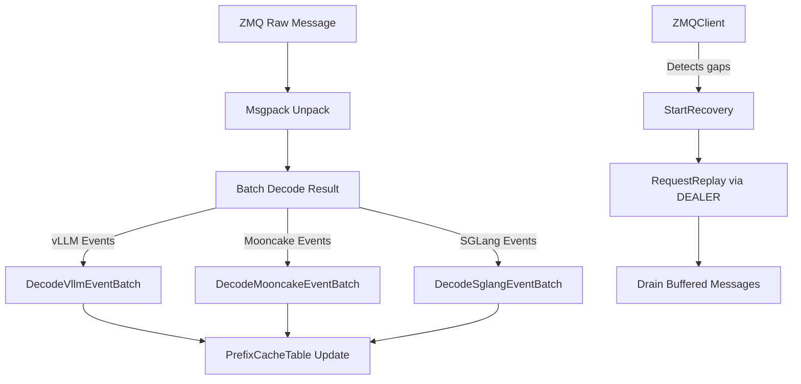
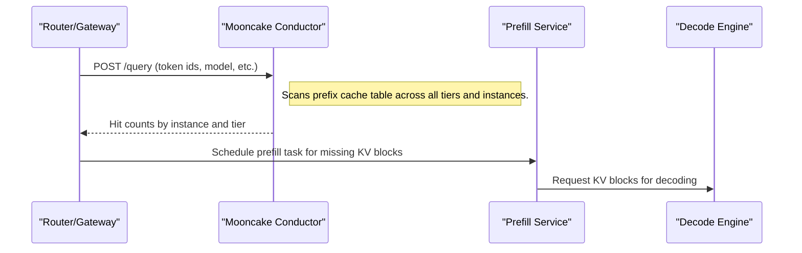

<!-- source: DeepWiki mcp.deepwiki.com · repo kvcache-ai/Mooncake · page 5.15 Conductor and KV Indexer · fetched 2026-10-21 -->

# Conductor and KV Indexer

<details>
<summary>Relevant source files</summary>

The following files were used as context for generating this wiki page:

- [.typos.toml](.typos.toml)
- [docs/source/design/conductor/conductor-architecture-design.md](docs/source/design/conductor/conductor-architecture-design.md)
- [docs/source/design/store/metadata-management.md](docs/source/design/store/metadata-management.md)
- [docs/source/design/store/mooncake-store.md](docs/source/design/store/mooncake-store.md)
- [mooncake-conductor/CMakeLists.txt](mooncake-conductor/CMakeLists.txt)
- [mooncake-conductor/include/conductor/kvevent/config.h](mooncake-conductor/include/conductor/kvevent/config.h)
- [mooncake-conductor/include/conductor/kvevent/event_manager.h](mooncake-conductor/include/conductor/kvevent/event_manager.h)
- [mooncake-conductor/include/conductor/prefixindex/hash_strategy.h](mooncake-conductor/include/conductor/prefixindex/hash_strategy.h)
- [mooncake-conductor/include/conductor/prefixindex/prefix_indexer.h](mooncake-conductor/include/conductor/prefixindex/prefix_indexer.h)
- [mooncake-conductor/include/conductor/prefixindex/types.h](mooncake-conductor/include/conductor/prefixindex/types.h)
- [mooncake-conductor/include/conductor/zmq/transport.h](mooncake-conductor/include/conductor/zmq/transport.h)
- [mooncake-conductor/include/conductor/zmq/zmq_client.h](mooncake-conductor/include/conductor/zmq/zmq_client.h)
- [mooncake-conductor/src/kvevent/config.cpp](mooncake-conductor/src/kvevent/config.cpp)
- [mooncake-conductor/src/kvevent/event_manager.cpp](mooncake-conductor/src/kvevent/event_manager.cpp)
- [mooncake-conductor/src/main.cpp](mooncake-conductor/src/main.cpp)
- [mooncake-conductor/src/prefixindex/hash_strategy.cpp](mooncake-conductor/src/prefixindex/hash_strategy.cpp)
- [mooncake-conductor/src/prefixindex/prefix_indexer.cpp](mooncake-conductor/src/prefixindex/prefix_indexer.cpp)
- [mooncake-conductor/src/zmq/zmq_client.cpp](mooncake-conductor/src/zmq/zmq_client.cpp)
- [mooncake-conductor/tests/CMakeLists.txt](mooncake-conductor/tests/CMakeLists.txt)
- [mooncake-conductor/tests/compute_hash_test.cpp](mooncake-conductor/tests/compute_hash_test.cpp)
- [mooncake-conductor/tests/event_manager_test.cpp](mooncake-conductor/tests/event_manager_test.cpp)
- [mooncake-conductor/tests/fixtures/generate_hash_golden_vectors.py](mooncake-conductor/tests/fixtures/generate_hash_golden_vectors.py)
- [mooncake-conductor/tests/fixtures/hash_golden_vectors.json](mooncake-conductor/tests/fixtures/hash_golden_vectors.json)
- [mooncake-conductor/tests/fixtures/hash_golden_vectors_sha256.json](mooncake-conductor/tests/fixtures/hash_golden_vectors_sha256.json)
- [mooncake-conductor/tests/fixtures/verify_fixture_against_vllm.py](mooncake-conductor/tests/fixtures/verify_fixture_against_vllm.py)
- [mooncake-conductor/tests/model_context_test.cpp](mooncake-conductor/tests/model_context_test.cpp)
- [mooncake-conductor/tests/prefix_indexer_test.cpp](mooncake-conductor/tests/prefix_indexer_test.cpp)
- [mooncake-conductor/tests/prefix_indexer_test_peer.h](mooncake-conductor/tests/prefix_indexer_test_peer.h)
- [mooncake-conductor/tests/zmq_client_test.cpp](mooncake-conductor/tests/zmq_client_test.cpp)
- [mooncake-conductor/tests/zmq_transport_test.cpp](mooncake-conductor/tests/zmq_transport_test.cpp)

</details>


The **Mooncake Conductor Indexer** is a specialized metadata service designed to efficiently track, manage, and report token hit counts across tiered KV cache levels. It serves as the intelligence layer within Mooncake’s KVCache-centric LLM serving platform, enabling LLM inference engines, routers, and gateways to make cache-aware scheduling decisions based on prefix-hit metadata. This service aggregates prefix storage state from multiple inference instances and provides a coherent query interface, seamlessly integrating with tiered KV cache pools and the transfer infrastructure [docs/source/design/conductor/conductor-architecture-design.md:3-9]().

---

## Tiered KV Cache Pools

Mooncake partitions KV cache storage into three logical tiers to balance access speed with capacity and persistence. The Conductor tracks these tiers to provide accurate cache state and hit information:

| Tier | Abbreviation | Storage Medium      | Description                                                                                       |
|-------|--------------|--------------------|-------------------------------------------------------------------------------------------------|
| G1    | Device Pool  | GPU/NPU HBM        | High-speed device-resident KV blocks owned by inference engines (e.g., vLLM, SGLang). Tracked via `StorageTier::kNpu` and `StorageTier::kCpuLocal`. |
| G2    | Host Pool    | DRAM               | Host CPU local memory blocks pooled for secondary caching. Managed under `StorageTier::kCpuLocal`. |
| G3    | Disk Pool    | SSD / 3FS / DFS    | Persistent disk-backed storage providing cold KV cache capacity, represented as `StorageTier::kDisk`. |

These tiers are represented as enum values in `StorageTier` and are tracked within the Conductor's core indexer, `PrefixCacheTable`, enabling routers to assess prefix availability across the entire cache hierarchy [docs/source/design/conductor/conductor-architecture-design.md:29-32](), [mooncake-conductor/src/prefixindex/prefix_indexer.cpp:92-125]().

Sources:  
[docs/source/design/conductor/conductor-architecture-design.md:29-32](),  
[mooncake-conductor/src/prefixindex/prefix_indexer.cpp:92-125]()

---

## Conductor Architecture and Event Publishing

The Conductor service subscribes to KV cache event streams published by inference engine instances and specialized cache daemons. It normalizes and indexes these events into a global prefix cache table, providing queries about prefix hit presence and distribution across storage tiers.

### Core Component Overview

| Component          | Role                                                                                           |
|--------------------|------------------------------------------------------------------------------------------------|
| `EventManager`     | Manages Conductor lifecycle, HTTP API, dynamic publisher registration, and active services.     |
| `ZMQClient`        | Connects to KV event publishers over ZeroMQ SUB sockets, decodes event batches, maintains sequence tracking. |
| `KVEventHandler`   | Adapts engine-specific decoded KV events into normalized Conductor events with registration metadata enrichment. |
| `PrefixCacheTable` | Maintains prefix hashes, tracks block presence per tier and instance, computes cache-hit results.|

### System Architecture Diagram



Conductor supports multiple simultaneous model contexts scoped by rich `ModelContext` descriptors, including tenant ID, model name, LoRA variant, block size, and instance ID [docs/source/design/conductor/conductor-architecture-design.md:16-44](), [mooncake-conductor/include/conductor/zmq/zmq_client.h:25-39]().

Sources:  
[docs/source/design/conductor/conductor-architecture-design.md:16-44](),  
[mooncake-conductor/include/conductor/zmq/zmq_client.h:25-39]()

---

## Token Hit Tracking and Hash Strategy

### Scoping and Profiles

The index scopes prefix hashes and queries by a `ContextKey` defined as:

```
(tenant_id, model_name, lora_name, block_size, additional_salt, instance_id)
```

Within each context, engine-provided block hashes are mapped to Conductor internal prefix hashes by pluggable hash strategies [mooncake-conductor/include/conductor/prefixindex/prefix_indexer.h:19-140]().

### Hashing and Algorithm Support

- **Pluggable Hash Strategies:** Support multiple algorithms such as `"vllm_v1"` with SHA-256 over CBOR and `"sglang"` with raw SHA-256, selectable for each context.
- **Lazy Chain Hashing:** Optimizes hash chain computations by recomputing only changed blocks, improving runtime efficiency.
- **Profiles:** Includes auxiliary metadata like seed roots and index projections, captured in `HashProfile` objects [mooncake-conductor/src/prefixindex/hash_strategy.cpp:1-175]().

### Query Result Data Model

The query returns a `CacheHitResult` object containing:

- `longest_match_tokens`: Number of consecutive tokens matched in the prefix.
- `dp`: A map of DP-rank to cache hit status.
- `rank_matches`: Detailed hit summary per data-parallel compute rank.
- Aggregated hit counts broken down by storage tiers: `npu`, `cpu_local`, `cpu_share`, and `disk`.

This granularity enables routing decisions based on which inference replicas and which tiers hold relevant cached KV blocks [docs/source/design/conductor/conductor-architecture-design.md:46-103](), [mooncake-conductor/tests/prefix_indexer_test.cpp:44-73]().

Sources:  
[mooncake-conductor/include/conductor/prefixindex/prefix_indexer.h:19-140](),  
[mooncake-conductor/src/prefixindex/hash_strategy.cpp:1-175](),  
[docs/source/design/conductor/conductor-architecture-design.md:46-103](),  
[mooncake-conductor/tests/prefix_indexer_test.cpp:44-73]()

---

## System Entity Mapping

### 1. Natural Language to Code Entities (Indexer Core)



### 2. Event and Decoding Subsystem Mapping



These mappings bridge conceptual layers to concrete codebase elements for better understanding [mooncake-conductor/include/conductor/zmq/zmq_client.h:25-60](), [mooncake-conductor/src/zmq/zmq_client.cpp:1-206]().

Sources:  
[mooncake-conductor/include/conductor/zmq/zmq_client.h:25-60](),  
[mooncake-conductor/src/zmq/zmq_client.cpp:1-206]()

---

## ZMQ KV Event Decoding and Replay

The Conductor uses `ZMQClient` to consume ZeroMQ streams of KV cache events emitted by inference engines or cache daemons.

- Handles connection lifecycle including reconnects, sequence number tracking, and detection of dropped or out-of-order events [mooncake-conductor/src/zmq/zmq_client.cpp:96-116]().
- Supports replay recovery via separate DEALER socket to replay missed events on reconnection or gap detection [mooncake-conductor/src/zmq/zmq_client.cpp:149-157]().
- Decodes received message batches into typed event objects (e.g., vLLM `Stored` and `Removed` events), passed to `KVEventHandler` for indexing [mooncake-conductor/src/zmq/zmq_client.cpp:100-101]().

### Decoding and Recovery Flow



The recovery mechanism ensures index state consistency across transient failures or network interruptions [mooncake-conductor/include/conductor/zmq/zmq_client.h:25-165](), [mooncake-conductor/src/zmq/zmq_client.cpp:1-206]().

Sources:  
[mooncake-conductor/src/zmq/zmq_client.cpp:96-116](),  
[mooncake-conductor/src/zmq/zmq_client.cpp:149-157](),  
[mooncake-conductor/src/zmq/zmq_client.cpp:100-101](),  
[mooncake-conductor/include/conductor/zmq/zmq_client.h:25-165](),  
[mooncake-conductor/src/zmq/zmq_client.cpp:1-206]()

---

## Prefix Indexer Implementation Detail

The core indexing functionality is implemented in `PrefixCacheTable`, which maintains the global prefix index for each registered `ContextKey`.

Key implementation details include:

- **Context Validation and Registration:** Validates inputs such as tenant ID, model name, effective block size, and cache group on registration [mooncake-conductor/src/prefixindex/prefix_indexer.cpp:16-86]().
- **Mutation and Clear Handling:** Applies block `Stored` and `Removed` events, differentiating mutations by storage tier (NPU, CPU local/share, disk) for fine-grained presence tracking [mooncake-conductor/src/prefixindex/prefix_indexer.cpp:88-129]().
- **Insertion Order Tracking:** Maintains prefix insertion order to enable oldest-first eviction policies when capacity limits are reached [mooncake-conductor/src/prefixindex/prefix_indexer.cpp:148-167]().
- **Capacity Eviction:** Proactively evicts the oldest cached prefixes when maximum context capacity (`max_blocks`) is exceeded; default limit is approximately 200,000 prefixes [mooncake-conductor/src/prefixindex/prefix_indexer.cpp:169-189]().
- **Query API:** Processes token ID sequences to compute the longest prefix match and per-instance, per-tier hit statistics to assist cache-aware routing [mooncake-conductor/src/prefixindex/prefix_indexer.cpp:400-440]().

The index maintains concurrency with shared mutexes guarding context state maps and global context registrations [mooncake-conductor/include/conductor/prefixindex/prefix_indexer.h:19-140](), [mooncake-conductor/src/prefixindex/prefix_indexer.cpp:1-615]().

Sources:  
[mooncake-conductor/src/prefixindex/prefix_indexer.cpp:16-86](),  
[mooncake-conductor/src/prefixindex/prefix_indexer.cpp:88-129](),  
[mooncake-conductor/src/prefixindex/prefix_indexer.cpp:148-167](),  
[mooncake-conductor/src/prefixindex/prefix_indexer.cpp:169-189](),  
[mooncake-conductor/src/prefixindex/prefix_indexer.cpp:400-440](),  
[mooncake-conductor/include/conductor/prefixindex/prefix_indexer.h:19-140](),  
[mooncake-conductor/src/prefixindex/prefix_indexer.cpp:1-615]()

---

## Master Service Integration and Configuration

The Mooncake Store Master Service configures KV event publishers for the Conductor to consume:

- **endpoint:** ZeroMQ SUB socket endpoint streaming KV cache event batches.
- **replay_endpoint:** ZeroMQ DEALER socket endpoint used for replay recovery.
- **block_size:** Token granularity of KV blocks sent by the inference engine.

Configuration may be static via JSON files or dynamically managed using the Conductor's HTTP API [docs/source/design/conductor/conductor-architecture-design.md:110-144]().

Sources:  
[docs/source/design/conductor/conductor-architecture-design.md:110-144]()

---

## HTTP API and Integration Workflows

The Conductor exposes an HTTP API to:

- **Register** KV cache event publishers dynamically (`POST /register`).
- **Query** prefix hit presence using token ID sequences (`POST /query`).
- **Unregister** publishers to stop indexing from specific instances (`POST /unregister`).

Typical router interaction workflow:



This enables routers to select the best cached prefix and inference engines to fetch missing KV blocks on demand through the transfer backends [docs/source/design/conductor/conductor-architecture-design.md:92-103]().

Sources:  
[docs/source/design/conductor/conductor-architecture-design.md:92-103]()

---

## Project Structure and Utilities Summary

Key codebase components related to the Conductor and KV Indexer:

| Component         | Purpose                                                               | Location                          |
|-------------------|-----------------------------------------------------------------------|----------------------------------|
| `HashStrategy`    | Implements prefix hash algorithms with serialization codecs           | `prefixindex/hash_strategy.cpp`  |
| `ZMQClient`       | ZeroMQ client managing event subscription, reconnection, and buffering| `zmq/zmq_client.cpp`              |
| `PrefixCacheTable`| Stores prefix index, applies mutations, provides query interface      | `prefixindex/prefix_indexer.cpp` |
| `EventManager`    | High-level service orchestration with HTTP API and service registration| `kvevent/event_manager.cpp`       |

This architecture supports extension to multi-tenant cache isolation, runtime registration, and integration with popular LLM serving frameworks like vLLM and SGLang [docs/source/design/conductor/conductor-architecture-design.md:168-181](), [mooncake-conductor/include/conductor/zmq/zmq_client.h:63-90]().

Sources:  
[docs/source/design/conductor/conductor-architecture-design.md:168-181](),  
[mooncake-conductor/include/conductor/zmq/zmq_client.h:63-90]()

---

# Summary

The Mooncake Conductor Indexer service collects KV cache event streams from inference engines over ZeroMQ, maintains a global tiered prefix cache table with advanced hashing strategies, and exposes query APIs that provide detailed cache hit metadata. This enables intelligent cache-aware request scheduling across device, host, and disk storage tiers, playing a critical role within Mooncake’s KVCache-centric LLM serving platform.

---

# References

- Mooncake Conductor Architecture Design documentation  
  `[docs/source/design/conductor/conductor-architecture-design.md:1-184]()`
- Prefix Cache Table Implementation  
  `[mooncake-conductor/include/conductor/prefixindex/prefix_indexer.h:1-140]()`  
  `[mooncake-conductor/src/prefixindex/prefix_indexer.cpp:1-615]()`
- Hash Strategy Implementation  
  `[mooncake-conductor/src/prefixindex/hash_strategy.cpp:1-175]()`
- ZMQ Client ZeroMQ Event Management  
  `[mooncake-conductor/include/conductor/zmq/zmq_client.h:1-165]()`  
  `[mooncake-conductor/src/zmq/zmq_client.cpp:1-206]()`
- Prefix Indexer Unit Tests  
  `[mooncake-conductor/tests/prefix_indexer_test.cpp:1-188]()`

Sources:  
[docs/source/design/conductor/conductor-architecture-design.md:1-184](),  
[mooncake-conductor/include/conductor/prefixindex/prefix_indexer.h:1-140](),  
[mooncake-conductor/src/prefixindex/prefix_indexer.cpp:1-615](),  
[mooncake-conductor/src/prefixindex/hash_strategy.cpp:1-175](),  
[mooncake-conductor/include/conductor/zmq/zmq_client.h:1-165](),  
[mooncake-conductor/src/zmq/zmq_client.cpp:1-206](),  
[mooncake-conductor/tests/prefix_indexer_test.cpp:1-188]()

---

