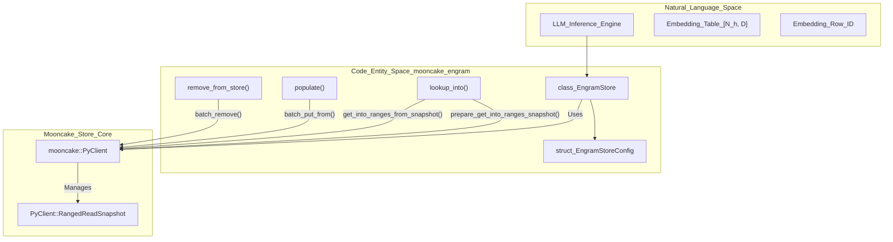
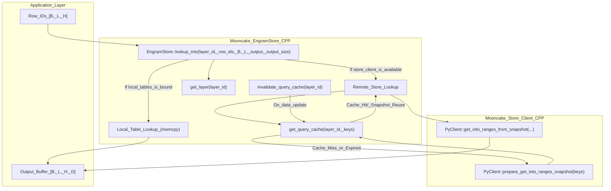
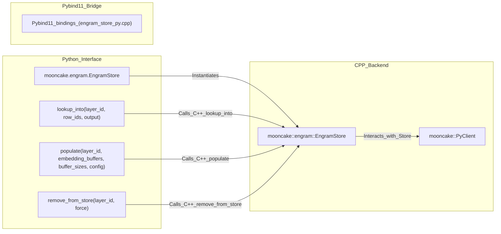

<!-- source: DeepWiki mcp.deepwiki.com · repo kvcache-ai/Mooncake · page 5.16 EngramStore Backend · fetched 2026-10-21 -->

# EngramStore Backend

<details>
<summary>Relevant source files</summary>

The following files were used as context for generating this wiki page:

- [docs/source/deployment/ssd/ssd-offload.md](docs/source/deployment/ssd/ssd-offload.md)
- [docs/source/design/store/ssd-offload.md](docs/source/design/store/ssd-offload.md)
- [mooncake-store/benchmarks/uring_batch_read_bench.cpp](mooncake-store/benchmarks/uring_batch_read_bench.cpp)
- [mooncake-store/include/file_interface.h](mooncake-store/include/file_interface.h)
- [mooncake-store/include/file_storage.h](mooncake-store/include/file_storage.h)
- [mooncake-store/include/storage_backend.h](mooncake-store/include/storage_backend.h)
- [mooncake-store/src/file_storage.cpp](mooncake-store/src/file_storage.cpp)
- [mooncake-store/src/posix_file.cpp](mooncake-store/src/posix_file.cpp)
- [mooncake-store/src/storage_backend.cpp](mooncake-store/src/storage_backend.cpp)
- [mooncake-store/src/uring_file.cpp](mooncake-store/src/uring_file.cpp)
- [mooncake-store/src/uring_submit.h](mooncake-store/src/uring_submit.h)
- [mooncake-store/tests/file_storage_test.cpp](mooncake-store/tests/file_storage_test.cpp)
- [mooncake-store/tests/posix_file_test.cpp](mooncake-store/tests/posix_file_test.cpp)
- [mooncake-store/tests/storage_backend_test.cpp](mooncake-store/tests/storage_backend_test.cpp)

</details>


The **EngramStore Backend** is a specialized embedding table storage system built on top of the Mooncake Store. It is designed to handle large-scale embedding lookups, typically used in long-context LLM serving or retrieval-augmented generation where embeddings (engrams) need to be persisted and queried efficiently across a distributed cluster.

The scope is intentionally narrow: the caller defines the physical table layout and provides precomputed row IDs, while Mooncake manages storage-side concerns like per-head table naming, batch populate/remove operations, and efficient retrieval [mooncake-store/include/engram/engram_store.h:21-29]().

## Overview

EngramStore provides a structured abstraction over Mooncake's raw object store, organizing data into **per-head embedding tables**. Instead of managing individual object keys manually, users interact with a logical table structure where rows are identified by IDs.

### Key Features
*   **Per-Head Layout**: Supports multiple embedding tables (one per attention head) with configurable vocab sizes and embedding dimensions [mooncake-store/include/engram/engram_store.h:19-45]().
*   **Batch Operations**: High-throughput `populate` and `remove_from_store` operations for managing embedding weights [mooncake-store/include/engram/engram_store.h:60-76]().
*   **Row-ID Lookup**: Efficiently retrieves specific embedding vectors using precomputed row indices with shape `[B, L, H]` [mooncake-store/include/engram/engram_store.h:51-53]().
*   **Python/C++ Integration**: Native C++ implementation with a Python API surface that accepts NumPy arrays and releases the Python GIL during I/O.

Sources: [mooncake-store/include/engram/engram_store.h:19-76]()

## Architecture and Data Flow

The `EngramStore` acts as a management layer that translates high-level embedding operations into Mooncake Store `put` and `get` requests. It relies on the `PyClient` to interact with the `MasterService` for metadata and the `TransferEngine` for data movement.

### Component Relationship

This diagram connects natural language concepts (embedding tables and rows) to the involved code entities:



Sources:  
[mooncake-store/include/engram/engram_store.h:19-76](),  
[mooncake-store/src/engram/engram_store.cpp:19-45](),  
[mooncake-store/src/engram/engram_store.cpp:57-77](),  
[mooncake-store/src/engram/engram_store.cpp:300-340]()

## Implementation Details

### Table Layout and Configuration

Tables are defined using `EngramStoreConfig` [mooncake-store/include/engram/engram_store_config.h:10-20](), which specifies:
- `table_vocab_sizes`: a vector with the number of rows per head table.
- `row_bytes`: the byte width of each embedding row (opaque bytes, no interpretation).

EngramStore validates on construction that `layer_id`s are nonnegative, `row_bytes` is positive, and vocab sizes are valid (not exceeding size_t limits) [mooncake-store/src/engram/engram_store.cpp:23-39]().  

For each layer and head, a unique Mooncake Store key is generated with the format:

```
engram:l{layer_id}:h{head_idx}
```

These keys map to contiguous byte arrays storing each head's rows (`N_h x row_bytes`) [mooncake-store/src/engram/engram_store.cpp:40-42]().

### Populate Flow

The `populate` method writes embedding tables to the backend [mooncake-store/src/engram/engram_store.cpp:321-340]():

1. It first validates that the number of embedding buffers matches the number of heads and that each buffer size equals `vocab_size * row_bytes`.
2. Registers all input buffers with the `PyClient` to allow zero-copy store writes.
3. Performs a batch upload of all per-head tables atomically with `batch_put_from`.
4. Unregisters the buffers after successful upload.

Errors during upload cause cleanup and rollback to maintain correct state.

### Lookup Flow

The primary data retrieval method is `lookup_into` [mooncake-store/src/engram/engram_store.cpp:102-298]().

It accepts:
- `row_ids`: a flattened array of precomputed row indices with shape `[B, L, H]`.
- `output_buffer`: writable buffer of shape `[B, L, H, row_bytes]` where target embedding vectors are written.

Lookup steps:

1. Validates inputs for null pointers, shape bounds, and output buffer size [mooncake-store/src/engram/engram_store.cpp:108-127]().
2. If local tables are **bound** (representing immutable, caller-owned buffers without a Store client):
   - Verifies all requested row IDs fall within vocab limits.
   - Performs direct `memcpy` from the in-memory tables to the output buffer, avoiding any Store calls [mooncake-store/src/engram/engram_store.cpp:134-156]().
3. Otherwise, when backed by a Mooncake Store client:
   - Retrieves or creates a cached `RangedReadSnapshot` for consistent batched get operations [mooncake-store/src/engram/engram_store.cpp:57-77]().
   - Prepares vectors describing keys and byte ranges for each requested row using the per-head layout metadata.
   - Invokes `PyClient::get_into_ranges_from_snapshot` to have Mooncake transfer the embedding data directly into the output buffer [mooncake-store/src/engram/engram_store.cpp:158-297]().

If invalid row IDs are found during lookup, the output buffer is zeroed to prevent data leakage.

### Query Cache

To optimize repeated lookups, `EngramStore` caches a `RangedReadSnapshot` per layer keyed by the embedding table keys, enabling reuse of the same consistent snapshot across multiple queries. Cache invalidation happens when the data is modified via `populate` or `remove_from_store` [mooncake-store/src/engram/engram_store.cpp:57-77](), [mooncake-store/src/engram/engram_store.cpp:79-82]().

### Binding Local Tables

The `bind_local` method allows binding of caller-owned immutable local tables without a Store client, enabling zero-copy local table lookup by direct memory access [mooncake-store/include/engram/engram_store.h:38-41](), [mooncake-store/src/engram/engram_store.cpp:84-100]().

- Requires the buffer count to match the number of heads.
- Validates buffer sizes conform to expected vocab size and row byte size.
- Lookup for such local bindings is handled purely by `memcpy` without Store interactions.
- The caller is responsible for the buffer lifetime.

Sources:  
[mooncake-store/include/engram/engram_store.h:19-45](),  
[mooncake-store/include/engram/engram_store_config.h:10-20](),  
[mooncake-store/src/engram/engram_store.cpp:23-42](),  
[mooncake-store/src/engram/engram_store.cpp:57-77](),  
[mooncake-store/src/engram/engram_store.cpp:84-100](),  
[mooncake-store/src/engram/engram_store.cpp:102-298](),  
[mooncake-store/src/engram/engram_store.cpp:321-340]()

## Data Flow and Execution Architecture

The following diagram depicts the lookup call flow bridging from the application layer down to Store interactions:



Sources:  
[mooncake-store/src/engram/engram_store.cpp:57-77](),  
[mooncake-store/src/engram/engram_store.cpp:102-298]()

## API Surface

### C++ API Surface

The main backend interface is the class `mooncake::engram::EngramStore` defined in `mooncake-store/include/engram/engram_store.h` [mooncake-store/include/engram/engram_store.h:30-92](). It provides:

| Function / Method | Description | Reference |
|-------------------|-------------|-----------|
| `EngramStore(layers, store)` | Constructor taking a map of `layer_id` to `EngramStoreConfig` and optionally a shared `PyClient` | [lines 32-33]() |
| `bind_local` | Bind caller-owned local tables (immutable buffers) with no Store client for zero-copy lookup | [lines 40-41]() |
| `lookup_into` | Look up embedding rows for a batch of rowIDs and write into output buffer | [lines 51-53]() |
| `populate` | Populate Store with per-head embedding tensor buffers, batch upload with replication config | [lines 73-75]() |
| `remove_from_store` | Remove all per-head tables of a layer from the Store | [lines 65]() |
| Metadata getters | `get_layer_ids`, `get_table_vocab_sizes`, `get_store_keys`, `get_num_heads`, `get_row_bytes` for introspection | [lines 54-58]() |

Internally, the `EngramStore` holds:

- A map of `layers_` indexed by `layer_id`, each containing `EngramStoreConfig`, associated Mooncake Store keys, optional local tables (pointers to buffers), and metadata.
- A shared pointer to `PyClient` that issues Store RPC requests.
- A query cache map from layer_id to `RangedReadSnapshot` with concurrency protection by a mutex.

Sources: [mooncake-store/include/engram/engram_store.h:30-92]()

### Python API Surface

The Python bindings wrap the C++ API using `pybind11` in `mooncake-integration/store/engram_store_py.cpp`. Highlights include:

- `EngramStoreConfig` exposed with two fields: `table_vocab_sizes` and `row_bytes`.
- The `EngramStore` Python class has methods:
  - `bind_local(layer_id, embedding_buffers)` - bind local immutable numpy arrays.
  - `get_layer_ids()` - get valid configured layer IDs.
  - `get_table_vocab_sizes(layer_id)` - get vocab sizes per head.
  - `get_store_keys(layer_id)` - get Mooncake Store keys for the layer.
  - `get_num_heads(layer_id)` - get number of heads.
  - `get_row_bytes(layer_id)` - get row byte size.
  - `remove_from_store(layer_id, force=False)` - delete layer data from Store backend.
  - `populate(layer_id, embedding_buffers, buffer_sizes, config)` - batch populate with specified buffers.
  - `lookup_into(layer_id, row_ids, output)` - perform embedding lookup with row IDs into preallocated output buffer.

All embedding buffers and outputs must be contiguous uint8 NumPy arrays to ensure zero-copy access. The Python `lookup_into` releases the GIL around blocking I/O operations to avoid blocking the host Python thread [mooncake-integration/store/engram_store_py.cpp:104-171]().



Sources:  
[mooncake-integration/store/engram_store_py.cpp:1-171]()  
[mooncake-store/include/engram/engram_store.h:30-92]()

## Validation and Error Handling

Robust validation mechanisms ensure correctness and memory safety:

- On construction, `EngramStore` verifies:
  - Layers map is non-empty.
  - `layer_id`s are nonnegative.
  - `row_bytes` per layer is positive.
  - Each vocab size is positive and prevents size_t overflow during buffer sizing [mooncake-store/src/engram/engram_store.cpp:22-39]().

- The `populate` method validates:
  - Buffer count equals number of heads.
  - Each buffer size matches precisely the expected `vocab_size * row_bytes`.
  - Throws exceptions on mismatch [mooncake-store/src/engram/engram_store.cpp:321-330]().

- The `lookup_into` method:
  - Checks for null pointers.
  - Validates output buffer is large enough and input row IDs shape matches assumptions.
  - Checks all row IDs are in-range for vocab sizes.
  - In local mode, bounds-checks row IDs before direct memcpy.
  - If any invalid row ID is detected, zeroes the output buffer and returns error without Store operations.
  - Propagates Store errors as negative returns but never corrupts output memory [mooncake-store/src/engram/engram_store.cpp:108-127](), [mooncake-store/src/engram/engram_store.cpp:134-156]().

- Query cache entries are invalidated immediately on `populate` or `remove_from_store` to guarantee strong consistency for lookups thereafter [mooncake-store/src/engram/engram_store.cpp:79-82]().

Sources:  
[mooncake-store/src/engram/engram_store.cpp:22-39](),  
[mooncake-store/src/engram/engram_store.cpp:108-127](),  
[mooncake-store/src/engram/engram_store.cpp:134-156](),  
[mooncake-store/src/engram/engram_store.cpp:321-330]()

---

This documentation covers the essential implementation and usage of the Mooncake EngramStore backend, focusing on its per-head table layout, batch operations, efficient row-id lookups, and seamless Python/C++ interoperability with the Mooncake Store ecosystem.

# End of EngramStore Backend page.

---

