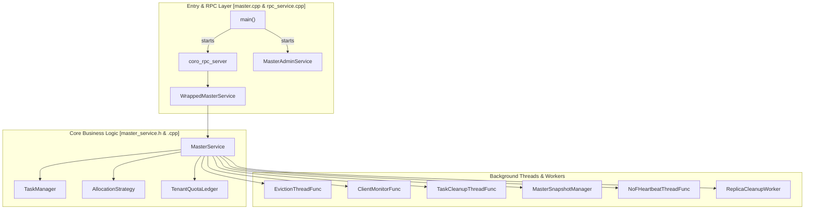
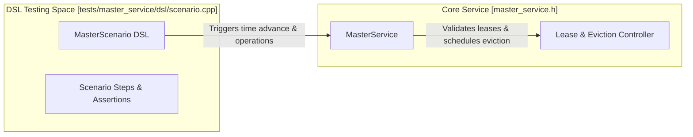
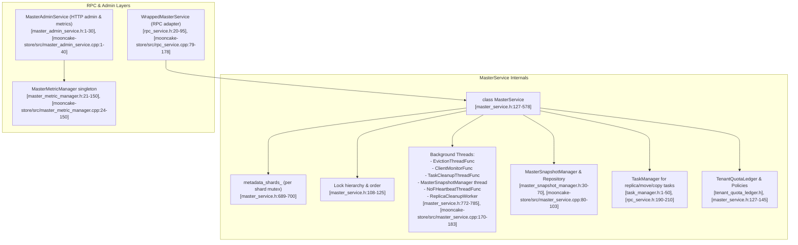

<!-- source: DeepWiki mcp.deepwiki.com · repo kvcache-ai/Mooncake · page 5.2 Master Service · fetched 2026-10-21 -->

# Master Service

<details>
<summary>Relevant source files</summary>

The following files were used as context for generating this wiki page:

- [docs/source/api-reference/http/http-service.md](docs/source/api-reference/http/http-service.md)
- [docs/source/deployment/mooncake-store-deployment-guide.md](docs/source/deployment/mooncake-store-deployment-guide.md)
- [mooncake-store/include/ha/standby_controller.h](mooncake-store/include/ha/standby_controller.h)
- [mooncake-store/include/ha/standby_metadata_store.h](mooncake-store/include/ha/standby_metadata_store.h)
- [mooncake-store/include/ha_metric_manager.h](mooncake-store/include/ha_metric_manager.h)
- [mooncake-store/include/hot_standby_service.h](mooncake-store/include/hot_standby_service.h)
- [mooncake-store/include/master_admin_service.h](mooncake-store/include/master_admin_service.h)
- [mooncake-store/include/master_client.h](mooncake-store/include/master_client.h)
- [mooncake-store/include/master_config.h](mooncake-store/include/master_config.h)
- [mooncake-store/include/master_metric_manager.h](mooncake-store/include/master_metric_manager.h)
- [mooncake-store/include/master_service.h](mooncake-store/include/master_service.h)
- [mooncake-store/include/mutex.h](mooncake-store/include/mutex.h)
- [mooncake-store/include/replica.h](mooncake-store/include/replica.h)
- [mooncake-store/include/rpc_service.h](mooncake-store/include/rpc_service.h)
- [mooncake-store/include/types.h](mooncake-store/include/types.h)
- [mooncake-store/src/ha/leadership/master_service_supervisor.cpp](mooncake-store/src/ha/leadership/master_service_supervisor.cpp)
- [mooncake-store/src/ha/standby_controller.cpp](mooncake-store/src/ha/standby_controller.cpp)
- [mooncake-store/src/ha/standby_metadata_store.cpp](mooncake-store/src/ha/standby_metadata_store.cpp)
- [mooncake-store/src/ha_metric_manager.cpp](mooncake-store/src/ha_metric_manager.cpp)
- [mooncake-store/src/hot_standby_service.cpp](mooncake-store/src/hot_standby_service.cpp)
- [mooncake-store/src/master.cpp](mooncake-store/src/master.cpp)
- [mooncake-store/src/master_admin_service.cpp](mooncake-store/src/master_admin_service.cpp)
- [mooncake-store/src/master_client.cpp](mooncake-store/src/master_client.cpp)
- [mooncake-store/src/master_metric_manager.cpp](mooncake-store/src/master_metric_manager.cpp)
- [mooncake-store/src/master_service.cpp](mooncake-store/src/master_service.cpp)
- [mooncake-store/src/rpc_service.cpp](mooncake-store/src/rpc_service.cpp)
- [mooncake-store/tests/ha/master_service_ha_test.cpp](mooncake-store/tests/ha/master_service_ha_test.cpp)
- [mooncake-store/tests/ha/standby/ha_metric_manager_test.cpp](mooncake-store/tests/ha/standby/ha_metric_manager_test.cpp)
- [mooncake-store/tests/ha/standby/hot_standby_service_test.cpp](mooncake-store/tests/ha/standby/hot_standby_service_test.cpp)
- [mooncake-store/tests/ha/standby/hot_standby_snapshot_bootstrap_test.cpp](mooncake-store/tests/ha/standby/hot_standby_snapshot_bootstrap_test.cpp)
- [mooncake-store/tests/master_admin_server_test.cpp](mooncake-store/tests/master_admin_server_test.cpp)
- [mooncake-store/tests/master_metrics_test.cpp](mooncake-store/tests/master_metrics_test.cpp)
- [mooncake-store/tests/master_service/dsl/scenario.cpp](mooncake-store/tests/master_service/dsl/scenario.cpp)
- [mooncake-store/tests/master_service/dsl/scenario.h](mooncake-store/tests/master_service/dsl/scenario.h)
- [mooncake-store/tests/master_service/dsl/scenario_contract_test.cpp](mooncake-store/tests/master_service/dsl/scenario_contract_test.cpp)
- [mooncake-store/tests/master_service_concurrent_scenario_test.cpp](mooncake-store/tests/master_service_concurrent_scenario_test.cpp)
- [mooncake-store/tests/master_service_config_test.cpp](mooncake-store/tests/master_service_config_test.cpp)
- [mooncake-store/tests/master_service_evict_scenario_test.cpp](mooncake-store/tests/master_service_evict_scenario_test.cpp)
- [mooncake-store/tests/master_service_offload_scenario_test.cpp](mooncake-store/tests/master_service_offload_scenario_test.cpp)
- [mooncake-store/tests/master_service_ssd_scenario_test.cpp](mooncake-store/tests/master_service_ssd_scenario_test.cpp)
- [mooncake-store/tests/master_service_ssd_test.cpp](mooncake-store/tests/master_service_ssd_test.cpp)
- [mooncake-store/tests/master_service_tenant_quota_test.cpp](mooncake-store/tests/master_service_tenant_quota_test.cpp)
- [mooncake-store/tests/master_service_test.cpp](mooncake-store/tests/master_service_test.cpp)
- [mooncake-store/tests/mutex_test.cpp](mooncake-store/tests/mutex_test.cpp)
- [mooncake-store/tests/offload_on_evict_test.cpp](mooncake-store/tests/offload_on_evict_test.cpp)
- [mooncake-store/tests/ssd_metrics_test.cpp](mooncake-store/tests/ssd_metrics_test.cpp)
- [mooncake-store/tests/task_executor_test.cpp](mooncake-store/tests/task_executor_test.cpp)
- [mooncake-store/tests/task_integration_test.cpp](mooncake-store/tests/task_integration_test.cpp)

</details>


## 1. Purpose and Scope
The Master Service is the central coordinator for Mooncake Store. It manages object metadata shards, oversees memory and NVMe segments, allocates and tracks replica buffers, enforces leases, drives eviction policies, hosts the admin HTTP service, and runs scenario DSL tests validating system behavior. This page documents the internal architecture and implementation of `MasterService` including metadata sharding, concurrency, background threads, locking hierarchy, snapshot subsystem, admin service, and scenario DSL tests.

Sources: `[mooncake-store/include/master_service.h:108-125]()`, `[mooncake-store/src/master_service.cpp:1-182]()`

---

## 2. Architecture & Component Hierarchy

The Master Service architecture separates business logic, RPC exposure, and admin/HA supervision into distinct components:

- **`MasterService`** (`[mooncake-store/include/master_service.h:127-132]()`): Core logic managing metadata shards, segments, leases, eviction, and tenant quotas.
- **`WrappedMasterService`** (`[mooncake-store/include/rpc_service.h:22-37]()`): RPC transport adapter exposing `MasterService` methods as asynchronous, tenant-aware RPC handlers (`[mooncake-store/src/rpc_service.cpp:79-126]()`).
- **`MasterAdminService`** (`[mooncake-store/include/master_admin_service.h:22-27]()`, `[mooncake-store/src/master_admin_service.cpp:1-40]()`): Embedded HTTP server providing admin endpoints for Prometheus metrics, health checks, and configuration.
- **`MasterServiceSupervisor`** (`[mooncake-store/src/ha/leadership/master_service_supervisor.cpp:1-50]()`): Coordinates leadership election and standby replication in HA deployments.

### Component Relationships (Code Entity Mapping)



Sources: `[mooncake-store/src/master.cpp:1-276]()`, `[mooncake-store/include/rpc_service.h:22-37]()`, `[mooncake-store/include/master_service.h:125-132]()`, `[mooncake-store/include/master_config.h:95-164]()`

---

## 3. MasterService Internals: Metadata Shards & Concurrency

### Metadata Sharding
`MasterService` partitions its internal metadata about objects across multiple shards to reduce contention and scale efficiently under heavy concurrent client loads. This is realized as a vector `metadata_shards_`, where each shard maintains its own mutex (`metadata_shards_[i].mutex`) and metadata structures such as object maps and lease information.

Shard selection is typically based on consistent hashing of the object key to allow lock granularity at shard level. This design enables high throughput by allowing parallel operations on different shards.

### Locking Hierarchy & Concurrency Model

`MasterService` enforces a strict lock acquisition order to prevent deadlocks, which is:

1. `client_mutex_` — protects state related to connected clients and their liveness.
2. `tenant_quota_policy_mutex_` — guards tenant-level quota policies.
3. `snapshot_mutex_` — synchronizes snapshot operations including save and restore.
4. Per-shard `metadata_shards_[shard_idx].mutex` — protects concurrent access to shard metadata.
5. `tenant_quota_recompute_mutex_` — serializes tenant quota capacity recomputations.
6. `ShardedTenantQuotaTable` internal mutex or `segment_mutex_` (never nested together).
7. `soft_pin_deadline_index_` mutex for managing soft pin expiration.

Tenant policy updates that require both tenant quota and snapshot locks always acquire the tenant quota lock first followed by the snapshot lock.

### Memory Optimization for Large Sharded Containers

Due to unordered containers (`std::unordered_map`, `std::unordered_set`) never shrinking buckets after erasures, the method `ShrinkBucketsIfSparse` is used for shrinking buckets when container is large but sparsely populated to mitigate memory bloat in big shards during intermittent workloads.

Sources: `[mooncake-store/include/master_service.h:98-125]()`, `[mooncake-store/include/mutex.h:1-40]()`, `[mooncake-store/src/master_service.cpp:1-182]()`

---

## 4. Background Threads & Lifecycle Management

The `MasterService` launches and manages several background threads responsible for maintenance and cluster health:

| Thread / Worker Function    | Description                                              |
|-----------------------------|---------------------------------------------------------|
| **Eviction Worker**          | Monitors memory thresholds and triggers eviction of cached objects to free up space. Uses watermarks and eviction ratio policies. |
| **Client Monitor**           | Polls client heartbeats to determine active/suspected/offline client states, triggering graceful unmount and offboarding when needed. |
| **Task Cleanup Thread**      | Periodically clears completed or expired replica lifecycle and replication tasks from `TaskManager`. |
| **Snapshot Thread**          | Oversees taking metadata snapshots via `MasterSnapshotManager` for state durability and HA. |
| **NoF Heartbeat Thread**     | Probes NVMe-over-Fabrics segments with periodic heartbeats to monitor health and connectivity. |
| **Replica Cleanup Worker**   | Asynchronously clears stale replica handles without blocking client RPC calls, improving performance. |

These threads coordinate via condition variables and shared locks consistent with the locking hierarchy to avoid deadlocks and race conditions.

Sources: `[mooncake-store/include/master_service.h:772-785]()`, `[mooncake-store/src/master_service.cpp:170-183]()`, `[mooncake-store/include/master_config.h:95-164]()`

---

## 5. Snapshot Subsystem

To enable high availability and fast recovery, the `MasterService` supports periodic snapshotting of cluster metadata state.

### Snapshot Catalog Backends

Snapshot metadata can be stored via pluggable backends:

- **Embedded**: Uses an embedded local catalog store for snapshots, tightly coupled with the master process.
- **Redis**: Optionally stores snapshot metadata in external Redis for separation and HA.

The backend kind is parsed using `ParseSnapshotCatalogKind()`, which maps strings `"embedded"` (or `"payload"`) to the embedded backend and `"redis"` to Redis backend. Unknown types result in errors.

### Snapshot Components

- `MasterSnapshotManager`: Manages overall snapshot lifecycle and periodic snapshot triggers.
- `MasterSnapshotRepository`: Stores and retrieves snapshot payloads.
- `ha::MasterSnapshotCodec`: Handles serialization/deserialization of `MasterService` internal state.
- `SnapshotObjectStore`: Abstract storage interface for snapshot objects.

### Lifecycle & Operation

- On startup, if snapshot restore is enabled in configuration, the latest persisted snapshot is restored to populate cluster metadata.
- In steady state, snapshots are asynchronously taken at configured intervals to persist incrmental changes.
- Snapshots include full metadata shards, lease states, replication tasks, tenant quota states, and segment allocations.

Sources: `[mooncake-store/src/master_service.cpp:85-103]()`, `[mooncake-store/include/master_service.h:60-70]()`, `[mooncake-store/include/master_config.h:95-174]()`

---

## 6. Task Management & RPC Operations

### Object Lifecycle: PutStart / PutEnd / PutRevoke

The Master Service implements a two-phase object creation lifecycle:

- **`PutStart`**:
  - Client requests allocation of enough replicas for an object.
  - The master invokes the `AllocationStrategy` to allocate memory or NoF buffers across segments according to the replication config.
  - Returns allocated `Replica::Descriptor`s representing the handles in the process of being written.
  - Partial allocation is allowed only under relaxed policies such as memory-only or flexible dual replica; strict policies require exact matches (`HasExpectedReplicaAllocation` helps decide).

- **`PutEnd`**:
  - Client confirms write completion; replicas transition into `COMPLETE` state.
  - Metrics are updated, and eviction triggers may be activated if cache watermarks are breached.

- **`PutRevoke`**:
  - Client cancels a pending object put operation.
  - The master cleans any partial replicas and resets metadata state.

### TaskManager for Asynchronous Tasks

Aside from object metadata, `MasterService` manages asynchronous replication, move, offload, and cleanup tasks via a `TaskManager` subsystem:

- New tasks are created (`CreateCopyTask`, `CreateMoveTask`).
- Worker threads fetch tasks from queues (`FetchTasks`).
- Completion is tracked with marks for success/failure and retries (`MarkTaskToComplete`).
- Cleanup thread removes finished and timed-out tasks.

This subsystem enables fault-tolerant processing of replication and data movement outside of client RPC paths.

### Task Lifecycle State Machine

```mermaid
stateDiagram-v2
    direction LR
    [*] --> Pending: "TaskManager::CreateCopyTask"
    Pending --> Processing: "TaskManager::FetchTasks"
    Processing --> Completed: "TaskManager::MarkTaskToComplete(SUCCESS)"
    Processing --> Failed: "TaskManager::MarkTaskToComplete(FAILURE)"
    Processing --> Pending: "Timeout / Retry (max retries)"
    Completed --> [*]
    Failed --> [*]
```

Sources: `[mooncake-store/include/rpc_service.h:92-132]()`, `[mooncake-store/include/task_manager.h:1-50]()`, `[mooncake-store/include/master_config.h:183-188]()`, `[mooncake-store/src/master_service.cpp:135-147]()`

---

## 7. Master Admin Service & Metrics

### MasterAdminService

The Master Admin Service runs as an embedded HTTP server in the master process providing:

- Prometheus-compatible `/metrics` endpoint for scraping detailed metrics.
- Readiness and liveness probes at `/ready` and `/healthz`.
- REST APIs to control tenant quotas, snapshotting, and other admin functions.

Implemented in files `[mooncake-store/include/master_admin_service.h]()` and `[mooncake-store/src/master_admin_service.cpp]()`, this service is vital for cluster observability and operational control.

### MasterMetricManager

A singleton class responsible for aggregating and exposing metrics related to:

- Memory and NVMe SSD segment allocation and capacity per segment and globally.
- Object count, soft pin counts, eviction statistics.
- Cache hit rates and detailed histograms of object sizes.
- Client liveness states and offboarding job metrics.
- RPC request counts and failure statistics for key operations (`PutStart`, `PutEnd`, `Remove`, segment mounts).

This class updates internal counters and gauges and exposes metrics via the admin service with labels and detailed breakdowns for operational insights.

Sources: `[mooncake-store/src/master.cpp:26]()`, `[mooncake-store/include/master_admin_service.h:1-30]()`, `[mooncake-store/src/master_admin_service.cpp:1-40]()`, `[mooncake-store/include/master_metric_manager.h:21-166]()`, `[mooncake-store/src/master_metric_manager.cpp:24-150]()`

---

## 8. Scenario DSL Tests & Validation

To validate `MasterService` correctness under complex conditions, the codebase includes a Scenario DSL test framework:

- The DSL simulates time and multi-client operation scenarios targeting locks, lease expiration, eviction cascades, and error paths.
- Runs against a fully in-memory instance of `MasterService` without wall-clock delays, enabling fast and deterministic tests.
- Covers concurrency stress tests including simultaneous `PutStart` and revoke races, tenant quota enforcement, and eviction interaction.

### Scenario Test Interaction Flow



This framework provides high confidence that master concurrency and resource management logic is free of race conditions or livelocks.

Sources: `[mooncake-store/tests/master_service/dsl/scenario.h:1-40]()`, `[mooncake-store/tests/master_service/dsl/scenario.cpp:1-50]()`

---

# Summary of Code Entity Mapping



# References

- `mooncake-store/include/master_service.h:98-125,127-185,689-700`
- `mooncake-store/src/master_service.cpp:1-182`
- `mooncake-store/include/rpc_service.h:22-95`
- `mooncake-store/src/rpc_service.cpp:79-178`
- `mooncake-store/include/master_admin_service.h:1-30`
- `mooncake-store/src/master_admin_service.cpp:1-40`
- `mooncake-store/include/master_metric_manager.h:21-150`
- `mooncake-store/src/master_metric_manager.cpp:24-150`
- `mooncake-store/tests/master_service/dsl/scenario.h:1-40`
- `mooncake-store/tests/master_service/dsl/scenario.cpp:1-50`

---

