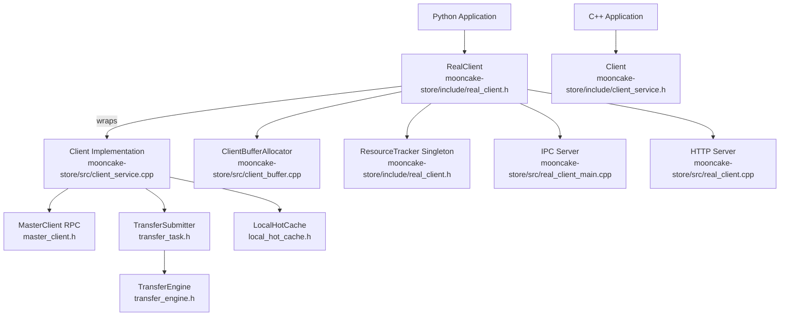
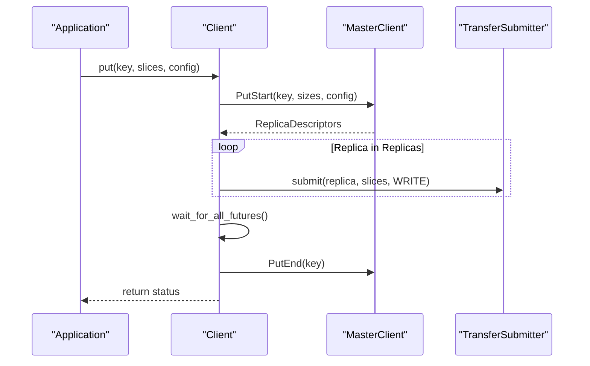
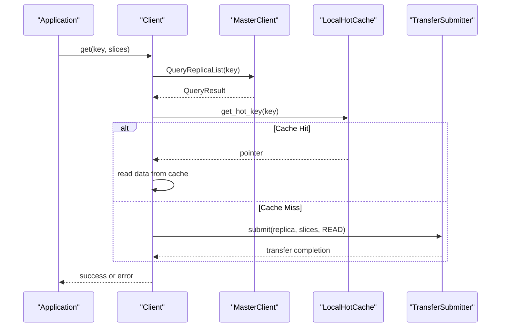
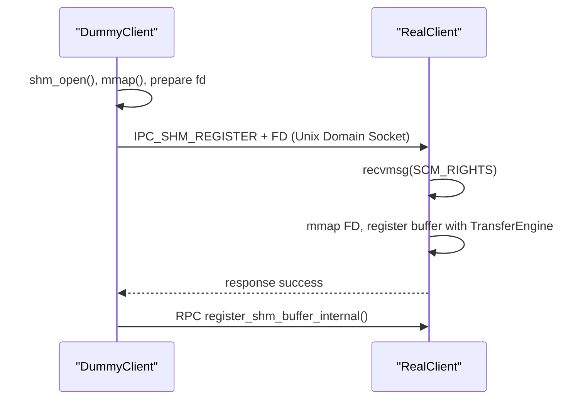

<!-- source: DeepWiki mcp.deepwiki.com · repo kvcache-ai/Mooncake · page 5.3 Client Operations · fetched 2026-10-21 -->

# Client Operations

<details>
<summary>Relevant source files</summary>

The following files were used as context for generating this wiki page:

- [docs/source/api-reference/python/mooncake-store.md](docs/source/api-reference/python/mooncake-store.md)
- [mooncake-integration/store/store_py.cpp](mooncake-integration/store/store_py.cpp)
- [mooncake-store/include/client_service.h](mooncake-store/include/client_service.h)
- [mooncake-store/include/common/mmap_aligned.h](mooncake-store/include/common/mmap_aligned.h)
- [mooncake-store/include/dummy_client.h](mooncake-store/include/dummy_client.h)
- [mooncake-store/include/pyclient.h](mooncake-store/include/pyclient.h)
- [mooncake-store/include/real_client.h](mooncake-store/include/real_client.h)
- [mooncake-store/include/shm_helper.h](mooncake-store/include/shm_helper.h)
- [mooncake-store/include/spdk/spdk_wrapper.h](mooncake-store/include/spdk/spdk_wrapper.h)
- [mooncake-store/src/client_service.cpp](mooncake-store/src/client_service.cpp)
- [mooncake-store/src/config/shm_spdk_registration_config.cpp](mooncake-store/src/config/shm_spdk_registration_config.cpp)
- [mooncake-store/src/config/shm_spdk_registration_config.h](mooncake-store/src/config/shm_spdk_registration_config.h)
- [mooncake-store/src/dummy_client.cpp](mooncake-store/src/dummy_client.cpp)
- [mooncake-store/src/real_client.cpp](mooncake-store/src/real_client.cpp)
- [mooncake-store/src/real_client_main.cpp](mooncake-store/src/real_client_main.cpp)
- [mooncake-store/src/shm_helper.cpp](mooncake-store/src/shm_helper.cpp)
- [mooncake-store/src/spdk/spdk_wrapper.cpp](mooncake-store/src/spdk/spdk_wrapper.cpp)
- [mooncake-store/tests/client_integration_test.cpp](mooncake-store/tests/client_integration_test.cpp)
- [mooncake-store/tests/e2e/run_session_ranges_tcp_e2e.sh](mooncake-store/tests/e2e/run_session_ranges_tcp_e2e.sh)
- [mooncake-store/tests/e2e/session_ranges_tcp_e2e.py](mooncake-store/tests/e2e/session_ranges_tcp_e2e.py)
- [mooncake-store/tests/pybind_client_test.cpp](mooncake-store/tests/pybind_client_test.cpp)
- [mooncake-store/tests/shm_spdk_registration_config_test.cpp](mooncake-store/tests/shm_spdk_registration_config_test.cpp)

</details>


This page provides detailed technical documentation of the `RealClient` and `Client` classes within Mooncake Store, focusing on their setup, data operations (put/get), buffer management, connection lifecycle, DummyClient IPC mechanisms, and the local hot cache subsystem. It explains implementation details, data flow, key functions, and includes diagrams bridging user concepts to precise code entities.

---

## Client Interfaces

Mooncake Store defines two main client classes to interact with the distributed store:

| Class           | Return Convention                    | Primary Usage                                                               |
|-----------------|------------------------------------|-----------------------------------------------------------------------------|
| **`Client`**       | `tl::expected<T, ErrorCode>`       | C++ applications; manages slices, replicas, metadata, and RPC coordination [mooncake-store/include/client_service.h:72-104]() |
| **`RealClient`**   | `int` / `int64_t` / `shared_ptr<BufferHandle>` | Python bindings via pybind11; wraps `Client` and manages buffer lifetimes and IPC [mooncake-store/include/real_client.h:77-185]() |
| **`DummyClient`**  | `int` / `int64_t`                  | Lightweight IPC client communicating with a separate `RealClient` process for multi-process scenarios [mooncake-store/include/dummy_client.h:19-165]() |

`Client` exposes a robust C++ interface for querying object metadata and performing get/put operations with batch and ranged slice support. `RealClient` adapts these operations for Python bindings, adds buffer registration, and runs an IPC server for multi-process coordination. `DummyClient` is a minimal client that interfaces via RPC and shared memory with a `RealClient` process, enabling inter-process buffer sharing.

### Diagram: Client Architecture and Code Mapping

This diagram bridges high-level client concepts to their corresponding code entities and files:



Sources: [mooncake-store/include/real_client.h:77-185](), [mooncake-store/src/real_client.cpp:27-100](), [mooncake-store/include/client_service.h:72-104](), [mooncake-store/src/client_service.cpp:1-210](), [mooncake-store/src/real_client_main.cpp:20-110]()

---

## Client Class Overview

### `Client` Class

`Client` is the core C++ client interface managing interactions with Mooncake Store. It handles metadata operations, lease management, replica coordination, and orchestrates data transfers through the Transfer Engine.

**Key Responsibilities:**

- Query object metadata and replica locations from the Master service.
- Manage leases to maintain ownership of KVCache entries.
- Coordinate data transfers using `TransferSubmitter` working with the Transfer Engine.
- Support batch and ranged slice get/put operations.
- Integrate local hot cache to accelerate repeated reads.
- Manage buffer registrations and segment mounts for zero-copy transfers.

`Client` is defined in the header [mooncake-store/include/client_service.h:72-104]() and implemented extensively in [mooncake-store/src/client_service.cpp]().

---

### `RealClient` Class

`RealClient` is a Python-friendly wrapper over `Client` providing:

- Simplified interfaces returning plain integers, sizes, or `BufferHandle` pointers, suitable for Python binding with pybind11.
- Buffer registration APIs for zero-copy memory management.
- An IPC server based on coroutine RPC and Unix Domain Sockets to serve concurrent `DummyClient` processes.
- Optional embedded HTTP server exposing health checks and metrics.
- Support for Ascend device contexts when compiled with Ascend SDK.
- Resource tracking, signal handling, and cleanup on process termination.

Key methods include `setup_real()`, which initializes transfers, connections, IPC sockets, and optionally HTTP servers.

Defined in [mooncake-store/include/real_client.h:77-185]() and implemented primarily in [mooncake-store/src/real_client.cpp]() with IPC server registration in [mooncake-store/src/real_client_main.cpp:38-111]().

---

## Client Creation and Initialization

### Creating a `Client` Instance

`Client::Create()` is a static factory method that initializes a heap-allocated `Client` instance configured with:

- Local hostname.
- Metadata connection string (can be P2PHANDSHAKE for decentralized discovery).
- Transfer protocol ("rdma", "tcp", etc.).
- Optional RDMA device names.
- Master server address (non-HA or HA connection string).
- Optional externally supplied Transfer Engine instance.
- Optional tenant id and client labels.

This method sets up transport protocols, metadata shards, RPC clients to the master, and spawn background threads for health monitoring and heartbeats.

```cpp
static std::optional<std::shared_ptr<Client>> Create(
    const std::string& local_hostname,
    const std::string& metadata_connstring,
    const std::string& protocol,
    const std::optional<std::string>& device_names = std::nullopt,
    const std::string& master_server_entry = kDefaultMasterAddress,
    const std::shared_ptr<TransferEngine>& transfer_engine = nullptr,
    std::map<std::string, std::string> labels = {},
    const std::string& tenant_id = "default");
```

Sources: [mooncake-store/include/client_service.h:97-104](), [mooncake-store/src/client_service.cpp:50-90]()

---

### Setting up `RealClient`

The main initialization method for `RealClient` is `setup_real()`. It performs:

- Instantiation and initialization of the underlying `Client` instance.
- Creation and configuration of buffer pools for local buffers.
- IPC server startup with coroutine RPC handlers over a Unix Domain Socket for inter-process DummyClient communication.
- Optional embedded HTTP server launch for client health and metrics.
- SSD offload patching for hybrid storage tiering (conditionally).
- Handling of multi-tenant contexts.
- Ascend device context manager initialization for environment-aware memory allocation.

```cpp
int setup_real(
    const std::string &local_hostname,
    const std::string &metadata_server,
    size_t global_segment_size = 16MB,
    size_t local_buffer_size = 16MB,
    const std::string &protocol = "tcp",
    const std::string &rdma_devices = "",
    const std::string &master_server_addr = "127.0.0.1:50051",
    const std::shared_ptr<TransferEngine> &transfer_engine = nullptr,
    const std::string &ipc_socket_path = "",
    bool enable_ssd_offload = false,
    const std::string &ssd_offload_path = "",
    const std::string &tenant_id = "default",
    bool enable_client_http_server = false,
    int client_http_port = DEFAULT_CLIENT_HTTP_PORT);
```

The setup process registers numerous RPC handlers related to put/get, buffer acquisition/release, hot cache operations, and segment management as seen in [mooncake-store/src/real_client_main.cpp:38-111]().

The IPC server allows DummyClient processes to offload buffer operations and memory registration to a centralized RealClient process for efficient data sharing and coordination.

Sources: [mooncake-store/include/real_client.h:80-102](), [mooncake-store/src/real_client.cpp:30-100](), [mooncake-store/src/real_client_main.cpp:20-110]()

---

## Core Data Operations

### Put Operation

The `put()` method stores a key-value object in Mooncake Store, with optional replication settings.

**Internal Steps:**

1. Query master service to initiate a put operation and acquire replica placement metadata.
2. Prepare data slices from input payload.
3. Utilize `TransferSubmitter` to dispatch `WRITE` transfers for each replica.
4. Wait for all transfers to complete.
5. Finalize put operation by invoking `PutEnd` RPC to master.

This process efficiently pipelines the replication of data to remote segments using the transfer engine protocols.

#### Flow Diagram: Put Operation



Sources: [mooncake-store/include/client_service.h:115-118](), [mooncake-store/src/client_service.cpp:210-260]()

---

### Get Operation

The `get()` method retrieves an object by key and stores the data into provided slices (buffers).

**Internal Workflow:**

1. Query master for replicas and lease information using `Query`.
2. Check `LocalHotCache` for cached data from previous reads.
3. If cache hit, map buffer indirectly via cached memory.
4. On cache miss, submit `READ` transfers using `TransferSubmitter`.
5. Await transfer completions.
6. Return success or detailed error codes.

The `RealClient` exposes batch and ranged fetch APIs such as `get_into_ranges()` for advanced multi-buffer, multi-key reads.

#### Flow Diagram: Get Operation



Sources: [mooncake-store/include/client_service.h:112-113](), [mooncake-store/include/real_client.h:140-149]().

---

## Buffer Management

Mooncake client employs fine-grained buffer management to enable zero-copy data transfers and efficient memory usage.

### ClientBufferAllocator

- Manages a contiguous memory pool, allocated via mmap or hugepages.
- Allocates buffer regions for transfer tasks and returns `BufferHandle` objects managing lifetime.
- Produces `Slice` sequences representing memory spans for each replica segment.

### BufferHandle

An RAII-style handle that retains ownership of allocated buffers. Supports both owned allocations and views into pre-registered buffers sourced from the user.

### Zero-Copy Registration API

`RealClient` exposes:

```cpp
int register_buffer(void *buffer, size_t size);
int unregister_buffer(void *buffer);
```

These functions register arbitrary user-provided buffers with the transfer engine to enable zero-copy put/get operations, avoiding intermediate copies by leveraging registered memory regions.

Sources: [mooncake-store/src/client_buffer.cpp:10-190](), [mooncake-store/include/real_client.h:117-120]().

---

## DummyClient and IPC

`DummyClient` provides a lightweight IPC client interface to connect to a `RealClient` process, typically in multi-process scenarios (e.g., model serving pipelines segmented by process).

### IPC Shared Memory Registration

- `DummyClient` creates shared memory (shm) segments using `shm_open` and `mmap`.
- It sends the file descriptor (FD) for the shm segment to `RealClient` via a Unix Domain Socket with the `SCM_RIGHTS` flag.
- `RealClient` receives the FD, maps it, and registers the allocated memory with the Transfer Engine for shared usage.
- This setup allows zero-copy sharing of buffers between processes.

This IPC shm registration lowers overhead by avoiding data copies between Dummy and Real clients, and enables pinned memory regions to participate in high-speed transport layers.

#### IPC SHM Registration Flow Diagram



### Async RPC Invocation

`DummyClient` uses asynchronous coroutine RPC clients to forward requests to `RealClient`. It incorporates connection and inflight request management to handle reconnects and synchronization safely.

Sources: [mooncake-store/include/pyclient.h:120-150](), [mooncake-store/include/dummy_client.h:19-165](), [mooncake-store/src/dummy_client.cpp:180-210]()

---

## Local Hot Cache System

The Local Hot Cache subsystem provides a per-client in-memory cache for frequently accessed KVCache blocks, reducing remote fetch latency and network load.

### Features

- Maintains blocks in an LRU list for capacity management and eviction.
- Supports "touch" mechanisms to refresh usage statistics.
- Supports segment-based cache in pinned memory for zero-copy reads.
- Manages `HotMemBlock` and `HotCachePutToken` structures to track cache occupancy and ownership.
- Supports multi-threaded safe accesses and integrates with the client get path transparently.
- Uses shared memory regions for cross-process cache sharing (related to IPC segments).

### Local Hot Cache Code Entity Mapping

| System Name          | Code Entity                | File Reference                             |
|----------------------|----------------------------|--------------------------------------------|
| Cache Block          | `HotMemBlock`              | [mooncake-store/include/local_hot_cache.h:100-120]()             |
| Hot Cache Store      | `LocalHotCache`            | [mooncake-store/include/local_hot_cache.h:120-130]()             |
| Shared Memory Segment | ShmSegment structs         | [mooncake-store/include/pyclient.h:22-34]()                    |
| Cache Put Token      | `HotCachePutToken`         | [mooncake-store/include/local_hot_cache.h:112-116]()                   |

Sources: [mooncake-store/src/client_service.cpp:40-60](), [mooncake-store/include/local_hot_cache.h](), [mooncake-store/include/client_service.h:27-28]()

---

## Client Lifecycle and Resource Tracking

### `ResourceTracker` Singleton

Handles lifecycle management, cleanup, and signal handling for clients in the process:

- Allows registration of `PyClient` instances upon creation.
- Sets up signal handlers for SIGINT, SIGTERM, etc.
- Runs a dedicated signal-handling thread for clean shutdown.
- Supports safe resource cleanup on exit to avoid leaks in pinned buffer registries and IPC segments.
- Detects the Python interpreter presence to avoid conflicting signal handling when embedded.

Methods include `getInstance()`, `registerInstance()`, and `cleanupAllResources()`.

Sources: [mooncake-store/include/real_client.h:40-80](), [mooncake-store/src/real_client.cpp:10-80]()

---

### Background Threads and Ping

Clients run background threads to:

- Periodically ping and refresh leases with the master service.
- Monitor connection health.
- Manage cleanup and transfer task polling.

These threads ensure steady state consistency and fault-tolerant operation.

Sources: [mooncake-store/include/client_service.h:18-40](), [mooncake-store/src/client_service.cpp:400-650]()

---

# Summary

This section documents Mooncake Store client operations and their corresponding code implementations. The `Client` class provides a robust C++ interface to distributed object metadata and data transfer coordination. `RealClient` wraps `Client` for Python bindings and manages IPC servers for multi-process zero-copy buffer sharing. The `DummyClient` acts as a minimal IPC client proxying requests to `RealClient`. Buffer management and zero-copy semantics boost throughput and latency. The Local Hot Cache provides a layer of client-side object caching to accelerate repeated data accesses.

Together, these components form a high-performance, resilient client abstraction for Mooncake's KVCache distributed object store.

---

# References

- [mooncake-store/include/client_service.h:72-177]()
- [mooncake-store/include/real_client.h:37-185]()
- [mooncake-store/include/dummy_client.h:19-165]()
- [mooncake-store/include/pyclient.h:20-150]()
- [mooncake-store/src/real_client.cpp:1-185]()
- [mooncake-store/src/client_service.cpp:1-210]()
- [mooncake-store/src/dummy_client.cpp:1-206]()
- [mooncake-store/src/real_client_main.cpp:20-140]()
- [mooncake-store/src/client_buffer.cpp:17-190]()
- [mooncake-store/include/local_hot_cache.h]()
- [mooncake-store/src/client_service.cpp:40-60]()

---

