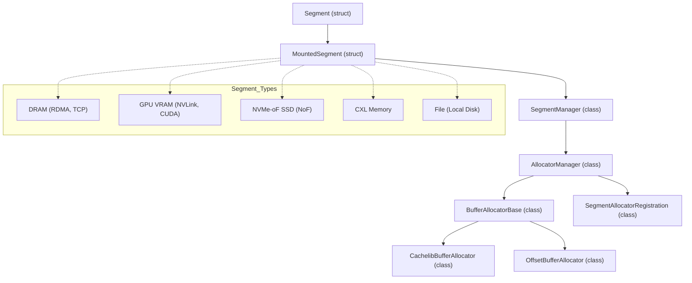
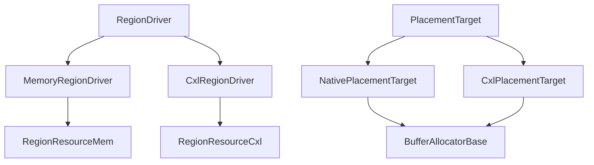
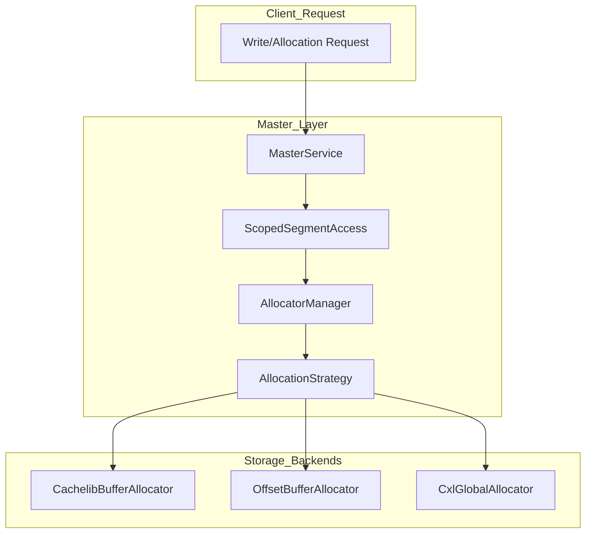

<!-- source: DeepWiki mcp.deepwiki.com · repo kvcache-ai/Mooncake · page 5.6 Segment Management · fetched 2026-10-21 -->

# Segment Management

<details>
<summary>Relevant source files</summary>

The following files were used as context for generating this wiki page:

- [mooncake-store/include/allocation_strategy.h](mooncake-store/include/allocation_strategy.h)
- [mooncake-store/include/allocator.h](mooncake-store/include/allocator.h)
- [mooncake-store/include/segment.h](mooncake-store/include/segment.h)
- [mooncake-store/include/segment/usage.h](mooncake-store/include/segment/usage.h)
- [mooncake-store/include/storage/distributed/dfs_allocator_interface.h](mooncake-store/include/storage/distributed/dfs_allocator_interface.h)
- [mooncake-store/include/storage/distributed/immutable_bucket_allocator.h](mooncake-store/include/storage/distributed/immutable_bucket_allocator.h)
- [mooncake-store/include/storage/distributed/shard_allocator.h](mooncake-store/include/storage/distributed/shard_allocator.h)
- [mooncake-store/src/allocator.cpp](mooncake-store/src/allocator.cpp)
- [mooncake-store/src/segment.cpp](mooncake-store/src/segment.cpp)
- [mooncake-store/src/storage/distributed/immutable_bucket_allocator.cpp](mooncake-store/src/storage/distributed/immutable_bucket_allocator.cpp)
- [mooncake-store/src/storage/distributed/shard_allocator.cpp](mooncake-store/src/storage/distributed/shard_allocator.cpp)
- [mooncake-store/tests/allocation_strategy_test.cpp](mooncake-store/tests/allocation_strategy_test.cpp)
- [mooncake-store/tests/buffer_allocator_test.cpp](mooncake-store/tests/buffer_allocator_test.cpp)
- [mooncake-store/tests/dfs_immutable_bucket_allocator_test.cpp](mooncake-store/tests/dfs_immutable_bucket_allocator_test.cpp)

</details>


## Purpose and Scope

Segment Management in Mooncake Store manages physical memory regions ("segments") that serve as storage for object replicas. These segments represent memory across multiple hardware tiers such as DRAM, GPU memory, CXL-attached memory, and files on disk (including NVMe-over-Fabrics SSD segments). The master service tracks these segments, handles their allocation and lifecycle (mount, remount, unmount), and manages buffer allocators associated with each segment.

This page details:

- Segment metadata and types (DRAM, GPU, CXL, and file-backed)
- Allocation strategies and NUMA-aware segmentation
- The segment mount/unmount lifecycle
- Region drivers and placement target abstractions
- The AllocatorManager container
- Placement index management
- Thread safety considerations

The documentation integrates code entity references and control/data flow diagrams for comprehensive understanding.

Sources:  
[mooncake-store/include/segment.h:24-196](),  
[mooncake-store/src/segment.cpp:1-186](),  
[mooncake-store/include/allocation_strategy.h:20-187](),  
[mooncake-store/include/allocator.h:19-203](),  
[mooncake-store/src/allocator.cpp:1-181](),  
[mooncake-store/tests/allocation_strategy_test.cpp:1-172]()

---

## Segment Metadata and Types

### Segment Data Structure

Mooncake tracks segments using the `Segment` struct and related types such as `NoFSegment` for NVMe-over-Fabrics storage. The core `Segment` struct encapsulates metadata about each memory region:

```cpp
struct Segment {
    UUID id;                    // Unique identifier (cluster-wide uniqueness)
    std::string name;           // Logical name for placement & preference
    uintptr_t base;             // Base memory address for allocations
    size_t size;                // Segment capacity in bytes
    std::string te_endpoint;    // TransferEngine endpoint ("ip:port") for P2P data
    std::string protocol;       // Transport protocol (e.g. "rdma", "tcp", "cxl")
    std::string host_id;        // Optional host or NUMA node identifier
};
```

- `name` allows preference for allocation locality and policy.
- `base` is used as the address base by buffer allocators.
- `te_endpoint` defines which Transfer Engine endpoint to use for segment data transfer.
- `host_id` supports NUMA-aware allocation optimizations.

Mounted segments are wrapped as `MountedSegment`, which hold additional metadata such as `SegmentStatus` and a pointer to the buffer allocator used to allocate buffers from that segment.

### Segment Types by Storage Backend

Segments represent memory or storage resources across multiple backends:

| Segment Type       | Protocol       | Characteristics                          | Use Case                                  |
|--------------------|----------------|-----------------------------------------|-------------------------------------------|
| DRAM               | rdma, tcp      | CPU-resident volatile memory             | Primary fast KVCache storage               |
| GPU VRAM           | nvlink, cuda   | GPU device memory with high bandwidth    | GPU-local disaggregated cache              |
| NVMe-over-Fabrics (NoF) | nof         | Remote SSD storage via fabrics            | Cold or large capacity storage             |
| CXL Memory         | cxl            | Disaggregated DRAM over CXL fabric       | Shared, scalable memory pool               |
| Local Disk         | file           | Persistent filesystem storage             | Persistent offload and backup              |

CXL segments feature a global (shared) allocator managed by the `SegmentManager` independently of specific client mounts [mooncake-store/src/segment.cpp:130-132]().

NVMe-oF (NoF) segments may leverage shared memory with SPDK for zero-copy transfers. SPDK registration can be enabled by `MC_STORE_REGISTER_SPDK` environment variable, and it requires hugepage-backed memory [mooncake-store/src/shm_helper.cpp:88-104](), [mooncake-store/src/shm_helper.cpp:91-100](), [mooncake-store/src/config/shm_spdk_registration_config.cpp:8-13]().

---

## Segment Allocation Strategies and NUMA-Aware Segmentation

### AllocatorManager Container

`AllocatorManager` maintains mappings from segment names to their buffer allocator registrations. It supports adding and removing allocators per segment name and provides access to allocators for allocation requests:

```cpp
class AllocatorManager {
  public:
    std::shared_ptr<SegmentAllocatorRegistration> addAllocator(
        const std::string& name,
        const std::shared_ptr<BufferAllocatorBase>& allocator,
        std::shared_ptr<ClientLivenessRecord> client_liveness = nullptr);

    bool removeAllocator(
        const std::string& name,
        const std::shared_ptr<SegmentAllocatorRegistration>& registration);

    const std::vector<std::shared_ptr<SegmentAllocatorRegistration>>* getAllocators(
        const std::string& name) const;

    const std::vector<std::string>& getNames() const; // Vector of all segment names
};
```

- Allocators are registered with an optional client liveness record for fault tolerance.
- Removal cleans up registrations and segment name records when no allocators remain.
- The manager is *not* internally thread-safe; external synchronization is imposed by `SegmentManager` [mooncake-store/include/allocation_strategy.h:33-187]().

### AllocationStrategy Abstraction

Mooncake implements pluggable allocation strategies that consume the current allocator registry and choose allocations for incoming buffer slice requests.

- Strategies receive allocator candidates via `AllocatorManager`.
- They utilize hints like preferred segments and exclusion lists.
- Implementations include `RandomAllocationStrategy` and `FreeRatioFirstAllocationStrategy` which consider free space ratios [mooncake-store/tests/allocation_strategy_test.cpp:1-172]().

### NUMA-Aware Host Segmentation and Placement Index

Segments are indexed by their `host_id` for NUMA-aware or multi-host deployments:

```cpp
using HostSegmentIndex = std::map<
    std::string,                   // host_id
    std::map<std::string,          // segment name
             std::set<UUID>>>;    // set of segment IDs
```

- This allows prioritizing segments local to a host or CPU socket.
- Function `BuildHostOrderedSegments` produces a deterministic ordered segment list starting from a host ID and shuffles segment ordering by a hash of a key for load balancing [mooncake-store/src/segment.cpp:49-92]().

This segmentation index supports balancing allocation requests across multiple hosts or NUMA nodes for locality and throughput optimization.

---

### Diagram: Segment Types and Allocation Components to Code Entities



Sources:  
[mooncake-store/include/segment.h:28-35](),  
[mooncake-store/src/allocator.cpp:139-152](),  
[mooncake-store/include/allocation_strategy.h:33-110](),  
[mooncake-store/include/allocator.h:19-203]()

---

## Segment Mount/Unmount Lifecycle

Segments transition through defined lifecycle states recorded by `SegmentStatus` (e.g., OK, DRAINING, UNMOUNTING).

| State                 | Meaning                                             |
|-----------------------|-----------------------------------------------------|
| `OK`                  | Mounted and available for new allocations          |
| `DRAINING`            | Draining allocations, only reads accepted          |
| `DRAINED`             | Drained fully, preparing for unmount                |
| `GRACEFULLY_UNMOUNTING` | Readable but no new allocations, delayed unmount   |
| `UNMOUNTING`          | Being unmounted, no operations allowed              |

### Mounting Segments (`ScopedSegmentAccess::MountSegment`)

The mount sequence performs:

- Validation of segment parameters (nonzero base and size) [mooncake-store/src/segment.cpp:143-146]() and Cachelib alignment checks [mooncake-store/src/allocator.cpp:17-24]().

- Construction of an appropriate buffer allocator—either `CachelibBufferAllocator` or `OffsetBufferAllocator`—based on configuration and segment properties [mooncake-store/src/allocator.cpp:150-176]().

- Registration of the allocator with the `AllocatorManager`, updating the host segment index by `host_id` for locality.

- Error handling for duplicate names, invalid parameters, and segments in transitional states.

### Remounting Segments (`ScopedSegmentAccess::ReMountSegment`)

- Supports batch remounts for reconnecting clients.

- Validates segments and merges states with existing mounts safely, skipping segments that are currently unmounting.

### Unmounting Segments

Unmount involves multiple phases to safely release resources:

- `PrepareUnmountSegment` removes the buffer allocator handle, detaching usage trackers and releasing allocations.

- `CommitUnmountSegment` deletes segment metadata and optionally removes segment name registrations from the allocator management index to avoid dangling references [mooncake-store/include/segment.h:117-136]().

- Graceful unmounts keep metadata temporarily to support delayed resource reclamation.

---

### Diagram: Segment Mount/Unmount Lifecycle and Key Classes

```mermaid
stateDiagram-v2
    [*] --> Mounting : MountSegment()
    Mounting --> OK : Successful mount
    Mounting --> Error : Validation failure

    OK --> Draining : Mark DRAINING
    Draining --> Drained : Mark DRAINED
    Drained --> GracefulUnmount : PrepareGracefulUnmountSegment()
    GracefulUnmount --> Unmounting : PrepareUnmountSegment()
    Unmounting --> [*] : CommitUnmountSegment()

    state Mounting {
        direction LR
        ValidateParams --> CreateAllocator
        CreateAllocator --> RegisterAllocator
        RegisterAllocator --> FinalizeMount
    }

class MountSegment,PrepareUnmountSegment,CommitUnmountSegment {
    description:
    "Implements lifecycle operations on segments.
     - Uses ScopedSegmentAccess for locking.
     - Creates/removes buffer allocators.
     - Updates segment status and metadata."
}
```

Sources:  
[mooncake-store/include/segment.h:85-135](),  
[mooncake-store/src/segment.cpp:169-186](),  
[mooncake-store/src/allocator.cpp:17-24](),  
[mooncake-store/src/allocator.cpp:150-176]()

---

## Region Drivers and Placement Targets

Mooncake abstracts physical segment management with the following layers:

- **RegionDriver**: Lifecycle manager responsible for preparing, adopting, and committing region resources for allocation. Different drivers handle different segment types and hardware.

- **PlacementTarget**: Represents an allocator target within the placement index by segment name, linking to appropriate allocators and protocol metadata.

Examples:

- `MemoryRegionDriver` handles standard CPU memory regions.

- `CxlRegionDriver` manages CXL-backed segments, including required base address transformations.

- `NativePlacementTarget` and `CxlPlacementTarget` provide segment-specific allocation interfaces aligned with their drivers [mooncake-store/include/placement/target.h]().

This layered design facilitates extensible support for diverse memory regions uniformly and cleanly.

---

### Diagram: Region Drivers and Placement Targets to Allocators



Sources:  
[mooncake-store/include/placement/target.h:21-39]()

---

## Allocator Types and Buffer Handling

The system uses polymorphic buffer allocators derived from `BufferAllocatorBase`:

- **CachelibBufferAllocator**: Integrates Facebook's CacheLib, imposing strict slab alignment and predictable allocation traits [mooncake-store/src/allocator.cpp:17-24, 139-152]().

- **OffsetBufferAllocator**: Offset-based allocator providing accurate largest-free-region reporting and efficient offset tracking [mooncake-store/src/allocator.cpp:170-176]().

- **CXL Allocator**: Managed as a global singleton with segment-base pointer transformations particular to CXL memory address spaces.

Buffers are represented by `AllocatedBuffer` objects that hold allocator references, pointers, sizes, and liveness metadata. They can serialize into `Descriptor` structures for coordination with the Transfer Engine and zero-copy data movement.

Special CXL buffer methods `change_to_cxl` and `get_vaddr_from_cxl` implement transformations between offset and virtual addresses relative to the global CXL base [mooncake-store/src/allocator.cpp:113-124]().

---

## Thread Safety and Locking

Segment management concurrency is coordinated by the `SegmentManager`'s `std::shared_mutex segment_mutex_`, allowing multiple concurrent readers or exclusive writers.

- `ScopedSegmentAccess` manages RAII-style locking for safe mutation and querying of segments during mount/unmount and allocation operations [mooncake-store/include/segment.h:72-80]().

- `ScopedAllocatorAccess` provides thread-safe access for allocator-related queries.

Allocator management is *not* internally thread-safe and relies on external locking by `SegmentManager`.

---

## Summary Diagram: Segment Management Workflow



This diagram traces the flow from client allocation requests through master service and scoped locking to allocator management and buffer allocator instantiations that supply requested backend memory.

---

# References

- `Segment` struct, mount/unmount lifecycle: [mooncake-store/include/segment.h:24-196](), [mooncake-store/src/segment.cpp:1-186]()  
- Allocation strategies and allocator management: [mooncake-store/include/allocation_strategy.h:20-187](), [mooncake-store/tests/allocation_strategy_test.cpp:1-172]()  
- Buffer allocator implementations: [mooncake-store/include/allocator.h:19-203](), [mooncake-store/src/allocator.cpp:1-181]()  
- CXL allocator and special handling: [mooncake-store/src/segment.cpp:130-132](), [mooncake-store/src/allocator.cpp:113-124]()  
- Thread safety and scoped segment access: [mooncake-store/include/segment.h:72-80]()  
- SPDK registration for NoF segments: [mooncake-store/src/shm_helper.cpp:88-104](), [mooncake-store/src/config/shm_spdk_registration_config.cpp:8-13]()

---

# Additional Notes

- Segment registration is closely tied to client liveness tracking for fault tolerance; allocator registrations incorporate client liveness references to prevent allocation from stale or disconnected clients.

- The `HostSegmentIndex` structure supports advanced load balancing across nodes using a hash-based segment ordering algorithm respecting writer locality.

- File- and SSD-backed segments (`NoFSegment`) support eviction and offload for cold storage but are managed by specialized allocators and eviction schemes not detailed here.

- The segment management system supports extensions such as region drivers for new memory technologies seamlessly due to its layered abstractions.

---

