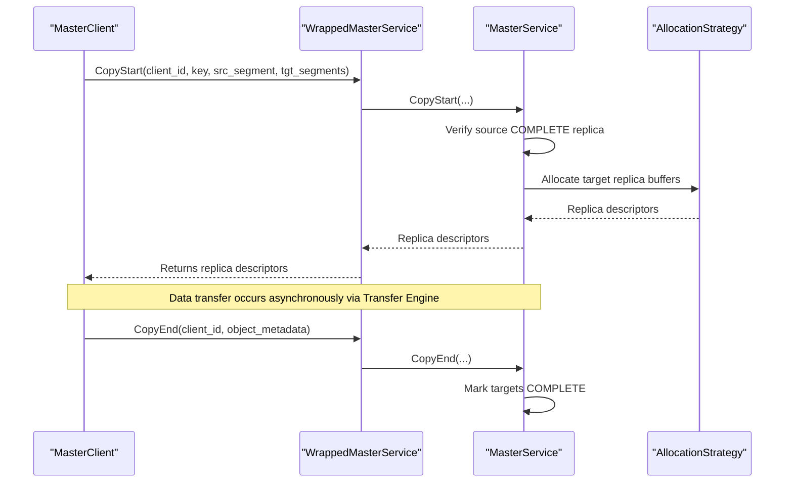
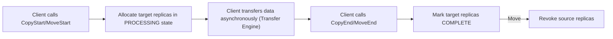
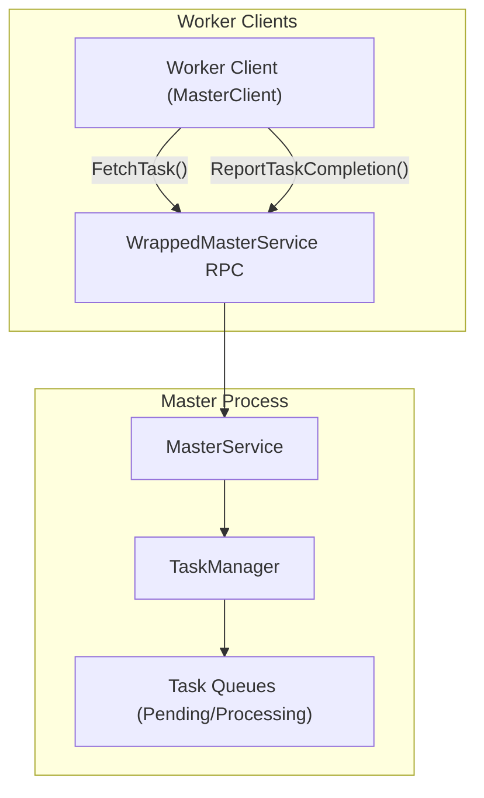
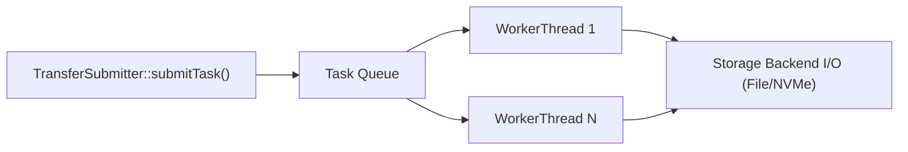
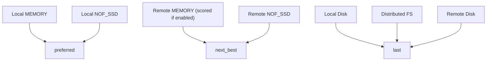
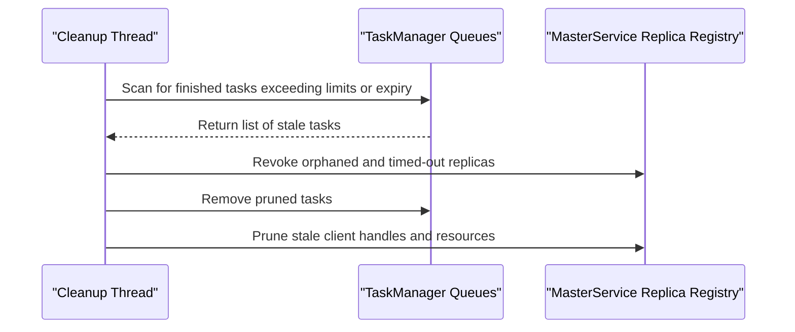

<!-- source: DeepWiki mcp.deepwiki.com · repo kvcache-ai/Mooncake · page 5.7 Replication and Async Tasks · fetched 2026-10-21 -->

# Replication and Async Tasks

Relevant source files

The following files were used as context for generating this wiki page:

- [mooncake-store/include/config/replica_selection_config.h](mooncake-store/include/config/replica_selection_config.h)
- [mooncake-store/include/ha_metric_manager.h](mooncake-store/include/ha_metric_manager.h)
- [mooncake-store/include/mutex.h](mooncake-store/include/mutex.h)
- [mooncake-store/include/replica_selection.h](mooncake-store/include/replica_selection.h)
- [mooncake-store/src/config/replica_selection_config.cpp](mooncake-store/src/config/replica_selection_config.cpp)
- [mooncake-store/src/ha_metric_manager.cpp](mooncake-store/src/ha_metric_manager.cpp)
- [mooncake-store/tests/ha/standby/ha_metric_manager_test.cpp](mooncake-store/tests/ha/standby/ha_metric_manager_test.cpp)
- [mooncake-store/tests/mutex_test.cpp](mooncake-store/tests/mutex_test.cpp)
- [mooncake-store/tests/replica_selection_config_test.cpp](mooncake-store/tests/replica_selection_config_test.cpp)
- [mooncake-store/tests/replica_selection_test.cpp](mooncake-store/tests/replica_selection_test.cpp)
- [mooncake-store/tests/ssd_metrics_test.cpp](mooncake-store/tests/ssd_metrics_test.cpp)
- [mooncake-store/tests/task_executor_test.cpp](mooncake-store/tests/task_executor_test.cpp)
- [mooncake-store/tests/task_integration_test.cpp](mooncake-store/tests/task_integration_test.cpp)

This page documents the replication API (`CopyStart`/`CopyEnd`, `MoveStart`/`MoveEnd`), the asynchronous task system managed by the `TaskManager`, background worker pools, task lifecycle management, replica selection policy, and cleanup threads within Mooncake Store. These subsystems support cluster-wide data movement, replica management, tier offloading, and background task pruning to guarantee consistency, fault tolerance, and scalability.

---

## 1. Synchronous Replication API

Mooncake Store exposes synchronous, client-orchestrated replication primitives for copying and moving object replicas between different storage segments (e.g., DRAM, GPU memory, and CXL). These APIs are available as RPC methods through `WrappedMasterService` and implemented inside `MasterService`.

### Operations Overview

| Operation | Source Segment Action | Target Segment Action | Use Case |
|-----------|----------------------|----------------------|----------|
| **Copy**  | Source replica preserved (`COMPLETE`) | Targets allocated (`PROCESSING` → `COMPLETE`) | Increase redundancy, load balancing |
| **Move**  | Source replica revoked after completion | Target allocated (`PROCESSING` → `COMPLETE`) | Segment migration, defragmentation |

Replication tasks proceed through a **start phase**, where target buffers are allocated and marked as `PROCESSING`; an **out-of-band data transfer** phase (typically via Transfer Engine); and an **end phase**, where target replicas are marked `COMPLETE` and source replicas are optionally revoked (for moves).

### Replication Control Flow and Key Classes

### Implementation Details

- **Copy/Move Start APIs**:  
  They validate a `COMPLETE` replica on the source segment and allocate target buffers in the `PROCESSING` state via the allocation strategy interface. Key functions:
  - `PutStart`, `BatchPutStart`, `UpsertStart`, `BatchUpsertStart` in `rpc_service.h` [mooncake-store/include/rpc_service.h:92-95,108-111,123-126,138-142]()
  - Replica allocation verification in `MasterService::HasExpectedReplicaAllocation` [mooncake-store/src/master_service.cpp:135-147]()

- **Copy/Move End APIs**:  
  Called after transfer completion (via Transfer Engine or other means), they mark target replicas as `COMPLETE`. For moves, source replicas are revoked atomically to maintain consistency. Functions include:
  - `PutEnd`, `BatchPutEnd`, `UpsertEnd`, `BatchUpsertEnd` [mooncake-store/include/rpc_service.h:98-100,114-117,128-130,144-146]()

- **Revocation APIs**:  
  These handle aborting in-flight or failed replications, revoking allocated replicas, and cleaning resources:
  - `PutRevoke`, `BatchPutRevoke`, `UpsertRevoke`, `BatchUpsertRevoke` [mooncake-store/include/rpc_service.h:102-105,119-122,132-135,148-150]()

### Summary of Replication API Flow

Sources:  
- [mooncake-store/include/rpc_service.h:92-150]()  
- [mooncake-store/src/master_service.cpp:135-147]()  
- [mooncake-store/include/master_service.h:127]()  
- [mooncake-store/include/rpc_service.h:92-100]()  

---

## 2. Asynchronous Task System and TaskManager

Mooncake Store includes a background asynchronous task system for cluster-wide operations such as replica copying, moving, offloading to tiers, and cleanup. This system is managed by the `TaskManager` embedded in `MasterService`.

### TaskManager Overview

- Centralized management of various async background task types (e.g., `REPLICA_COPY`, `REPLICA_MOVE`).
- Maintains queues of tasks in different states: `PENDING`, `PROCESSING`, `SUCCESS`, `FAILED`, and `CANCELLED`.
- Assigns tasks to worker clients on demand via RPC fetch calls.
- Supports retries and timeout policies to handle failures and worker preemptions.

### TaskManager-Worker Clients Interaction

### Task Lifecycle States and Behavior

| State      | Description                              | Timeout or Retry Behavior                       |
|------------|--------------------------------------|----------------------------------------------|
| **PENDING**   | Waiting in the queue to be picked     | Can time out → transition to `FAILED` if stale |
| **PROCESSING** | Claimed by a worker and in progress  | Processing timeout triggers retry if retries left |
| **SUCCESS**   | Task completed successfully           | Terminal                                       |
| **FAILED**    | Task failed after retries exhausted  | Terminal                                       |
| **CANCELLED** | Task revoked by user or system        | Terminal                                       |

### Fault Tolerance Mechanisms

- Tasks automatically retry according to max retry limits.
- Timeouts avoid hanging tasks due to worker failure or network issues.
- Retried tasks return to the `PENDING` queue for dispatch.

Sources:  
- [mooncake-store/include/master_service.h:53]()  

---

## 3. Worker Pools and Background Execution

Frequently, some async tasks involve blocking or slow I/O (e.g., file reads or NVMe requests). To prevent these from blocking main RPC threads, Mooncake employs worker pools to manage concurrency and task isolation.

### FilereadWorkerPool

- Dedicated thread pool for asynchronous file I/O operations, especially for local filesystems like NFS or 3FS.
- Tasks submitted via `TransferSubmitter::submitTask` are enqueued and executed by this pool.
- Supports concurrent file read tasks without blocking the main processing loop.

### SPDK/NoF Worker Pool

- Specialized QoS-aware worker pool for NVMe-over-Fabrics (NoF) or SPDK-backed storage I/O.
- Manages limited task submission slots using backpressure and priorities (`SpdkNofQos`).
- Completion is handled asynchronously via callbacks like `nvmf_io_complete`.
- Worker count configurable via environment variables such as `MC_NOF_WORKERS`.

### Worker Pool Execution Flow

These pools decouple slow I/O from latency-critical RPC and master activities, improving throughput and responsiveness.

Sources: Implementation details inferred from task manager and storage subsystem context; specific file paths not shown explicitly in the provided snippets.

---

## 4. Replica Selection Policy

When a client requests an object, the master returns a list of available replicas. The client uses a replica selection policy to pick the most suitable replica to fetch data from, balancing locality, replica type, and network protocol.

### Replica Types and Priority

| Priority         | Description                                      |
|------------------|------------------------------------------------|
| **Local MEMORY**  | Replica in local node’s fast DRAM or GPU memory |
| **Local NOF_SSD** | Local NVMe-oF SSD replicas                       |
| **Remote MEMORY** | Remote memory replicas (scoring supported)      |
| **Remote NOF_SSD**| Remote NVMe-oF SSD replicas                       |
| **Local Disk**    | Local disk-based replica                         |
| **Distributed FS**| Replicas on a distributed filesystem             |
| **Remote Disk**   | Replicas on remote disk storage                   |

### Replica Scoring and Selection Logic

Mooncake's replica selection logic is located in `replica_selection.h` and operates as follows:

1. **Locality First**:  
   Local `MEMORY` replicas always have highest priority over local `NOF_SSD`, which in turn outranks remote replicas.

2. **Scoring Remote MEMORY Replicas**:  
   When multiple remote `MEMORY` replicas exist, a scoring mechanism can be enabled to pick the best replica based on criteria like transport protocol (`rdma` preferred over `tcp`) or custom injected scorers.

3. **Backward Compatibility**:  
   Without scoring enabled (default), the first remote `MEMORY` replica returned by the master is selected.

### Enabling Remote Replica Scoring

- Controlled by the environment variable `MC_STORE_REPLICA_SCORING=1` or by programmatically injecting a scorer via `SetRemoteReplicaScorer()`.
- Default scorer prefers `rdma` protocol over `tcp` for remote memory replicas.
- The scoring mechanism is thread-safe and configurable at runtime.

### Code Entities and Functions

- `ReplicaScorer`: type alias to a function that scores replicas (`double(const Replica::Descriptor&)`) [mooncake-store/include/replica_selection.h:38]()
- `BuiltinRemoteReplicaScore`: assigns scores based on transport protocol [mooncake-store/include/replica_selection.h:70-79]()
- `RemoteReplicaScoringEnabled`: checks if scoring is active [mooncake-store/include/replica_selection.h:84-89]()
- `SelectBestReplica`: main selection function enforcing priority and scoring [mooncake-store/include/replica_selection.h:122-164]()
- `PickBestRemoteMemory`: returns best-scored remote memory replica [mooncake-store/include/replica_selection.h:94-111]()

### Replica Selection Priority Flow

### Unit Test Highlights

- Local memory replicas beat local NVMe-oF regardless of list order [mooncake-store/tests/replica_selection_test.cpp:126-152]()
- Local replicas have priority over remote ones regardless of protocol speed [mooncake-store/tests/replica_selection_test.cpp:107-118,167-177]()
- Scoring disabled by default, returning first remote memory replica instead [mooncake-store/tests/replica_selection_test.cpp:179-190]()

Sources:  
- [mooncake-store/include/replica_selection.h:5-164]()  
- [mooncake-store/tests/replica_selection_test.cpp:107-190]()  
- [mooncake-store/include/config/replica_selection_config.cpp:8-14]()  

---

## 5. Task and Replica Cleanup Threads

Mooncake uses background cleanup threads to maintain system health by pruning completed/failed tasks, revoking orphaned replicas, and freeing resources.

### Cleanup Responsibilities

- **Task Pruning**: Limits the number of stored finished tasks and purges tasks surpassing retention thresholds to control memory growth.
- **Orphaned Replica Release**: Severs replicas stuck in `PROCESSING` state due to client disconnects, task timeouts, or failed transfers.
- **Stale Handle Pruning**: Cleans up metadata shard handles that no longer correspond to active clients or tasks.
- **Consistency Enforcement**: Ensures that revoked replicas are deallocated and no stale state lingers.

### Cleanup Batch Size

- The cleanup of stale handles operates in bounded batches defined by `kStaleHandleCleanupBatchSize` [mooncake-store/src/master_service.cpp:71-76]() to avoid lock contention and maintain responsiveness.

### Cleanup Thread Control Flow

Sources:  
- [mooncake-store/src/master_service.cpp:71-76]()  

---

# Summary

| Component            | Key APIs / Classes                      | Description                                        |
|---------------------|---------------------------------------|---------------------------------------------------|
| Replication API      | `CopyStart`, `CopyEnd`, `MoveStart`, `MoveEnd`   in `MasterService` | Synchronous APIs for orchestrated replica copy/move operations with allocation, transfer, and completion coordination |
| Async Task Manager   | `TaskManager` (part of `MasterService`) | Background task lifecycle management: queueing, dispatch, retries, timeouts |
| Worker Pools         | `FilereadWorkerPool`, `SpdkNofQos`    | Thread pools for asynchronous file and NVMe block I/O tasks |
| Replica Selection    | Replica selection functions   in `replica_selection.h` | Policy for picking the best replica based on locality, type, and optional scoring |
| Cleanup Threads      | Background cleanup loops in `MasterService` | Prunes finished tasks, revokes orphaned replicas, and cleans stale state in bounded batches |

These components cooperate to support consistent, scalable, and fault-tolerant replica management and background processing in Mooncake’s distributed KVCache storage system.

---

Sources:  
- [mooncake-store/include/rpc_service.h:92-150]()  
- [mooncake-store/src/master_service.cpp:71-76]()  
- [mooncake-store/src/master_service.cpp:135-147]()  
- [mooncake-store/include/master_service.h:53,127]()  
- [mooncake-store/include/replica_selection.h:5-164]()  
- [mooncake-store/tests/replica_selection_test.cpp:107-190]()  
- [mooncake-store/include/config/replica_selection_config.cpp:8-14]()

---

