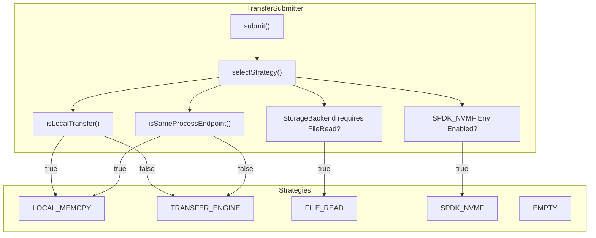
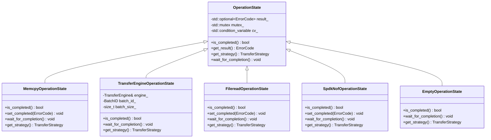
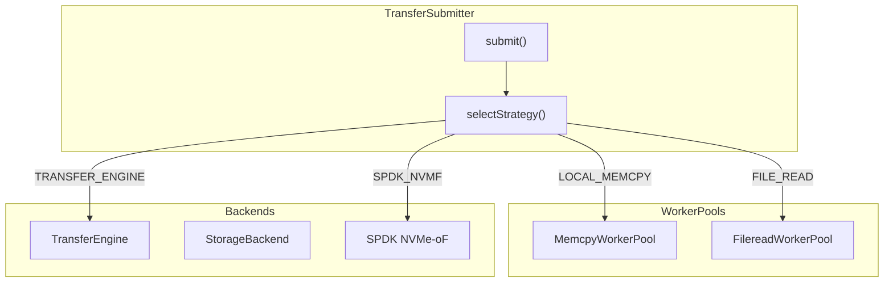
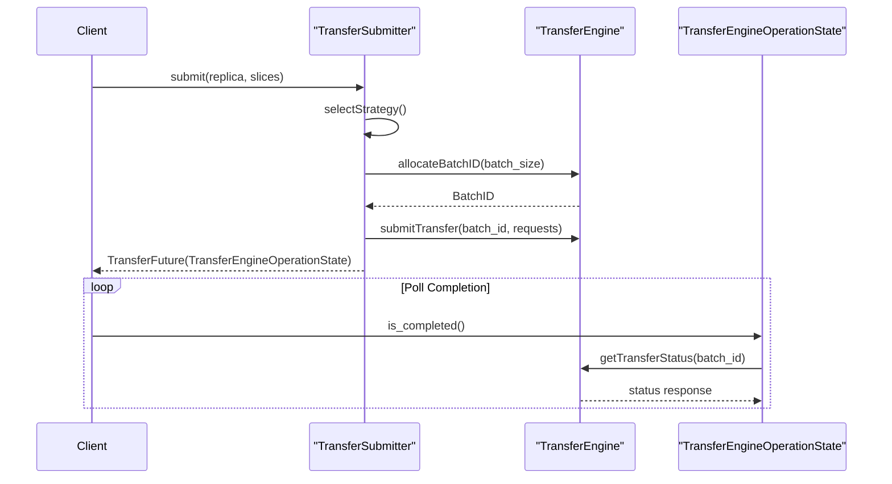
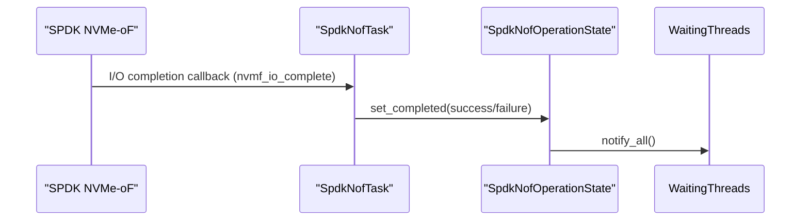

<!-- source: DeepWiki mcp.deepwiki.com · repo kvcache-ai/Mooncake · page 5.8 Transfer Task System · fetched 2026-10-21 -->

# Transfer Task System

<details>
<summary>Relevant source files</summary>

The following files were used as context for generating this wiki page:

- [mooncake-common/include/environment_variables.h](mooncake-common/include/environment_variables.h)
- [mooncake-common/src/environ.cpp](mooncake-common/src/environ.cpp)
- [mooncake-common/tests/environ_test.cpp](mooncake-common/tests/environ_test.cpp)
- [mooncake-store/include/transfer_task.h](mooncake-store/include/transfer_task.h)
- [mooncake-store/src/CMakeLists.txt](mooncake-store/src/CMakeLists.txt)
- [mooncake-store/src/transfer_task.cpp](mooncake-store/src/transfer_task.cpp)
- [mooncake-store/tests/CMakeLists.txt](mooncake-store/tests/CMakeLists.txt)
- [mooncake-store/tests/transfer_task_test.cpp](mooncake-store/tests/transfer_task_test.cpp)
- [mooncake-transfer-engine/tests/rdma_large_mr_test.cpp](mooncake-transfer-engine/tests/rdma_large_mr_test.cpp)

</details>


The Transfer Task System facilitates asynchronous, efficient data transfer operations within the Mooncake distributed storage environment. It serves as the bridge linking high-level client requests from the Mooncake Store to low-level data movement primitives provided by the Transfer Engine and storage backends.

At its core, the system analyzes transfer requests, selects the optimal execution strategy from among `LOCAL_MEMCPY`, `TRANSFER_ENGINE`, `FILE_READ`, and `SPDK_NVMF`, dispatches tasks to dedicated worker pools or remote transfer mechanisms, and manages operation state and completion results via a unified future interface.

This design provides flexible, performant, and scalable data movement that leverages local memory copies where possible, high-performance network fabrics across nodes, efficient file-level reads from disk, and specialized NVMe-oF acceleration through SPDK.

Sources:  
[mooncake-store/include/transfer_task.h:27-59](), [mooncake-store/include/transfer_task.h:67-114](), [mooncake-store/src/transfer_task.cpp:681-742]()

---

## Core Components and Transfer Strategy Selection

### TransferSubmitter

`TransferSubmitter` is the primary orchestrator of transfer requests. It receives abstracted replica and slice information describing the data to be transferred, analyzes the source and destination endpoints, and decides which strategy to employ for executing the transfer.

The supported transfer strategies enumerated in `TransferStrategy` are:

| Strategy Identifier | Description                                           |
|---------------------|-----------------------------------------------------|
| `LOCAL_MEMCPY (0)`  | Local memory copy using `memcpy` or accelerator APIs|
| `TRANSFER_ENGINE (1)` | Remote transfer using the Mooncake Transfer Engine  |
| `FILE_READ (2)`     | Disk-backed read operation from the StorageBackend  |
| `EMPTY (3)`         | No operation / immediate completion                  |
| `SPDK_NVMF (4)`     | High-throughput NVMe-over-Fabrics I/O via SPDK       |

The selection logic considers:

- Whether the source and target buffers reside in the same process or node, enabling a `LOCAL_MEMCPY` optimization.
- Whether SPDK NVMe-oF integration is enabled and appropriate.
- Whether the underlying storage backend requires file reads.
- Otherwise, falling back to remote transfers using the `TRANSFER_ENGINE`.

### Strategy Selection Flow



This design optimizes for minimal data movement when local, leverages specialized NVMe-oF for storage direct I/O if configured, or uses the remote Transfer Engine for cross-node fabric transfers.

Sources:  
[mooncake-store/include/transfer_task.h:32-38](),  
[mooncake-store/src/transfer_task.cpp:681-742]()

---

## Operation States and Completion Tracking

Each transfer operation is modeled with an `OperationState` interface abstraction that encapsulates the state, synchronization primitives, and completion outcome of an asynchronous transfer. This abstraction enables clients to monitor operations via the `TransferFuture` wrapper.

### OperationState Interface

- `is_completed()`: Returns whether the operation has finished.
- `get_result()`: Retrieves the final `ErrorCode` of the operation. Requires the operation to be completed.
- `wait_for_completion()`: Blocks until the transfer completes.
- `get_strategy()`: Returns the `TransferStrategy` for this operation instance.

### Concrete OperationState Implementations

| Class Name                   | Strategy         | Description                               |
|------------------------------|------------------|-------------------------------------------|
| `MemcpyOperationState`       | LOCAL_MEMCPY     | Waits for local memory copy to complete. |
| `TransferEngineOperationState` | TRANSFER_ENGINE | Tracks batch transfer completion via `TransferEngine::getTransferStatus()`. |
| `FilereadOperationState`     | FILE_READ        | Manages completion of file read via `StorageBackend`. |
| `SpdkNofOperationState`      | SPDK_NVMF        | Tracks SPDK NVMe-oF NVMe I/O completions and errors. |
| `EmptyOperationState`        | EMPTY            | Immediate completion; no work.            |

### Operation State Class Hierarchy Diagram



Sources:  
[mooncake-store/include/transfer_task.h:67-245]()

### TransferFuture

`TransferFuture` wraps a shared pointer to an `OperationState` instance. It exposes:

- `isReady()`: Non-blocking check if operation is complete.
- `wait()`: Blocks until operation completion.
- `get()`: Blocks and retrieves the final transfer `ErrorCode`.

This design cleanly decouples asynchronous execution and completion polling from client request logic.

Sources:  
[mooncake-store/include/transfer_task.h:248-281]()

---

## Worker Pools

The system uses specialized worker pools to asynchronously handle specific strategy workloads.

### MemcpyWorkerPool

- Executes `LOCAL_MEMCPY` operations.
- Internally, a small thread pool (often single-threaded) dispatches tasks.
- Uses `AcceleratorRegistry` for device-aware copies (e.g., GPU memcpy).
- Designed to saturate local memory bandwidth with few threads.

### FilereadWorkerPool

- Handles `FILE_READ` tasks for offloaded read operations.
- Uses a configurable number of worker threads (default ~10).
- Worker threads invoke `StorageBackend::LoadObject` methods to fulfill file reads.
- Optimized to saturate SSD/NVMe I/O bandwidth for efficient data fetch.

### Worker Pools and Strategy Overview Diagram



Sources:  
[mooncake-store/include/transfer_task.h:306-356](),  
[mooncake-store/src/transfer_task.cpp:15-19](),  
[mooncake-store/src/transfer_task.cpp:124-275]()

---

## Transfer Engine Integration

When the `TRANSFER_ENGINE` strategy is selected, `TransferSubmitter` hands off transfer requests to the Mooncake Transfer Engine subsystem, which orchestrates remote data movement across fabric transports (RDMA, TCP, etc.).

The flow is:

1. `TransferSubmitter` allocates a batch ID from the `TransferEngine`.
2. It submits a batch of `TransferRequest` entries representing the data to move.
3. It creates a `TransferEngineOperationState` holding the batch ID.
4. Transfer completion is polled by querying `TransferEngine::getTransferStatus()` for this batch.
5. Upon completion or error, the operation state is updated, and client waits/unblocks.

### Transfer Engine Execution Sequence Diagram



Sources:  
[mooncake-store/src/transfer_task.cpp:405-516](),  
[mooncake-store/src/transfer_task.cpp:681-742]()

---

## SPDK NVMe-oF Integration

When SPDK NVMe-oF (NVMF) support is enabled and chosen (`SPDK_NVMF` strategy), the transfer system uses a specialized asynchronous I/O path directly to NVMe storage devices over fabrics managed by SPDK.

### SPDK NVMe-oF Operational Details

- The system partitions large requests into manageable chunks defined by the environment variable `MC_NOF_SUBMIT_CHUNK_BYTES`.
- It manages inflight byte limits with `MC_NOF_INFLIGHT_BYTES_LIMIT` to prevent resource exhaustion.
- `SpdkNofTask` instances track individual async I/O requests.
- NVMe I/O completions trigger callbacks (`nvmf_io_complete`) that update task progress, failure states, and completion results.
- The operation state `SpdkNofOperationState` manages synchronization and reports completion via condition variables.

### SPDK NVMe-oF I/O Completion Callback Snippet

```cpp
static void nvmf_io_complete(void* ctx, const struct spdk_nvme_cpl* cpl) {
    mooncake::SpdkNofSubTask* sub_task = reinterpret_cast<mooncake::SpdkNofSubTask*>(ctx);
    mooncake::SpdkNofTask* task = sub_task->task;
    // Decrement outstanding I/O counts, update QoS inflight blocks
    // On error, mark task failed
    // Signal completion if all sub-requests done
    // Return sub-task to pool
}
```

### SPDK NVMe-oF Task Completion Flow



Sources:  
[mooncake-store/src/transfer_task.cpp:57-174](),  
[mooncake-store/src/transfer_task.cpp:93-127](),  
[mooncake-store/include/transfer_task.h:184-208]()

---

# Summary

The Transfer Task System enables robust, efficient, and flexible asynchronous data transfers within Mooncake:

- It intelligently selects between local copy, remote transfer, file I/O, and NVMe-oF strategies.
- It exposes a unified asynchronous `OperationState` and `TransferFuture` API to clients.
- It manages concurrency through worker pools specialized for memcpy and file read workloads.
- It tightly integrates with the Transfer Engine for remote fabric-based data movement.
- It supports SPDK NVMe-oF I/O for direct high-performance storage access.

This modular, strategy-driven architecture optimizes data movement paths and resource usage, abstracting complexity while taking full advantage of hardware capabilities.

---

# References (critical files)

- `mooncake-store/include/transfer_task.h:27-281`  
- `mooncake-store/src/transfer_task.cpp:1-212`  
- `mooncake-store/src/transfer_task.cpp:681-776`

# End of 5.8 Transfer Task System

---

