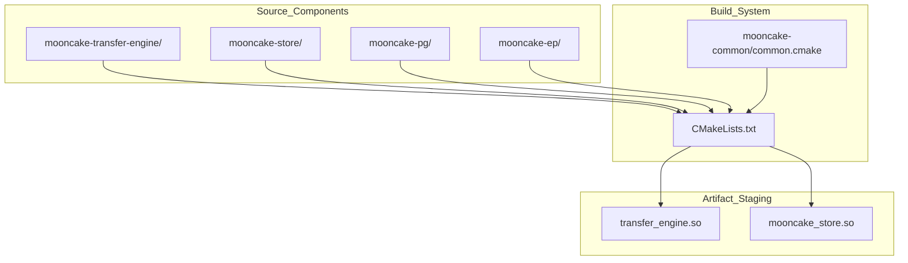
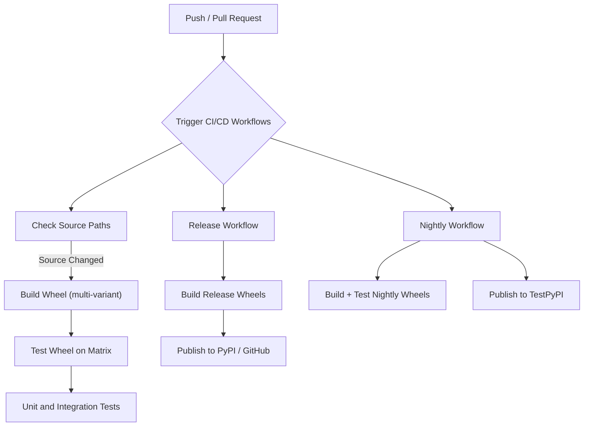
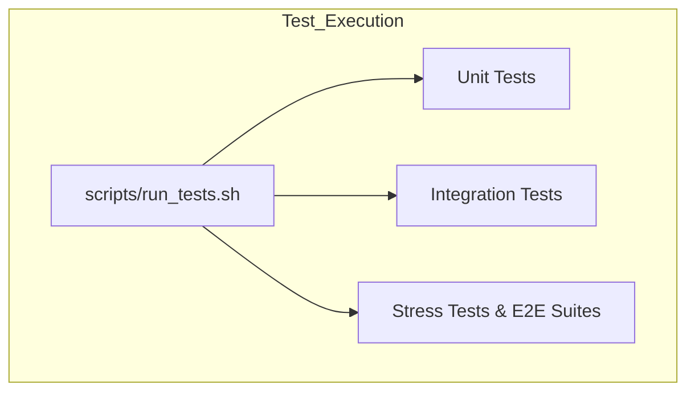

<!-- source: DeepWiki mcp.deepwiki.com · repo kvcache-ai/Mooncake · page 6 Building and Deployment · fetched 2026-10-21 -->

# Building and Deployment

<details>
<summary>Relevant source files</summary>

The following files were used as context for generating this wiki page:

- [.github/workflows/ci.yml](.github/workflows/ci.yml)
- [.github/workflows/pre-release.yaml](.github/workflows/pre-release.yaml)
- [.github/workflows/release-cuda13.yaml](.github/workflows/release-cuda13.yaml)
- [.github/workflows/release-non-cuda.yaml](.github/workflows/release-non-cuda.yaml)
- [.github/workflows/release-npu.yaml](.github/workflows/release-npu.yaml)
- [.github/workflows/release.yaml](.github/workflows/release.yaml)
- [.gitmodules](.gitmodules)
- [CMakeLists.txt](CMakeLists.txt)
- [dependencies.sh](dependencies.sh)
- [docker/mooncake.Dockerfile](docker/mooncake.Dockerfile)
- [docker/musa.Dockerfile](docker/musa.Dockerfile)
- [mooncake-wheel/tests/test_distributed_object_store.py](mooncake-wheel/tests/test_distributed_object_store.py)
- [mooncake-wheel/tests/test_release_wheel_tags.py](mooncake-wheel/tests/test_release_wheel_tags.py)
- [scripts/run_tests.sh](scripts/run_tests.sh)

</details>


This page serves as the parent guide for building Mooncake from source, understanding its build system, managing its CI/CD and test suites, and deploying it across various production environments. For in-depth technical details, platform requirements, and advanced configuration, please refer to the child pages linked below.

**Related Documentation:** For runtime configuration options, see [Configuration Overview](#2.3). For LLM framework integration specifics, see [LLM Framework Integration](#7).

---

## Build System Overview

Mooncake employs a comprehensive multi-layered build system that orchestrates compilation, packaging, testing, and deployment. The core C++ libraries are built with CMake, Python bindings are generated via PyBind11, and additional shell scripts handle packaging and distribution. The system supports variants targeting multiple hardware accelerators, including NVIDIA CUDA, Huawei Ascend, Moore Threads MUSA, and CPU-only modes, ensuring binary compatibility and discrete Python packages on PyPI.

### Build System Architecture



Sources: [CMakeLists.txt:1-191](), [mooncake-common/common.cmake:1-133]()

---

## 6.1. Dependencies and Prerequisites

Mooncake requires a broad set of system dependencies to enable full functionality across platforms:

- **Build Tools:** `cmake`, `ninja-build`, `git`, `pkg-config` and standard compilers.
- **Network and Fabric Libraries:** `libibverbs-dev`, `rdma-core`, `libnuma-dev`.
- **C++ Libraries:** `glog`, `jsoncpp`, `protobuf`, `grpc` and associated development headers.
- **Python Development:** Python headers and runtime for supported versions.
- **Hardware SDKs:** CUDA Toolkit (for NVIDIA), HIP (AMD), Ascend CANN toolkit, MUSA SDK for Moore Threads.
- **Optional Components:** Go toolchain (version 1.25.9), SPDK for NVMe-oF storage backend support.

The included `dependencies.sh` script automates dependency detection and installation. It identifies the operating system (Ubuntu, Debian, CentOS, RHEL, Rocky, AlmaLinux, EulerOS, openEuler, Kylin) and installs package sets accordingly. Additionally, it detects special hardware stacks such as ScaleFabric SHCA, adjusting conflicting packages like `libibverbs-dev` and `libboost-all-dev`.

For complete details on required packages, OS variations, and installation options (including flags like `--with-spdk`), see [Dependencies and Prerequisites](#6.1).

Sources: [dependencies.sh:1-207]()

---

## 6.2. CMake Build System

The Mooncake build configuration is managed through CMake with extensive option flags:

- **Key toggle options:**
  - `USE_CUDA` (ON/OFF) - Enable NVIDIA CUDA support.
  - `WITH_STORE` (ON/OFF) - Build the Mooncake Store service and libraries.
  - `WITH_EP` (ON/OFF) - Enable Elastic Expert Parallelism support.
  - `USE_ETCD` and `STORE_USE_ETCD` - Enable etcd support for metadata backend.
  - `STORE_USE_REDIS` - Optional Redis backend support.
  - `USE_NOF` - Enables NoF SSD pool support.
  - Kubernetes Lease support and other advanced features via options such as `STORE_USE_K8S_LEASE`.

- **Project structure support:**
  - Mooncake submodules such as Transfer Engine (`mooncake-transfer-engine`), Store (`mooncake-store`), Conductor service (`mooncake-conductor`), and Expert Parallelism libraries.
  - Rust and Go bindings support toggled by respective options.

- **Build type and flags:**
  - Standard CMake build types (`Debug`, `Release`).
  - Compile definitions for ASIO, jemalloc, and other performance features.
  - Platform-specific settings like CUDA toolkit detection.

Common configuration logic and discovery helpers reside in `mooncake-common/common.cmake`.

Refer to [CMake Build System](#6.2) for a comprehensive list of options and how to customize builds per deployment needs.

Sources: [CMakeLists.txt:1-191](), [mooncake-common/common.cmake:1-133]()

---

## 6.3. Building from Source

Building Mooncake from source follows these general steps:

1. **Install Dependencies:** Run `./dependencies.sh` to install required packages and setup submodules and Go toolchain.
2. **Configure Build:** Create a build directory and invoke `cmake` with your chosen flags, for example:
   ```
   cmake -G Ninja .. -DUSE_CUDA=ON -DWITH_EP=ON -DSTORE_USE_ETCD=ON
   ```
3. **Compile:** Use `cmake --build .` or `ninja` to compile all components.
4. **Install:** Optionally install binaries and libraries to system locations for easier usage.

Platform-specific SDKs and drivers should be installed and configured prior to building for hardware accelerators like CUDA or Ascend.

Detailed platform notes and troubleshooting advice are available in [Building from Source](#6.3).

Sources: [dependencies.sh:1-207](), [CMakeLists.txt:1-191]()

---

## 6.4. Python Package Building

Python packaging is orchestrated by the script `build_wheel.sh`, which performs the following:

- Compiles native C++ shared libraries and PyBind11 bindings.
- Applies multi-variant strategy to produce wheels targeting CUDA 12, CUDA 13, non-CUDA, and Ascend hardware without binary conflicts.
- Utilizes `auditwheel` to ensure manylinux compliance and patch RPATHs.
- Supports injection of Elastic Expert Parallelism (EP) and Process Group (PG) extensions.
- Protects CUDA fatbinary inlining to reduce runtime conflicts.

The Python package metadata and build backend are declared in `mooncake-wheel/pyproject.toml`.

For the full explanation of Python packaging internals, including extension injection, wheel metadata, and runtime fixes, see [Python Package Building](#6.4).

Sources: [mooncake-wheel/pyproject.toml:1-67]()

---

## 6.5. CI/CD Pipeline

Mooncake's CI/CD leverages GitHub Actions workflows to automate building, testing, and releasing across multiple platforms and variants:

- **Build & Test:** Runs on pushes and pull requests to main and release branches, building wheels for multiple Python versions and architectures.
- **Release Workflows:** Trigger on semantic version tags to produce official release wheels and publish them to PyPI and GitHub Releases.
- **Variant Support:** Separate workflows handle CUDA 12, CUDA 13, non-CUDA, and hardware-specific builds like Ascend and MUSA.
- **Nightly Builds:** Development wheel builds with forward-looking version tags and optional publishing to TestPyPI.
- **Composite and Reusable Actions:** Maintain DRY principles across workflows.
- **Labelers and Test Orchestration:** Manage selective reruns and integration test coverage.

### CI/CD Workflow High-Level Diagram



Sources: [.github/workflows/ci.yml:1-206](), [.github/workflows/release.yaml:1-34]()

---

## 6.6. Testing Infrastructure

Mooncake features a comprehensive testing framework ensuring stability across all subsystems:

- **Unit Tests:** Cover core Transfer Engine and Mooncake Store functionality, including Python bindings.
- **Integration Tests:** Validate distributed store operations and protocols.
- **Stress Tests & End-to-End Suites:** Test robustness under real-world scenarios, including SSD offload, tensor snapshotting, and replication.
- **Language Bindings:** Go and Rust smoke tests assess bindings health.
- **CUDA Fabric Compatibility:** Specialized tests verify fabric initialization and transport interoperability.
- **Tone_tests Framework:** Advanced scenario-driven tests.

Tests are runnable via the script `scripts/run_tests.sh`, which manages metadata server lifecycle and parallel test execution environments.

### Test Execution Diagram



Sources: [scripts/run_tests.sh:1-189](), [.github/workflows/ci.yml:95-167]()

---

## 6.7. Docker Deployment

Mooncake provides pre-configured Dockerfiles for containerized builds and runtime environments to ease deployment:

- **Standard CUDA Image:** Builds on NVIDIA CUDA base images, installs dependencies and Python interpreters, produces a self-contained wheel, and installs runtime dependencies.
- **MUSA Image:** Uses a Moore Threads MUSA-based PyTorch image and SDK, compiles Mooncake variants compatible with MUSA hardware.
- **Multi-Node Testing:** Supports multi-node demonstration clusters via `docker-compose`, enabling simulation of distributed environments.
- **Development Containers:** `devcontainer` configurations foster consistent IDE and development environments.

Containers integrate hardware SDKs, Python packages, and runtime libraries for straightforward deployment on equipped hosts.

See [Docker Deployment](#6.7) for detailed Dockerfiles, build instructions, and container usage.

Sources: [docker/mooncake.Dockerfile](), [docker/musa.Dockerfile]()

---

## 6.8. Production Deployment Patterns

Production deployments consider operational stability and performance tuning:

- **High Availability:** Configurations enable ETCD-based master failover or Kubernetes Lease leader election for HA Mooncake Store masters.
- **Client Settings:** Advice on lease TTLs, buffer sizing, and retry policies to optimize throughput and fault tolerance.
- **Network Tuning:** Leverages advanced Linux features such as `io_uring` and NVMe-oF to maximize network and storage I/O.
- **Monitoring:** Prometheus exporters and Grafana dashboard integration provide real-time observability on cluster health, transfer metrics, and storage performance.
- **Troubleshooting:** Guides address common network issues, storage stalls, and client-master communication problems.

For extensive best practices and configuration guidance in production, consult [Production Deployment Patterns](#6.8).

Sources: [mooncake-common/common.cmake:32-39]()

---

## 6.9. Kubernetes Deployment

Mooncake supports Kubernetes-native operation for cloud-scale disaggregated serving:

- **Store Cluster Deployment:** StatefulSets and Operators manage distributed store node lifecycles.
- **Leader Election:** Kubernetes Lease API enables reliable master failover without external dependencies.
- **SGLang Prefill/Decode Disaggregation:** Separation of prefill and decode processes across pods for scalable serving.
- **Resource Brokers:** The RBG operator manages resource allocation and lifecycle.
- **llm-d Integration:** Interfaces with LLM orchestration systems for integrated end-to-end deployments.

Deploying Mooncake on Kubernetes enables cloud agility and elastic scaling of KVCache disaggregation services.

Details on manifests, operators, and integration patterns appear in [Kubernetes Deployment](#6.9).

Sources: [CMakeLists.txt:73-89]()

---

# Summary

This page provides a high-level overview of the Mooncake build and deployment ecosystem, bridging source code, build tooling, continuous integration, testing, containerization, and production readiness strategies. Each of the child pages listed below covers in-depth implementation details, command examples, and configuration parameters to equip developers and operators with the necessary knowledge to build, package, test, and deploy Mooncake effectively.

---

### Child Pages for Further Detail

- [Dependencies and Prerequisites](#6.1)
- [CMake Build System](#6.2)
- [Building from Source](#6.3)
- [Python Package Building](#6.4)
- [CI/CD Pipeline](#6.5)
- [Testing Infrastructure](#6.6)
- [Docker Deployment](#6.7)
- [Production Deployment Patterns](#6.8)
- [Kubernetes Deployment](#6.9)

---

