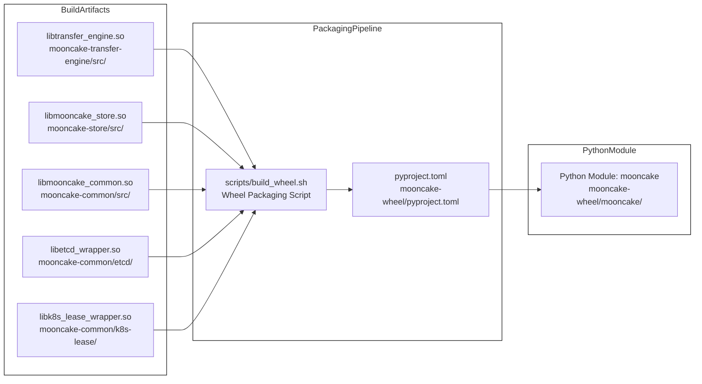

<!-- source: DeepWiki mcp.deepwiki.com · repo kvcache-ai/Mooncake · page 6.1 Dependencies and Prerequisites · fetched 2026-10-21 -->

# Dependencies and Prerequisites

<details>
<summary>Relevant source files</summary>

The following files were used as context for generating this wiki page:

- [.devcontainer/Dockerfile](.devcontainer/Dockerfile)
- [.devcontainer/README.md](.devcontainer/README.md)
- [.devcontainer/devcontainer.json](.devcontainer/devcontainer.json)
- [.github/workflows/ci.yml](.github/workflows/ci.yml)
- [.github/workflows/ci_ascend.yml](.github/workflows/ci_ascend.yml)
- [.github/workflows/e2e-ci.yml](.github/workflows/e2e-ci.yml)
- [.github/workflows/integration-test.yml](.github/workflows/integration-test.yml)
- [.github/workflows/pre-release.yaml](.github/workflows/pre-release.yaml)
- [.github/workflows/release-cuda13.yaml](.github/workflows/release-cuda13.yaml)
- [.github/workflows/release-non-cuda.yaml](.github/workflows/release-non-cuda.yaml)
- [.github/workflows/release-npu.yaml](.github/workflows/release-npu.yaml)
- [.github/workflows/release.yaml](.github/workflows/release.yaml)
- [.gitmodules](.gitmodules)
- [CMakeLists.txt](CMakeLists.txt)
- [dependencies.sh](dependencies.sh)
- [docker/mooncake.Dockerfile](docker/mooncake.Dockerfile)
- [docker/musa.Dockerfile](docker/musa.Dockerfile)
- [mooncake-wheel/tests/test_distributed_object_store.py](mooncake-wheel/tests/test_distributed_object_store.py)
- [mooncake-wheel/tests/test_release_wheel_tags.py](mooncake-wheel/tests/test_release_wheel_tags.py)
- [scripts/ascend/dependencies_ascend.sh](scripts/ascend/dependencies_ascend.sh)
- [scripts/ascend/dependencies_ascend_installation.sh](scripts/ascend/dependencies_ascend_installation.sh)
- [scripts/ascend/dependencies_openeuler.sh](scripts/ascend/dependencies_openeuler.sh)
- [scripts/run_tests.sh](scripts/run_tests.sh)

</details>


## Purpose and Scope

This document details all system dependencies, external libraries, and hardware SDKs required to build, test, and deploy Mooncake. It covers essential build tools, core package requirements across various Linux distributions, hardware-specific acceleration toolkits (CUDA, HIP, Ascend NPU, MUSA, etc.), metadata service integrations (etcd, Redis, HTTP, K8s Lease), and the automated installation scripts provided in the repository. For configuration flags and feature toggles, see [6.2 CMake Build System](); for compilation steps, see [6.3 Building from Source]().

**Sources:** [mooncake-common/common.cmake:1-129](), [CMakeLists.txt:1-191](), [dependencies.sh:1-119]()

---

## System Requirements

### Operating System and Compiler

Mooncake targets Linux-based environments and requires a modern C++ compiler supporting C++20 coroutines:

- **Operating Systems**: Officially supported distributions include Ubuntu, Debian, CentOS, RHEL, Rocky, AlmaLinux, EulerOS, openEuler, and Kylin. Windows and macOS are blocked at the package build level to prevent unsupported setups. OS detection leverages `/etc/os-release` parsing, with fallback heuristics for legacy systems [dependencies.sh:78-92](). 

- **Compilers**: GCC or Clang with C++20 coroutine support. Compiler flags enforce `-std=c++20` and enable explicit coroutine support (e.g., `-fcoroutines` on GCC). C source files use the C99 standard. These settings are declared in `mooncake-common/common.cmake` [mooncake-common/common.cmake:1-30]().

**Sources:** [mooncake-common/common.cmake:1-30](), [dependencies.sh:78-92]()

### Build Tools and Runtimes

- **CMake**: Minimum version 3.16 is required; it is the principal build system for Mooncake [CMakeLists.txt:1]().
- **Ninja Build**: Preferred as the build executor for its concurrency support and speed [dependencies.sh:168]().
- **Go Toolchain**: Version 1.25.9 is required for building etcd and Kubernetes Lease leadership components, installed as part of `dependencies.sh` [dependencies.sh:26](), [dependencies.sh:162-190]().
- **Python**: Python 3.10+ is required for runtime use and Python package building [mooncake-wheel/pyproject.toml:31]().
- **Utilities**: Additional essential tools include `pkg-config`, `patchelf`, and standard Unix build essentials and build dependencies [dependencies.sh:194-195]().

**Sources:** [CMakeLists.txt:1](), [dependencies.sh:26-195](), [mooncake-wheel/pyproject.toml:31]()

---

## Core System Dependencies

Mooncake relies on several system packages to enable network fabric access, serialization, and runtime support.

### Essential Packages per Linux Distribution

| Package (Ubuntu/Debian) | Equivalent (RHEL/openEuler etc.) | Purpose in Mooncake                                                |
|------------------------|---------------------------------|-------------------------------------------------------------------|
| `build-essential`       | `gcc`, `gcc-c++`, `make`, `cmake`, `ninja-build` | Compiler toolchain                                                |
| `libibverbs-dev`        | `libibverbs-devel`              | RDMA verbs library for fabric transport                          |
| `libgoogle-glog-dev`    | `glog-devel`                    | Logging framework for runtime/server components                  |
| `libjsoncpp-dev`        | `jsoncpp-devel`                 | JSON parsing for metadata services                               |
| `libunwind-dev`         | `libunwind-devel`               | Stack tracing and debugging support                              |
| `libnuma-dev`           | `numactl-devel`                 | NUMA-aware memory allocation and affinity                        |
| `libgrpc-dev`, `libgrpc++-dev` | `grpc-devel`             | gRPC RPC framework for control plane communications              |
| `libprotobuf-dev`       | `protobuf-devel`                | Protocol buffer serialization                                    |
| `liburing-dev`          | `liburing-devel`                | Support for Linux `io_uring` asynchronous I/O                    |
| `libhiredis-dev`        | `hiredis-devel`                 | Redis client library for metadata backend                        |
| `libyaml-cpp-dev`       | `yaml-cpp`                     | YAML configuration parsing                                       |
| `libzmq3-dev`           | `zeromq-devel`                  | ZMQ event publishing (optional feature)                         |

**Special Case:** On systems with ScaleFabric SHCA (`shca-tools`), the script excludes `libibverbs-dev` and replaces `libboost-all-dev` with `libboost-dev` to avoid conflicts. Building with `-DUSE_SHCA=ON` enables SHCA support [dependencies.sh:199-206]().

**Sources:** [dependencies.sh:166-206]()

---

### Automated Dependency Installation (`dependencies.sh`)

Mooncake includes an automated Bash script, `dependencies.sh`, to install required system packages, language runtimes, and optionally SPDK support for NVMe-oF. Key features include:

- **OS Detection**: Detects supported Linux distributions by parsing `/etc/os-release` or legacy files [dependencies.sh:78-92]().

- **Package Updates**: Updates package sources and enables repositories appropriately per distribution [dependencies.sh:147-157]().

- **Package Installation**: Installs required system packages including build tools, networking libraries, and key dependencies like `libibverbs`, `libglog`, `libgrpc`, `libprotobuf`, `liburing`, and `hiredis` [dependencies.sh:162-195]().

- **Go Installation**: Installs Go 1.25.9 from official tarballs for building etcd and cloud-native components [dependencies.sh:26, 162-190]().

- **SPDK Optional Install**: Supports an optional `--with-spdk` flag to install the Storage Performance Development Kit for NVMe-oF [dependencies.sh:106-108]().

- **Privilege Check**: Requires root permissions (should be run via `sudo`) [dependencies.sh:94-96]().

**Example flow excerpt:**
```bash
# Detect OS, update package lists
detect_os
# Install packages depending on OS
apt-get update && apt-get install ... # on Debian/Ubuntu
# Install Go 1.25.9
# Optionally install SPDK
```

**Sources:** [dependencies.sh:1-207]()

---

### openEuler and Ascend Platform Installations

Specialized support for openEuler and Huawei Ascend NPU platforms is provided by the `scripts/ascend` directory:

- **OpenEuler Compatibility**: `dependencies_openeuler.sh` maps Debian package requirements to RPM equivalents and installs them, considering ecosystem differences [scripts/ascend/dependencies_openeuler.sh:89-207]().

- **Ascend SDK Setup**: `dependencies_ascend_installation.sh` handles Ascend CANN SDK environment setup, runtime components, MPICH installation, and Mooncake fabric allocator builds on Ascend platforms [scripts/ascend/dependencies_ascend_installation.sh:58-135]().

- **Submodule and Fallback**: Git submodules like `pybind11` are updated with retries and mirrors for stability in restricted networks [scripts/ascend/dependencies_ascend_installation.sh:58-130]().

**Sources:** [scripts/ascend/dependencies_openeuler.sh:89-207](), [scripts/ascend/dependencies_ascend_installation.sh:58-135]()

---

## Hardware and Transport SDK Dependencies

Mooncake supports various hardware accelerators and transport protocols. Installation of matching SDKs and libraries is necessary before building with relevant features.

| Feature                  | CMake Flag(s)             | SDK / Library                         | Remarks                                       |
|--------------------------|---------------------------|-------------------------------------|-----------------------------------------------|
| NVIDIA CUDA GPU           | `USE_CUDA=ON`             | CUDA Toolkit                        | Detected by CMake FindCUDA module              |
| AMD HIP GPU              | `USE_HIP=ON`              | ROCm SDK and HIP runtime            | HIP device and host libraries                   |
| NVIDIA NVLink (MNNVL)     | `USE_MNNVL=ON`            | NVIDIA CUDA Toolkit + Mooncake NVLink code | Requires NVIDIA GPU and CUDA                    |
| Huawei Ascend NPU         | `USE_ASCEND=ON` and `USE_ASCEND_DIRECT=ON` | Ascend CANN SDK + ADXL engine      | Direct fabric transport on Ascend platforms     |
| AMD MUSA                  | `USE_MUSA=ON`             | Mthreads MUSA SDK                   | AMD accelerator SDK                             |
| RDMA Fabric (InfiniBand)  | `libibverbs` (system)     | libibverbs kernel and userspace    | Used by `mooncake-transfer-engine` for RDMA    |
| TCP Transport             | `USE_TCP=ON`              | Native Linux socket API             | Default/fallback transport                      |
| AWS Elastic Fabric Adapter| `USE_EFA=ON`              | AWS EFA SDK                       | For specialized AWS cluster networking          |
| CXL Device Transport      | `USE_CXL=ON`              | CXL device userspace libraries      | For CXL fabric support                          |
| NVMe-oF                  | `USE_NVMEOF=ON`           | SPDK (Storage Performance Dev Kit) | Optional for SSD offload via NVMe over Fabrics |
| Kunpeng UB SDK            | `USE_UB=ON`               | Kunpeng UB SDK                     | Specific Kunpeng device integration             |

**Example CMake snippet for CUDA SDK detection:**

```cmake
if(USE_CUDA)
  find_package(CUDAToolkit REQUIRED)
  target_link_libraries(mooncake_transfer_engine PRIVATE CUDA::cuda_driver CUDA::cudart mlx5)
endif()
```

**Sources:** [mooncake-common/common.cmake:79-129](), [mooncake-transfer-engine/src/CMakeLists.txt:105-177](), [mooncake-transfer-engine/include/cuda_alike.h:3-29]()

---

## Metadata Service Dependencies and Configuration

Mooncake uses pluggable metadata service backends for object metadata and transfer coordination. These can be selected via compile-time flags and runtime settings.

| Metadata Service         | Compilation Flag(s)       | Implementation Components                    |
|-------------------------|---------------------------|----------------------------------------------|
| etcd                    | `USE_ETCD`, `STORE_USE_ETCD` | Go wrapper shared library `libetcd_wrapper.so` |
| Redis                   | `USE_REDIS`, `STORE_USE_REDIS` | Redis client library `hiredis`                |
| HTTP Metadata           | `USE_HTTP`                | Curl libraries for HTTP access                |
| ZeroMQ KV Events        | `ENABLE_KV_EVENTS`        | libzmq event publisher for KV events         |
| Kubernetes Lease Leader | `STORE_USE_K8S_LEASE`     | Go shared library `libk8s_lease_wrapper.so`  |

The following diagram maps configuration flags to code components that enable them.

```mermaid
%% Diagram: Metadata Services to Code Entities

graph TD
  subgraph NaturalLanguageSpace
    EtcdOpt["\"USE_ETCD\" / \"STORE_USE_ETCD\""]
    RedisOpt["\"USE_REDIS\" / \"STORE_USE_REDIS\""]
    HttpOpt["\"USE_HTTP\""]
    ZmqOpt["\"ENABLE_KV_EVENTS\""]
    K8sLeaseOpt["\"STORE_USE_K8S_LEASE\""]
  end

  subgraph CodeEntitySpace
    GoScript["Go SDK 1.25.9\n(dependencies.sh:26)"]
    EtcdLib["libetcd_wrapper.so\nmooncake-common/etcd/"]
    K8sLeaseLib["libk8s_lease_wrapper.so\nmooncake-common/k8s-lease/"]
    TransferMeta["transfer_metadata_plugin\nmooncake-transfer-engine/src/CMakeLists.txt"]
    HiredisPkg["Mooncake::hiredis\nmooncake-common/common.cmake"]
    StoreTarget["mooncake_store\nmooncake-store/src/"]
    CurlPkg["CURL_LIBRARIES\nmooncake-transfer-engine/src/CMakeLists.txt"]
    ZmqLib["mooncake_provide_libzmq()\nCMakeLists.txt:107"]
  end

  EtcdOpt --> GoScript
  EtcdOpt --> EtcdLib
  EtcdLib --> TransferMeta

  RedisOpt --> HiredisPkg
  HiredisPkg --> StoreTarget

  HttpOpt --> CurlPkg
  CurlPkg --> TransferMeta

  ZmqOpt --> ZmqLib
  ZmqLib --> StoreTarget

  K8sLeaseOpt --> GoScript
  K8sLeaseOpt --> K8sLeaseLib
  K8sLeaseLib --> StoreTarget

  style NaturalLanguageSpace fill:none,stroke:#000,stroke-width:1px
  style CodeEntitySpace fill:none,stroke:#000,stroke-width:1px
```

*Figure 1: Mapping of Metadata Service Configuration Flags to Code Libraries and Targets.*

**Sources:** [dependencies.sh:26](), [CMakeLists.txt:53-72,107](), [mooncake-transfer-engine/src/CMakeLists.txt:28-67]()

---

## Packaging and Component Resolution

Mooncake consists of multiple native shared libraries that are built and packaged into a Python wheel for distribution. The build system uses CMake and Ninja to create these native artifacts, and the packaging script embeds them into the Python module.

| Artifact                      | Description                               | Location                                  |
|-------------------------------|-------------------------------------------|-------------------------------------------|
| `libtransfer_engine.so`        | Transfer Engine native library            | `mooncake-transfer-engine/src/`          |
| `libmooncake_store.so`         | Mooncake Store distributed storage library| `mooncake-store/src/`                     |
| `libmooncake_common.so`        | Common utility library                     | `mooncake-common/src/`                    |
| `libetcd_wrapper.so`           | etcd metadata service Go wrapper library  | `mooncake-common/etcd/`                   |
| `libk8s_lease_wrapper.so`      | Kubernetes lease leader election library  | `mooncake-common/k8s-lease/`              |

The `scripts/build_wheel.sh` orchestrates the creation of the wheel package, including copying README and replacing placeholders in setup files. The Python package metadata is in `mooncake-wheel/pyproject.toml`, defining `mooncake-transfer-engine` and its dependencies [mooncake-wheel/pyproject.toml:8-33]().



*Figure 2: Component Resolution and Packaging Workflow into the Mooncake Python Wheel.*

**Sources:** [CMakeLists.txt:28-30](), [mooncake-transfer-engine/src/CMakeLists.txt:69-99](), [mooncake-store/CMakeLists.txt:1-46](), [mooncake-wheel/pyproject.toml:8-33]()

---

## Summary of Key Dependency Setup

- Run `./dependencies.sh` on supported Linux systems with root permission to install common system packages, Go toolchain, and optionally SPDK.

- For Huawei Ascend and openEuler platforms, use specialized `scripts/ascend/` installer scripts.

- Install hardware SDKs corresponding to your target accelerators and fabrics: CUDA, HIP, Ascend CANN, MUSA, etc.

- Use configured CMake options (`USE_CUDA`, `USE_HIP`, `USE_ETCD`, `USE_REDIS`, `USE_ASCEND_DIRECT`, etc.) to enable or disable backend features.

- Mooncake's metadata service plugins are modular; select etcd, Redis, HTTP, or Kubernetes Lease by compile options and runtime environment.

- Ensure your build environment has CMake ≥3.16, Python 3.10+, Ninja build tool, and a suitable C++20 compiler with coroutine support.

- The automated dependency script and CMake configurations help maintain a consistent and reproducible build/install environment across platforms.

---

# End of 6.1 Dependencies and Prerequisites

---

