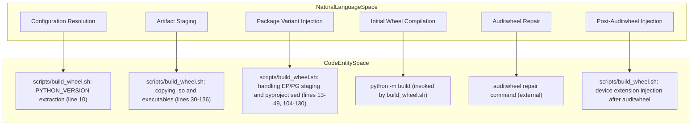
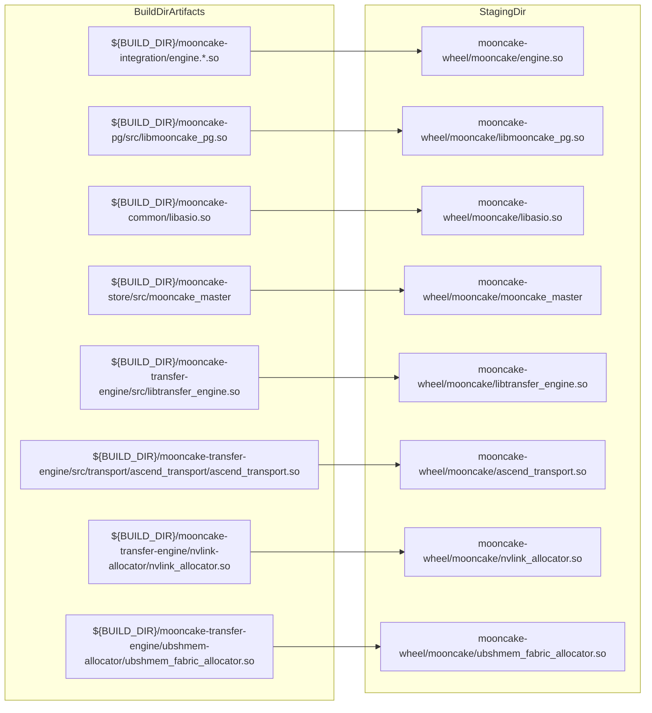
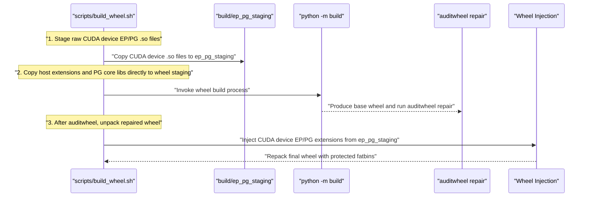

<!-- source: DeepWiki mcp.deepwiki.com · repo kvcache-ai/Mooncake · page 6.4 Python Package Building · fetched 2026-10-21 -->

# Python Package Building

<details>
<summary>Relevant source files</summary>

The following files were used as context for generating this wiki page:

- [.github/CODEOWNERS](.github/CODEOWNERS)
- [.github/labeler.yml](.github/labeler.yml)
- [mooncake-integration/CMakeLists.txt](mooncake-integration/CMakeLists.txt)
- [mooncake-wheel/pyproject.toml](mooncake-wheel/pyproject.toml)
- [mooncake-wheel/setup.py](mooncake-wheel/setup.py)
- [python/tests/packaging/test_installed_wheel.py](python/tests/packaging/test_installed_wheel.py)
- [python/tests/packaging/test_project.py](python/tests/packaging/test_project.py)
- [scripts/build_wheel.sh](scripts/build_wheel.sh)
- [scripts/test_installation.sh](scripts/test_installation.sh)

</details>


This document describes the Python wheel building process for Mooncake, detailing the orchestration via `scripts/build_wheel.sh`, the `auditwheel` repair workflow, EP/PG extension injection, multi-variant strategy, fatbin protection, `pyproject.toml` configuration, and `RPATH` linkage. For information about the underlying CMake compilation flags, see [6.2 CMake Build System](). For CI/CD release automation, see [6.5 CI/CD Pipeline]().

Sources: [scripts/build_wheel.sh:1-137](), [python/tests/packaging/test_project.py:1-410]()

---

## Overview and Multi-Variant Strategy

Mooncake distributes Python packages as binary wheels (`*.whl`) bundling compiled C++ shared objects and Python binding modules. To support diverse hardware setups—including NVIDIA CUDA 12/13, Huawei Ascend NPU, and CPU-only configurations—the build process generates distinct variants by parameterizing packaging scripts and modifying metadata.

| Package Variant                | Target Hardware | SDK Version | Build Flag / Setting | Use Case                      |
|-------------------------------|-----------------|-------------|---------------------|-------------------------------|
| `mooncake-transfer-engine`    | NVIDIA GPUs     | CUDA 12.x   | Default             | Standard GPU clusters          |
| `mooncake-transfer-engine-cuda13` | NVIDIA GPUs     | CUDA 13.x   | `CU13_BUILD=1`       | Newer architectures (Sm_103+) |
| `mooncake-transfer-engine-non-cuda` | CPU / Generic   | None        | `NON_CUDA_BUILD=1`   | Cloud / edge / testing w/o GPU|
| NPU Variant                   | Huawei Ascend   | CANN / NPU  | `NPU_BUILD=1`        | Ascend NPU environments        |

All variants support Python versions `3.10` through `3.13` on `manylinux` container runtimes.

Sources: [scripts/build_wheel.sh:1-137]()

---

## Build Script Orchestration (`build_wheel.sh`)

The primary build orchestration script is `scripts/build_wheel.sh`. It manages environment parameters such as target Python version and output directory, cleans the staging area, copies compiled shared objects from CMake build outputs to the packaging directory, invokes the Python wheel builder, and post-processes results with `auditwheel`.

Key environment variables controlling behavior include:

- `PYTHON_VERSION`: Targets the Python interpreter version to build for. Defaults to current interpreter minor version resolved at runtime [scripts/build_wheel.sh:10-10]().
- `OUTPUT_DIR`: Directory for resulting `.whl` files, defaulting to `dist` [scripts/build_wheel.sh:12-12]().
- `BUILD_DIR`: Directory where CMake compilation outputs reside, default is `build` [scripts/build_wheel.sh:16-16]().
- `NON_CUDA_BUILD`, `CU13_BUILD`, `NPU_BUILD`: Flags influencing build variant naming and packaging behavior.

The script also ensures `LD_LIBRARY_PATH` includes key build artifact directories to enable dynamic linking at build time [scripts/build_wheel.sh:21-21]().

### Build Orchestration Code Entity Bridge



Sources: [scripts/build_wheel.sh:1-137]()

---

## Artifact Collection and Staging

The build script copies compiled shared libraries and helper Python modules from the intermediate CMake build outputs into a dedicated `mooncake-wheel/mooncake/` staging directory before invoking wheel packaging.

Key staged artifacts include:

- `engine.so`: Core Transfer Engine Python binding shared object from `mooncake-integration` [scripts/build_wheel.sh:33-34]()
- `libmooncake_pg.so`: PyTorch GPU (PG) core shared library, copied conditionally if built [scripts/build_wheel.sh:37-40]()
- Native EP host extension shared libraries (`_ep.*.so`) copied if present [scripts/build_wheel.sh:45-49]()
- `shared_segment.py`: Python wrapper that builds on the engine module [scripts/build_wheel.sh:51-52]()
- `libasio.so`: Runtime dependency needed by `engine.so` [scripts/build_wheel.sh:54-55]()
- Mooncake Store shared objects and CLI binaries (`store.so`, `mooncake_master`, etc.) included if the store component is enabled [scripts/build_wheel.sh:57-70]()
- Transport libraries like `ascend_transport.so`, allocator libraries like `nvlink_allocator.so` (CUDA GPU builds) and `ubshmem_fabric_allocator.so` (NPU builds) [scripts/build_wheel.sh:102-132]()

This staging ensures all required binaries and Python modules are collocated for the wheel build.

### Artifact Staging Code Entity Bridge



Sources: [scripts/build_wheel.sh:30-136](), [mooncake-integration/CMakeLists.txt:52-170]()

---

## pyproject.toml Packaging and CLI Entry Points

Package metadata is declared in a `pyproject.toml` file residing in `mooncake-wheel`. This file specifies:

- Project name, version, and description for PyPI publishing: `"mooncake-transfer-engine"`, version `"0.3.13"` [mooncake-wheel/pyproject.toml:25-31]().
- Python version requirement: `>=3.10` [mooncake-wheel/pyproject.toml:31-31]().
- Build system backend requirements: `setuptools>=61.0.0`, `wheel>=0.37.0`, `numpy` [mooncake-wheel/pyproject.toml:20-22]().
- Dependencies: `"aiohttp"`, `"requests"`, `"msgpack"` are main dependencies, with conditional `"typing_extensions"` for Python < 3.10 [mooncake-wheel/pyproject.toml:32-33]().
- Optional dependencies include an `administration` group with `"paramiko"` [mooncake-wheel/pyproject.toml:38-39]().
- Console scripts mapped to Python entry points for CLI tooling:

  | Script                     | Target Python Module                    |
  |----------------------------|---------------------------------------|
  | `mooncake_master`           | `mooncake.cli:main`                   |
  | `mooncake_client`           | `mooncake.cli_client:main`            |
  | `transfer_engine_bench`     | `mooncake.cli_bench:main`             |
  | `mooncake_http_metadata_server` | `mooncake.http_metadata_server:main` |
  | `mc_store_rest_server`      | `mooncake.mooncake_store_service:sync_main` |
  | `transfer_engine_topology_dump` | `mooncake.transfer_engine_topology_dump:main` |

- Package data includes native `.so` files and binary executables to be included in the wheel [mooncake-wheel/pyproject.toml:66-67]().

This configuration enables automatic installation of Python bindings and CLI tools with the wheel.

Sources: [mooncake-wheel/pyproject.toml:1-67](), [python/tests/packaging/test_project.py:24-29]()

---

## auditwheel Repair and RPATH Configuration

To comply with the `manylinux` standard for Linux binary wheels, the built wheels undergo `auditwheel repair`. This process does:

- Verification of external shared library dependencies.
- Bundling all required `.so` dependencies inside the wheel.
- Adjustment of dynamic linker runtime search paths (`RPATH`) for portability without system-wide installs.

The `RPATH` property is set at the CMake build stage to `$ORIGIN` so that shared libraries are discovered relative to the `.so` file location inside the package.

Relevant CMake directives from `mooncake-integration/CMakeLists.txt`:

```cmake
set(CMAKE_INSTALL_RPATH_USE_LINK_PATH TRUE)
set(CMAKE_BUILD_WITH_INSTALL_RPATH TRUE)

set_target_properties(engine PROPERTIES INSTALL_RPATH "$ORIGIN")
set_target_properties(store PROPERTIES INSTALL_RPATH "$ORIGIN")
```

This instructs the dynamic linker to load libraries from the same directory as the built shared object, ensuring the package is self-contained at runtime.

Sources: [mooncake-integration/CMakeLists.txt:46-57](), [mooncake-integration/CMakeLists.txt:157-157]()

---

## CUDA Extension Handling (Fatbin Protection)

Mooncake includes CUDA extensions (`mooncake-ep` and `mooncake-pg`) containing GPU kernel fat binaries (fatbins). These fatbins are delicate; tools like `patchelf` (used by `auditwheel`) may corrupt them if run directly on the libraries.

To protect fatbins, Mooncake uses a two-stage process involving explicit device extension injection:

1. **Staging:**  
   CUDA EP device extension `.so` files are built and staged in a separate directory under the CMake build tree: `${BUILD_DIR}/ep_pg_staging`. The host extensions and core PG host library are copied directly to the wheel staging directory `mooncake-wheel/mooncake/` before the wheel build and auditwheel steps.

2. **Build and Auditwheel:**  
   The base wheel is built **without** the device-side CUDA extension libraries, letting `auditwheel` run safely without corrupting fatbins.

3. **Post-Auditwheel Injection:**  
   After `auditwheel repair` completes (which involves `patchelf`), the script manually injects the staged CUDA EP/PG device `.so` shared objects into the repaired wheel archive. This step bypasses `patchelf` patching for these critical files.

The sequence preserves CUDA GPU extension fatbins intact and ensures proper linkage with host library components.

### Fatbin Protection Workflow



Sources: [scripts/build_wheel.sh:13-49](), [mooncake-integration/CMakeLists.txt:148-198]()

---

## RPATH Configuration Details

Dynamic linker path configuration (`RPATH`) ensures shared libraries packaged inside the wheel load correctly regardless of install location.

Mooncake sets `RPATH` at build time for critical targets `engine` and `store` using CMake:

```cmake
set(CMAKE_INSTALL_RPATH_USE_LINK_PATH TRUE)
set(CMAKE_BUILD_WITH_INSTALL_RPATH TRUE)

set_target_properties(engine PROPERTIES INSTALL_RPATH "$ORIGIN")
set_target_properties(store PROPERTIES INSTALL_RPATH "$ORIGIN")
```

Here, `$ORIGIN` resolves at runtime to the directory containing the shared object, enabling relative loading of other packaged `.so` files.

This approach avoids dependency on global library paths or environment-specific configurations, simplifying deployment and reduces runtime linkage issues.

Sources: [mooncake-integration/CMakeLists.txt:46-57](), [mooncake-integration/CMakeLists.txt:157-157]()

---

## Validation and Testing of Installed Wheels

Mooncake wheel packages are validated through a comprehensive testing pipeline involving:

- Creation of isolated Python virtual environments for clean, uncontaminated installations [scripts/test_installation.sh:11-12]().
- Installation of the wheel using `pip` [scripts/test_installation.sh:19-20]().
- Verifying importability of core Python modules including:

  - `mooncake.engine`
  - `mooncake.reshard`
  - `mooncake.store`
  - CLI modules such as `mooncake.cli`, `mooncake.cli_bench`, `mooncake.cli_client`, and `mooncake.transfer_engine_topology_dump` [scripts/test_installation.sh:33-36]().

- Verification that CLI entry points (`mooncake_master`, `mooncake_client`, `transfer_engine_bench`, `mooncake_http_metadata_server`, `transfer_engine_topology_dump`) exist, are executable, and respond correctly [scripts/test_installation.sh:75-97]().

- Checking dependency boundaries, ensuring optional dependencies like `paramiko` are not accidentally included in base installs, but available in the administration extra [python/tests/packaging/test_project.py:63-64]().

- Automated smoke tests perform runtime execution and import resolution to ensure binary and Python incompatibilities do not occur [python/tests/packaging/test_installed_wheel.py:33-202]().

These validation steps confirm the built wheels are functional, cleanly packaged, and correctly expose all runtime components.

Sources: [scripts/test_installation.sh:1-90](), [python/tests/packaging/test_installed_wheel.py:1-202](), [python/tests/packaging/test_project.py:63-64]()

---

# Summary

Mooncake's Python package building strategy supports broad hardware and SDK variants via a coordinated build system using CMake and shell scripting. The build pipeline stages shared libraries into a wheel staging area, invokes standardized Python wheel builders, and employs `auditwheel` for Linux manylinux compliance. Special care is taken to protect CUDA device extension fatbins by staging and injecting after `auditwheel` repairs. The RPATH is configured to `$ORIGIN` during the native build to ensure portable and correct dynamic linking at runtime. Packaging metadata in `pyproject.toml` declares dependencies, optional features, and command-line tooling, enabling clean installs and environment isolation. Comprehensive installation and import test scripts validate wheel correctness for production deployment.

---

# References

- `scripts/build_wheel.sh` [scripts/build_wheel.sh:1-137]()
- `mooncake-wheel/pyproject.toml` [mooncake-wheel/pyproject.toml:1-67]()
- `mooncake-integration/CMakeLists.txt` [mooncake-integration/CMakeLists.txt:1-197]()
- `scripts/test_installation.sh` [scripts/test_installation.sh:1-90]()
- `python/tests/packaging/test_project.py` [python/tests/packaging/test_project.py:1-183]()
- `python/tests/packaging/test_installed_wheel.py` [python/tests/packaging/test_installed_wheel.py:1-202]()

---

