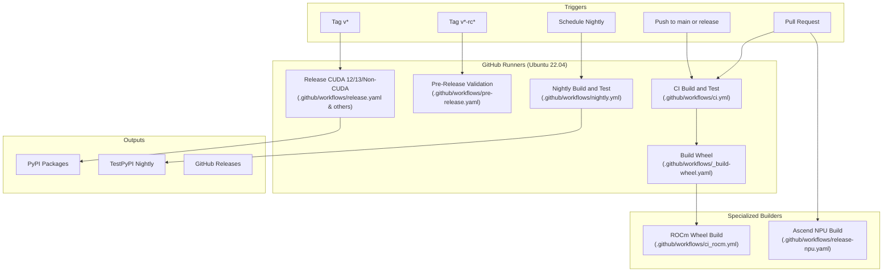
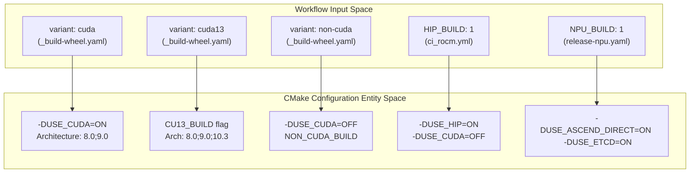
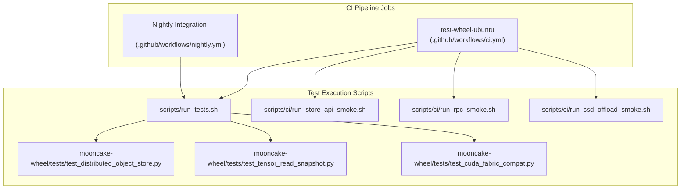

<!-- source: DeepWiki mcp.deepwiki.com · repo kvcache-ai/Mooncake · page 6.5 CI/CD Pipeline · fetched 2026-10-21 -->

# CI/CD Pipeline

<details>
<summary>Relevant source files</summary>

The following files were used as context for generating this wiki page:

- [.github/pull_request_template.md](.github/pull_request_template.md)
- [.github/workflows/_build-efa-wheel.yaml](.github/workflows/_build-efa-wheel.yaml)
- [.github/workflows/_build-wheel.yaml](.github/workflows/_build-wheel.yaml)
- [.github/workflows/ci.yml](.github/workflows/ci.yml)
- [.github/workflows/ci_efa.yml](.github/workflows/ci_efa.yml)
- [.github/workflows/ci_hygon.yml](.github/workflows/ci_hygon.yml)
- [.github/workflows/ci_rocm.yml](.github/workflows/ci_rocm.yml)
- [.github/workflows/nightly.yml](.github/workflows/nightly.yml)
- [.github/workflows/pre-release.yaml](.github/workflows/pre-release.yaml)
- [.github/workflows/release-cuda13.yaml](.github/workflows/release-cuda13.yaml)
- [.github/workflows/release-efa-cuda13.yaml](.github/workflows/release-efa-cuda13.yaml)
- [.github/workflows/release-efa-non-cuda.yaml](.github/workflows/release-efa-non-cuda.yaml)
- [.github/workflows/release-efa.yaml](.github/workflows/release-efa.yaml)
- [.github/workflows/release-non-cuda.yaml](.github/workflows/release-non-cuda.yaml)
- [.github/workflows/release-npu.yaml](.github/workflows/release-npu.yaml)
- [.github/workflows/release-rocm.yaml](.github/workflows/release-rocm.yaml)
- [.github/workflows/release.yaml](.github/workflows/release.yaml)
- [.gitmodules](.gitmodules)
- [.pre-commit-config.yaml](.pre-commit-config.yaml)
- [AGENTS.md](AGENTS.md)
- [CLAUDE.md](CLAUDE.md)
- [CMakeLists.txt](CMakeLists.txt)
- [CONTRIBUTING.md](CONTRIBUTING.md)
- [dependencies.sh](dependencies.sh)
- [docker/mooncake.Dockerfile](docker/mooncake.Dockerfile)
- [docker/musa.Dockerfile](docker/musa.Dockerfile)
- [docs/AGENTS.md](docs/AGENTS.md)
- [mooncake-store/tests/e2e/readme.md](mooncake-store/tests/e2e/readme.md)
- [mooncake-store/tests/e2e/run_nof_heartbeat_tcp_e2e.sh](mooncake-store/tests/e2e/run_nof_heartbeat_tcp_e2e.sh)
- [mooncake-store/tests/e2e/run_oplog_batch_cluster.sh](mooncake-store/tests/e2e/run_oplog_batch_cluster.sh)
- [mooncake-store/tests/e2e/run_oplog_batch_cluster_test.sh](mooncake-store/tests/e2e/run_oplog_batch_cluster_test.sh)
- [mooncake-store/tests/ha/snapshot/batch_oplog/capacity.py](mooncake-store/tests/ha/snapshot/batch_oplog/capacity.py)
- [mooncake-store/tests/ha/snapshot/batch_oplog/capacity.sh](mooncake-store/tests/ha/snapshot/batch_oplog/capacity.sh)
- [mooncake-store/tests/ha/snapshot/batch_oplog/capacity_test.py](mooncake-store/tests/ha/snapshot/batch_oplog/capacity_test.py)
- [mooncake-transfer-engine/tests/rdma_context_reprobe_test.cpp](mooncake-transfer-engine/tests/rdma_context_reprobe_test.cpp)
- [mooncake-transfer-engine/tests/rdma_memory_location_test.cpp](mooncake-transfer-engine/tests/rdma_memory_location_test.cpp)
- [mooncake-transfer-engine/tests/rdma_test_peers.h](mooncake-transfer-engine/tests/rdma_test_peers.h)
- [mooncake-wheel/tests/test_distributed_object_store.py](mooncake-wheel/tests/test_distributed_object_store.py)
- [mooncake-wheel/tests/test_meta_server.py](mooncake-wheel/tests/test_meta_server.py)
- [mooncake-wheel/tests/test_release_wheel_tags.py](mooncake-wheel/tests/test_release_wheel_tags.py)
- [python/mooncake/http_metadata_server.py](python/mooncake/http_metadata_server.py)
- [python/tests/services/test_http_metadata_server.py](python/tests/services/test_http_metadata_server.py)
- [scripts/ci/run_rpc_smoke.sh](scripts/ci/run_rpc_smoke.sh)
- [scripts/ci/run_ssd_offload_smoke.sh](scripts/ci/run_ssd_offload_smoke.sh)
- [scripts/ci/run_store_rust_smoke.sh](scripts/ci/run_store_rust_smoke.sh)
- [scripts/ci/tests/test_nightly_rocm_publish.py](scripts/ci/tests/test_nightly_rocm_publish.py)
- [scripts/code_format.sh](scripts/code_format.sh)
- [scripts/hygon/redact_ci_logs.py](scripts/hygon/redact_ci_logs.py)
- [scripts/hygon/test_mooncake_store_cross_node.sh](scripts/hygon/test_mooncake_store_cross_node.sh)
- [scripts/hygon/test_transfer_engine_cross_node.sh](scripts/hygon/test_transfer_engine_cross_node.sh)
- [scripts/run_tests.sh](scripts/run_tests.sh)

</details>


This document describes the GitHub Actions-based continuous integration and continuous deployment (CI/CD) pipeline for the Mooncake codebase. The pipeline automates building, unit and integration testing, cross-platform packaging, and releasing the Mooncake platform across multiple Python versions, operating systems, and hardware configurations including NVIDIA CUDA (12/13), Huawei Ascend NPU, AMD ROCm/HIP, Moore Threads MUSA, and non-CUDA environments.

The CI/CD system consists of several primary GitHub Actions workflows and supporting scripts:

- **CI Workflow** (`.github/workflows/ci.yml`): Build verification, unit tests, and smoke testing for standard Linux environments [.github/workflows/ci.yml:1-206]().
- **Ascend CI & Release Workflows** (`.github/workflows/release-npu.yaml`): Hardware packaging and cross-compilation for Huawei Ascend NPU [.github/workflows/release-npu.yaml:1-187]().
- **ROCm CI Workflow** (`.github/workflows/ci_rocm.yml`): AMD ROCm/HIP wheel compilation and packaging [.github/workflows/ci_rocm.yml:1-190]().
- **Nightly Workflow** (`.github/workflows/nightly.yml`): Automated daily builds for TestPyPI with date-based PEP 440 version stamping [.github/workflows/nightly.yml:1-195]().
- **Release Workflows**: Production packaging for PyPI and GitHub across variants like CUDA 12 [.github/workflows/release.yaml:1-34](), CUDA 13 [.github/workflows/release-cuda13.yaml:1-35](), Non-CUDA [.github/workflows/release-non-cuda.yaml:1-37](), and Ascend NPU [.github/workflows/release-npu.yaml:1-187]().
- **Pre-Release Workflow** (`.github/workflows/pre-release.yaml`): Dry run validation and GitHub pre-release attachment for release candidates [.github/workflows/pre-release.yaml:1-199]().

Sources: [.github/workflows/ci.yml:1-206](), [.github/workflows/release-npu.yaml:1-187](), [.github/workflows/ci_rocm.yml:1-190](), [.github/workflows/nightly.yml:1-195](), [.github/workflows/release.yaml:1-34](), [.github/workflows/release-cuda13.yaml:1-35](), [.github/workflows/release-non-cuda.yaml:1-37](), [.github/workflows/pre-release.yaml:1-199]()

---

## Workflow Architecture

The pipeline implements a multi-tier architecture involving local runner builds, containerized manylinux compilation, and remote hardware execution.

### High-Level Flow



### Workflow Conditional Execution and Hardware Targets

| Workflow                   | Trigger                                       | Hardware Target                    | Source Range (.yml)                       |
|----------------------------|----------------------------------------------|----------------------------------|------------------------------------------|
| CI Workflow                | Push/PR/`workflow_dispatch`                   | CPU + CUDA 12.8 (Build & Test)   | [.github/workflows/ci.yml:3-17]()        |
| Nightly Workflow           | Schedule + `workflow_dispatch`                | Multiple Variants (TestPyPI)      | [.github/workflows/nightly.yml:4-79]()   |
| Release CUDA 12            | Tag `v*`                                      | CUDA 12 (x86_64 & arm64)         | [.github/workflows/release.yaml:3-24]()  |
| Release CUDA 13            | Tag `v*`                                      | CUDA 13 (x86_64 & arm64)         | [.github/workflows/release-cuda13.yaml:3-18]() |
| Release Non-CUDA           | Tag `v*`                                      | CPU-only x86_64 & arm64          | [.github/workflows/release-non-cuda.yaml:3-20]() |
| Release Ascend NPU         | Tag `v*`, or manual dispatch                  | Huawei Ascend NPU (x86_64/aarch64) | [.github/workflows/release-npu.yaml:1-187]() |


Sources: [.github/workflows/ci.yml:3-17](), [.github/workflows/nightly.yml:4-79](), [.github/workflows/release.yaml:3-24](), [.github/workflows/release-cuda13.yaml:3-18](), [.github/workflows/release-non-cuda.yaml:3-20](), [.github/workflows/release-npu.yaml:1-187]()

---

## Build and Test Jobs

### CI Workflow Overview (`.github/workflows/ci.yml`)

The main CI workflow triggers on pushes and pull requests to main and release branches and on manual dispatch. Its key jobs:

- **Build Wheel**: Uses a reusable workflow `_build-wheel.yaml` to build Python wheels for Python 3.10 and 3.12, producing artifacts with a `mooncake-wheel-ci` prefix [.github/workflows/ci.yml:31-42]().
- **Test Wheel on Ubuntu**: Runs separate test jobs on Ubuntu 22.04 and 24.04, downloading the built wheel, installing CUDA Toolkit 12.8.1, and running a series of smoke tests including store API tests and SSD offload end-to-end tests [.github/workflows/ci.yml:43-167]().

### Unit Tests Job

- Runs comprehensive CTest-based unit tests inside Ubuntu 22.04 with Python 3.12 [.github/workflows/ci.yml:168-206]().
- Includes installing Rust toolchain and etcd, configuring CUDA tooling, and managing dependencies.

### CI Job Workflow Steps Summary

```mermaid
graph TD
    WC[Build Wheel (build-wheel) Job]
    TST_U[Run Tests on Ubuntu (test-wheel-ubuntu)]
    UNIT[Unit Tests Job]
    SETUP_CUDA[Install CUDA Toolkit, Setup Environment]
    RUN_MASTER[Run master server for integration tests]
    RUN_SCRIPTS[Execute store API, RPC, and SSD offload smoke scripts]

    WC --> TST_U
    TST_U --> SETUP_CUDA
    SETUP_CUDA --> RUN_MASTER
    RUN_MASTER --> RUN_SCRIPTS
    WC --> UNIT
```

Sources: [.github/workflows/ci.yml:31-206]()

---

### Local Test Runner Script (`scripts/run_tests.sh`)

This bash script is used locally or in container environments to orchestrate tests:
- Starts and stops a standalone HTTP metadata server on port 8080 used by many integration tests.
- Runs Transfer Engine target and initiator test suites.
- Runs distributed object store and tensor snapshot regression tests.
- Manages test environment variables and dependencies like `LD_LIBRARY_PATH` for dynamic libraries [.github/workflows/ci.yml:90-130](), [scripts/run_tests.sh:1-189]().

Sources: [scripts/run_tests.sh:1-189](), [.github/workflows/ci.yml:90-130]()

---

## Wheel Packaging Implementation

### Reusable Build Workflow (`.github/workflows/_build-wheel.yaml`)

This reusable CI workflow encapsulates details for building Python wheels for specific variants and architectures. It supports:

- Variants: `cuda`, `cuda13`, and `non-cuda`.
- Architectures: `x86_64` and `arm64`.
- Python versions matrix (defaults: 3.10, 3.11, 3.12, 3.13).
- Optional version override for nightly builds.

#### Key Features:

- Runs inside official PyTorch manylinux Docker builder images for strict GLIBC compatibility.
- Dynamically configures CMake options according to variant:
  - `cuda`: Enables CUDA with SM architectures 8.0 and 9.0.
  - `cuda13`: Enables CU13 build flags and SM arch 8.0, 9.0, 10.3.
  - `non-cuda`: Disables CUDA, disables expert parallelism.
- Integrates `sccache` caching to speed up C++ compilation.
- Patch `pyproject.toml` to override the package version if requested.
- Builds wheels with `cmake` and `setup.py` workflows inside container.
- Supports limiting concurrency and retry logic in build steps [.github/workflows/_build-wheel.yaml:5-165]().

Sources: [.github/workflows/_build-wheel.yaml:1-165]()

---

## Release Workflows

Release workflows trigger only on tags with version pattern `v*` and are variant-specific, publishing production-ready Python wheels to PyPI and GitHub.

### CUDA 12 Release (`release.yaml`)

- Builds x86_64 and arm64 wheels for CUDA 12.
- Uses `_build-wheel.yaml` for build step.
- Publishes to PyPI using `PYPI_API_TOKEN`.
- Verifies no pre-release tags are present [.github/workflows/release.yaml:1-34]().

### CUDA 13 Release (`release-cuda13.yaml`)

- Similar to CUDA 12 release but targets CUDA 13 variants and SM arch including 10.3.
- Uses a dedicated PyPI token `PYPI_CU13_API_TOKEN`.
- Supports x86_64 and arm64 [.github/workflows/release-cuda13.yaml:1-35]().

### Non-CUDA Release (`release-non-cuda.yaml`)

- Builds CPU-only wheels with CUDA disabled.
- Supports x86_64 and arm64.
- Publishes with appropriate tokens to PyPI [.github/workflows/release-non-cuda.yaml:1-37]().

### Ascend NPU Release (`release-npu.yaml`)

- Builds wheels with Ascend NPU support.
- Downloads and installs Huawei's CANN toolkit.
- Cross-compiles necessary components.
- Supports both aarch64 and x86_64 architectures.
- Publishes artifacts to PyPI [.github/workflows/release-npu.yaml:1-187]().

### Pre-Release Workflow (`pre-release.yaml`)

- Triggers on pre-release version tags like `v1.0.0-rc1`.
- Normalizes version format to PEP 440 compliant.
- Builds and uploads wheels to GitHub Pre-release attachments.
- Publishes pre-release wheels to TestPyPI for consumption and testing.
- Runs integration tests consuming published artifacts [.github/workflows/pre-release.yaml:1-199]().

Sources: [.github/workflows/release.yaml:1-34](), [.github/workflows/release-cuda13.yaml:1-35](), [.github/workflows/release-non-cuda.yaml:1-37](), [.github/workflows/release-npu.yaml:1-187](), [.github/workflows/pre-release.yaml:1-199]()

---

## Composite and Specialized Workflows

### ROCm CI Workflow (`ci_rocm.yml`)

- Builds ROCm (HIP) compatible wheels inside an ROCm-enabled Ubuntu container.
- Uses HIP compiler and dependencies inside container image `rocm/dev-ubuntu-22.04:7.2.3-complete`.
- Supports Python 3.10 and 3.12.
- Incorporates patching and build retries.
- Produces HIP wheels for AMD GPU support [.github/workflows/ci_rocm.yml:1-190]().

### Ascend CI

- Contains build steps to handle Ascend NPU SDK installation and cross-compilation.
- Runs integration tests on Ascend hardware.
- Treated as a specialized CI segment [.github/workflows/ci_ascend.yml:1-361]() and release-npu.yaml.

### Labeler Workflow and Composite Actions

- Automated PR labeling based on changed paths applies tags such as `[CI]`, `[Store]`, `[TE]` to orchestrate targeted runs.
- Composite GitHub Actions like `free-disk-space` and `setup-etcd` aid resource management and service setup.
- Version normalization and artifact deployment utilities shared across workflows.

Sources: [.github/workflows/ci_rocm.yml:1-190](), [.github/workflows/release-npu.yaml:1-187](), [.github/workflows/ci.yml:60-83](), [.github/actions/free-disk-space/action.yml](), [.github/workflows/ci_ascend.yml:1-361]()

---

## Code Entity Association Diagrams

### Workflow Variant to CMake Build Flags

This diagram maps GitHub Actions input variants to the key CMake build configuration flags controlling CUDA, HIP, Ascend, and other platform variants used in `_build-wheel.yaml` and release workflows:



Sources: [.github/workflows/_build-wheel.yaml:60-122](), [.github/workflows/ci_rocm.yml:40-141](), [.github/workflows/release-npu.yaml:37-120]()

---

### Test Suite Orchestration to Scripts and Tests

This diagram bridges the CI jobs to concrete test scripts and Python test modules run during CI and nightly workflows, emphasizing integration among the test layers:



Sources: [.github/workflows/ci.yml:38-154](), [.github/workflows/nightly.yml:87-107](), [scripts/run_tests.sh:1-189](), [mooncake-wheel/tests/test_distributed_object_store.py:1-181](), [mooncake-wheel/tests/test_tensor_read_snapshot.py:1-81]()

---

## Additional Notes

- The dependency installation script `dependencies.sh` is used in CI for installing system packages, Go, and conditionally SPDK support for NVMe-oF [dependencies.sh:1-207]().

- Configurable environment variables such as `SCCACHE_GHA_ENABLED`, `MC_METADATA_SERVER`, and CUDA toolkit versions allow flexible builds across different jobs.

- The labeler workflow applies labels to PRs to trigger or filter CI runs based on file changes but is not listed explicitly in visible files.

- The builds integrate with sccache caching to reduce compile times, and pre-commit hooks enforce code consistency on codebase changes [CONTRIBUTING.md:40-118]().

---

This CI/CD pipeline ensures comprehensive build coverage, hardware variant packaging, and robust testing before production release, supporting a wide range of configurations and deployment targets for the Mooncake KVCache-centric LLM serving platform.

Sources summary:  
[.github/workflows/ci.yml](), [.github/workflows/_build-wheel.yaml](), [.github/workflows/release.yaml](), [.github/workflows/release-cuda13.yaml](), [.github/workflows/release-non-cuda.yaml](), [.github/workflows/release-npu.yaml](), [.github/workflows/ci_rocm.yml](), [.github/workflows/nightly.yml](), [.github/workflows/pre-release.yaml](), [scripts/run_tests.sh](), [dependencies.sh](), [CONTRIBUTING.md](), [.github/actions/free-disk-space/action.yml](), [.github/workflows/ci_ascend.yml]()

---

