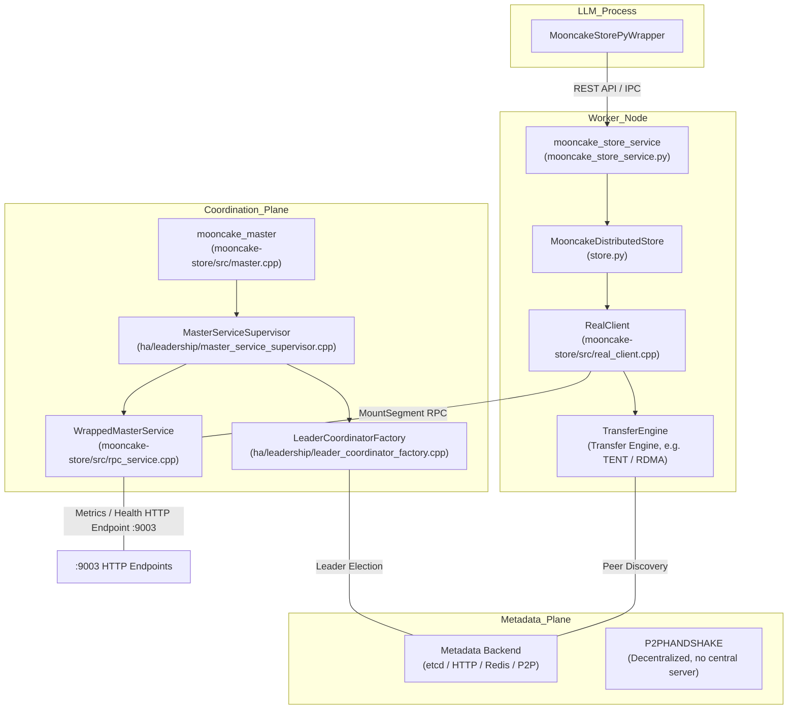
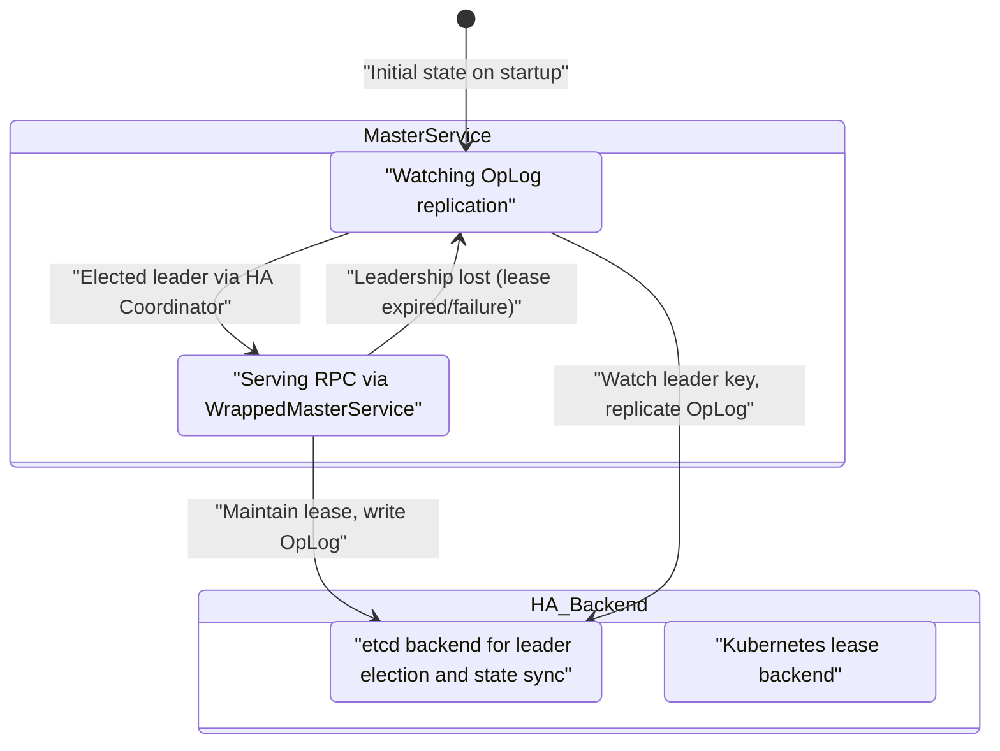
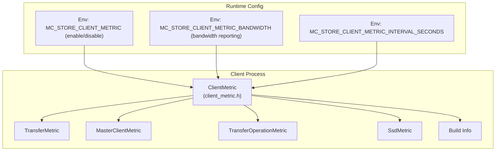
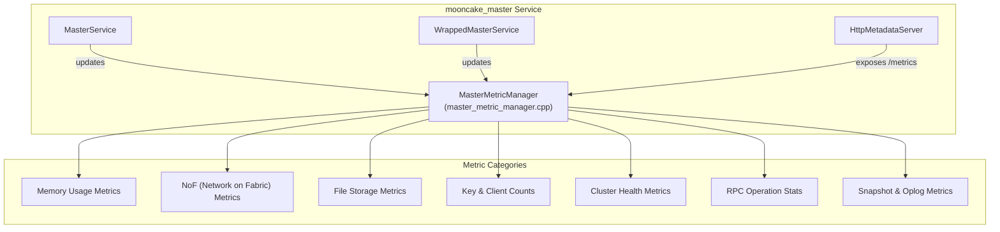

<!-- source: DeepWiki mcp.deepwiki.com · repo kvcache-ai/Mooncake · page 6.8 Production Deployment Patterns · fetched 2026-10-21 -->

# Production Deployment Patterns

<details>
<summary>Relevant source files</summary>

The following files were used as context for generating this wiki page:

- [docs/source/deployment/mooncake-store-deployment-guide.md](docs/source/deployment/mooncake-store-deployment-guide.md)
- [docs/source/getting_started/observability.md](docs/source/getting_started/observability.md)
- [docs/source/troubleshooting/troubleshooting.md](docs/source/troubleshooting/troubleshooting.md)
- [mooncake-store/include/allocator_metric.h](mooncake-store/include/allocator_metric.h)
- [mooncake-store/include/allocator_status.h](mooncake-store/include/allocator_status.h)
- [mooncake-store/include/client_metric.h](mooncake-store/include/client_metric.h)
- [mooncake-store/include/ha/standby_controller.h](mooncake-store/include/ha/standby_controller.h)
- [mooncake-store/include/ha/standby_metadata_store.h](mooncake-store/include/ha/standby_metadata_store.h)
- [mooncake-store/include/hot_standby_service.h](mooncake-store/include/hot_standby_service.h)
- [mooncake-store/include/hybrid_metric.h](mooncake-store/include/hybrid_metric.h)
- [mooncake-store/include/master_config.h](mooncake-store/include/master_config.h)
- [mooncake-store/include/replica.h](mooncake-store/include/replica.h)
- [mooncake-store/include/types.h](mooncake-store/include/types.h)
- [mooncake-store/src/allocator_metric.cpp](mooncake-store/src/allocator_metric.cpp)
- [mooncake-store/src/client_metric.cpp](mooncake-store/src/client_metric.cpp)
- [mooncake-store/src/ha/leadership/master_service_supervisor.cpp](mooncake-store/src/ha/leadership/master_service_supervisor.cpp)
- [mooncake-store/src/ha/standby_controller.cpp](mooncake-store/src/ha/standby_controller.cpp)
- [mooncake-store/src/ha/standby_metadata_store.cpp](mooncake-store/src/ha/standby_metadata_store.cpp)
- [mooncake-store/src/hot_standby_service.cpp](mooncake-store/src/hot_standby_service.cpp)
- [mooncake-store/src/master.cpp](mooncake-store/src/master.cpp)
- [mooncake-store/tests/client_metrics_test.cpp](mooncake-store/tests/client_metrics_test.cpp)
- [mooncake-store/tests/ha/master_service_ha_test.cpp](mooncake-store/tests/ha/master_service_ha_test.cpp)
- [mooncake-store/tests/ha/standby/hot_standby_service_test.cpp](mooncake-store/tests/ha/standby/hot_standby_service_test.cpp)
- [mooncake-store/tests/ha/standby/hot_standby_snapshot_bootstrap_test.cpp](mooncake-store/tests/ha/standby/hot_standby_snapshot_bootstrap_test.cpp)
- [mooncake-store/tests/master_service_config_test.cpp](mooncake-store/tests/master_service_config_test.cpp)

</details>


This page details production deployment best practices for Mooncake, covering the `mooncake_master` service lifecycle, high availability (HA) configurations, metadata backend selection, client node tuning, and operational monitoring with Prometheus and Grafana.

For details on the `MasterService` RPC interface, see [5.2. Master Service](). For client API usage, see [5.3. Client Operations](). For Transfer Engine configuration tuning, see [4.14. Configuration and Tuning]().

---

## 1. Deployment Topology & Architecture

A Mooncake production cluster is structured into three distinct logical planes:

- **Coordination Plane**: Managed by the `mooncake_master` service for cluster membership and resource allocation.
- **Metadata Plane**: Uses external services like etcd, Redis, HTTP metadata server, or decentralized P2P handshake for Transfer Engine peer coordination.
- **Data Plane (Worker Nodes)**: Host client nodes contributing storage (DRAM, VRAM, SSD) and providing KVCache serving functionality.

### Mooncake Production Topology and Code Entities



**Explanation:**

- `mooncake_master` coordinates the cluster using `MasterServiceSupervisor` to control HA leadership and metadata replication.
- The metadata plane provides peer discovery and cluster state; it can be central (etcd/Redis/HTTP) or decentralized with P2P handshake.
- Worker nodes run `RealClient` instances contributing memory and storage resources, coordinated by `mooncake_master`.
- Transfer Engine (`TE`) handles high-speed data movement using RDMA, TCP, or other transports.
- LLM processes typically interact with the `mooncake_store_service` via REST or IPC for KVCache operations.

Sources: [docs/source/deployment/mooncake-store-deployment-guide.md:10-16](), [mooncake-store/src/master.cpp:50-120](), [mooncake-store/src/ha/leadership/master_service_supervisor.cpp:1-120]()

---

## 2. Master Service Lifecycle & High Availability (HA)

The `mooncake_master` binary serves as the central coordinator, tracking cluster membership, node health, and storage allocation policies.

### Launch and Configuration Flags

The master is configured via command-line flags or configuration files mapping to the `MasterConfig` struct [mooncake-store/include/master_config.h:95-185](). Example launch:

```bash
mooncake_master \
  --rpc_port=50051 \
  --enable_http_metadata_server=true \
  --http_metadata_server_port=8080 \
  --enable_ha=true \
  --ha_backend_type=etcd \
  --ha_backend_connstring="10.0.0.1:2379;10.0.0.2:2379"
```

| Flag                          | Default  | Purpose                                                 |
|-------------------------------|----------|---------------------------------------------------------|
| `rpc_port`                    | `50051`  | Master RPC port for client communication                 |
| `enable_http_metadata_server` | `false`  | Embed HTTP metadata server for Transfer Engine peer discovery |
| `metrics_port`                | (config) | Port for HTTP metrics server                              |
| `enable_ha`                   | `false`  | Enables leader election with HA backend (e.g., etcd)     |
| `ha_backend_type`             | `""`     | HA backend type (`etcd`, `redis`, `k8s`, etc.)           |
| `ha_backend_connstring`       | `""`     | Connection string for HA backend cluster                  |
| `default_kv_lease_ttl`        | 10000 ms | Default lease TTL for KV objects                          |
| `default_kv_soft_pin_ttl`     | 1800000ms| Default soft pin TTL for KV objects                       |
| `client_active_ttl_sec`       | 10 sec   | Heartbeat TTL before client considered offline           |

The master parses and validates durations such as lease TTLs, with runtime logs reporting invalid value errors or exit on invalid configs [mooncake-store/src/master.cpp:50-76]().

Sources: [mooncake-store/src/master.cpp:120-160](), [mooncake-store/include/master_config.h:95-185](), [docs/source/deployment/mooncake-store-deployment-guide.md:30-44](), [mooncake-store/include/types.h:84-105]()

### High Availability State Machine

Master nodes form a cluster coordinated by `MasterServiceSupervisor` [mooncake-store/src/ha/leadership/master_service_supervisor.cpp:1-150]() which uses `LeaderCoordinator` backends such as etcd or Kubernetes leases.



- The leader master serves RPC to clients through `WrappedMasterService`.
- OpLog (operation log) replication ensures consistent metadata state across standby masters. The `HotStandbyService` [mooncake-store/include/hot_standby_service.h:88-193]() manages this replication, applying OpLog entries to its local metadata store [mooncake-store/src/hot_standby_service.cpp:19-46]().
- On failure, standby nodes detect lost leadership, stop serving requests, and attempt re-election.

Sources: [mooncake-store/src/ha/leadership/master_service_supervisor.cpp:20-150](), [docs/source/deployment/mooncake-store-deployment-guide.md:136-160](), [mooncake-store/include/hot_standby_service.h:88-193](), [mooncake-store/src/hot_standby_service.cpp:19-46]()

---

## 3. Mooncake Store Client Configuration & Storage Tiers

Worker nodes run instances of `RealClient` that contribute memory/storage and handle data requests. The client APIs are accessible programmatically or via dedicated client processes [docs/source/deployment/mooncake-store-deployment-guide.md:49-66]().

### Programmatic Client Setup

Clients can be initialized via Python APIs:

```python
from mooncake.store import MooncakeDistributedStore
store = MooncakeDistributedStore()
store.setup(
    local_hostname="10.0.0.1",
    metadata_server="P2PHANDSHAKE",           # decentralized metadata mode
    global_segment_size=32 * 1024**3,         # 32GB DRAM segment
    local_buffer_size=512 * 1024**2,           # 512MB transfer engine buffer
    protocol="rdma",
    master_server_addr="etcd://10.0.0.1:2379;10.0.0.2:2379"
)
```

### Client Roles and Deployment Modes

- **Embedded Client**: Runs inside an LLM inference process, issuing `put/get` requests and contributing memory resources.
- **Standalone Store Service**: Runs independently, dedicates resources, exposes RPC (e.g., `mooncake_store_service`).
- **Dummy + Real Client Pattern**: Dummy clients forward requests to one real client holding storage ownership, useful in multi-rank distributed scenarios.

### Storage Tiers and Eviction Policies

Resources contributed by clients are pooled into DRAM segments and optionally SSD offloads managed by the master. Eviction policy parameters include:

- `eviction_ratio`
- `eviction_high_watermark_ratio`
- `tenant_eviction_high_watermark_ratio` for multi-tenant isolation
- `allow_evict_soft_pinned_objects` controls whether soft pinned objects can be evicted [mooncake-store/include/master_config.h:150-162]()

Eviction ensures space reclamation to maintain system health and fairness across tenants.

Sources: [docs/source/deployment/mooncake-store-deployment-guide.md:49-66](), [mooncake-store/include/master_config.h:150-162](), [docs/source/design/store/mooncake-store.md:1-53]()

---

## 4. Network Tuning & Transport Protocol Best Practices

### Preferred Transport Protocols

- **RDMA**: Recommended for high-performance setups with RDMA-capable NICs. Use explicit device names in `rdma_devices`.
- **TCP**: Suitable for quick evaluation, dev, or single-host deployments; more compatible.
- **Others**: Ascend Direct, CXL, NVLink and more for specialized hardware setups.

### Metadata Handshake Modes

- **P2PHANDSHAKE (Decentralized)**: The simplest metadata mode; nodes exchange transfer engine metadata directly at connection time; no central metadata service required.
- **Centralized Metadata Backends**: External etcd, Redis, or embedded HTTP metadata server inside `mooncake_master`.
- **Metadata Cleanup**: The master supports automatic cleanup of stale transfer metadata related to timed-out clients either locally or via HTTP DELETE requests, based on configured metadata server. [mooncake-store/src/master.cpp:75-120]()

### Environment Variables for Network Tuning

- `MC_MTU` for MTU size tuning
- `MC_GID_INDEX` for RDMA GID index configuration
- `MC_MS_AUTO_DISC` and `MC_MS_FILTERS` for auto-discovery and NIC selection

Sources: [docs/source/deployment/mooncake-store-deployment-guide.md:14-61](), [mooncake-store/src/master.cpp:70-120]()

---

## 5. Monitoring, Metrics, and Observability

Mooncake exposes rich metrics suitable for Prometheus scraping and visualization through Grafana dashboards.

### Client-Side Metrics

Client runtime instruments throughput, latency, RPC counts by the `ClientMetric` and `TransferMetric` classes [mooncake-store/include/client_metric.h:90-154]().



### Master-Side Metrics

The master service gathers overall cluster health, memory usage, client counts, and RPC operation stats via `MasterMetricManager` [mooncake-store/include/master_metric_manager.h:21-29]().



### Critical Metrics Reference

| Metric Name                        | Description                                         | Code Symbol / Location                                                      |
|----------------------------------|-----------------------------------------------------|----------------------------------------------------------------------------|
| `mooncake_transfer_read_bytes`   | Total bytes read by Mooncake client                  | `TransferMetric::total_read_bytes` [client_metric.h:110-111]()             |
| `mooncake_transfer_write_bytes`  | Total bytes written by client                         | `TransferMetric::total_write_bytes` [client_metric.h:111-112]()            |
| `mooncake_transfer_get_latency`  | Latency distribution for Get operations              | `TransferMetric::get_latency_us` [client_metric.h:113]()                   |
| `mooncake_transfer_put_latency`  | Latency distribution for Put operations              | `TransferMetric::put_latency_us` [client_metric.h:115]()                   |
| `master_allocated_bytes`          | Memory used across all mounted segments              | `MasterMetricManager::mem_allocated_size_` [master_metric_manager.cpp:27]  |
| `master_total_capacity_bytes`     | Total mounted memory capacity                         | `MasterMetricManager::mem_total_capacity_` [master_metric_manager.cpp:29]  |
| `master_key_count`                | Total number of keys managed                          | `MasterMetricManager::key_count_` [master_metric_manager.cpp:54]           |
| `master_active_clients`           | Number of active clients connected                    | `MasterMetricManager::active_clients_` [master_metric_manager.cpp:65]      |
| `master_put_start_requests_total`| Count of PutStart RPC requests                         | `MasterMetricManager::put_start_requests_` [master_metric_manager.cpp:98]  |
| `master_rpc_count`                | Count of RPC calls to master                          | `MasterClientMetric::rpc_count` [client_metric.h:192-193]()                |

### HTTP Endpoints & Health Checks

The master runs an admin HTTP server (default port 9003) exposing:

- `GET /metrics` — Prometheus exposition format metrics.
- `GET /metrics/summary` — Human-readable summary of metrics.
- `GET /health` — JSON health status including HA role and service readiness.
- `GET /role` — Current HA role (leader/standby).
- `GET /ha_status` — Current HA runtime state.

Example usage:

```bash
curl -s http://localhost:9003/metrics/summary
curl -s http://localhost:9003/metrics
```

Sources: [docs/source/getting_started/observability.md:114-134](), [mooncake-store/include/master_admin_service.h:24-42](), [mooncake-store/src/master_admin_service.cpp:35-110](), [mooncake-store/include/client_metric.h:90-154]()

---

## 6. Troubleshooting and Operational Tips

### Common Issues

- **Connection failures:** Verify `connectable_name` is not a loopback address and is reachable by other nodes.
- **Metadata server misconfiguration:** Ensure etcd/HTTP servers are reachable and protocol settings match.
- **Incorrect MTU and GID for RDMA:** Use environment variables `MC_MTU` and `MC_GID_INDEX` to tune RDMA settings.
- **RDMA device failures:** Confirm device names exist using `ibv_devinfo` and ports are active.
- **Firewall settings:** Ensure required RPC and RDMA ports are open.

### Corrupted Data

Enable checksum verification during client startup by setting:

```bash
export MOONCAKE_STORE_CHECKSUM=1
```

This activates CRC-64 checksum verification for full-object read/write operations to detect corrupted data. (`CHECKSUM_MISMATCH` errors report discrepancies.) This incurs some performance overhead and disables the local hot cache; disable once the issue is resolved.

### Heartbeat Monitoring

Master monitors client heartbeats and enforces TTLs configurable by:

- `client_active_ttl_sec` — client considered offline if no heartbeat within TTL.
- `client_suspicion_ttl_sec` — suspicion timeout after which client considered down.

Proper heartbeat configuration ensures timely detection of client failures for cluster stability.

Sources: [docs/source/troubleshooting/troubleshooting.md:1-64](), [mooncake-store/include/master_config.h:13-19]()

---

## 7. Mooncake Store Deployment Guide Summary

The minimal production deployment involves:

1. **Metadata service:**

   - For quick start: use `P2PHANDSHAKE` mode, requiring no external metadata service.
   - For production HA: deploy external etcd or Redis cluster or enable master's embedded HTTP metadata server.

2. **Master service:**

   - Run one or more `mooncake_master` instances with HA enabled for fault tolerance.
   - Configure RPC port, metadata backend, and HTTP metrics endpoint.

3. **Client nodes:**

   - Run `RealClient` nodes contributing memory/storage, configured with correct `metadata_server`, `master_server_addr`, and hardware transport parameters.
   - Tune buffer sizes and transport devices for your hardware.

For deeper details, consult [Mooncake Store Deployment & Tuning Guide](docs/source/deployment/mooncake-store-deployment-guide.md).

---

# Summary

This page has covered Mooncake production deployment best practices centered on:

- The HA-enabled master service lifecycle and state machine.
- Metadata backend options and handshake modes for metadata coordination.
- Client configuration patterns and storage tiering.
- Network tuning for RDMA and alternative protocols.
- Metrics monitoring via Prometheus-compatible exports from master and clients.
- Operational troubleshooting and checksum diagnostics.

By following these patterns, Mooncake clusters achieve scalable, resilient, and high-throughput KVCache serving suitable for large-scale LLM inference workloads.

Sources:  
[docs/source/deployment/mooncake-store-deployment-guide.md:1-151](),  
[mooncake-store/src/master.cpp:1-162](),  
[mooncake-store/include/master_config.h:1-185](),  
[mooncake-store/src/ha/leadership/master_service_supervisor.cpp:1-184](),  
[docs/source/design/store/mooncake-store.md:1-53](),  
[mooncake-store/include/client_metric.h:1-180](),  
[mooncake-store/src/client_metric.cpp:1-176](),  
[docs/source/getting_started/observability.md:1-138](),  
[docs/source/troubleshooting/troubleshooting.md:1-64](),
[mooncake-store/include/types.h:84-105](),
[mooncake-store/include/hot_standby_service.h:88-193](),
[mooncake-store/src/hot_standby_service.cpp:19-46]()

---

