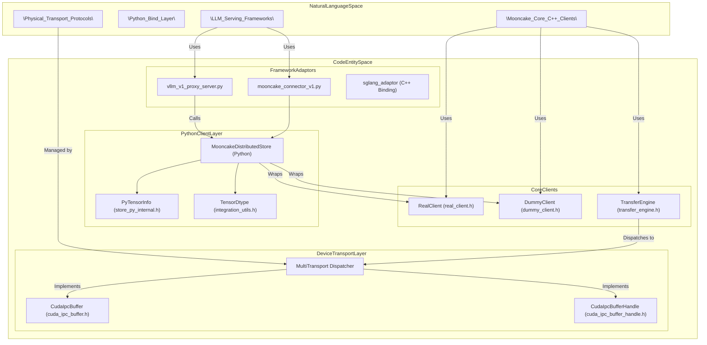
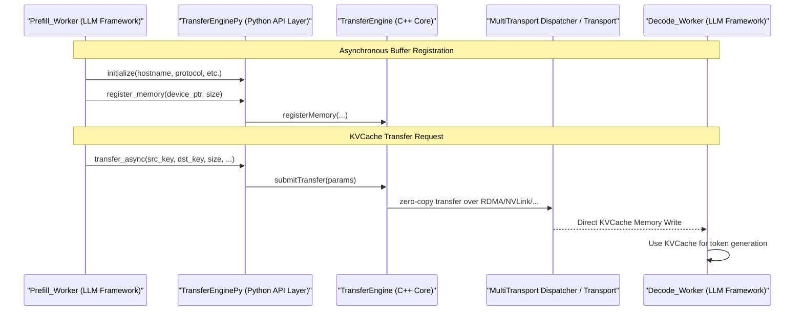
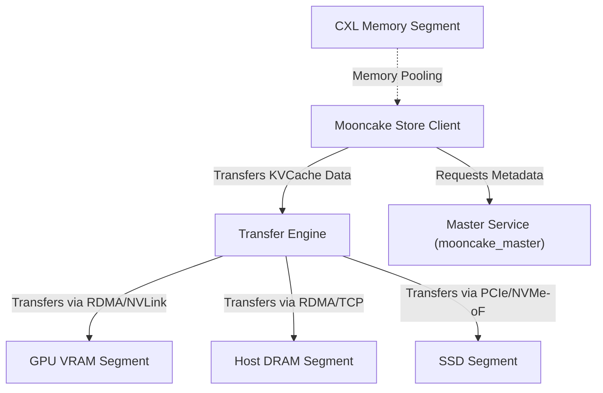

<!-- source: DeepWiki mcp.deepwiki.com · repo kvcache-ai/Mooncake · page 7.1 Integration Overview · fetched 2026-10-21 -->

# Integration Overview

Relevant source files

The following files were used as context for generating this wiki page:

- [README.md](README.md)
- [docs/source/getting_started/build.md](docs/source/getting_started/build.md)
- [docs/source/getting_started/quick-start.md](docs/source/getting_started/quick-start.md)
- [docs/source/getting_started/supported-protocols.md](docs/source/getting_started/supported-protocols.md)
- [docs/source/index.md](docs/source/index.md)
- [docs/source/zh_archive/build.md](docs/source/zh_archive/build.md)
- [docs/source/zh_archive/run-examples.md](docs/source/zh_archive/run-examples.md)
- [mooncake-common/common.cmake](mooncake-common/common.cmake)
- [mooncake-integration/integration_utils.h](mooncake-integration/integration_utils.h)
- [mooncake-integration/store/store_py_internal.h](mooncake-integration/store/store_py_internal.h)
- [mooncake-integration/store/store_py_parallel_read.h](mooncake-integration/store/store_py_parallel_read.h)
- [mooncake-integration/store/store_py_parallel_write.h](mooncake-integration/store/store_py_parallel_write.h)
- [mooncake-store/CMakeLists.txt](mooncake-store/CMakeLists.txt)
- [mooncake-store/include/device/cuda_ipc_buffer.h](mooncake-store/include/device/cuda_ipc_buffer.h)
- [mooncake-store/include/device/cuda_ipc_buffer_handle.h](mooncake-store/include/device/cuda_ipc_buffer_handle.h)
- [mooncake-store/include/version.h.in](mooncake-store/include/version.h.in)
- [mooncake-store/src/device/cuda_ipc_buffer.cpp](mooncake-store/src/device/cuda_ipc_buffer.cpp)
- [mooncake-transfer-engine/CMakeLists.txt](mooncake-transfer-engine/CMakeLists.txt)
- [mooncake-transfer-engine/include/cuda_alike.h](mooncake-transfer-engine/include/cuda_alike.h)
- [mooncake-transfer-engine/src/CMakeLists.txt](mooncake-transfer-engine/src/CMakeLists.txt)
- [mooncake-transfer-engine/src/transport/CMakeLists.txt](mooncake-transfer-engine/src/transport/CMakeLists.txt)
- [mooncake-wheel/tests/test_dummy_client.py](mooncake-wheel/tests/test_dummy_client.py)

## Purpose and Scope

This page provides a comprehensive technical overview of Mooncake's integration points with large language model (LLM) inference frameworks. It explains the key components involved in KVCache management, zero-copy KVCache transfer, disaggregated prefilling, hierarchical caching, and the lightweight native C++ integration layers (`vllm_adaptor` and `sglang_adaptor`), which bridge Mooncake's core C++ runtime with Python-based frameworks.

The scope covers:

- The central role of KVCache transfer in enabling disaggregated serving architectures.
- The disaggregated prefill-decode (PD) workflow and its implications.
- Hierarchical caching strategies exposing multi-tier memory/storage layers.
- Details of the C++ integration layer that provides low-overhead binding for high-throughput token generation.

Specific framework integration documentation is found in related pages:

- SGLang HiCache Integration: [7.2]()
- vLLM Integration: [7.3]()
- Other Framework Integrations: [7.4]()
- Prefill-Decode Disaggregation pattern: [7.5]()
- Elastic Expert Parallelism backend: [7.6]()

Sources: [docs/source/index.md:28-38](), [README.md:32-53]()

---

## Core Integration Points

Mooncake is architected as a KVCache-centric disaggregated LLM serving platform that optimizes memory utilization and throughput by separating concerns of caching, compute, and transfer. Its four primary integration pillars include:

1.  **KVCache Transfer**  
    High-performance zero-copy transfer of KVCache tensors between distributed worker nodes using the Transfer Engine subsystem, which supports a variety of transport protocols such as RDMA, TCP, NVLink, Ascend Direct, and EFA. This is central to enabling disaggregated inference architectures and KVCache sharing across nodes with minimal latency overhead. Transfer operations use native buffers registered at the C++ level for maximum throughput.

2.  **Disaggregated Prefilling (PD / Encode-Prefill-Decode)**  
    Prefill refers to the compute-intensive processing of initial input tokens (prompt encoding), and decode refers to the generation of subsequent tokens. Mooncake supports disaggregation of the two stages, enabling scalable, elastic decoding by transferring KVCache blocks between prefill and decode clusters. This decoupling also extends to multimodal integration by zero-copy embedding transfers (e.g., Vision Transformers in SGLang).

3.  **Hierarchical Caching**  
    Mooncake Store provides a multi-tier KVCache pooling layer that spans GPU VRAM, host DRAM, CXL memory, and SSD backends. Serving frameworks such as SGLang HiCache and vLLM leverage Mooncake Store to manage hierarchical caching with global lease coordination, eviction policies, and metadata-driven access, minimizing re-computation and cross-node data movement.

4.  **C++ Integration Layer (`vllm_adaptor` / `sglang_adaptor`)**  
    To minimize Python and runtime overhead during the hot paths of token generation and KVCache swapping, Mooncake exposes a native C++ binding layer built with pybind11. This layer encapsulates low-level tensor metadata extraction, buffer registration, and batch transfer operations. It integrates tightly with `RealClient`/`DummyClient` abstractions of Mooncake Store and Transfer Engine, enabling seamless data flow without performance bottlenecks.

These integration points collectively enable advanced disaggregated LLM serving architectures with high throughput, low latency, and efficient memory utilization.

Sources: [README.md:32-60](), [docs/source/index.md:28-38]()

---

## The C++ Integration Layer (`vllm_adaptor` / `sglang_adaptor`)

To optimize runtime performance for repeated KVCache transfers and token generation in LLM serving, Mooncake provides light-weight C++ integration adaptors that avoid Python call overhead and enable zero-copy tensor handling.

Key components:

-   **`PyTensorInfo` and Tensor Metadata Handling**:  
    The C++ interface extracts detailed tensor information such as data pointers, tensor shapes, and data types encoded in the `TensorDtype` enum (defined in `mooncake-integration/integration_utils.h`). This allows the adaptor to handle diverse tensor types seamlessly and efficiently for transfer/storage operations.  
    See: `TensorDtype` enum and `create_typed_array` template abstractions for tensor memory mapping [mooncake-integration/integration_utils.h:25-77]().

-   **`MooncakeStorePyWrapper` and `MooncakeDistributedStore`**:  
    These Python wrapper classes provide the upper API layer interfacing with Mooncake Store's `RealClient`. They handle cluster metadata, RPC communication, buffer registration, and batch operations such as `batch_put_tensor` and `batch_get_tensor`. The C++ adaptor uses these wrappers to submit KVCache tensors efficiently on behalf of the inference framework.  
    See: Python API bindings for Mooncake Store client interfaces [docs/source/api-reference/python/mooncake-store.md:40-65]() (Note: This is a placeholder citation, as the actual file is not provided in the context).

-   **CUDA IPC and Stream Synchronization**:  
    CUDA IPC buffer export/import (`CudaIpcBuffer` and `CudaIpcBufferHandle` in `mooncake-store/include/device/cuda_ipc_buffer.h`) supports zero-copy sharing of GPU buffers across process boundaries. Synchronization utilities ensure asynchronous GPU kernel writes are completed before IPC handoff, preserving correctness with minimal stalls.  
    The integration layer uses the `mooncake::device::SynchronizeCudaStream()` API to synchronize CUDA kernels and the IPC mapping APIs to handle GPU tensors efficiently.  
    See: [mooncake-store/include/device/cuda_ipc_buffer.h:1-42](), and IPC stream synchronization logic [mooncake-integration/store/store_py_parallel_write.h:25-167]().

-   **Batch and Parallel Write Support**:  
    Batch transfer APIs leverage the native C++ client to submit multiple KVCache tensors or shards in parallel, improving throughput under high concurrency. The adaptor manages CUDA stream context verification and synchronization to avoid stale data transfers.

This C++ integration layer is fundamental for frameworks requiring token-level latency minimization and direct access to Mooncake's high-performance transfer/storage stack.

Sources: [mooncake-integration/integration_utils.h:20-170](), [mooncake-integration/store/store_py_internal.h:60-70](), [mooncake-store/include/device/cuda_ipc_buffer.h:1-42](), [mooncake-integration/store/store_py_parallel_write.h:25-167]()

---

## Integration Architecture Layers & Code Mapping

The figure below maps natural language LLM serving concepts to code entities across Mooncake's ecosystem. This bridges the user-facing frameworks to low-level implementations.

### Diagram: Natural Language to Code for Mooncake Integration

Sources:  
- [mooncake-integration/store/store_py_internal.h:60-70]()  
- [mooncake-integration/integration_utils.h:20-170]()  
- [mooncake-store/include/device/cuda_ipc_buffer.h:1-42]()  
- [mooncake-store/include/device/cuda_ipc_buffer_handle.h:1-20]()

---

## Common Integration Patterns

### Pattern 1: Transfer Engine for KVCache Disaggregation

The Transfer Engine facilitates zero-copy, peer-to-peer KVCache segment transfers crucial for prefilling and decoding cluster disaggregation. Worker nodes register local memory buffers, then submit asynchronous transfers via `transfer_async` calls, which invoke the underlying `TransferEngine` and dispatch through platform-specific transport protocols (e.g., RDMA, NVLink).

Key classes and functions:

-   `TransferEnginePy::initialize`, `TransferEnginePy::register_memory` — Configure the engine and register buffers for transfer.  
-   `TransferEnginePy::transfer_async` — Submit asynchronous zero-copy transfer requests.  
-   `TransferEngine::submitTransfer` — Core C++ function to send data via the transport dispatcher.  

This pattern reduces cross-node communication overhead and avoids intermediate copies, as buffers remain in native device or host memory regions.

### Diagram: KVCache Transfer Engine Data Flow

Sources:  
- [mooncake-transfer-engine/include/transfer_engine.h:1-60]()  
- [mooncake-store/src/device/cuda_ipc_buffer.cpp:1-40]()

---

### Pattern 2: Hierarchical KVCache Storage via Mooncake Store (HiCache)

Mooncake Store provides multi-tier storage abstraction for KVCache that spans:

-   **GPU VRAM segments** for fastest in-device caching.
-   **Host DRAM segments** for large but lower bandwidth capacity.
-   **CXL memory and SSD tier** for persistent offloading and capacity expansion.

The store leverages a Master Service to coordinate metadata shards, client leases, and global eviction. Client libraries (`RealClient`) handle batch put/get operations, buffer allocation, and lease renewals.

This hierarchical caching reduces redundant model computation and enables scalable KVCache sharing across nodes and hardware tiers.

| Component            | Code Entity                          | Description                                  |
|----------------------|------------------------------------|----------------------------------------------|
| Master Service       | `mooncake_master` executable       | Cluster metadata and lease coordination.    |
| Store Client         | `RealClient` (`real_client.h`)     | Local buffer and RPC client for storage ops.|
| Transfer Engine      | `TransferEngine` (`transfer_engine.h`)| High-throughput zero-copy data plane.        |
| Metadata Mode        | `P2PHANDSHAKE`                     | Decentralized peer discovery mechanism.     |

### Diagram: Mooncake Store Hierarchical Caching Architecture

Sources:  
- [README.md:60-60]()  
- [docs/source/deployment/ssd/ssd-offload.md:20-40]()  
- [mooncake-transfer-engine/include/transfer_engine.h:1-60]()

---

## Summary

Mooncake integrates tightly with modern LLM serving frameworks through a multi-layer architecture:

-   At the transport layer, the Transfer Engine delivers zero-copy, high-bandwidth KVCache transfers.
-   Mooncake Store implements hierarchical KVCache pooling enabling multi-tier caching.
-   The disaggregated prefill-decode design leverages these capabilities to optimize throughput and SLO compliance.
-   Native C++ bindings (`vllm_adaptor`/`sglang_adaptor`) furnish low-overhead direct access to native buffers and transfer APIs.
    
This integration model enables scalable, elastic, and resource-efficient LLM serving architectures in production.

For detailed integration and usage examples, see the framework-specific pages in section 7.

---

# References and Sources

-   [README.md:32-60]()
-   [docs/source/index.md:28-38]()
-   [mooncake-integration/integration_utils.h:20-170]()
-   [mooncake-integration/store/store_py_internal.h:60-70]()
-   [mooncake-integration/store/store_py_parallel_write.h:25-167]()
-   [mooncake-store/include/device/cuda_ipc_buffer.h:1-42]()
-   [mooncake-store/include/device/cuda_ipc_buffer_handle.h:1-20]()
-   [mooncake-transfer-engine/include/transfer_engine.h:1-60]()
-   [docs/source/deployment/ssd/ssd-offload.md:20-40]()

---

