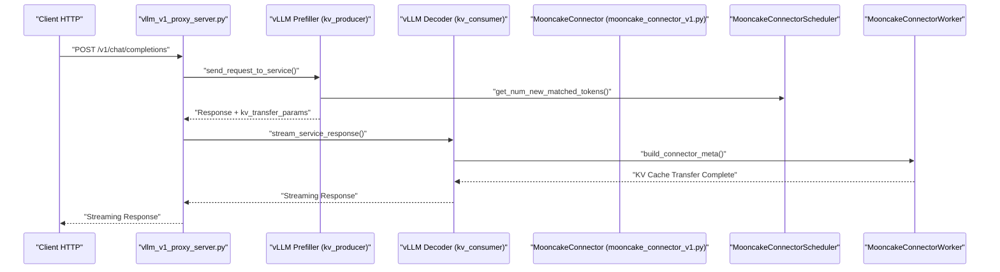
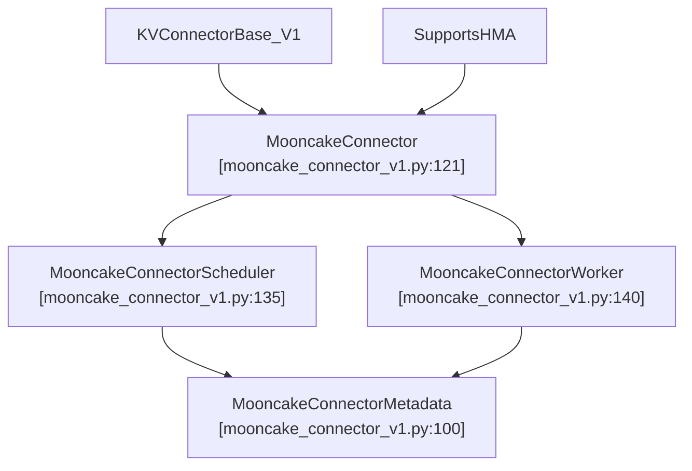
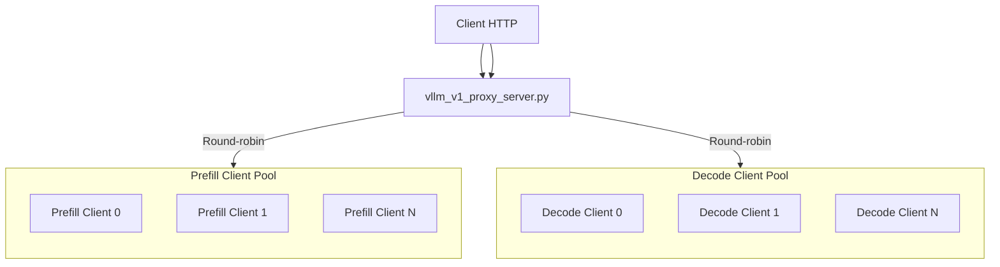
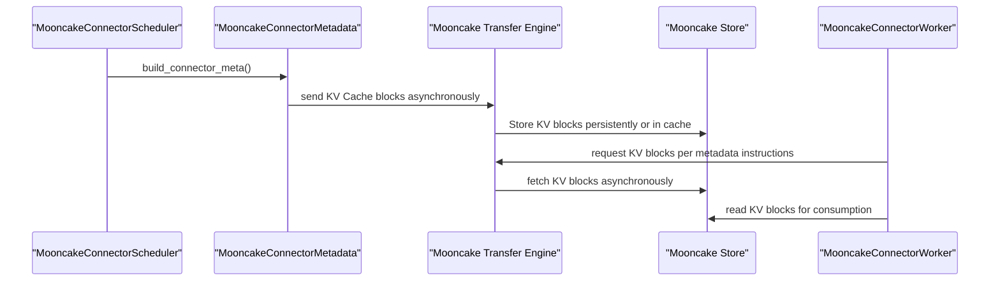
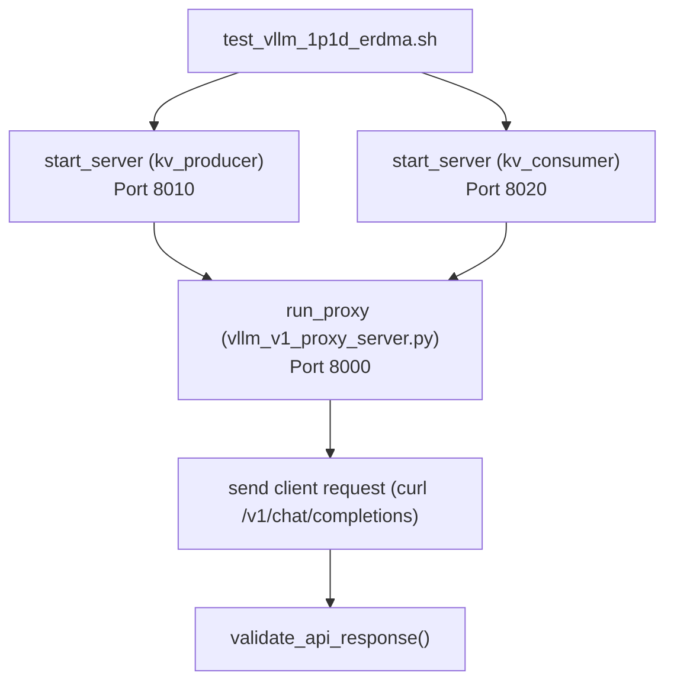

<!-- source: DeepWiki mcp.deepwiki.com · repo kvcache-ai/Mooncake · page 7.3 vLLM Integration · fetched 2026-10-21 -->

# vLLM Integration

<details>
<summary>Relevant source files</summary>

The following files were used as context for generating this wiki page:

- [mooncake-wheel/mooncake/README.md](mooncake-wheel/mooncake/README.md)
- [mooncake-wheel/mooncake/mooncake_connector_v1.py](mooncake-wheel/mooncake/mooncake_connector_v1.py)
- [mooncake-wheel/mooncake/vllm_v1_proxy_server.py](mooncake-wheel/mooncake/vllm_v1_proxy_server.py)

</details>


## Purpose and Scope

This page documents the Mooncake integration with [vLLM](https://github.com/vllm-project/vllm) for disaggregated prefill-decode serving. It details the implementation of `MooncakeConnector` (KV Connector v1), the `vllm_v1_proxy_server.py` orchestration proxy, and the coordination between prefill and decode instances via the Mooncake Transfer Engine and Mooncake Store backends [mooncake-wheel/mooncake/mooncake_connector_v1.py:121-141](), [mooncake-wheel/mooncake/vllm_v1_proxy_server.py:20-87]().

Sources: [mooncake-wheel/mooncake/mooncake_connector_v1.py:121-141](), [mooncake-wheel/mooncake/vllm_v1_proxy_server.py:20-87]()

---

## Overview and Architecture

The vLLM integration enables **prefill-decode (PD) disaggregation**: computation is split so that a prefiller instance (Producer) computes the prompt's KV cache, transfers it across nodes, and a decoder instance (Consumer) continues generation without re-computing the prefix. This is achieved using Mooncake's KV Connector v1 interface and its backend storage and transfer mechanisms supporting RDMA and other high-performance protocols [mooncake-wheel/mooncake/README.md:15-26]().

### System Architecture and Code Entity Mapping

Title: "vLLM Disaggregation Flow with Code Entities"

This diagram shows the client request passing through the proxy server, which dispatches requests between the prefiller and decoder vLLM instances. The MooncakeConnector mediates the key-value cache transfer via its scheduler on the prefiller side and worker on the decoder side.

Sources: [mooncake-wheel/mooncake/vllm_v1_proxy_server.py:156-212](), [mooncake-wheel/mooncake/mooncake_connector_v1.py:121-166]()

---

## MooncakeConnector (v1) Implementation

The `MooncakeConnector` class implements vLLM's `KVConnectorBase_V1` interface and inherits from `SupportsHMA` (Hybrid Memory Allocator) to support disaggregation across hybrid models. It splits roles between a `MooncakeConnectorScheduler` (on kv_producer/prefill side) and a `MooncakeConnectorWorker` (on kv_consumer/decode side). This connector manages request metadata and coordinates KV cache segment transfers, leveraging asynchronous and multi-threaded mechanisms [mooncake-wheel/mooncake/mooncake_connector_v1.py:121-141](), [mooncake-wheel/mooncake/mooncake_connector_v1.py:100-119]().

### Class Hierarchy and Roles

Title: "MooncakeConnector Code Entity Relationships"

- `MooncakeConnector` instantiates either a scheduler or worker based on its role
- `MooncakeConnectorScheduler` handles producing KV cache metadata and state on the prefill side
- `MooncakeConnectorWorker` handles consuming KV cache metadata and coordinating retrieval on the decode side
- `MooncakeConnectorMetadata` stores request-to-block mappings and remote host/port info

Sources: [mooncake-wheel/mooncake/mooncake_connector_v1.py:100-141]()

### Connector Metadata Management

The metadata class `MooncakeConnectorMetadata` tracks:

| Field              | Description                                                      |
|--------------------|------------------------------------------------------------------|
| `reqs_to_recv`     | Mapping of request IDs to `RecvReqMeta` describing blocks to receive remotely |
| `reqs_to_send`     | Mapping of request IDs to lists of local block IDs to send       |

Where `RecvReqMeta` and `SendBlockMeta` store block IDs, remote host/port, and synchronization events for asynchronous transfer coordination.

Sources: [mooncake-wheel/mooncake/mooncake_connector_v1.py:73-118]()

### Configuration Parameters

The connector is activated by passing the following parameters in the vLLM command line under `--kv-transfer-config`:

```json
{
  "kv_connector": "MooncakeConnector",
  "kv_role": "kv_producer" or "kv_consumer",
  "kv_connector_module_path": "mooncake.mooncake_connector_v1"
}
```

- `kv_role` = `"kv_producer"` for the prefill node (producer of KV)
- `kv_role` = `"kv_consumer"` for the decode node (consumer of KV)

This instructs vLLM to use Mooncake's KV Connector for disaggregation [mooncake-wheel/mooncake/README.md:4-25]().

Sources: [mooncake-wheel/mooncake/README.md:1-11](), [mooncake-wheel/mooncake/mooncake_connector_v1.py:121-141]()

---

## Proxy Server (`vllm_v1_proxy_server.py`)

The `vllm_v1_proxy_server.py` script is a FastAPI application that acts as a transparent HTTP proxy for client requests, forwarding them to a pool of prefill and decode backend vLLM instances. It manages client pools, load balances requests via round-robin, and handles streaming responses [mooncake-wheel/mooncake/vllm_v1_proxy_server.py:20-87]().

### Key Components and Workflow

- **Lifespan (`lifespan`)**: On startup, initializes multiple asynchronous HTTP clients connected to prefill and decode servers.
- **Client Selection (`get_next_client`)**: Selects clients in a round-robin fashion for load balancing.
- **Sending Requests (`send_request_to_service`)**: Sends requests to prefill services with proper `kv_transfer_params` and disables streaming.
- **Streaming Responses (`stream_service_response`)**: Streams responses from decoder services back to the client.

Title: "Proxy Server Client Pools and Request Flow"


This proxy design allows horizontal scaling of prefill and decode instances via configuration of multiple host/port entries.

Sources: [mooncake-wheel/mooncake/vllm_v1_proxy_server.py:20-212]()

---

## Prefill-Decode Disaggregation Data Flow

The `MooncakeConnector` acts as the key interface between the vLLM scheduler/worker and Mooncake Store:

1. **Prefill (Producer) side:**
   - `MooncakeConnectorScheduler` calculates matched tokens and updates KV cache allocation state.
   - Builds and attaches `MooncakeConnectorMetadata` that contains remote host/port and block ID mappings.
   - Sends the computed KV data blocks to remote decode instances asynchronously.

2. **Decode (Consumer) side:**
   - The `MooncakeConnectorWorker` receives metadata indicating blocks to fetch.
   - Retrieves KV cache data asynchronously from the Mooncake Store backend.
   - Integrates KV cache blocks into the decode generation process, avoiding redundant computation.

Title: "Prefill-Decode Data Flow and Components"


This flow achieves efficient transfer and sharing of large KV caches between separate vLLM instances in a distributed environment.

Sources: [mooncake-wheel/mooncake/mooncake_connector_v1.py:100-173](), [mooncake-wheel/mooncake/vllm_v1_proxy_server.py:156-212]()

---

## Key Functions and Classes in `mooncake_connector_v1.py`

- `MooncakeConnector` (lines 121-141): Main KV connector class that delegates operations to scheduler or worker role implementations.
- `MooncakeConnectorMetadata` (lines 100-119): Stores per-request KV transfer metadata including block IDs and host/port.
- `RecvReqMeta` and `SendBlockMeta` (lines 86-99): Data classes managing block transfer state and synchronization.
- Role-dependent methods on `MooncakeConnector` provide accessors to scheduler or worker logic, e.g. `get_num_new_matched_tokens()`, `update_state_after_alloc()`, `build_connector_meta()`, `request_finished()`.

These components cooperate asynchronously to coordinate KV cache transfers respecting vLLM's disaggregated execution model.

Sources: [mooncake-wheel/mooncake/mooncake_connector_v1.py:73-173]()

---

## Integration Test Workflow Example

Integration tests exercising the vLLM Mooncake KV disaggregation typically perform:

1. Launch a **prefill vLLM server** with role `"kv_producer"` on port 8010.
2. Launch a **decode vLLM server** with role `"kv_consumer"` on port 8020.
3. Start the **proxy** (`vllm_v1_proxy_server.py`) on port 8000 to route requests.
4. Send completion requests via the proxy.
5. Validate correctness and performance of KV cache transfers.

Title: "vLLM Integration Test Pipeline"


Sources: [scripts/tone_tests/scripts/test_vllm_1p1d_erdma.sh:18-163]()

---

## Summary

The vLLM integration in Mooncake establishes a robust, pluggable KV Connector (version 1) enabling disaggregated prefill-decode serving workflows. It leverages Mooncake's high-performance KV Store and Transfer Engine backend, enabling large KV caches to be transferred efficiently across nodes without recomputation. The integration is facilitated by:

- `MooncakeConnector` implementing vLLM's KVConnectorBase_V1 APIs
- Asynchronous streaming of KV cache blocks coordinated via scheduler/worker roles
- The `vllm_v1_proxy_server.py` script functioning as a transparent request router
- Configuration via KV transfer config enabling roles and module loading dynamically
- Support for RDMA and other transport protocols for zero-copy high-throughput transfer

This integration underpins vLLM's ability to serve large models with scalable and high-throughput distributed KV cache management.

Sources:  
[mooncake-wheel/mooncake/mooncake_connector_v1.py:1-173](),  
[mooncake-wheel/mooncake/vllm_v1_proxy_server.py:1-212](),  
[mooncake-wheel/mooncake/README.md:1-32](),  
[scripts/tone_tests/scripts/test_vllm_1p1d_erdma.sh:1-163]()

---

