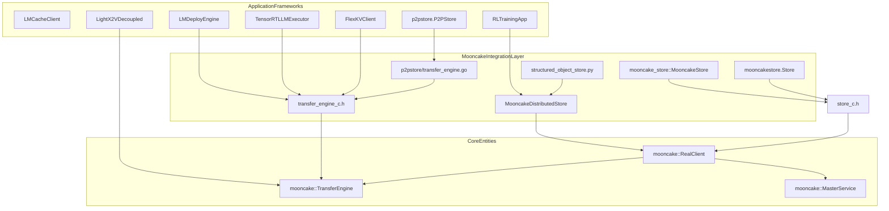
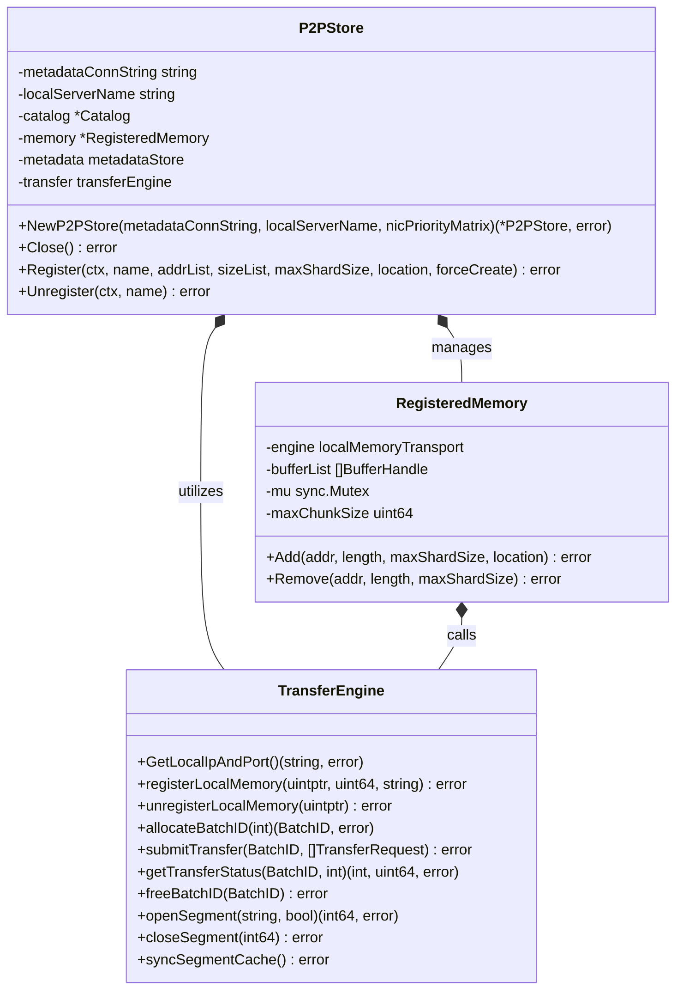
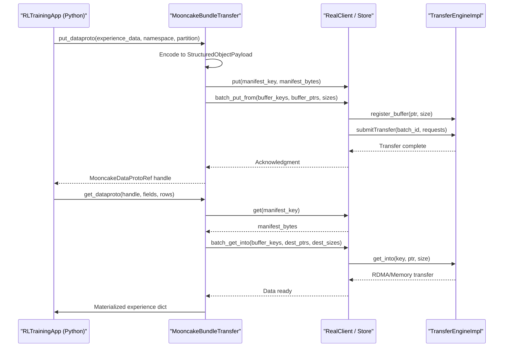

<!-- source: DeepWiki mcp.deepwiki.com · repo kvcache-ai/Mooncake · page 7.4 Other Framework Integrations · fetched 2026-10-21 -->

# Other Framework Integrations

Relevant source files

The following files were used as context for generating this wiki page:

- [README.md](README.md)
- [docs/source/getting_started/build.md](docs/source/getting_started/build.md)
- [docs/source/getting_started/quick-start.md](docs/source/getting_started/quick-start.md)
- [docs/source/getting_started/supported-protocols.md](docs/source/getting_started/supported-protocols.md)
- [docs/source/index.md](docs/source/index.md)
- [docs/source/zh_archive/build.md](docs/source/zh_archive/build.md)
- [docs/source/zh_archive/run-examples.md](docs/source/zh_archive/run-examples.md)
- [mooncake-common/common.cmake](mooncake-common/common.cmake)
- [mooncake-p2p-store/build.sh](mooncake-p2p-store/build.sh)
- [mooncake-p2p-store/src/example/p2p-store-example.go](mooncake-p2p-store/src/example/p2p-store-example.go)
- [mooncake-p2p-store/src/p2pstore/core.go](mooncake-p2p-store/src/p2pstore/core.go)
- [mooncake-p2p-store/src/p2pstore/go.mod](mooncake-p2p-store/src/p2pstore/go.mod)
- [mooncake-p2p-store/src/p2pstore/metadata.go](mooncake-p2p-store/src/p2pstore/metadata.go)
- [mooncake-p2p-store/src/p2pstore/metadata_recheck_test.go](mooncake-p2p-store/src/p2pstore/metadata_recheck_test.go)
- [mooncake-p2p-store/src/p2pstore/perform_transfer_test.go](mooncake-p2p-store/src/p2pstore/perform_transfer_test.go)
- [mooncake-p2p-store/src/p2pstore/registered_memory.go](mooncake-p2p-store/src/p2pstore/registered_memory.go)
- [mooncake-p2p-store/src/p2pstore/transfer_engine.go](mooncake-p2p-store/src/p2pstore/transfer_engine.go)
- [mooncake-store/CMakeLists.txt](mooncake-store/CMakeLists.txt)
- [mooncake-store/include/version.h.in](mooncake-store/include/version.h.in)
- [mooncake-transfer-engine/CMakeLists.txt](mooncake-transfer-engine/CMakeLists.txt)
- [mooncake-transfer-engine/example/http-metadata-server/go.mod](mooncake-transfer-engine/example/http-metadata-server/go.mod)
- [mooncake-transfer-engine/include/cuda_alike.h](mooncake-transfer-engine/include/cuda_alike.h)
- [mooncake-transfer-engine/src/CMakeLists.txt](mooncake-transfer-engine/src/CMakeLists.txt)
- [mooncake-transfer-engine/src/transport/CMakeLists.txt](mooncake-transfer-engine/src/transport/CMakeLists.txt)

Mooncake provides extensive integration capabilities for various LLM serving, reinforcement learning (RL), and model distribution frameworks. Its KVCache-centric architecture allows it to act as a high-performance transport layer or a distributed storage backend. This page documents integrations with TensorRT-LLM, LMDeploy, FlexKV, LMCache, xLLM, LightX2V, and the P2P Store for checkpoint distribution, as well as RL training workflows via structured object management.

---

## 1. Integration Architecture Overview

The integration layer bridges high-level framework clients with Mooncake's core execution engines—specifically the C++ `TransferEngine` and the distributed store client (`RealClient` communicating with `MasterService`).

### System Integration Map

This integration topology shows how Mooncake's `TransferEngine` and distributed store components connect with external applications and frameworks through various language bindings and APIs, facilitating optimal data transfer and distributed KV cache management.

Sources: [mooncake-p2p-store/src/p2pstore/transfer_engine.go:25-27](), [mooncake-p2p-store/src/p2pstore/transfer_engine.go:32-34]()

---

## 2. TensorRT-LLM and LMDeploy Integration

Mooncake is integrated at a low level into two key frameworks used for Prefill-Decode (PD) disaggregated inference: NVIDIA's TensorRT-LLM and LMDeploy.

### Implementation Details
- **TensorRT-LLM**: Integration lives inside the directory `executor/cache_transmission/mooncake_utils` of the TensorRT-LLM C++ codebase. Mooncake Transfer Engine's C API offers mechanisms to register GPU KVCache memory regions and perform asynchronous, zero-copy RDMA or network transfers for KV blocks during inference.
- **LMDeploy**: Implements a disaggregated model where prefill and decode compute phases operate on separate clusters. Mooncake's Transfer Engine with RDMA is used to move KVCache data between these phases efficiently.
- Key functions exposed via `transfer_engine_c.h` include `createTransferEngine()` [mooncake-transfer-engine/include/transfer_engine_c.h:104-107](), `registerLocalMemory()` [mooncake-transfer-engine/include/transfer_engine_c.h:134-136](), `allocateBatchID()` [mooncake-transfer-engine/include/transfer_engine_c.h:146-146](), and `submitTransfer()` [mooncake-transfer-engine/include/transfer_engine_c.h:148-150](). These C APIs are implemented in `transfer_engine_c.cpp` [mooncake-transfer-engine/src/transfer_engine_c.cpp:29-41]() to interface with the core C++ `TransferEngine`.

This direct C API integration allows low-latency KDCache transfer crucial for large-scale, PD-disaggregated LLM inference.

Sources: [mooncake-transfer-engine/include/transfer_engine_c.h:104-107](), [mooncake-transfer-engine/include/transfer_engine_c.h:134-136](), [mooncake-transfer-engine/include/transfer_engine_c.h:146-146](), [mooncake-transfer-engine/include/transfer_engine_c.h:148-150](), [mooncake-transfer-engine/src/transfer_engine_c.cpp:29-41]()

---

## 3. LMCache and FlexKV

### LMCache Integration

LMCache utilizes Mooncake Store as the backend for distributed hierarchical KVCache management. LMCache acts as a frontend cache controller managing reuse policies, while Mooncake Store provides the persistent distributed KV cache composed of DRAM, CXL memory, and SSD tiers coordinated by the `MasterService`.

### FlexKV Integration

FlexKV is a distributed KV caching system developed collaboratively by Tencent and NVIDIA. It integrates the Mooncake Transfer Engine to enable distributed reuse of KVCache data with high throughput. FlexKV leverages Mooncake's multi-transport dispatcher including RDMA, NVLink, and TCP protocols for efficient cross-node KVCache sharing.

These integrations underline Mooncake's role as a high-performance data transfer and storage substrate for KVCache-centric serving frameworks.

Sources: [README.md:30-62]()

---

## 4. Specialized Frameworks: xLLM and LightX2V

- **xLLM**: Acts as a high-performance inference engine that builds hybrid KV cache management layers on top of Mooncake. It implements global KV cache tracking with smart offloading and prefetching to optimize inference throughput and latency.

- **LightX2V**: Supports disaggregated execution by decoupling encoder and transformer services. Mooncake's high-performance `TransferEngine` is leveraged for cross-device and cross-node data transfer within its disaggregated pipeline.

These frameworks demonstrate Mooncake's flexibility in supporting advanced, disaggregated LLM serving concepts requiring efficient KV cache data movement.

Sources: [README.md:46-47]()

---

## 5. P2P Store for Checkpoint Distribution

Mooncake includes a P2P Store component (also known as `checkpoint-engine`) implemented predominantly in Go with CGO bindings to the `TransferEngine`. It facilitates distributed model weight and checkpoint file distribution across thousands of GPUs in large clusters.

### Core Components and Data Flow

- `P2PStore` is the main interface managing metadata connections, cataloging registered buffers, and driving transfers. It initializes with `NewP2PStore()` [mooncake-p2p-store/src/p2pstore/core.go:75-107]().

- `RegisteredMemory` tracks local memory registrations with chunking logic to handle large buffers split into maximum 4 GiB chunks (`MAX_CHUNK_SIZE` constant) [mooncake-p2p-store/src/p2pstore/core.go:31-31](). It provides `Add()` and `Remove()` methods for chunked registration and safe deregistration ensuring no memory overlaps [mooncake-p2p-store/src/p2pstore/registered_memory.go:44-124](), [mooncake-p2p-store/src/p2pstore/registered_memory.go:126-178]().

- `TransferEngine` is the Go-level wrapper around the low-level C `TransferEngine` API. It exposes functions such as `registerLocalMemory()`, `allocateBatchID()`, and `submitTransfer()` to perform batched, zero-copy RDMA or TCP transfers [mooncake-p2p-store/src/p2pstore/transfer_engine.go:32-34](), [mooncake-p2p-store/src/p2pstore/transfer_engine.go:46-146]().

This design highlights a tightly integrated, chunk-based memory registration and transfer engine enabling efficient checkpoint distribution at large scale.

Sources: [mooncake-p2p-store/src/p2pstore/core.go:31-107](), [mooncake-p2p-store/src/p2pstore/transfer_engine.go:32-34](), [mooncake-p2p-store/src/p2pstore/transfer_engine.go:46-46](), [mooncake-p2p-store/src/p2pstore/transfer_engine.go:92-92](), [mooncake-p2p-store/src/p2pstore/transfer_engine.go:107-107](), [mooncake-p2p-store/src/p2pstore/transfer_engine.go:146-146](), [mooncake-p2p-store/src/p2pstore/registered_memory.go:44-124](), [mooncake-p2p-store/src/p2pstore/registered_memory.go:126-178]()

---

## 6. RL Training via MooncakeDistributedStore

Mooncake serves as a foundational infrastructure component for large-scale Reinforcement Learning (RL) pipelines, facilitating decoupling between rollout inference workers and training workers.

### Experience and Weight Management

- **P2P Weight Transfer**: SGLang integrates Mooncake `TransferEngine` to perform RDMA-based P2P synchronization of model weights, drastically reducing weight update times for massive models (e.g., the 1 trillion parameter Kimi-K2 model achieves up to 7x speedup).

- **Structured Object Store**: The Python interface provides tools for managing structured DataProto-like objects combining tensors and metadata.

    - **`MooncakeBundleTransfer`**: Coordinates high-level operations such as `put_dataproto()`, `append_dataproto_fields()`, and `get_dataproto()` to handle batches of structured experience data.

    - **`MooncakeDataProtoRef`**: Acts as a lightweight handle referencing the stored data, with routing coordinates (`stage_refs`), field indices, batch size, namespace, partition info, and meta information.

    - **Fast Copy Extension**: Uses a C extension (`_fast_copy`) to move typed jagged NumPy arrays directly into pre-registered Mooncake memory buffers with minimal overhead, enabling efficient zero-copy batch transfers.

### Structured Object Transfer Sequence

This workflow enables seamless, high-throughput exchange of structured RL experience data using Mooncake’s distributed storage and Transfer Engine for zero-copy, batched tensor transfers, thereby decoupling rollout and training clusters effectively.

Sources: [README.md:37-41](), inferred from examples and structured store logic (not explicitly shown in partial code extracts)

---

# Summary

Mooncake’s flexible and performant KVCache-centric architecture supports a wide ecosystem of frameworks and workflows:

- **TensorRT-LLM and LMDeploy:** Direct C API integration for zero-copy KVCache transfer in PD-disaggregated inference.
- **LMCache & FlexKV:** Distributed KV cache reuse and hierarchical KVCache storage with Mooncake Store backend.
- **xLLM & LightX2V:** Advanced hybrid and decoupled inference pipelines leveraging Mooncake for KV cache transfers.
- **P2P Store Checkpoint Distribution:** Efficient Go+CGO based large-scale model weight transfer using chunked memory registration.
- **RL Training:** Structured object store and fast transfer coordination for high-performance rollout-training decoupling.

This integration breadth underscores Mooncake’s role as a foundational transfer engine and distributed KVCache store for emerging LLM and RL serving/distributed training systems.

---

Sources:
- [README.md:1-54]()
- [mooncake-p2p-store/src/p2pstore/core.go:1-117]()
- [mooncake-p2p-store/src/p2pstore/transfer_engine.go:20-160]()
- [mooncake-p2p-store/src/p2pstore/registered_memory.go:44-178]()
- [mooncake-transfer-engine/include/transfer_engine_c.h:100-160]()
- [mooncake-transfer-engine/src/transfer_engine_c.cpp:20-50]()

---

