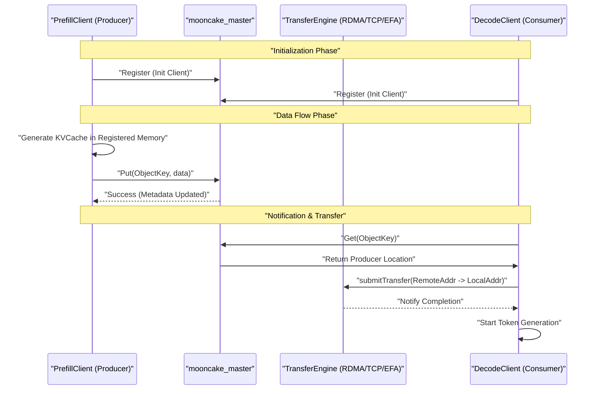
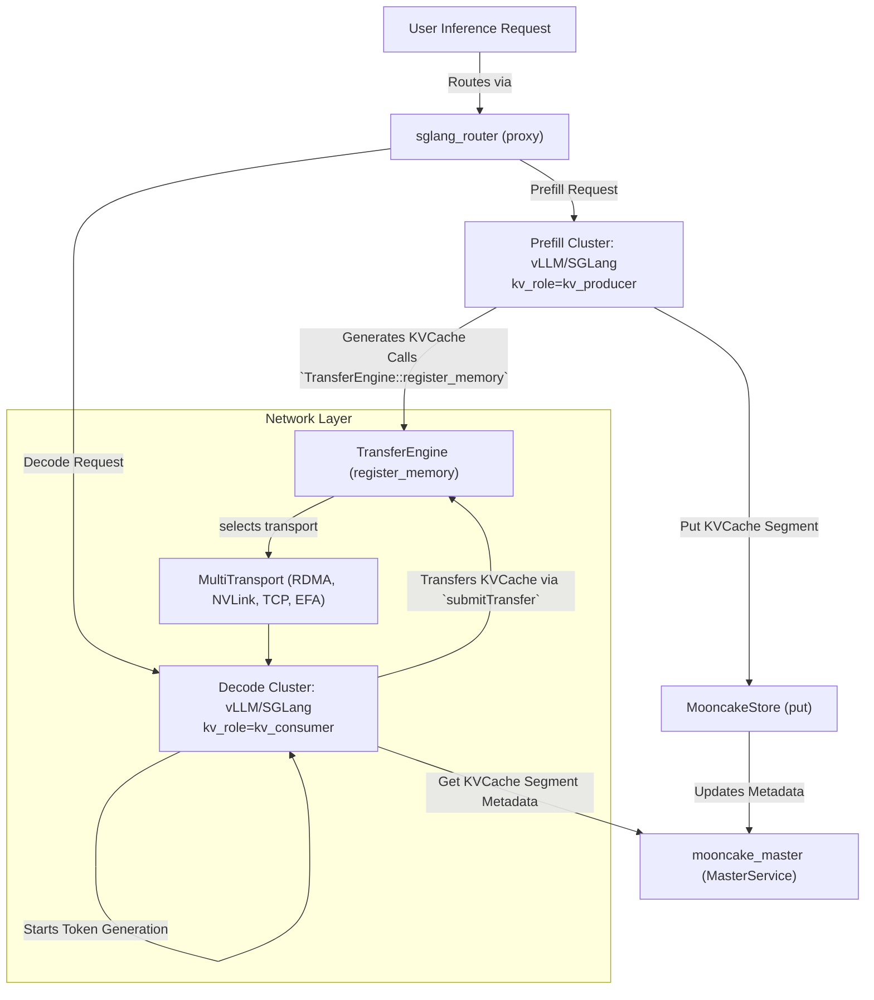

<!-- source: DeepWiki mcp.deepwiki.com · repo kvcache-ai/Mooncake · page 7.5 Prefill-Decode Disaggregation · fetched 2026-10-21 -->

# Prefill-Decode Disaggregation

<details>
<summary>Relevant source files</summary>

The following files were used as context for generating this wiki page:

- [README.md](README.md)
- [benchmarks/storage_benchmark_v1/__init__.py](benchmarks/storage_benchmark_v1/__init__.py)
- [benchmarks/storage_benchmark_v1/__main__.py](benchmarks/storage_benchmark_v1/__main__.py)
- [benchmarks/storage_benchmark_v1/benchmark.py](benchmarks/storage_benchmark_v1/benchmark.py)
- [benchmarks/storage_benchmark_v1/doc/README.md](benchmarks/storage_benchmark_v1/doc/README.md)
- [benchmarks/storage_benchmark_v1/layout/__init__.py](benchmarks/storage_benchmark_v1/layout/__init__.py)
- [benchmarks/storage_benchmark_v1/layout/interface.py](benchmarks/storage_benchmark_v1/layout/interface.py)
- [benchmarks/storage_benchmark_v1/layout/mla.py](benchmarks/storage_benchmark_v1/layout/mla.py)
- [benchmarks/storage_benchmark_v1/storage/__init__.py](benchmarks/storage_benchmark_v1/storage/__init__.py)
- [benchmarks/storage_benchmark_v1/storage/disk.py](benchmarks/storage_benchmark_v1/storage/disk.py)
- [benchmarks/storage_benchmark_v1/storage/interface.py](benchmarks/storage_benchmark_v1/storage/interface.py)
- [docs/source/getting_started/build.md](docs/source/getting_started/build.md)
- [docs/source/getting_started/quick-start.md](docs/source/getting_started/quick-start.md)
- [docs/source/getting_started/supported-protocols.md](docs/source/getting_started/supported-protocols.md)
- [docs/source/index.md](docs/source/index.md)
- [docs/source/zh_archive/build.md](docs/source/zh_archive/build.md)
- [docs/source/zh_archive/run-examples.md](docs/source/zh_archive/run-examples.md)
- [mooncake-common/common.cmake](mooncake-common/common.cmake)
- [mooncake-store/CMakeLists.txt](mooncake-store/CMakeLists.txt)
- [mooncake-store/include/version.h.in](mooncake-store/include/version.h.in)
- [mooncake-transfer-engine/CMakeLists.txt](mooncake-transfer-engine/CMakeLists.txt)
- [mooncake-transfer-engine/include/cuda_alike.h](mooncake-transfer-engine/include/cuda_alike.h)
- [mooncake-transfer-engine/src/CMakeLists.txt](mooncake-transfer-engine/src/CMakeLists.txt)
- [mooncake-transfer-engine/src/transport/CMakeLists.txt](mooncake-transfer-engine/src/transport/CMakeLists.txt)

</details>


## Purpose and Scope

This page provides a comprehensive technical overview of the Prefill-Decode (PD) Disaggregation architecture within the Mooncake ecosystem. It covers the conceptual compute separation, key workflows for KVCache transfer, performance benefits, flexible `XpYd` deployment patterns, and the early rejection policy crucial for maintaining SLOs under load. The document references core code entities and mechanics, with diagrams bridging the natural language system components and their implementations.

Sources: [docs/source/index.md:30-38]()

---

## 1. Compute Separation and Architectural Foundations

Prefill-Decode (PD) disaggregation partitions the LLM inference pipeline into two distinct clusters, each optimized for different computational characteristics:

| Phase           | Characteristics                                     | Resource Constraint        | Assigned Role           |
|-----------------|----------------------------------------------------|----------------------------|------------------------|
| Prefill         | Processes all input tokens through full attention and feed-forward sublayers | FLOP-bound (heavy compute)  | `kv_producer` (Prefill cluster) |
| Decode          | Generates tokens one by one, heavily relying on KVCache lookups | Memory bandwidth-bound      | `kv_consumer` (Decode cluster)  |

Conventional co-located prefill and decode workloads on the same GPU lead to contention—prefill stalls decode due to heavy memory bandwidth needs, while decode underutilizes compute resources. Mooncake addresses this by physically separating these phases into dedicated clusters, connected through a high-throughput, low-latency zero-copy KVCache transfer fabric.

This architecture allows prefill to fully utilize GPU FLOPs without blocking decode, while decode throughput is boosted by efficient KVCache sharing and tailored memory access.

Prefill nodes register their KVCache memory with the `TransferEngine` to enable zero-copy remote access by decode nodes. The decode cluster initiates remote transfers using Mooncake’s multi-protocol transport stacking (RDMA, NVLink, TCP, EFA, etc.).

Sources: [README.md:35-41]()

---

## 2. XpYd Deployment Configurations

Mooncake supports scalable deployment patterns expressed as `XpYd`, where:

- `X`: Number of Prefill cluster nodes (producers)
- `Y`: Number of Decode cluster nodes (consumers)

### Notable Variants

- **1p1d Configuration:** Baseline testing setup with one prefill and one decode node, utilized for functional verification and performance baselining in SGLang and vLLM integrations [scripts/tone_tests/scripts/test_1p1d_erdma.sh:3-4]().
- **Differential Tensor Parallelism (TP):** Enables heterogeneous TP allocations, e.g., Prefill TP=8, Decode TP=2, to balance computational and decoding throughput needs efficiently [scripts/tone_tests/scripts/test_disaggregation_different_tp.sh:7-8]().
- **Mixed Hardware Deployment:** Combining diverse compute backends such as NVIDIA CUDA GPUs, Huawei Ascend NPUs, and Moore Threads MUSA GPUs for heterogeneous KVCache processing [README.md:22-28](), [docs/source/getting_started/build.md:116-130]().

### Proxy Routing and Handling

To orchestrate requests, a proxy layer (e.g., `sglang_router`) directs incoming user queries:

1. It dispatches requests to an available prefill node.
2. Prefill nodes produce the KVCache, which is stored and indexed via the Mooncake Store or directly streamed via the TransferEngine to decode nodes.
3. Decode nodes retrieve KVCache from the prefill phase to resume incremental token generation.
   
Mooncake applies **early rejection policies** based on prediction analytics to throttle or drop requests under overload scenarios, optimizing resource utilization and maintaining latency SLOs.

Sources: [docs/source/index.md:30-38](), [README.md:47-49](), [scripts/tone_tests/scripts/test_1p1d_erdma.sh:41-52](), [scripts/tone_tests/scripts/test_disaggregation_different_tp.sh:7-8]()

---

## 3. KVCache Transfer Workflow and Data Flow

This section explains the data flow and function interactions supporting PD disaggregation by showing how Mooncake’s core components integrate and orchestrate KVCache transfers.

### System Entity Mapping for PD Disaggregation

```mermaid
graph LR
    subgraph "PrefillCluster"
      P1["vLLM/SGLang Rank<br/>kv_role: kv_producer"]
      P_TE["TransferEngine::register_memory"]
    end

    subgraph "MooncakeInfrastructure"
      MM["mooncake_master<br/>(MasterService)"]
      MT["MultiTransport<br/>(submitTransfer)"]
      MS["MooncakeStore<br/>(Put/Get/Remove)"]
    end

    subgraph "DecodeCluster"
      D1["vLLM/SGLang Rank<br/>kv_role: kv_consumer"]
      D_TE["TransferEngine::submitTransfer"]
    end

    subgraph "ProxyLayer"
      LB["sglang_router<br/>(Request Routing)"]
    end

    P1 -->| "1. Put (ObjectKey)" | MS
    MS -->| "Metadata" | MM
    P1 -->| "2. Zero-copy Transfer" | MT
    MT -->| "RDMA/NVLink/EFA" | D1
    LB -->| "Route Prefill Request" | P1
    LB -->| "Route Decode Request" | D1
    D1 -->| "3. Get KVCache" | MS
```

This diagram depicts the interplay among:

- Prefill cluster registers KVCache memory with `TransferEngine` and puts data to `MooncakeStore`.
- `mooncake_master` manages metadata shards, lease state, and coordinates cluster membership.
- Decode cluster requests KVCache and initiates zero-copy network transfers using the `MultiTransport` abstraction that can select RDMA, NVLink, or other paths based on topology and runtime conditions.
- The Proxy layer routes requests and responses between prefill and decode roles.

Sources: [docs/source/index.md:30-38](), [scripts/tone_tests/scripts/test_1p1d_erdma.sh:27-48]()

---

### KVCache Transfer Sequence



This sequence details the lifecycle from client initialization, KVCache production, centralized metadata update in the master, to consumer-side retrieval and direct zero-copy transfer through the TransferEngine. The decode node can then proceed to token generation with the fetched KVCache state.

Sources: [scripts/tone_tests/scripts/test_1p1d_erdma.sh:18-37](), [docs/source/getting_started/quick-start.md:79-95]()

---

## 4. Performance Benefits

The PD separation unlocks substantial improvements:

- **Throughput**: Achieves up to 525% higher throughput in long-context scenarios by removing the mutual blocking of prefill and decode GPU workloads [docs/source/index.md:38]().
- **Capacity**: Enables production LLM services like Kimi to serve 75%+ more requests within latency SLOs under real-world loads [README.md:33-35]().
- **Minimal Overheads**: Zero-copy RDMA and GPUDirect enable direct memory registration and transfer from GPU buffer to GPU buffer or CPU memory, bypassing redundant copies.
- **Extensive Protocol Support**: Mooncake’s TransferEngine supports diverse transport protocols including RDMA, NVLink, TCP, and AWS EFA, allowing tailoring for different cluster environments [docs/source/getting_started/supported-protocols.md:3-130]().
- **Validated Benchmarks**: Comprehensive KVCache storage benchmarks simulate various workload patterns (`conversation`, `synthetic`, `toolagent`), file modes, and produce comprehensive stats (QPS, bandwidth, latency percentiles). These benchmarks validate Mooncake Store and Transfer Engine performance for PD disaggregation workloads [benchmarks/storage_benchmark_v1/doc/README.md:1-175]().

Sources: [docs/source/index.md:30-38](), [README.md:33-41](), [benchmarks/storage_benchmark_v1/doc/README.md:1-175]()

---

## 5. Key Code Entities and Configuration

| System Role             | Code Entity / Configuration            | Role & Description                                |
|------------------------|---------------------------------------|--------------------------------------------------|
| Metadata & Coordination | `mooncake_master` (MasterService)     | Manages metadata shards, object indexing, cluster membership, and lease coordination [docs/source/getting_started/quick-start.md:75-84]() |
| Data Transfer           | `TransferEngine`                      | Provides API for memory registration, multi-transport zero-copy transfers, asynchronous submission, and completion notifications [docs/source/getting_started/quick-start.md:15-30](), [docs/source/getting_started/supported-protocols.md:5-24]() |
| Distributed Store       | `MooncakeStore`                      | Distributed object key-value store for high-level put/get/remove operations on KVCache segments |
| Prefill Role Config     | `kv_role: kv_producer`               | Prefill nodes register their role to enable write and serve KVCache segments [scripts/tone_tests/scripts/test_1p1d_erdma.sh:31-36]() |
| Decode Role Config      | `kv_role: kv_consumer`               | Decode nodes register their role to consume KVCache segments [scripts/tone_tests/scripts/test_1p1d_erdma.sh:31-36]() |
| Proxy Routing           | `sglang_router`                     | Routes inference requests between prefill and decode clusters in SGLang integration [scripts/tone_tests/scripts/test_1p1d_erdma.sh:41-52]() |

These components collectively realize PD disaggregation. The TransferEngine leverages flexible protocol selection and topology awareness for efficient data movement, while the MooncakeStore abstracts segment-level caching and metadata management.

Sources: [docs/source/getting_started/quick-start.md:15-95](), [scripts/tone_tests/scripts/test_1p1d_erdma.sh:31-52]()

---

## 6. Early Rejection Policy

Under high service load or degraded cluster conditions, Mooncake implements a *prediction-based early rejection policy* to maintain latency SLOs:

- Incoming requests that are predicted (through learned models or runtime heuristics) to miss their deadline are rejected **before** expensive prefill and decode compute phases.
- This protects cluster resources from being overwhelmed and avoids wasteful compute.
- Early rejection decisions are integrated in the proxy layer (`sglang_router`) and prefill cluster admission queues.
- Policy parameters are configurable via SLO targets, throughput thresholds, and historic latency traces.

This mechanism is vital for production deployments with bursty traffic and large model contexts to maintain overall service quality.

Sources: [docs/source/index.md:38](), [scripts/tone_tests/scripts/test_1p1d_erdma.sh:41-52]()

---

# Summary Diagram: Natural Language Components to Code Entities Mapping



This diagram visually bridges Mooncake’s user-facing concepts with explicit code components and function calls pivotal to PD disaggregation.

Sources: [docs/source/index.md:30-38](), [scripts/tone_tests/scripts/test_1p1d_erdma.sh:27-52]()

---

# Additional References

- Prefill-decode test script illustrating role configuration and transfer calls: `scripts/tone_tests/scripts/test_1p1d_erdma.sh` [lines 3-52]()
- Mooncake integration notes with vLLM and SGLang highlighting PD disaggregation benefits and workflow [README.md:52-60]()
- TransferEngine supported protocols and dynamic transport selection for PD disaggregation [docs/source/getting_started/supported-protocols.md:1-134]()
- Storage benchmark analysis for KVCache performance under disaggregation workloads [benchmarks/storage_benchmark_v1/doc/README.md]()

---

**End of Page: Prefill-Decode Disaggregation**

---

