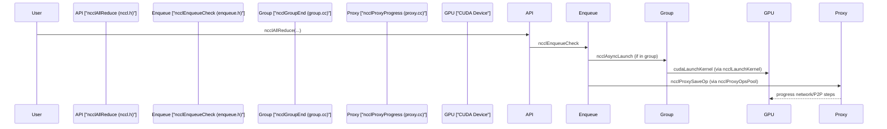

<!-- source: DeepWiki mcp.deepwiki.com · repo NVIDIA/nccl · page 1 Overview · fetched 2026-10-28 -->

# Overview

<details>
<summary>Relevant source files</summary>

The following files were used as context for generating this wiki page:

- [.github/pull_request_template.md](.github/pull_request_template.md)
- [CONTRIBUTING.md](CONTRIBUTING.md)
- [LICENSE.txt](LICENSE.txt)
- [README.md](README.md)
- [ThirdPartyNotices.txt](ThirdPartyNotices.txt)
- [cmake/NCCLConfig.cmake.in](cmake/NCCLConfig.cmake.in)
- [docs/dev_guide/nccl_coding_style.md](docs/dev_guide/nccl_coding_style.md)
- [docs/userguide/source/api/types.rst](docs/userguide/source/api/types.rst)
- [pkg/python_wheel/Makefile](pkg/python_wheel/Makefile)
- [pkg/python_wheel/build_wheel.sh](pkg/python_wheel/build_wheel.sh)
- [pkg/txz/CMakeLists.txt](pkg/txz/CMakeLists.txt)
- [pkg/txz/Makefile](pkg/txz/Makefile)
- [pkg/txz/create_txz.sh.in](pkg/txz/create_txz.sh.in)
- [src/bootstrap.cc](src/bootstrap.cc)
- [src/cft_dev_runtime.cc](src/cft_dev_runtime.cc)
- [src/debug.cc](src/debug.cc)
- [src/group.cc](src/group.cc)
- [src/include/comm.h](src/include/comm.h)
- [src/include/enqueue.h](src/include/enqueue.h)
- [src/include/proxy.h](src/include/proxy.h)
- [src/include/strongstream.h](src/include/strongstream.h)
- [src/include/transport.h](src/include/transport.h)
- [src/init.cc](src/init.cc)
- [src/misc/strongstream.cc](src/misc/strongstream.cc)
- [src/nccl.h.in](src/nccl.h.in)
- [src/param/c_api.cc](src/param/c_api.cc)
- [src/param/ncclparam.cc](src/param/ncclparam.cc)
- [src/proxy.cc](src/proxy.cc)
- [src/transport.cc](src/transport.cc)

</details>


This page describes what NCCL is, what collective operations it exposes, which hardware interconnects it supports, and how its major subsystems are organized. It is intended as a starting point for navigating the codebase. For details on any individual subsystem, follow the links to the dedicated sub-pages.

---

## What NCCL Is

NCCL (pronounced "Nickel") is a standalone C++ library that provides optimized collective and point-to-point communication primitives for NVIDIA GPUs. It is designed to be used directly by deep learning frameworks and HPC applications that need to move data between GPUs within a single node or across multiple nodes. [README.md:1-7]()

The current version is defined in `nccl.h.in` via the `NCCL_MAJOR`, `NCCL_MINOR`, and `NCCL_PATCH` variables. [src/nccl.h.in:20-22]()

NCCL ships as several build artifacts, including:
- `libnccl.so` — shared library [src/Makefile:58]()
- `libnccl_static.a` — static library [src/Makefile:59]()
- `ncclras` — reliability, availability, and serviceability binary [src/Makefile:61]()

The public C API surface is declared in `src/nccl.h`. All symbols follow the `NCCL_API` macro convention for versioned visibility. [src/init.cc:195-200]()

Sources: [README.md:1-7](), [src/nccl.h.in:20-22](), [src/Makefile:58-61](), [src/init.cc:195-200]()

---

## Collective Operations

NCCL implements the standard set of collective communication operations used in distributed ML workloads. The canonical string names used in log output are defined in `src/init.cc`. [src/init.cc:55-58]()

| Operation | Description |
|---|---|
| `Broadcast` | One rank sends; all ranks receive |
| `Reduce` | All ranks contribute; one rank receives the result |
| `AllGather` | Every rank gathers data from all other ranks |
| `ReduceScatter` | Reduction followed by scatter across ranks |
| `AllReduce` | Reduction result delivered to all ranks |
| `Send` / `Recv` | Point-to-point send and receive |

Group operations (`ncclGroupStart` / `ncclGroupEnd`) allow multiple collectives or point-to-point calls to be batched and submitted together. [src/group.cc:164-182]() For details, see [Communication Pipeline](#4) and [Group Operations and Batching](#4.1).

Sources: [src/init.cc:55-58](), [src/group.cc:164-182]()

---

## Supported Hardware Interconnects

NCCL selects the best available transport for each channel based on the detected topology. [README.md:7]() The available transports are registered in `ncclTransports`. [src/transport.cc:15-20]()

| Interconnect | Transport |
|---|---|
| NVLink / NVSwitch | `p2pTransport` (P2P shared memory) [src/transport.cc:16]() |
| NVLink SHARP (NVLS) | `ncclNvls` (Multicast in-network reduction) [src/include/transport.h:77-102]() |
| PCIe peer-to-peer | `shmTransport` (Shared memory) [src/transport.cc:17]() |
| InfiniBand (RDMA) | `netTransport` (via IB Verbs) [src/transport.cc:18]() |
| TCP/IP sockets | `netTransport` (via Sockets) [src/transport.cc:18]() |
| Collective network (CollNet) | `collNetTransport` (In-network allreduce) [src/transport.cc:19]() |

The transport layer is described in detail on page [Transport Layer](#5).

Sources: [README.md:7](), [src/transport.cc:15-20](), [src/include/transport.h:77-102]()

---

## Major Subsystems

The diagram below maps the main subsystems and their primary dependencies. Node labels use the actual source file and key type or function names.

**Subsystem Map**

```mermaid
graph TD
    [PublicAPI] ["Public API<br/>nccl.h / src/nccl.h.in<br/>ncclAllReduce, ncclSend, etc."]

    subgraph "Core Runtime"
        [Init] ["src/init.cc<br/>ncclInit<br/>ncclGetUniqueId"]
        [Comm] ["src/include/comm.h<br/>struct ncclComm"]
        [Group] ["src/group.cc<br/>ncclGroupStart/End"]
        [Enqueue] ["src/include/enqueue.h<br/>ncclEnqueueCheck"]
    end

    subgraph "Topology Subsystem"
        [TopoCore] ["src/graph/topo.h<br/>ncclTopoSystem"]
        [TopoPaths] ["src/graph/paths.cc<br/>ncclTopoComputePaths"]
        [TopoTuning] ["src/tuning.cc<br/>ncclTopoTuneModel"]
    end

    subgraph "Transport Layer"
        [Transport] ["src/include/transport.h<br/>struct ncclTransport"]
        [P2P] ["src/transport.cc<br/>ncclTransportP2pSetup"]
        [NVLS] ["src/include/transport.h<br/>ncclNvlsInit"]
    end

    subgraph "Proxy Service"
        [Proxy] ["src/proxy.cc<br/>ncclProxyServiceUDS<br/>struct ncclProxyArgs"]
    end

    subgraph "Bootstrap"
        [Bootstrap] ["src/bootstrap.cc<br/>bootstrapNetInit<br/>bootstrapGetUniqueId"]
    end

    subgraph "Infrastructure"
        [Socket] ["src/include/socket.h<br/>ncclSocket"]
        [Utils] ["src/include/utils.h<br/>ncclMemoryPool"]
    end

    [PublicAPI] --> [Init]
    [PublicAPI] --> [Group]
    [Init] --> [Bootstrap]
    [Init] --> [Comm]
    [Comm] --> [TopoCore]
    [TopoCore] --> [TopoPaths]
    [TopoPaths] --> [TopoTuning]
    [Group] --> [Enqueue]
    [Enqueue] --> [Transport]
    [Transport] --> [P2P]
    [Transport] --> [NVLS]
    [Enqueue] --> [Proxy]
    [Bootstrap] --> [Socket]
```

Sources: [src/init.cc:177-206](), [src/include/comm.h:98-280](), [src/proxy.cc:33-53](), [src/include/transport.h:117-142]()

---

## Execution Flow: From API Call to GPU Kernel

The following diagram shows the sequence of major operations from a user-level collective call through to device execution.

**Call Path: ncclAllReduce → GPU kernel**



Sources: [src/init.cc:55-58](), [src/group.cc:36-74](), [src/proxy.cc:209-231](), [src/include/proxy.h:218-226]()

---

## Communicator Lifecycle

Every communication operation requires an `ncclComm_t` handle. Creating one involves rank discovery via bootstrap and topology setup. For full details see page [Communicator Management](#2) and page [Initialization and Bootstrap Process](#2.1).

**Phases of ncclCommInitRank**

```mermaid
flowchart LR
    [A] ["bootstrapNetInit()<br/>ncclGetUniqueId()"] --> [B]
    [B] ["ncclTopoComputePaths()<br/>ncclTopoTuneModel()"] --> [C]
    [C] ["ncclTransportP2pSetup()<br/>ncclNvlsSetup()"] --> [D]
    [D] ["ncclProxyServiceUDS()"] --> [E] ["ncclComm ready"]
```

Sources: [src/init.cc:170-193](), [src/transport.cc:125-150](), [src/bootstrap.cc:105-138]()

---

## Repository Structure

| Directory / File | Purpose |
|---|---|
| `src/nccl.h.in` | Template for public API declarations [src/nccl.h.in:1-41]() |
| `src/init.cc` | Communicator creation and initialization [src/init.cc:177-206]() |
| `src/include/comm.h` | `ncclComm` struct and internal state definitions [src/include/comm.h:98-280]() |
| `src/group.cc` | `ncclGroupStart` / `ncclGroupEnd` async launch logic [src/group.cc:36-74]() |
| `src/proxy.cc` | Proxy service thread for network/P2P progress [src/proxy.cc:33-53]() |
| `src/bootstrap.cc` | Out-of-band rank rendezvous network [src/bootstrap.cc:105-138]() |
| `src/transport.cc` | Transport selection and P2P setup [src/transport.cc:23-44]() |
| `src/include/transport.h` | Transport abstraction and NVLS definitions [src/include/transport.h:117-142]() |
| `src/cft_dev_runtime.cc` | Logical Endpoint (CFT) support for device communication [src/cft_dev_runtime.cc:18-35]() |
| `README.md` | Project introduction and build instructions [README.md:1-33]() |

Sources: [src/Makefile:1-61](), [src/init.cc:1-206](), [README.md:1-86]()

---

## Subsystem Index

| Wiki Page | Subsystem | Primary Source Files |
|---|---|---|
| [Communicator Management](#2) | Communicator Management | `src/init.cc`, `src/include/comm.h` |
| [Topology System](#3) | Topology System | `src/tuning.cc`, `src/graph/` |
| [Communication Pipeline](#4) | Communication Pipeline | `src/group.cc`, `src/enqueue.h` |
| [Transport Layer](#5) | Transport Layer | `src/transport.cc`, `src/include/transport.h` |
| [Proxy Service Architecture](#5.6) | Proxy Service | `src/proxy.cc`, `src/include/proxy.h` |
| [Bootstrap Communication](#5.2) | Bootstrap | `src/bootstrap.cc` |
| [Infrastructure and Utilities](#6) | Infrastructure & Utilities | `src/debug.cc`, `src/include/utils.h` |
| [Build System](#8) | Build System | `Makefile`, `src/Makefile` |

---

## Versioning and Licensing

The library version is defined in `nccl.h.in` [src/nccl.h.in:20-22](). At runtime, `ncclGetVersion()` returns `NCCL_VERSION_CODE` [src/init.cc:195-200]().

The codebase is licensed under the **Apache License 2.0**. [LICENSE.txt:1-10]()

For information about contributing to NCCL, see page [Contributing and Community](#1.1).

Sources: [src/nccl.h.in:20-25](), [src/init.cc:195-200](), [LICENSE.txt:1-10]()

---

