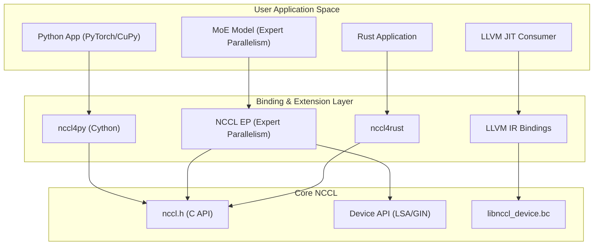
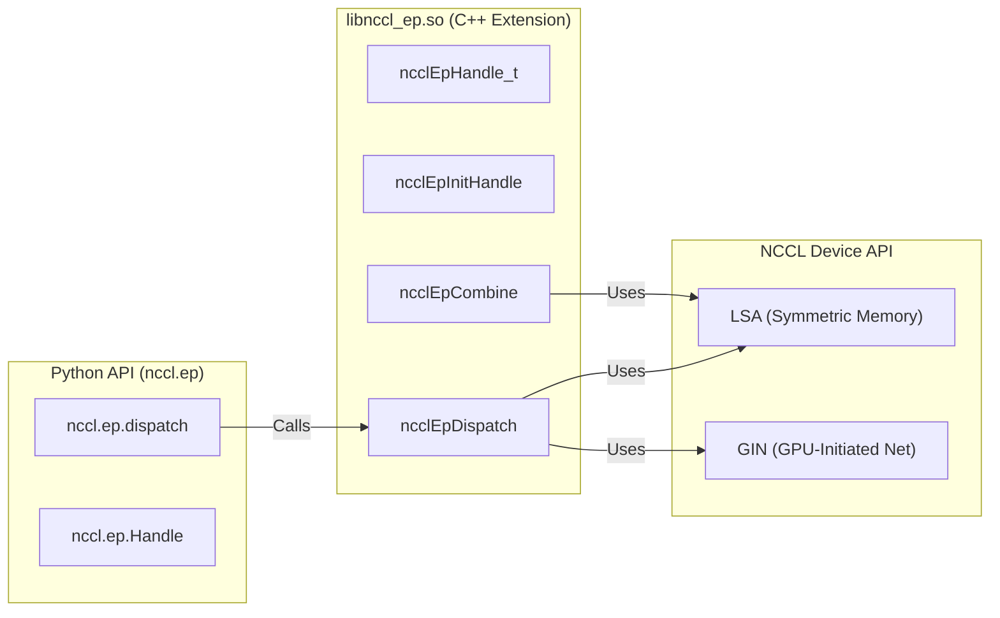

<!-- source: DeepWiki mcp.deepwiki.com · repo NVIDIA/nccl · page 10 Language Bindings and Extensions · fetched 2026-10-28 -->

# Language Bindings and Extensions

Relevant source files

The following files were used as context for generating this wiki page:

- [CMakeLists.txt](CMakeLists.txt)
- [Makefile](Makefile)
- [bindings/ir/CMakeLists.txt](bindings/ir/CMakeLists.txt)
- [bindings/ir/Makefile](bindings/ir/Makefile)
- [bindings/ir/clang_compat/texture_fetch_functions.h](bindings/ir/clang_compat/texture_fetch_functions.h)
- [bindings/nccl4py/nccl/bindings/_internal/nccl.pxd](bindings/nccl4py/nccl/bindings/_internal/nccl.pxd)
- [bindings/nccl4py/nccl/bindings/_internal/nccl_linux.pyx](bindings/nccl4py/nccl/bindings/_internal/nccl_linux.pyx)
- [bindings/nccl4py/nccl/bindings/cynccl.pxd](bindings/nccl4py/nccl/bindings/cynccl.pxd)
- [bindings/nccl4py/nccl/bindings/cynccl.pyx](bindings/nccl4py/nccl/bindings/cynccl.pyx)
- [bindings/nccl4py/nccl/bindings/nccl.pxd](bindings/nccl4py/nccl/bindings/nccl.pxd)
- [bindings/nccl4py/nccl/bindings/nccl.pyx](bindings/nccl4py/nccl/bindings/nccl.pyx)
- [bindings/nccl4py/nccl/core/__init__.py](bindings/nccl4py/nccl/core/__init__.py)
- [bindings/nccl4py/nccl/core/communicator.py](bindings/nccl4py/nccl/core/communicator.py)
- [bindings/nccl4py/nccl/core/params.py](bindings/nccl4py/nccl/core/params.py)
- [bindings/nccl4py/nccl/core/resources.py](bindings/nccl4py/nccl/core/resources.py)
- [bindings/nccl4py/nccl/core/team.py](bindings/nccl4py/nccl/core/team.py)
- [docs/userguide/source/nccl4py/parameters.rst](docs/userguide/source/nccl4py/parameters.rst)
- [makefiles/common.mk](makefiles/common.mk)
- [src/include/nccl_device.h](src/include/nccl_device.h)

NCCL provides a variety of language bindings and architectural extensions to facilitate high-performance collective communication across different programming environments and specialized parallel workloads. While the core of NCCL is implemented in C++, these extensions allow seamless integration into Python and Rust ecosystems, provide an Intermediate Representation (IR) layer for compiler-driven JIT consumers, and offer specialized primitives for advanced scaling techniques like Expert Parallelism (EP).

### Ecosystem Overview

The following diagram illustrates how the various bindings and extensions interface with the core NCCL library and the underlying hardware.

**NCCL Language and Extension Architecture**

Sources: [bindings/nccl4py/nccl/bindings/cynccl.pxd:16-100](), [bindings/nccl4py/nccl/core/communicator.py:6-69](), [Makefile:29-58]()

---

### Python Bindings (nccl4py)

The `nccl4py` package provides high-performance Python bindings for NCCL using Cython. It exposes both a low-level API that mirrors the C interface and a high-level Pythonic API that simplifies communicator management and collective execution.

*   **Low-level Bindings**: Defined in `nccl.pyx` and `cynccl.pxd`, providing direct access to `ncclComm_t` [bindings/nccl4py/nccl/bindings/cynccl.pxd:99-99]() and collective functions like `ncclAllReduce` [bindings/nccl4py/nccl/bindings/nccl.pxd:80-80]().
*   **High-level API**: The `Communicator` class in `communicator.py` provides a Pythonic interface for collectives, supporting automatic stream management and integration with `torch` and `cupy` [bindings/nccl4py/nccl/core/communicator.py:68-138]().
*   **Resource Management**: Classes like `RegisteredBufferHandle` and `RegisteredWindowHandle` in `resources.py` manage the lifecycle of communicator-owned objects [bindings/nccl4py/nccl/core/resources.py:165-220]().

For details, see [nccl4py: Python Bindings](#10.1).

---

### LLVM IR Bindings

The NCCL IR layer provides a pipeline for generating optimized LLVM bitcode of NCCL device functions. This allows downstream JIT compilers to inline and fuse communication primitives directly into compute kernels.

*   **Bitcode Generation**: Device functions are compiled to `libnccl_device.bc` using a pipeline of `clang`, `opt`, and `llvm-as` [bindings/ir/Makefile:18-22]().
*   **Compatibility**: Includes a `clang_compat` shim to handle headers removed in CUDA 13, ensuring consistent compilation [bindings/ir/Makefile:48-51]().
*   **JIT Integration**: The `nccl_device_wrapper.h` provides the necessary interface for consumers to link against NCCL's device-side bitcode at runtime [bindings/ir/Makefile:70-75]().

For details, see [LLVM IR Bindings](#10.2).

---

### NCCL EP: Expert Parallelism Extension

NCCL EP is an extension designed for efficient communication in Mixture-of-Experts (MoE) models. It leverages the NCCL Device API, specifically Load-Store Accessible (LSA) and GPU-Initiated Networking (GIN) operations, to minimize CPU overhead during token routing.

**Expert Parallelism Component Mapping**

Sources: [bindings/nccl4py/nccl/bindings/nccl.pxd:95-96](), [bindings/nccl4py/nccl/bindings/cynccl.pxd:188-203]()

*   **Primitives**: Introduces specialized routing logic for MoE, supporting both Low-Latency and High-Throughput algorithm modes.
*   **Lifecycle**: Managed via `ncclEpGroup` and `ncclEpHandle` to coordinate staged execution and compute-communication overlap.

For details, see [NCCL EP: Expert Parallelism Extension](#10.3).

---

### Community Contributions (contrib/)

The `contrib/` directory contains specialized extensions and experimental features provided by the community.

*   **Resilience and Interop**: `nccl_checkpoint` provides an `LD_PRELOAD` shim for communicator save/restore via Redis, while `nccl_m2n` enables cross-group tensor resharding [bindings/nccl4py/nccl/bindings/nccl.pxd:72-74]().
*   **Advanced Hardware Support**: `nccl_ubx` provides ultra-bandwidth NVLink collectives with compute fusion support for Hopper and Blackwell architectures.
*   **Experimental Bindings and Engines**: Includes `nccl4rust` (Rust bindings), `NIIN` (NVSHMEM implemented in NCCL), and `PACE` (Parallelism-Aware Collective Engine).

For details, see [Community Contributions: Checkpoint, M2N, UBX, and Custom Algorithms](#10.4) and [Additional Community Contributions: NIIN, PACE, and nccl4rust](#10.5).

Sources:
- [Makefile:29-61]()
- [bindings/nccl4py/nccl/bindings/nccl.pyx:73-112]()
- [bindings/nccl4py/nccl/core/communicator.py:72-138]()
- [bindings/ir/Makefile:9-43]()
- [bindings/nccl4py/nccl/core/resources.py:39-98]()

---

