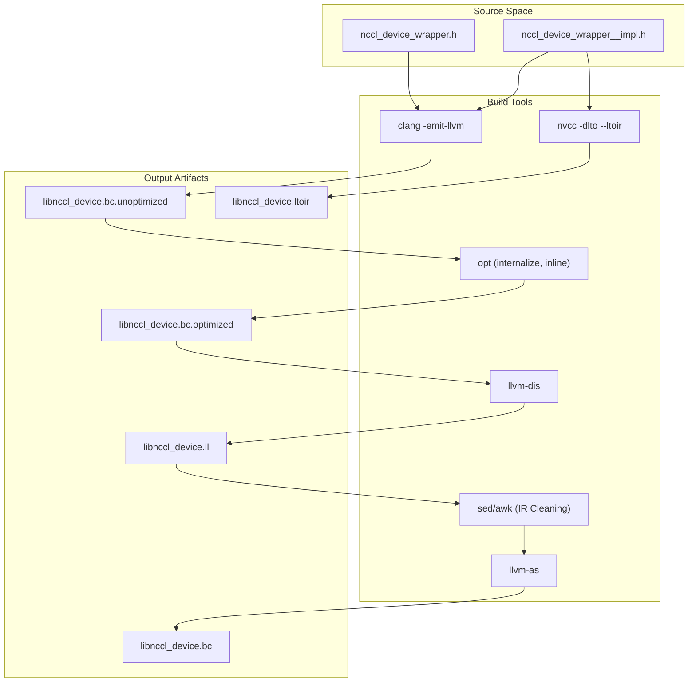

<!-- source: DeepWiki mcp.deepwiki.com · repo NVIDIA/nccl · page 10.2 LLVM IR Bindings · fetched 2026-10-28 -->

# LLVM IR Bindings

<details>
<summary>Relevant source files</summary>

The following files were used as context for generating this wiki page:

- [CMakeLists.txt](CMakeLists.txt)
- [Makefile](Makefile)
- [bindings/ir/CMakeLists.txt](bindings/ir/CMakeLists.txt)
- [bindings/ir/Makefile](bindings/ir/Makefile)
- [bindings/ir/clang_compat/texture_fetch_functions.h](bindings/ir/clang_compat/texture_fetch_functions.h)
- [bindings/ir/nccl_device_wrapper.h](bindings/ir/nccl_device_wrapper.h)
- [bindings/ir/nccl_device_wrapper__impl.h](bindings/ir/nccl_device_wrapper__impl.h)
- [docs/userguide/source/api/device_gin.rst](docs/userguide/source/api/device_gin.rst)
- [docs/userguide/source/api/flags.rst](docs/userguide/source/api/flags.rst)
- [makefiles/common.mk](makefiles/common.mk)
- [src/include/bitops.h](src/include/bitops.h)
- [src/include/nccl_device.h](src/include/nccl_device.h)
- [src/include/nccl_device/barrier.h](src/include/nccl_device/barrier.h)
- [src/include/nccl_device/gin_barrier.h](src/include/nccl_device/gin_barrier.h)
- [src/include/nccl_device/impl/barrier__funcs.h](src/include/nccl_device/impl/barrier__funcs.h)
- [src/include/nccl_device/impl/barrier__types.h](src/include/nccl_device/impl/barrier__types.h)
- [src/include/nccl_device/impl/gin_barrier__funcs.h](src/include/nccl_device/impl/gin_barrier__funcs.h)
- [src/include/nccl_device/impl/gin_barrier__types.h](src/include/nccl_device/impl/gin_barrier__types.h)
- [src/include/nccl_device/impl/lsa_barrier__funcs.h](src/include/nccl_device/impl/lsa_barrier__funcs.h)
- [src/include/nccl_device/impl/lsa_barrier__types.h](src/include/nccl_device/impl/lsa_barrier__types.h)
- [src/include/nccl_device/lsa_barrier.h](src/include/nccl_device/lsa_barrier.h)
- [src/include/nccl_device/utility.h](src/include/nccl_device/utility.h)

</details>


The LLVM IR bindings in NCCL provide a mechanism to compile NCCL device-side functions into optimized LLVM bitcode (`libnccl_device.bc`). This allows downstream Just-In-Time (JIT) consumers, such as the NCCL Python bindings (`nccl4py`) or custom DSL compilers, to link against NCCL's high-performance communication primitives without requiring the full CUDA C++ toolchain at runtime.

### IR Generation Pipeline

The generation of the bitcode library is orchestrated by a specialized build pipeline that utilizes `clang`, `opt`, `llvm-dis`, and `llvm-as`. This pipeline ensures that NCCL's C++ device templates are instantiated, optimized, and stripped of incompatible metadata before being packaged.

#### Data Flow and Build Stages

The pipeline follows a multi-stage transformation process:

1.  **Clang Compilation**: The source `nccl_device_wrapper__impl.h` is compiled by `clang` using the `-emit-llvm` flag. This stage instantiates the necessary C++ templates for the Device API [bindings/ir/Makefile:77-80]().
2.  **LLVM Optimization**: The `opt` tool applies optimization passes, specifically `internalize`, `inline`, and `globaldce`. The `internalize` pass is configured to preserve symbols matching `*nccl*` while allowing the optimizer to aggressively prune unused code [bindings/ir/Makefile:66-67, 82-84]().
3.  **IR Cleaning**: The bitcode is disassembled into human-readable LLVM IR (`.ll`). The build system then performs text-based cleaning to remove `nvvm-reflect-ftz` flags (to preserve subnormal handling) and strips function alignment attributes that are rejected by `libNVVM` [bindings/ir/Makefile:89-97]().
4.  **Final Assembly**: The cleaned IR is re-assembled into the final `libnccl_device.bc` using `llvm-as` [bindings/ir/Makefile:99-102]().
5.  **LTO IR Generation**: Optionally, if `NCCL_EMIT_LTO_IR` is set, the system uses `nvcc` with `-dlto --ltoir` to generate a `.ltoir` file for link-time optimization consumers [bindings/ir/Makefile:115-123]().

**Pipeline Architecture Diagram**


Sources: [bindings/ir/Makefile:12-136](), [bindings/ir/nccl_device_wrapper.h:10-19](), [Makefile:9-24]()

---

### Clang Compatibility Shim

To support compilation with `clang` against newer CUDA Toolkits (specifically CUDA 13+), NCCL includes a `clang_compat` directory. This is necessary because `clang`'s internal CUDA wrappers may unconditionally include headers that were removed in later CUDA versions, such as `texture_fetch_functions.h`.

The build system adds these compatibility stubs to the include path during IR generation [bindings/ir/Makefile:51-58](). This ensures that the device code, which does not use legacy texture/surface APIs, can still compile successfully under `clang` [bindings/ir/Makefile:48-50]().

Sources: [bindings/ir/Makefile:48-58](), [bindings/ir/clang_compat/texture_fetch_functions.h:1-5]()

---

### Device Wrapper Interface

The `nccl_device_wrapper.h` header serves as the primary interface for LLVM IR consumers. It provides a C-style view of the NCCL Device API, enabling interoperability with languages and runtimes that cannot directly consume C++ templates.

#### Key Implementation Details

*   **Linkage Overrides**: To ensure symbols are emitted in the bitcode rather than being inlined away, the wrapper undefines `NCCL_DEVICE_INLINE` and redefines it based on the build mode (e.g., `__attribute__((always_inline))` for clang bitcode) [bindings/ir/nccl_device_wrapper.h:22-41]().
*   **Opaque Session Wrappers**: C++ templates like `ncclBarrierSession<Coop>` are wrapped in C-style structs (e.g., `ncclBarrierSession_C`) which use `ncclCoopAny` as the concrete cooperative group type [bindings/ir/nccl_device_wrapper.h:63-73]().
*   **Size Accessors**: Functions like `ncclBarrierSession_C_size()` allow JIT consumers to allocate the correct amount of stack space using `llvm.alloca` without needing to mirror the complex C++ struct layout in the high-level language [bindings/ir/nccl_device_wrapper.h:75-82]().
*   **Comm Accessors**: Since the `ncclDevComm` struct contains internal types, the wrapper provides accessor functions (e.g., `ncclDevComm_Rank`, `ncclDevComm_LsaBarrier`) to read fields [bindings/ir/nccl_device_wrapper.h:84-97]().
*   **Cooperative Groups**: The wrapper exposes `ncclCoopAny` initialization functions to define the scope of threads (Thread, Warp, CTA) participating in a collective or barrier [bindings/ir/nccl_device_wrapper.h:103-112]().

**Code Entity Mapping: C++ to IR Wrapper**

| C++ Entity (Device API) | IR Wrapper Entity (C-style) | Implementation Site |
| :--- | :--- | :--- |
| `ncclLsaBarrierSession<Coop>` | `ncclLsaBarrierSession_C` | [bindings/ir/nccl_device_wrapper.h:63-65]() |
| `ncclGinBarrierSession<Coop>` | `ncclGinBarrierSession_C` | [bindings/ir/nccl_device_wrapper.h:67-69]() |
| `ncclBarrierSession<Coop>` | `ncclBarrierSession_C` | [bindings/ir/nccl_device_wrapper.h:71-73]() |
| `ncclDevComm::rank` | `ncclDevComm_Rank()` | [bindings/ir/nccl_device_wrapper__impl.h:28]() |
| `ncclCoopThread` | `ncclCoopAnyInitThread()` | [bindings/ir/nccl_device_wrapper__impl.h:44-46]() |

**IR Binding Entity Relationship Diagram**

```mermaid
classDiagram
    class "ncclDevComm" {
        +int rank
        +ncclLsaBarrierHandle lsaBarrier
        +ncclGinBarrierHandle worldGinBarrier
    }
    class "nccl_device_wrapper.h" {
        <<interface>>
        +ncclDevComm_Rank(comm)
        +ncclBarrierSessionInit(session, coop, ...)
        +ncclBarrierSessionSync(session, coop, ...)
    }
    class "ncclBarrierSession_C" {
        +ncclBarrierSession bar
    }
    class "ncclCoopAny" {
        +ncclCoopAnyInitThread()
        +ncclCoopAnyInitCta()
    }

    "nccl_device_wrapper.h" ..> "ncclDevComm" : accesses
    "nccl_device_wrapper.h" ..> "ncclBarrierSession_C" : manages
    "nccl_device_wrapper.h" ..> "ncclCoopAny" : configures
```
Sources: [bindings/ir/nccl_device_wrapper.h:40-170](), [bindings/ir/nccl_device_wrapper__impl.h:22-148](), [src/include/nccl_device/barrier.h:18-42]()

---

### Integration with Downstream Consumers

The `libnccl_device.bc` is generated during the standard build process if `EMIT_LLVM_IR=1` is passed to `make` [Makefile:9-16](). The resulting bitcode and the `nccl_device_wrapper.h` header are installed into the build directory's `lib/` and `include/` folders respectively [bindings/ir/Makefile:13-22, 72-75]().

Downstream tools (like the Python Device API in `nccl4py`) load this bitcode, link it with user-generated IR, and then use the `nccl_device_wrapper.h` symbols to invoke NCCL's optimized communication routines [bindings/ir/nccl_device_wrapper.h:15-19, 75-79]().

Sources: [Makefile:29-34, 57-61](), [bindings/ir/Makefile:104-113](), [bindings/ir/nccl_device_wrapper.h:10-19]()

---

