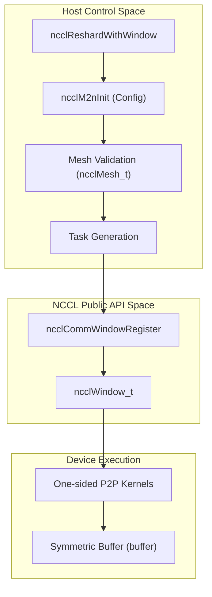
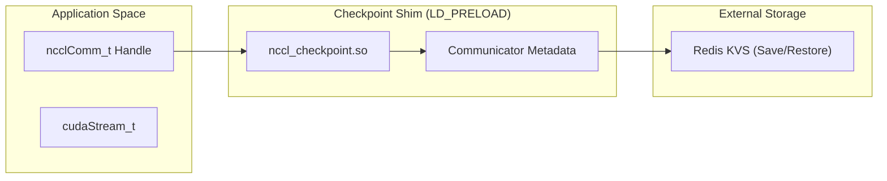

<!-- source: DeepWiki mcp.deepwiki.com · repo NVIDIA/nccl · page 10.4 Community Contributions: Checkpoint, M2N, UBX, and Custom Algorithms · fetched 2026-10-28 -->

# Community Contributions: Checkpoint, M2N, UBX, and Custom Algorithms

Relevant source files

The following files were used as context for generating this wiki page:

- [contrib/README.md](contrib/README.md)
- [contrib/custom_algos/README.md](contrib/custom_algos/README.md)
- [contrib/custom_algos/allreduce/.gitkeep](contrib/custom_algos/allreduce/.gitkeep)
- [contrib/custom_algos/allreduce/Makefile](contrib/custom_algos/allreduce/Makefile)
- [contrib/custom_algos/allreduce/README.md](contrib/custom_algos/allreduce/README.md)
- [contrib/custom_algos/allreduce/allreduce_perf_4gpu.png](contrib/custom_algos/allreduce/allreduce_perf_4gpu.png)
- [contrib/custom_algos/allreduce/allreduce_perf_8gpu.png](contrib/custom_algos/allreduce/allreduce_perf_8gpu.png)
- [contrib/custom_algos/allreduce/main.cu](contrib/custom_algos/allreduce/main.cu)
- [contrib/custom_algos/allreduce/oneshot_mc_allreduce_kernel.cuh](contrib/custom_algos/allreduce/oneshot_mc_allreduce_kernel.cuh)
- [contrib/custom_algos/allreduce/twoshot_mc_poison_allreduce_kernel.cuh](contrib/custom_algos/allreduce/twoshot_mc_poison_allreduce_kernel.cuh)
- [contrib/custom_algos/allreduce/twoshot_mc_simple_allreduce_kernel.cuh](contrib/custom_algos/allreduce/twoshot_mc_simple_allreduce_kernel.cuh)
- [contrib/custom_algos/alltoall/Makefile](contrib/custom_algos/alltoall/Makefile)
- [contrib/custom_algos/alltoall/README.md](contrib/custom_algos/alltoall/README.md)
- [contrib/custom_algos/alltoall/alltoall_perf.png](contrib/custom_algos/alltoall/alltoall_perf.png)
- [contrib/custom_algos/alltoall/alltoall_perf_32gpu.png](contrib/custom_algos/alltoall/alltoall_perf_32gpu.png)
- [contrib/custom_algos/alltoall/alltoall_perf_64gpu.png](contrib/custom_algos/alltoall/alltoall_perf_64gpu.png)
- [contrib/custom_algos/alltoall/lsa_poison_alltoall_kernel.cuh](contrib/custom_algos/alltoall/lsa_poison_alltoall_kernel.cuh)
- [contrib/custom_algos/alltoall/lsa_simple_alltoall_kernel.cuh](contrib/custom_algos/alltoall/lsa_simple_alltoall_kernel.cuh)
- [contrib/custom_algos/alltoall/main.cu](contrib/custom_algos/alltoall/main.cu)
- [contrib/nccl_m2n/Makefile](contrib/nccl_m2n/Makefile)
- [contrib/nccl_m2n/Makefile.common](contrib/nccl_m2n/Makefile.common)
- [contrib/nccl_m2n/README.md](contrib/nccl_m2n/README.md)
- [contrib/nccl_m2n/RELEASE.md](contrib/nccl_m2n/RELEASE.md)
- [contrib/nccl_m2n/ThirdPartyNotices.txt](contrib/nccl_m2n/ThirdPartyNotices.txt)
- [contrib/nccl_m2n/benchmarks/Makefile](contrib/nccl_m2n/benchmarks/Makefile)
- [contrib/nccl_m2n/benchmarks/bench_common.h](contrib/nccl_m2n/benchmarks/bench_common.h)
- [contrib/nccl_m2n/benchmarks/bench_common_kernels.cu](contrib/nccl_m2n/benchmarks/bench_common_kernels.cu)
- [contrib/nccl_m2n/benchmarks/bench_common_kernels.h](contrib/nccl_m2n/benchmarks/bench_common_kernels.h)
- [contrib/nccl_m2n/benchmarks/configs/model_configs/dsv3-toy.model.json](contrib/nccl_m2n/benchmarks/configs/model_configs/dsv3-toy.model.json)
- [contrib/niin/LICENSE.txt](contrib/niin/LICENSE.txt)
- [contrib/niin/README.md](contrib/niin/README.md)
- [contrib/niin/ThirdPartyNotices.txt](contrib/niin/ThirdPartyNotices.txt)

The `contrib/` directory serves as a host for community and partner extensions that provide new capabilities, algorithms, or higher-level APIs building on top of NCCL's public interfaces [contrib/README.md:7-10](). These contributions are maintained by their respective authors and must rely solely on public headers such as `nccl.h` and `nccl_device.h` [contrib/README.md:67-69]().

## 1. Custom Algorithms (custom_algos)

The `custom_algos` directory provides reference implementations of collective kernels built directly on the **NCCL Device API**. These examples demonstrate how to build high-performance collective algorithms that bypass the host-driven NCCL pipeline to achieve lower latency for small-to-medium messages [contrib/custom_algos/alltoall/README.md:3-8]().

### 1.1 Implementation Architecture
Custom kernels utilize the `ncclDevComm` handle, passed by value, to access NVLink primitives [contrib/custom_algos/alltoall/README.md:15-16](). Key primitives include:
*   **`ncclGetLsaPointer`**: Resolves peer symmetric buffer addresses for direct load/store via `ncclWindow_t` [contrib/custom_algos/alltoall/README.md:19-20]().
*   **`ncclLsaBarrierSession`**: A lightweight, GPU-only inter-rank barrier that synchronizes GPUs in an LSA team without CPU involvement [contrib/custom_algos/alltoall/README.md:21-22]().
*   **`ncclGetLsaMultimemPointer`**: (Hopper/Blackwell) Resolves multicast virtual addresses for hardware-accelerated reductions using `multimem.*` PTX instructions [contrib/custom_algos/allreduce/README.md:10-13]().

### 1.2 AllToAll Variants
| Algorithm | Completion Mechanism | Synchronization |
| :--- | :--- | :--- |
| `lsa_simple` | `ncclLsaBarrierSession` | Explicit barrier after all ranks finish writing [contrib/custom_algos/alltoall/README.md:31-48](). |
| `lsa_poison` | Lamport Sentinel (Poison) | Polls `.w` field of `uint4` for `!= LSA_SENTINEL_POISON` (`0xFFFAFFFA`) [contrib/custom_algos/alltoall/README.md:54-67](). |

### 1.3 AllReduce Variants (Multicast)
These kernels require Compute Capability 9.0+ for `multimem` PTX instructions [contrib/custom_algos/allreduce/main.cu:21-23]().
*   **Oneshot**: Every rank independently issues `multimem.ld_reduce.add` to read the hardware-summed value from all peers simultaneously [contrib/custom_algos/allreduce/README.md:39-52]().
*   **Twoshot**: Fuses ReduceScatter and AllGather into a single loop. Each rank reduces $1/N$ of the data and broadcasts the result via `multimem.st` [contrib/custom_algos/allreduce/README.md:60-81]().

**Sources:** [contrib/custom_algos/alltoall/README.md:1-122](), [contrib/custom_algos/allreduce/README.md:1-118](), [contrib/custom_algos/allreduce/main.cu:1-60]().

## 2. NCCL M2N (Cross-group Transfer)

`nccl_m2n` provides an API for resharding global tensors between disjoint sets of ranks (e.g., between an Inference group and a Training group) [contrib/nccl_m2n/README.md:7-11](). It leverages `ncclWindow_t` for zero-copy, one-sided transfers [contrib/nccl_m2n/README.md:13-14]().

### 2.1 Mesh and Tensor Configuration
The library uses `ncclMesh_t` to describe rank topology and `ncclDistTensor_t` to describe the logical sharding/replication layout [contrib/nccl_m2n/README.md:42-50](), [contrib/nccl_m2n/README.md:166-179]().

| Entity | Description |
| :--- | :--- |
| `ncclMesh_t` | 2-axis description of ranks, including `startRank` and `placement` (SHARD or REPLICATE) [contrib/nccl_m2n/README.md:42-50](). |
| `ncclDistTensor_t` | Logical tensor metadata: `dataPtr`, `localShape`, `ndims`, and `dtype` [contrib/nccl_m2n/README.md:166-179](). |
| `ncclReshardWithWindow` | Public entry point for executing the redistribution [contrib/nccl_m2n/README.md:15](). |

### 2.2 M2N Execution Flow
The following diagram maps the logical resharding request to the underlying NCCL window API.

**M2N Resharding Logic**

**Sources:** [contrib/nccl_m2n/README.md:1-187](), [contrib/nccl_m2n/benchmarks/bench_common_kernels.cu:1-155]().

## 3. NCCL UBX (Ultra-Bandwidth eXperimental)

`nccl_ubx` implements low-latency NVLink collectives specifically optimized for Hopper and Blackwell architectures [contrib/README.md:33](). It focuses on fusing communication with compute kernels, such as performing `Residual + RMSNorm` or `mxfp8 dispatch` during the collective operation [contrib/README.md:33]().

### 3.1 Key Features
*   **Symmetric Allocator**: Uses a specialized allocator to ensure buffers are Load-Store Accessible (LSA) across the NVLink fabric [contrib/README.md:33]().
*   **Compute Fusion**: Minimizes kernel launch overhead by embedding collective logic inside mathematical transformation kernels [contrib/README.md:33]().

**Sources:** [contrib/README.md:26-35]().

## 4. NCCL Checkpoint

The `nccl_checkpoint` library is an `LD_PRELOAD` shim designed for multi-node, communicator-aware save and restore operations [contrib/README.md:31](). It is built to work with CUDA Checkpoint/CRIU (Checkpoint/Restore In Userspace).

### 4.1 Checkpoint/Restore Mechanism
The library captures the state of `ncclComm_t` and associated network connections, storing the metadata in a **Redis Key-Value Store (KVS)** [contrib/README.md:31](). This allows a distributed application to resume execution on a different set of nodes while maintaining the logical consistency of the NCCL communicators.

**Checkpoint State Mapping**

**Sources:** [contrib/README.md:26-35]().

## 5. NIIN (NVSHMEM Implemented In NCCL)

NIIN implements the NVSHMEM API on top of NCCL's infrastructure (LSA pointers, GIN transport, barriers) [contrib/niin/README.md:3-5](). It allows applications to use `nvshmem_*` calls while using NCCL for underlying communication [contrib/niin/README.md:6-7]().

### 5.1 Routing and Primitives
NIIN performs RMA operations by checking if the target PE is an LSA peer [contrib/niin/README.md:172-173]():
*   **LSA Path**: Direct load/store via `ncclGetPeerPointer()` [contrib/niin/README.md:174]().
*   **Network Path (GIN)**: Uses `ncclGin::put()` or `ncclGin::get()` for non-LSA peers [contrib/niin/README.md:175-176]().

**Sources:** [contrib/niin/README.md:1-180]().

## 6. Contribution Policy

Community contributions must adhere to the following requirements for maintenance in the `contrib/` tree:
1.  **Self-containment**: All code must reside within `contrib/<name>/` [contrib/README.md:48-49]().
2.  **No Internal Dependencies**: Code must rely only on public headers (e.g., `nccl.h`, `nccl_device.h`) [contrib/README.md:67-69]().
3.  **Maintainer Responsibility**: Each entry must have a named maintainer responsible for keeping the code building against current NCCL releases [contrib/README.md:86-90]().

**Sources:** [contrib/README.md:1-107]().

---

