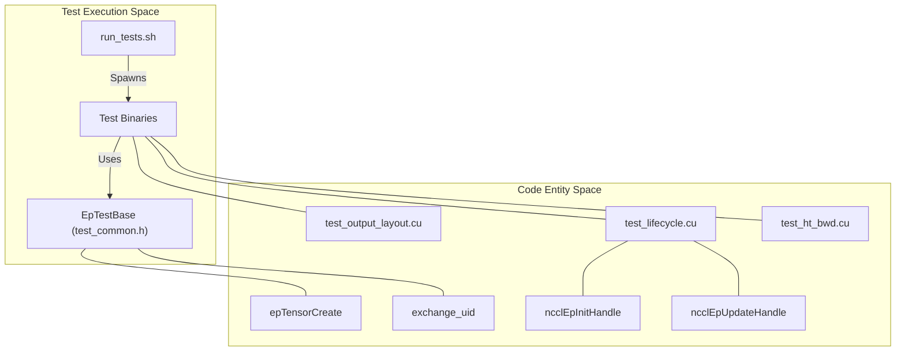
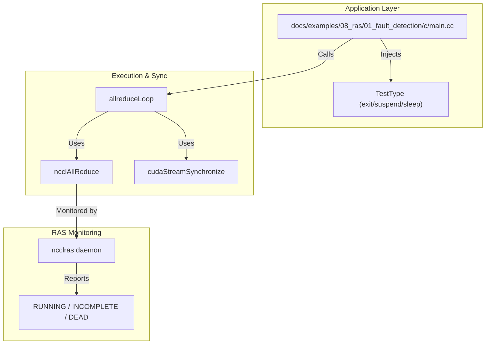

<!-- source: DeepWiki mcp.deepwiki.com · repo NVIDIA/nccl · page 11 Testing and Examples · fetched 2026-10-28 -->

# Testing and Examples

Relevant source files

The following files were used as context for generating this wiki page:

- [docs/examples/08_ras/01_fault_detection/c/README.md](docs/examples/08_ras/01_fault_detection/c/README.md)
- [docs/examples/08_ras/01_fault_detection/c/main.cc](docs/examples/08_ras/01_fault_detection/c/main.cc)
- [docs/examples/08_ras/Makefile](docs/examples/08_ras/Makefile)
- [docs/examples/08_ras/README.md](docs/examples/08_ras/README.md)
- [docs/examples/Makefile](docs/examples/Makefile)
- [docs/examples/README.md](docs/examples/README.md)

This page provides an overview of the NCCL repository's testing infrastructure and the collection of example programs designed to guide developers from basic communicator setup to advanced kernel fusion techniques and RAS monitoring. NCCL employs a multi-tiered testing strategy ranging from unit tests for specific extensions to comprehensive multi-process collective validation.

## Test Infrastructure

The NCCL test infrastructure is designed to validate correctness and performance across various hardware configurations. The primary test suite is located in the `test/` directory, while specialized extensions like **Expert Parallelism (EP)** maintain their own test suites.

### Core Test Suite
The core tests utilize a set of utilities and harnesses to simulate real-world distributed environments:
*   **MPI-based Harness**: The `mpi_test.cu` harness provides a multi-process execution environment, allowing tests to run across multiple GPUs and nodes using MPI for rank synchronization and `ncclUniqueId` distribution.
*   **Single-process Collectives**: Individual tests for collectives such as `all_reduce`, `all_gather`, `reduce_scatter`, `broadcast`, and `reduce` validate the functional correctness of the underlying algorithms.
*   **Correctness Scanning**: Tests often include scan-based verification where results are compared against a CPU-calculated reference to ensure bit-accurate reductions and data movement.

### Expert Parallelism (EP) Tests
Located in `contrib/nccl_ep/tests/`, this suite focuses on the `nccl_ep` extension, which provides optimized primitives for Mixture-of-Experts (MoE) routing.
*   **Test Runner**: The `run_tests.sh` script manages multi-GPU execution without requiring an MPI runtime by using a shared UID file for rank rendezvous.
*   **Layout Validation**: Tests like `test_output_layout.cu` verify that tokens are correctly grouped by either source rank (`NCCL_EP_LAYOUT_RANK_MAJOR`) or local expert (`NCCL_EP_LAYOUT_EXPERT_MAJOR`).
*   **Lifecycle and Memory**: Tests validate handle initialization (`ncclEpInitHandle`), update (`ncclEpUpdateHandle`), and the use of caller-owned memory to prevent leaks.

For details, see [Test Infrastructure](#11.1).

### Test System Mapping
The following diagram maps the testing abstractions to the physical code entities in the `nccl_ep` test suite.

**NCCL EP Test Entity Map**

Sources: [docs/examples/README.md:19-22](), [docs/examples/08_ras/01_fault_detection/c/main.cc:104-105]()

## Examples and Tutorials

The `docs/examples/` directory contains a progressive collection of programs that demonstrate how to integrate NCCL into applications [docs/examples/README.md:10-13](). These examples are designed to be pedagogical, moving from simple setup to complex performance optimizations.

### Example Progression
The examples are categorized by complexity and feature set [docs/examples/Makefile:11-15]():
1.  **Communicators (01)**: Demonstrates creating, testing, and destroying communicators using single-thread, multi-thread, and multi-process patterns [docs/examples/README.md:36-41]().
2.  **Point 2 Point (02)**: Implements a simple ring pattern using `ncclSend` and `ncclRecv` [docs/examples/README.md:43-47]().
3.  **Collectives (03)**: Showcases basic collective communication calls [docs/examples/README.md:48-51]().
4.  **User Buffer Registration (04)**: Eliminates data copy overhead by registering user buffers with internal NCCL structures [docs/examples/README.md:71-75]().
5.  **Symmetric Memory (05)**: Demonstrates window registration for low-latency Load-Store Accessible (LSA) communication [docs/examples/README.md:77-82]().
6.  **Device APIs (06)**: Enables communication directly from within CUDA kernels [docs/examples/README.md:84-90]().
7.  **Kernel Fusion (07)**: Fuses reduction, computation, and distribution (e.g., RMSNorm) into a single kernel launch using LSA, Multimem, or GIN [docs/examples/README.md:92-100]().
8.  **RAS (08)**: Demonstrates health monitoring and fault detection (exit, suspend, sleep modes) using the `ncclras` diagnostic subsystem [docs/examples/README.md:103-112]().

### Execution and Bindings
*   **Execution Models**: Examples support single process (multi-GPU), one thread per GPU, or MPI-based multi-process execution [docs/examples/README.md:59-64]().
*   **Python Variants**: Where `nccl4py` supports the required APIs, Python variants are provided in the `python/` subdirectories [docs/examples/README.md:24-27]().

For details, see [Examples and Tutorials](#11.2).

### Example Infrastructure Mapping
The following diagram illustrates how the example layer bridges host-side process management with NCCL diagnostic and communication features.

**Example Utility Infrastructure**

Sources: [docs/examples/08_ras/01_fault_detection/c/main.cc:108-112](), [docs/examples/08_ras/01_fault_detection/c/main.cc:130-137](), [docs/examples/08_ras/README.md:99-107]()

### Summary of Components

| Component | Location | Purpose |
| :--- | :--- | :--- |
| **Core Examples** | `docs/examples/` | Progressive C and Python tutorials for all major NCCL features [docs/examples/README.md:29-112](). |
| **RAS Fault Demo** | `docs/examples/08_ras/` | Interactive playground for observing NCCL's health monitoring [docs/examples/08_ras/README.md:52-64](). |
| **Build Orchestration** | `docs/examples/Makefile` | Centralized management for building, testing, and installing examples [docs/examples/Makefile:19-45](). |
| **Common Helpers** | `docs/examples/common/` | Shared bootstrap and broadcast logic to reduce boilerplate in examples [docs/examples/README.md:66-70](). |

Sources: [docs/examples/Makefile:11-15](), [docs/examples/README.md:29-112](), [docs/examples/08_ras/01_fault_detection/c/main.cc:130-137]()

---

