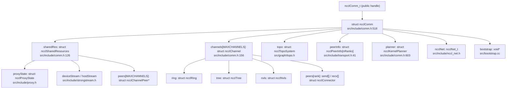
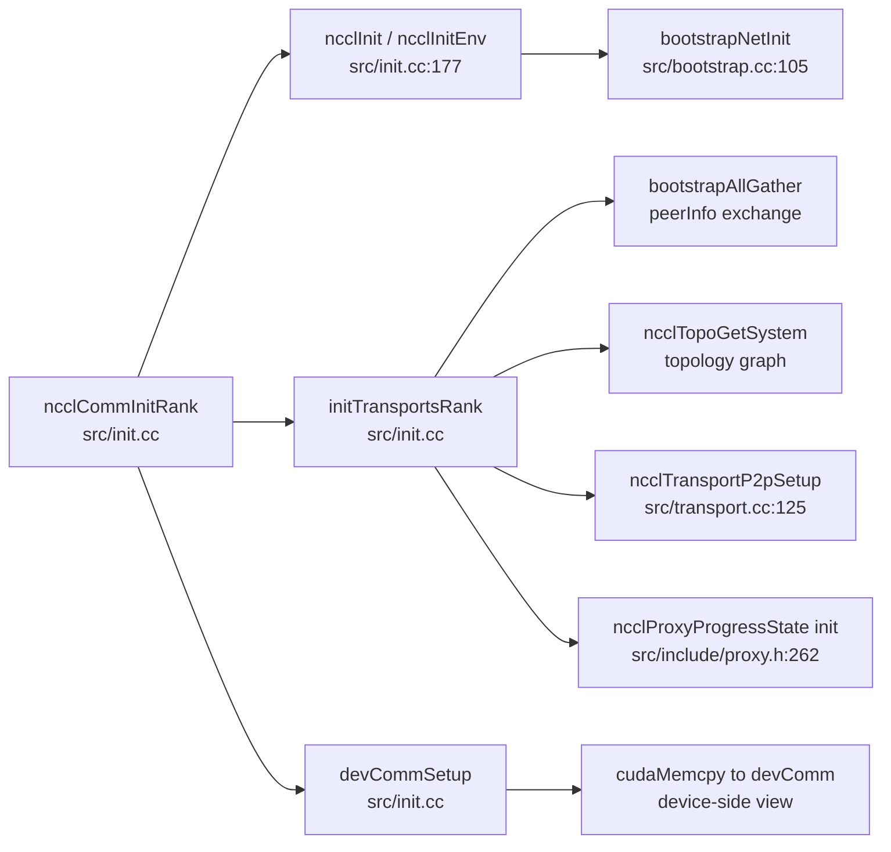
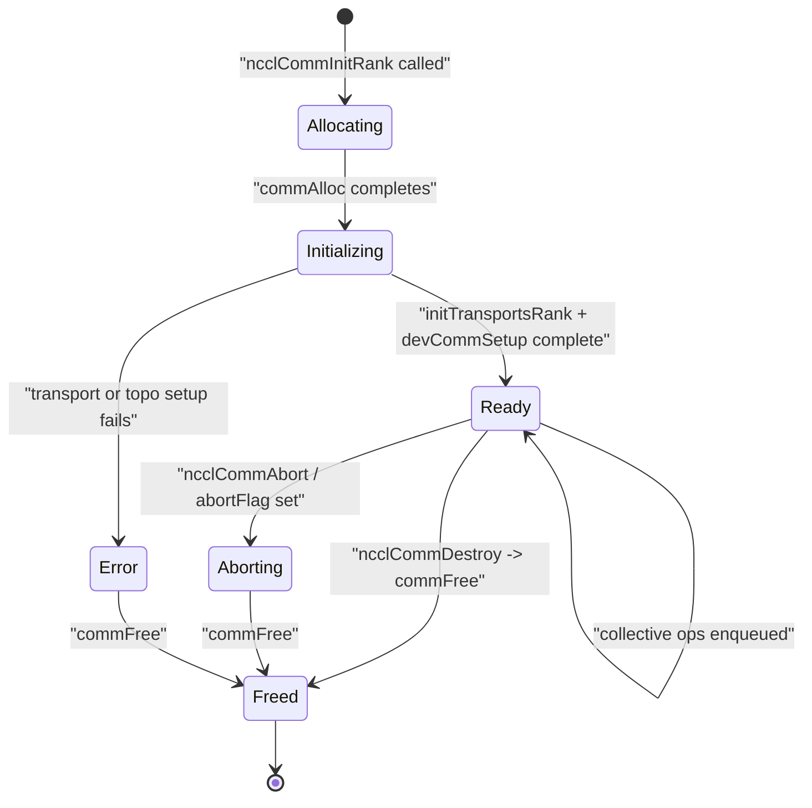

<!-- source: DeepWiki mcp.deepwiki.com · repo NVIDIA/nccl · page 2 Communicator Management · fetched 2026-10-28 -->

# Communicator Management

Relevant source files

The following files were used as context for generating this wiki page:

- [docs/userguide/source/api/types.rst](docs/userguide/source/api/types.rst)
- [src/bootstrap.cc](src/bootstrap.cc)
- [src/cft_dev_runtime.cc](src/cft_dev_runtime.cc)
- [src/debug.cc](src/debug.cc)
- [src/group.cc](src/group.cc)
- [src/include/comm.h](src/include/comm.h)
- [src/include/enqueue.h](src/include/enqueue.h)
- [src/include/proxy.h](src/include/proxy.h)
- [src/include/strongstream.h](src/include/strongstream.h)
- [src/include/transport.h](src/include/transport.h)
- [src/init.cc](src/init.cc)
- [src/misc/strongstream.cc](src/misc/strongstream.cc)
- [src/nccl.h.in](src/nccl.h.in)
- [src/param/c_api.cc](src/param/c_api.cc)
- [src/param/ncclparam.cc](src/param/ncclparam.cc)
- [src/proxy.cc](src/proxy.cc)
- [src/transport.cc](src/transport.cc)

## Purpose and Scope

This page covers the `ncclComm_t` handle: what it is, the data structures that back it, and how the subsystems it owns relate to each other. It serves as an entry point to the communicator subsystem.

Detailed treatments are in the sub-pages:

*   **Initialization and Bootstrap Process** — Covers `ncclCommInitRank`, bootstrap rendezvous via `ncclUniqueId`, and transport setup. For details, see [Initialization and Bootstrap Process](#2.1).
*   **Lifecycle and State Management** — Covers `ncclComm` fields, reference counting, state transitions, and the destroy/abort paths. For details, see [Lifecycle and State Management](#2.2).
*   **Split, Shrink, and Grow Operations** — Covers `ncclCommSplit` and related operations that derive child communicators or modify membership. For details, see [Split, Shrink, and Grow Operations](#2.3).
*   **Configuration and Versioning** — Covers `version.mk`, symbol visibility macros (`NCCL_API`), and runtime `NCCL_PARAM` tuning. For details, see [Configuration and Versioning](#2.4).

For the topology discovery and path computation that runs during init, see [Topology System](#3). For the transport layer that backs communicator channels, see [Transport Layer](#5). For the enqueue and kernel planning pipeline that uses the communicator at runtime, see [Communication Pipeline](#4).

---

## The `ncclComm_t` Handle

`ncclComm_t` is an opaque typedef for `struct ncclComm*` [src/nccl.h.in:36](). The full struct is defined in [src/include/comm.h:518-700]() and is internal to the library; callers only ever hold the pointer.

One `ncclComm` is created per participating GPU per communicator group. A rank is identified by its `rank` index within a group of `nRanks` GPUs. Each communicator owns or shares all resources required to drive collective operations on its device: topology data, transport connections, CUDA streams, a proxy service, and memory pools.

The struct begins and ends with sentinel fields (`startMagic`, `endMagic`) set to `NCCL_MAGIC` to detect memory corruption [src/include/comm.h:519,700](). The helper `commPoison` in [src/init.cc:207-211]() (implied by lifecycle management) deliberately overwrites identity fields before `free()` to catch use-after-free bugs.

---

## Core Data Structures

### `struct ncclComm`

The full struct is in [src/include/comm.h:518-700]().

| Field(s) | Type | Role |
| :--- | :--- | :--- |
| `rank`, `nRanks` | `int` | Rank identity within this communicator [src/include/comm.h:522-523]() |
| `cudaDev`, `busId`, `compCap` | `int` / `int64_t` | Device identity and PCI location [src/include/comm.h:525-528]() |
| `node`, `nNodes`, `localRank` | `int` | Node-level topology information [src/include/comm.h:531-534]() |
| `topo` | `ncclTopoSystem*` | Hardware topology graph built during init [src/include/comm.h:537]() |
| `peerInfo` | `ncclPeerInfo*` | Array of peer metadata exchanged via bootstrap [src/include/comm.h:541]() |
| `channels[MAXCHANNELS]` | `ncclChannel[]` | Communication channels for different algorithms [src/include/comm.h:545]() |
| `sharedRes` | `ncclSharedResources*` | Ref-counted resources shared with split children [src/include/comm.h:548]() |
| `ncclNet` | `ncclNet_t*` | Active network plugin for P2P/Collectives [src/include/comm.h:550]() |
| `bootstrap` | `void*` | Handle for out-of-band bootstrap network [src/include/comm.h:553]() |
| `planner` | `ncclKernelPlanner` | Task accumulation and plan building state [src/include/comm.h:603]() |
| `abortFlag` | `uint32_t*` | Host-side flag to signal operation abort [src/include/comm.h:614]() |
| `config` | `ncclConfig_t` | User-provided or default runtime configuration [src/nccl.h.in:91-119]() |

**Sources:** [src/include/comm.h:518-700](), [src/nccl.h.in:91-119]()

---

### `struct ncclSharedResources`

`ncclSharedResources` holds resources that are potentially shared between a parent communicator and its split children [src/include/comm.h:126-154](). It is reference-counted and freed when `refCount` reaches zero.

| Field | Type | Role |
| :--- | :--- | :--- |
| `refCount` | `int` | Number of `ncclComm` instances sharing this struct [src/include/comm.h:127]() |
| `peers[MAXCHANNELS]` | `ncclChannelPeer*` | Host-side per-channel peer connection states [src/include/comm.h:129]() |
| `deviceStream`, `hostStream` | `ncclStrongStream` | Internal CUDA streams for kernels and proxy [src/include/comm.h:145]() |
| `proxyState` | `ncclProxyState*` | State machine and thread for proxy operations [src/include/comm.h:150]() |
| `ginState` | `ncclGinState` | Shared state for GPU-Initiated Networking [src/include/comm.h:153]() |

**Sources:** [src/include/comm.h:120-154]()

---

### `struct ncclChannel`

Each communicator contains `MAXCHANNELS` channels. A channel represents one logical communication path and holds the topology layout for every algorithm [src/include/comm.h:156-178]().

| Field | Type | Role |
| :--- | :--- | :--- |
| `ring` | `ncclRing` | Ring algorithm peer ordering [src/include/comm.h:161]() |
| `tree` | `ncclTree` | Binary tree up/down peer assignments [src/include/comm.h:163]() |
| `nvls` | `ncclNvls` | NVLink SHARP multicast topology [src/include/comm.h:168]() |
| `peers`, `devPeers` | `ncclChannelPeer**` | Per-peer send/recv connectors [src/include/comm.h:157-158]() |
| `id` | `int` | Logical index of this channel [src/include/comm.h:170]() |

**Sources:** [src/include/comm.h:156-178]()

---

## Structural Relationships

**Diagram: ncclComm and its major sub-objects (mapped to code entities)**

**Sources:** [src/include/comm.h:126-178](), [src/include/comm.h:518-700](), [src/include/transport.h:41-65]()

---

## Initialization Overview

A communicator is created through `ncclCommInitRank` [src/init.cc:203]() or `ncclCommInitAll`. Internally, initialization proceeds through three main phases:

1.  **Environment and Bootstrap Init** — `ncclInit` and `ncclInitEnv` prepare global library state and the bootstrap network [src/init.cc:177-193]().
2.  **`initTransportsRank`** — Runs the AllGather of peer info via `bootstrapAllGather`, topology discovery, graph search, and transport setup via `ncclTransportP2pSetup`.
3.  **Proxy and Resource Bring-up** — Initializes the `ncclProxyState` and proxy service thread if required for the selected transports [src/proxy.cc:262-276]().

**Diagram: Communicator initialization phases mapped to functions**

**Sources:** [src/init.cc:177-206](), [src/transport.cc:125-150](), [src/bootstrap.cc:105-138]()

---

## Communicator Lifecycle

**Diagram: State transitions of an ncclComm instance**

The active abort mechanism uses two flags:
*   `abortFlag` (host-mapped, `uint32_t*`) — set by `ncclCommAbort` [src/include/comm.h:614]().
*   `abortFlagDev` (device-visible, `volatile uint32_t*`) — polled by running GPU kernels [src/include/comm.h:615]().

**Sources:** [src/include/comm.h:614-617](), [src/group.cc:49-52]()

---

## Shared Resources and Communicator Splitting

When `ncclCommSplit` derives a child communicator, the new communicator can inherit the parent's `ncclSharedResources` depending on the `splitShare` configuration [src/nccl.h.in:91-119](). This increments the `refCount` in the shared resources struct [src/include/comm.h:127]().

When any communicator is freed via `commFree`, the `refCount` is decremented. Only when it reaches zero are the shared resources (proxy thread, streams, etc.) destroyed.

**Sources:** [src/include/comm.h:120-154](), [src/nccl.h.in:247-257]()

---

## Resource Cleanup

Communicator destruction is managed via `ncclCommDestroy` or `ncclCommAbort`. Resources are released in dependency order:

1.  **Destructor chain** — A linked list of `ncclDestructor` nodes registered via internal APIs to ensure specific subsystem cleanup [src/include/comm.h:109-114]().
2.  **Proxy thread join** — The proxy service thread is stopped and joined if the communicator is the owner [src/include/proxy.h:269]().
3.  **Transport Free** — Peer connectors and transport-specific buffers are released [src/include/transport.h:121]().
4.  **Shared Resources** — The ref-counted `ncclSharedResources` is freed if the count reaches zero [src/include/comm.h:127]().

**Sources:** [src/include/comm.h:109-154](), [src/include/transport.h:121-128]()

---

## Environment Parameters

Several `NCCL_PARAM` entries in `src/init.cc` affect communicator behavior:

| Parameter | Environment Variable | Default | Effect |
| :--- | :--- | :--- | :--- |
| `ncclParamCommBlocking` | `NCCL_COMM_BLOCKING` | `UNDEF` | Force blocking/non-blocking mode [src/init.cc:63]() |
| `ncclParamRuntimeConnect` | `NCCL_RUNTIME_CONNECT` | `1` | Enable lazy transport connection [src/init.cc:64]() |
| `ncclParamCollnetEnable` | `NCCL_COLLNET_ENABLE` | `UNDEF` | Enable/disable CollNet [src/init.cc:66]() |
| `ncclParamNvlsChannels` | `NCCL_NVLS_NCHANNELS` | `UNDEF` | Override NVLS channel count [src/init.cc:67]() |
| `ncclParamGdrCopyEnable` | `NCCL_GDRCOPY_ENABLE` | `0` | Enable GDRCopy support [src/init.cc:146]() |

**Sources:** [src/init.cc:60-74](), [src/init.cc:146-149]()

---

