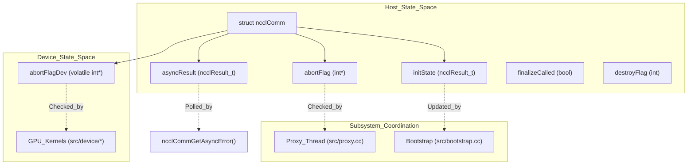
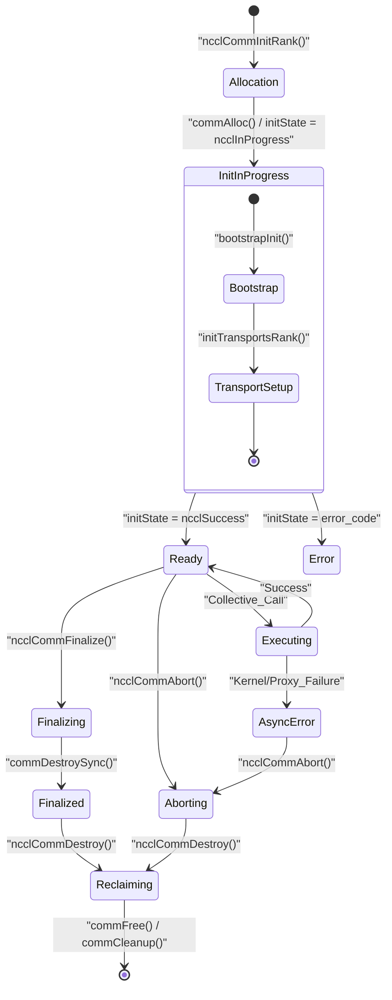
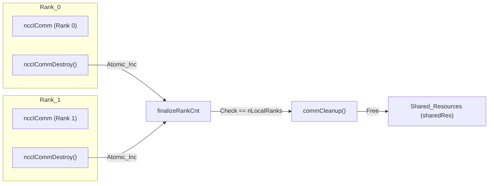

<!-- source: DeepWiki mcp.deepwiki.com · repo NVIDIA/nccl · page 2.2 Lifecycle and State Management · fetched 2026-10-28 -->

# Lifecycle and State Management

Relevant source files

The following files were used as context for generating this wiki page:

- [src/allocator.cc](src/allocator.cc)
- [src/bootstrap.cc](src/bootstrap.cc)
- [src/debug.cc](src/debug.cc)
- [src/group.cc](src/group.cc)
- [src/include/alloc.h](src/include/alloc.h)
- [src/include/allocator.h](src/include/allocator.h)
- [src/include/comm.h](src/include/comm.h)
- [src/include/enqueue.h](src/include/enqueue.h)
- [src/include/mem_manager.h](src/include/mem_manager.h)
- [src/include/proxy.h](src/include/proxy.h)
- [src/include/transport.h](src/include/transport.h)
- [src/init.cc](src/init.cc)
- [src/mem_manager.cc](src/mem_manager.cc)
- [src/proxy.cc](src/proxy.cc)
- [src/transport.cc](src/transport.cc)

## Purpose and Scope

This page describes the lifecycle of the NCCL communicator (`ncclComm_t`), focusing on the `ncclComm` struct fields, state transitions, reference counting, and the mechanisms for graceful finalization versus emergency aborts. The communicator state machine coordinates transitions from allocation and asynchronous initialization through collective execution to resource reclamation.

## The ncclComm Structure and State Fields

The `ncclComm` structure is the central entity for managing communication state. It contains fields that track initialization progress, runtime health, and synchronization requirements across host and device.

### Primary State Fields

| Field | Type | Purpose |
| :--- | :--- | :--- |
| `initState` | `ncclResult_t` | Tracks host-side initialization progress (`ncclInProgress` → `ncclSuccess`). [src/init.cc:1585-1619]() |
| `asyncResult` | `ncclResult_t` | Captures asynchronous errors occurring during GPU kernel execution or proxy operations. [src/init.cc:2129-2137]() |
| `abortFlag` | `int*` | Host-side pointer used to signal proxy threads and the group engine to stop. [src/init.cc:2400]() |
| `abortFlagDev` | `volatile int*` | Device-mapped pointer checked by GPU kernels to exit loops on error. [src/init.cc:2401]() |
| `finalizeCalled` | `bool` | Guard to prevent multiple entries into the finalization path. [src/init.cc:2282]() |
| `destroyFlag` | `int` | Internal marker that the communicator is scheduled for destruction. [src/init.cc:2379]() |
| `revokedFlag` | `int` | Marks the communicator as "revoked" for graceful error recovery. [src/init.cc:2469]() |
| `startMagic`/`endMagic` | `uint64_t` | Integrity markers (set to `0xCCE0CCE0CCE0CCE0`) to detect memory corruption. [src/init.cc:208-210]() |

### Code Entity Relationship Diagram

The following diagram maps high-level lifecycle concepts to the specific C++ entities and flags within the `ncclComm` struct.

**Sources:** [src/include/comm.h:293-410](), [src/init.cc:207-211](), [src/init.cc:1585-1619](), [src/init.cc:2400-2401]()

---

## Lifecycle State Machine

The communicator transitions through several phases, often driven by asynchronous background jobs managed by the `ncclAsyncJob` infrastructure. Initialization is performed via `ncclCommInitRank` which calls `ncclInitEnv` and `ncclInit` to prepare the library [src/init.cc:204-205]().

### Complete State Transition Flow

**Sources:** [src/init.cc:1512-1621](), [src/init.cc:1964-2042](), [src/init.cc:2263-2302](), [src/init.cc:2502-2541](), [src/group.cc:36-74]()

---

## Destruction and Resource Reclamation

NCCL employs a two-phase destruction process to ensure that all asynchronous work (CUDA kernels, proxy operations, and network transfers) has completed before memory is freed.

### 1. The Destroy Path (`ncclCommDestroy`)
The user calls `ncclCommDestroy()`, which marks the communicator for reclamation. If the communicator was not previously finalized, it triggers an implicit synchronization.

*   **Synchronization**: `commDestroySync()` is called to synchronize the `hostStream` and `deviceStream`. [src/init.cc:2138-2177]()
*   **Proxy Termination**: `ncclProxyStop()` is invoked to shut down the background proxy thread. [src/init.cc:2171]()
*   **Reference Counting**: Communicators often share resources (like the bootstrap network or proxy state). NCCL uses atomic reference counts (e.g., `sharedRes->refCount`) to ensure shared objects are only freed by the last rank. [src/init.cc:223-323]()

### 2. The Abort Path (`ncclCommAbort`)
`ncclCommAbort()` is the emergency exit. It bypasses graceful synchronization.
*   **Signaling**: It sets `abortFlag` and `abortFlagDev` to 1. [src/init.cc:2515]()
*   **Propagation**: This signal causes GPU kernels to terminate their loops and proxy threads to cease processing immediately. [src/init.cc:2394-2403]()
*   **Reclamation**: It schedules `commReclaim()` to clean up host-side structures as quickly as possible. [src/init.cc:2533]()

### Resource Freeing Logic (`commFree`)
The `commFree` function handles the actual deallocation of memory. NCCL uses a custom memory management system including `ncclMemoryStack` and `ncclMemoryPool` [src/include/mem_manager.h:9-20]().
*   **Permanent Memory**: Resources allocated via the `memPermanent` stack are released. [src/init.cc:207-211]()
*   **Destructors**: A linked list of `ncclDestructor` objects is processed to free CUDA memory and host buffers. [src/init.cc:221-235]()
*   **Host Allocations**: Memory allocated via `ncclCalloc` or `ncclCudaHostCalloc` is returned to the system or CUDA driver [src/include/alloc.h:148-189]().

### Intra-Process Coordination Diagram
In multi-GPU single-process scenarios, ranks coordinate via a shared resources structure to ensure the process-wide resources are cleaned up only once.

**Sources:** [src/init.cc:2230-2281](), [src/init.cc:2304-2355](), [src/include/comm.h:126-154]()

---

## Summary of Reference Counting

NCCL manages complex resource dependencies through several reference counting mechanisms:

1.  **`sharedRes->refCount`**: Tracks how many communicators (including those created via `ncclCommSplit`) are using the shared device streams and proxy state. [src/include/comm.h:127](), [src/init.cc:273-287]()
2.  **`abortFlagRefCount`**: Specifically manages the lifecycle of the `abortFlag` memory, which may be shared between a parent and its children. [src/init.cc:300-305]()
3.  **`ncclChannelPeer->refCount`**: Tracks usage of peer-to-peer connection structures across different channels and communicators. [src/include/comm.h:129](), [src/transport.cc:27-28]()

### Resource Ownership and Sharing

| Resource | Scope | Lifecycle Manager |
| :--- | :--- | :--- |
| `ncclSharedResources` | Shared across ranks in a process | `sharedRes->refCount` [src/include/comm.h:127]() |
| `ncclChannelPeer` | Shared across channels/communicators | `refCount` in `ncclChannelPeer` [src/include/comm.h:129]() |
| `ncclProxyState` | Part of `ncclSharedResources` | Managed via `sharedRes` lifecycle [src/include/comm.h:150]() |
| `memPermanent` | Per-communicator | Freed during `commFree` [src/init.cc:207-211]() |

**Sources:** [src/include/comm.h:126-154](), [src/init.cc:223-323](), [src/transport.cc:15-44]()

---

