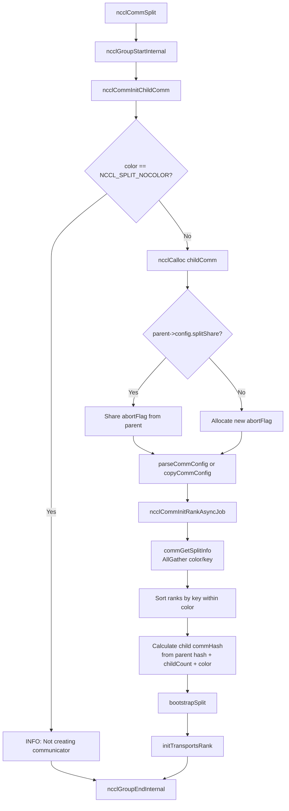
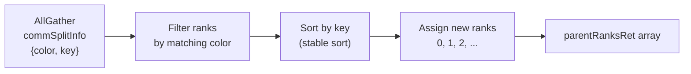
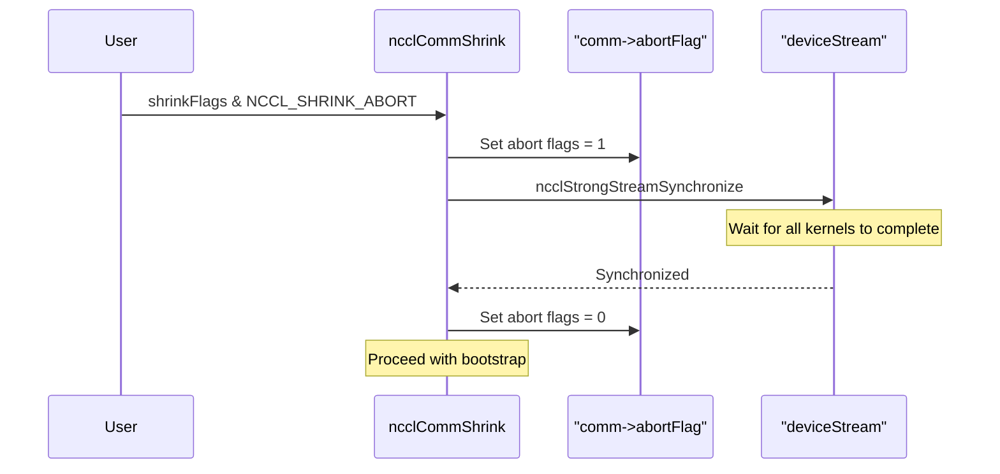
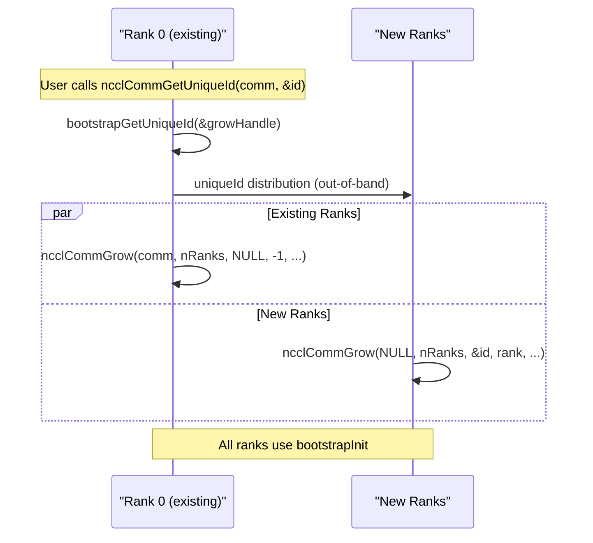
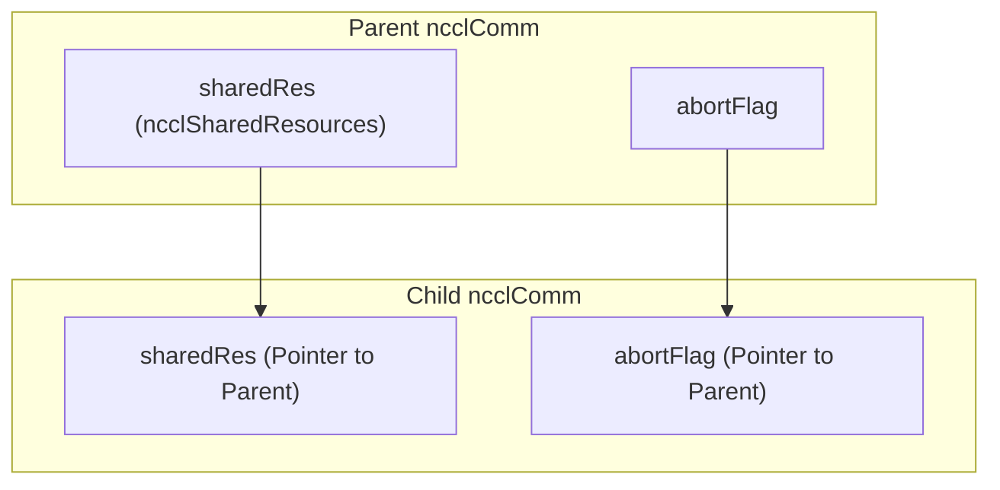
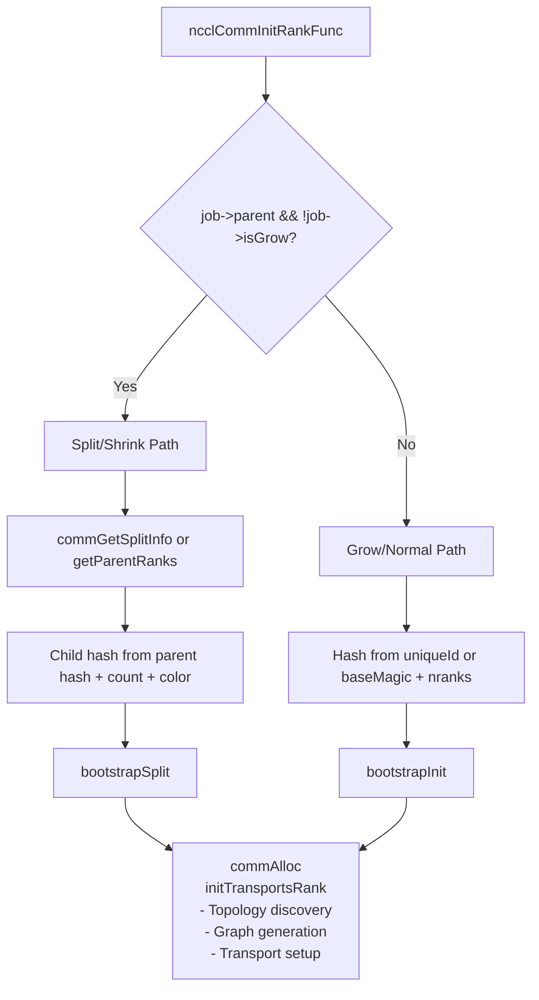

<!-- source: DeepWiki mcp.deepwiki.com · repo NVIDIA/nccl · page 2.3 Split, Shrink, and Grow Operations · fetched 2026-10-28 -->

# Split, Shrink, and Grow Operations

Relevant source files

The following files were used as context for generating this wiki page:

- [src/bootstrap.cc](src/bootstrap.cc)
- [src/channel.cc](src/channel.cc)
- [src/debug.cc](src/debug.cc)
- [src/group.cc](src/group.cc)
- [src/include/comm.h](src/include/comm.h)
- [src/include/enqueue.h](src/include/enqueue.h)
- [src/include/proxy.h](src/include/proxy.h)
- [src/include/transport.h](src/include/transport.h)
- [src/init.cc](src/init.cc)
- [src/proxy.cc](src/proxy.cc)
- [src/transport.cc](src/transport.cc)

## Purpose and Scope

This page documents NCCL's dynamic communicator management operations that allow creating new communicators from existing ones. These operations enable flexible partitioning, exclusion, and expansion of communication groups during runtime without requiring full reinitialization.

Three primary operations are covered:
- **Split**: Partition a communicator into multiple sub-communicators based on color and key.
- **Shrink**: Create a new communicator by excluding specific ranks.
- **Grow**: Expand a communicator to include additional ranks.

For information about initial communicator creation, see [Initialization and Bootstrap Process](2.1). For communicator lifecycle management, see [Lifecycle and State Management](2.2).

---

## Operation Overview

### Split, Shrink, and Grow Comparison

| Operation | API Function | Purpose | Rank Selection | Bootstrap Method |
|-----------|-------------|---------|----------------|------------------|
| **Split** | `ncclCommSplit` | Create sub-communicators | Color/key based grouping | `bootstrapSplit` |
| **Shrink** | `ncclCommShrink` | Exclude specific ranks | Explicit exclusion list | `bootstrapSplit` |
| **Grow** | `ncclCommGrow` | Add new ranks | Boundary rank coordination | `bootstrapInit` |

**Sources:** [src/init.cc:2989-3005](), [src/init.cc:2786-2806](), [src/init.cc:2825-2987]()

---

## Communicator Split Operation

### Split API and Semantics

The `ncclCommSplit` function partitions ranks into groups based on the `color` parameter. Within each color group, ranks are ordered by their `key` values. The special value `NCCL_SPLIT_NOCOLOR` indicates a rank should not join any new communicator. [src/init.cc:2989-3005]()

**Key Parameters:**
- `color`: Group identifier (same color = same communicator).
- `key`: Ordering within the group (lower keys get lower ranks).
- `newcomm`: Output pointer for the new communicator.
- `config`: Optional configuration (NULL uses parent config).

**Sources:** [src/init.cc:2989-3005]()

### Split Implementation Flow

The implementation relies on `ncclCommInitRankAsyncJob` to handle the heavy lifting of initialization in the background. [src/init.cc:1589-1715]()

**Sources:** [src/init.cc:2989-3005](), [src/init.cc:2691-2784](), [src/init.cc:1589-1715]()

### Split Rank Mapping Algorithm

The `commGetSplitInfo` function computes the new rank assignments by gathering metadata from all peers in the parent communicator. [src/init.cc:1532-1572]()

The algorithm:
1. Each rank broadcasts its `(color, key)` via `bootstrapAllGather` with the `BOOTSTRAP_TAG_COMMSPLIT` tag. [src/init.cc:1541-1546](), [src/bootstrap.cc:24-24]()
2. Ranks with matching color are collected into a local list. [src/init.cc:1551-1555]()
3. Within each color, ranks are sorted by key using a stable sort to maintain parent rank order for identical keys. [src/init.cc:1558-1568]()
4. New ranks are assigned sequentially (0, 1, 2, ...) in sorted order. [src/init.cc:1571]()

**Sources:** [src/init.cc:1532-1572](), [src/bootstrap.cc:24-24]()

---

## Communicator Shrink Operation

### Shrink API and Semantics

Shrink creates a new communicator by excluding specified ranks from the parent. Unlike split, all remaining ranks join a single new communicator. [src/init.cc:2786-2806]()

**Shrink Flags:**
- `NCCL_SHRINK_DEFAULT` (0): Normal shrink with optional resource sharing.
- `NCCL_SHRINK_ABORT`: Force parent to abort before creating child. [src/init.cc:2792-2796]()

**Sources:** [src/init.cc:2786-2806]()

### Shrink Error Handling Mode

When `NCCL_SHRINK_ABORT` is set, the parent communicator's state is invalidated to ensure no pending kernels interfere with the new communicator's initialization. [src/init.cc:2792-2796]()

**Sources:** [src/init.cc:2792-2796]()

---

## Communicator Grow Operation

### Grow API and Coordination

Grow involves **two categories of ranks**:
1. **Existing ranks** (`comm != NULL`): Ranks from the parent communicator.
2. **New ranks** (`comm == NULL`): Freshly joining ranks. [src/init.cc:2825-2987]()

### Coordination Protocol

**Sources:** [src/init.cc:2808-2823](), [src/init.cc:2825-2987]()

---

## Resource Sharing Mechanism

### Share vs. Non-Share Mode

Split and shrink support resource sharing to reduce memory footprint and context overhead. [src/init.cc:2724-2739]()

| Configuration Field | Environment Variable | Effect |
|---------------------|---------------------|--------|
| `config.splitShare` | `NCCL_COMM_SPLIT_SHARE_RESOURCES` | Share proxy, streams, abort flags. |
| `config.shrinkShare` | `NCCL_COMM_SHRINK_SHARE_RESOURCES` | Share proxy, streams, abort flags. |

**Sources:** [src/init.cc:2060-2077](), [src/init.cc:2724-2739]()

### Shared Resources Diagram

When sharing is enabled, the child communicator points to the parent's internal structures. [src/init.cc:2726-2730]()

Shared resources defined in `ncclSharedResources` include the `ncclProxyState` for network communication and the `ncclStrongStream` handles for host/device synchronization. [src/include/comm.h:126-154]()

**Sources:** [src/init.cc:2726-2730](), [src/include/comm.h:126-154]()

---

## Bootstrap Mechanisms

### Bootstrap Split vs. Bootstrap Init

| Operation | Bootstrap Function | Parent Bootstrap | Unique ID Source |
|-----------|-------------------|------------------|------------------|
| Split/Shrink | `bootstrapSplit` | Reused | Derived from parent hash. |
| Grow | `bootstrapInit` | New instance | External `ncclUniqueId`. |

**Sources:** [src/init.cc:1643](), [src/init.cc:1667]()

### Bootstrap Split Implementation

`bootstrapSplit` leverages the existing out-of-band network established by the parent. It creates a virtual partition within the existing socket infrastructure using `BOOTSTRAP_TAG_COMMSPLIT`. [src/bootstrap.cc:24-24](), [src/init.cc:1643-1643]()

---

## Initialization Path Convergence

All three operations converge at `ncclCommInitRankFunc`, which performs the standard initialization sequence:

**Sources:** [src/init.cc:1589-1715](), [src/init.cc:879-1480]()

### Initialization Phases

The `initTransportsRank` function performs:
- **Topology Discovery**: Hardware probing via `ncclTopoGetSystem`. [src/init.cc:1115]()
- **Graph Generation**: Computing rings and trees via `ncclTopoCompute`. [src/init.cc:1145]()
- **Transport Selection**: Assigning P2P, SHM, or NET transports via `selectTransport`. [src/transport.cc:23-44]()
- **Connection Setup**: Establishing data plane connections via `ncclTransportP2pSetup`. [src/transport.cc:125-243]()

**Sources:** [src/init.cc:879-1480](), [src/transport.cc:23-243]()

---

