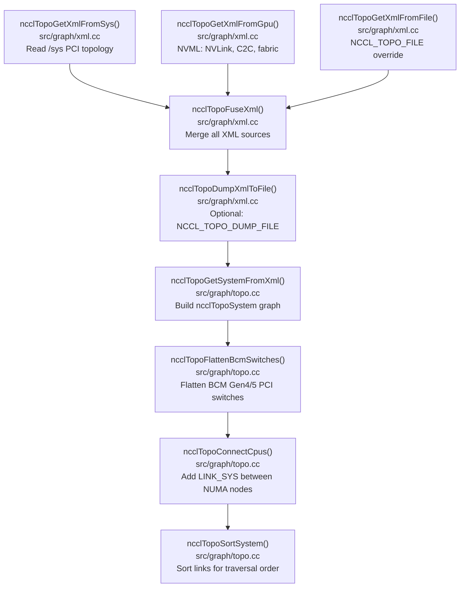
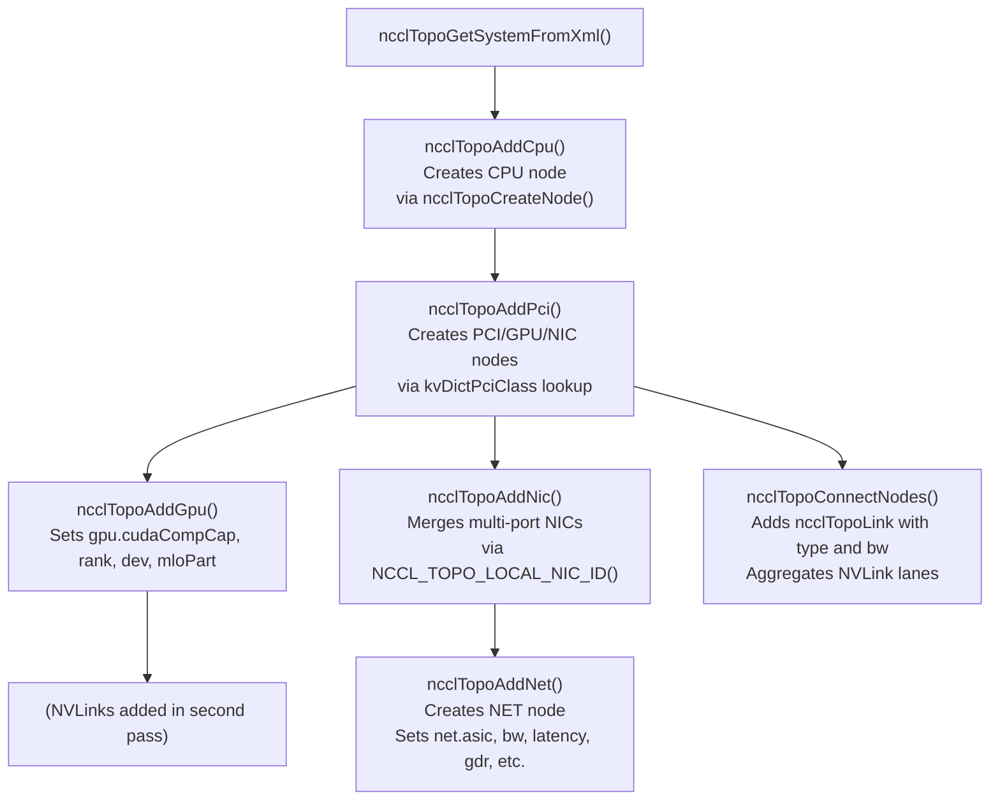
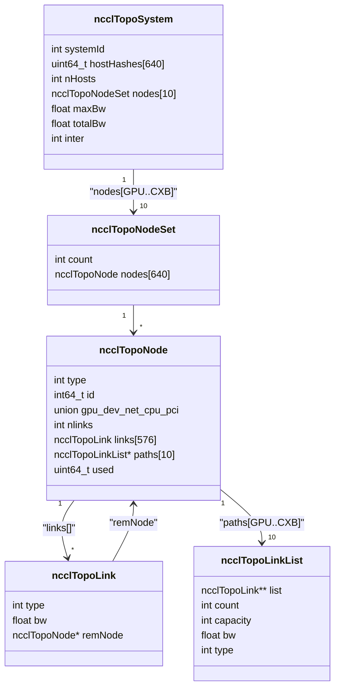

<!-- source: DeepWiki mcp.deepwiki.com · repo NVIDIA/nccl · page 3.1 Hardware Discovery and XML Configuration · fetched 2026-10-28 -->

# Hardware Discovery and XML Configuration

<details>
<summary>Relevant source files</summary>

The following files were used as context for generating this wiki page:

- [makefiles/version.mk](makefiles/version.mk)
- [src/diagnostics.h](src/diagnostics.h)
- [src/graph/paths.cc](src/graph/paths.cc)
- [src/graph/search.cc](src/graph/search.cc)
- [src/graph/topo.cc](src/graph/topo.cc)
- [src/graph/topo.h](src/graph/topo.h)
- [src/graph/xml.cc](src/graph/xml.cc)
- [src/graph/xml.h](src/graph/xml.h)
- [src/include/cudawrap.h](src/include/cudawrap.h)
- [src/include/graph.h](src/include/graph.h)
- [src/include/ibvsymbols.h](src/include/ibvsymbols.h)
- [src/include/ibvwrap.h](src/include/ibvwrap.h)
- [src/include/nvmlwrap.h](src/include/nvmlwrap.h)
- [src/misc/cudawrap.cc](src/misc/cudawrap.cc)
- [src/misc/ibvsymbols.cc](src/misc/ibvsymbols.cc)
- [src/misc/ibvwrap.cc](src/misc/ibvwrap.cc)
- [src/misc/nvmlwrap.cc](src/misc/nvmlwrap.cc)
- [src/ras/CMakeLists.txt](src/ras/CMakeLists.txt)
- [src/ras/diagnostics.cc](src/ras/diagnostics.cc)
- [src/ras/diagnostics.h](src/ras/diagnostics.h)
- [src/ras/diagnostics_checks.h](src/ras/diagnostics_checks.h)
- [src/ras/diagnostics_checks_common.cc](src/ras/diagnostics_checks_common.cc)
- [src/ras/diagnostics_checks_common.h](src/ras/diagnostics_checks_common.h)
- [src/ras/diagnostics_env.cc](src/ras/diagnostics_env.cc)
- [src/ras/diagnostics_gpu.cc](src/ras/diagnostics_gpu.cc)
- [src/transport/coll_net.cc](src/transport/coll_net.cc)
- [src/transport/net.cc](src/transport/net.cc)
- [src/transport/p2p.cc](src/transport/p2p.cc)

</details>


## Purpose and Scope

This page describes how NCCL discovers the physical hardware topology and converts it into the `ncclTopoSystem` graph that drives all subsequent communication optimization. Specifically, it covers:

- Reading PCI topology from the Linux sysfs filesystem.
- Querying NVML for NVLink and C2C connections.
- Loading and merging a user-supplied topology override via `NCCL_TOPO_FILE`.
- The XML intermediate representation that bridges raw hardware data to a typed graph.
- The `ncclTopoSystem` data structures—nodes, links, and path type classifications.

For how this graph is used to compute shortest paths between devices, see [Path Computation and Graph Search](3.2). For how it drives algorithm and channel selection, see [Performance Tuning and Algorithm Selection](3.3).

---

## Discovery Pipeline

Hardware discovery happens during communicator initialization and produces a fully populated `ncclTopoSystem`. It is implemented across `src/graph/xml.cc` (sysfs reading, XML parsing, and NVML queries) and `src/graph/topo.cc` (converting XML to the graph structure).

**Figure 1: Hardware Discovery Pipeline**



Sources: [src/graph/topo.cc:521-558](), [src/graph/topo.cc:186-264](), [src/graph/topo.cc:311-341]()

---

## XML Intermediate Representation

NCCL uses an XML document as an intermediate format between raw hardware data and the typed `ncclTopoSystem` graph.

### XML Document Schema

The document structure mirrors the physical hierarchy: NUMA CPU nodes at the root, PCI subtrees hanging below each CPU, and GPU/NIC leaf devices at the bottom.

**Figure 2: XML Element Hierarchy**

```mermaid
graph TD
    SYS["\"<system version=...>\""]
    CPU["\"<cpu numaid=N arch=x86_64|arm64|ppc64\n vendor=... host_hash=... affinity=...>\""]
    PCI["\"<pci busid=... class=... vendor=...\n device=... link_width=N link_speed=...>\""]
    PCI2["\"<pci ...> (recursive for switches)\""]
    GPU["\"<gpu sm=N rank=N dev=N gdr=0|1>\""]
    NVL["\"<nvlink target=BUSID count=N speed=N>\""]
    C2C["\"<c2c ...>\""]
    NIC["\"<nic>\""]
    NET["\"<net dev=N guid=... speed=N latency=...\n port=N gdr=0|1 maxconn=N coll=0|1>\""]
    PCIL["\"<pcilink> (BCM virtual links)\""]

    SYS --> CPU
    CPU --> PCI
    PCI --> PCI2
    PCI --> GPU
    GPU --> NVL
    GPU --> C2C
    PCI --> NIC
    NIC --> NET
    PCI --> PCIL
```

Sources: [src/graph/topo.h:174-180](), [src/graph/topo.cc:521-558]()

---

## sysfs PCI Topology Discovery

NCCL walks the Linux sysfs PCI bus hierarchy to enumerate all PCI devices visible to the system.

For each NUMA node found under `/sys/devices/system/node/`, a `<cpu>` XML element is created. The discovery logic fills in CPU architecture and affinity:

- Architecture is determined by compile-time macros (`__x86_64__`, `__aarch64__`, `__PPC__`).
- On x86, vendor and family/model IDs are detected to set bandwidth constants like `BDW_QPI_BW` or `SKL_QPI_BW` [src/graph/topo.cc:60-85]().

Below each CPU, PCI devices are discovered. NCCL reads files from each device's sysfs directory (e.g., `class`, `vendor`, `device`, `current_link_width`, `current_link_speed`) and stores them as XML attributes.

Sources: [src/graph/topo.cc:60-85](), [src/graph/topo.h:17-38]()

---

## NVML GPU and NVLink Discovery

NCCL augments the sysfs-derived XML with GPU-specific information available through NVML:

- **NVLink connections**: For each GPU, NVML is queried for active NVLink lanes. Each connection becomes an `<nvlink>` child element under the `<gpu>` element, recording the target GPU's bus ID, lane count, and speed.
- **C2C connections**: On platforms using chip-to-chip (C2C) interconnects (e.g., Grace-Hopper), NVML reports these as `<c2c>` elements [src/graph/topo.cc:87-92]().
- **GPU fabric info**: On MNNVL (Multi-Node NVLink) systems, NVML provides fabric data used to verify fabric cliques.

Sources: [src/graph/topo.cc:87-92](), [src/graph/paths.cc:395-413]()

---

## User XML Override: `NCCL_TOPO_FILE`

Users can supply an XML file to override or augment auto-detected topology by setting the `NCCL_TOPO_FILE` environment variable.

The user file is **merged** into the auto-detected XML using `ncclTopoFuseXml` [src/graph/xml.cc:66-66](). This recursive tree merge allows users to add missing devices or override specific attributes (like `link_speed` or `gdr` support) while preserving auto-detected topology.

Sources: [src/graph/xml.cc:66-66](), [src/graph/search.cc:13-14]()

---

## Building the `ncclTopoSystem` Graph

`ncclTopoGetSystemFromXml()` [src/graph/topo.cc:521-558]() converts the merged XML tree into typed C graph structures. It iterates over `<cpu>` nodes and calls `ncclTopoAddCpu()`, which recursively processes the PCI subtree.

**Figure 3: XML-to-Graph Conversion Functions**



Sources: [src/graph/topo.cc:104-137](), [src/graph/topo.cc:175-190]()

### PCI Class to Node Type Mapping

NCCL maps PCI class codes to graph node types defined in `topo.h`:

| PCI Class Code | Node Type | Description |
|----------------|-----------|-------------|
| `0x060400` | `PCI` | PCI-to-PCI bridge / switch |
| `0x068000` | `NVS` | NVLink switch |
| `0x03xxxx` | `GPU` | Display / GPU class |
| `0x02xxxx` | `NIC` | Network class |

Sources: [src/graph/topo.h:44-53](), [src/graph/xml.h:18-20]()

---

## The `ncclTopoSystem` Data Model

**Figure 4: Core Topology Data Structures**



Sources: [src/graph/topo.h:159-172](), [src/graph/topo.h:73-77](), [src/graph/topo.h:82-88](), [src/graph/topo.h:106-157]()

### Node Type Constants

Defined in `src/graph/topo.h:44-53`:

| Constant | Value | Represents |
|----------|-------|-----------|
| `GPU` | 0 | NVIDIA GPU |
| `PCI` | 1 | PCI switch or bridge |
| `NVS` | 2 | NVLink switch |
| `CPU` | 3 | NUMA domain |
| `NIC` | 4 | Network interface controller |
| `NET` | 5 | Logical network device |
| `GIN` | 6 | GPU-Initiated Networking |
| `RMA` | 7 | Remote Memory Access |
| `DEV` | 8 | Physical GPU device partition |
| `CXB` | 9 | C2C Cross-Bridge |

### Path Type Constants

Path types classify the worst-case interconnect traversed between two nodes. These are computed by `ncclTopoSetPaths()` using a BFS traversal [src/graph/paths.cc:52-147]().

Defined in `src/include/graph.h:120-157`:

| Constant | Value | Meaning |
|----------|-------|---------|
| `PATH_LOC` | 0 | Same device |
| `PATH_NVL` | 1 | Direct NVLink |
| `PATH_NVB` | 2 | NVLink via intermediate GPU |
| `PATH_C2C` | 3 | Chip-to-Chip interconnect |
| `PATH_PIX` | 4 | Single PCIe bridge |
| `PATH_PXB` | 5 | Multiple PCIe bridges |
| `PATH_P2C` | 6 | GPU to NIC via C2C + PCI |
| `PATH_PXN` | 7 | GPU to NIC via intermediate GPU |
| `PATH_PHB` | 8 | Through PCIe host bridge (CPU) |
| `PATH_SYS` | 9 | Through NUMA interconnect (QPI/UPI) |
| `PATH_NET` | 10 | Over network |

Sources: [src/graph/paths.cc:52-147](), [src/include/graph.h:120-157]()

---

## Bandwidth and Latency Constants

`src/graph/topo.h` defines default bandwidths used during graph construction:

| Interconnect | BW (GB/s) | Macro |
|---|---|---|
| Local Memory | 5000.0 | `LOC_BW` |
| PCI Gen3 x16 | 12.0 | `PCI_BW` |
| NVLink (Ampere) | 20.0 | `SM80_NVLINK_BW` |
| NVLink (Hopper) | 20.6 | `SM90_NVLINK_BW` |
| NVLink (Blackwell) | 40.1 | `SM100_NVLINK_BW` |
| Intel SKL QPI | 10.0 | `SKL_QPI_BW` |

Sources: [src/graph/topo.h:17-37]()

---

## Environment Variables

| Variable | Effect |
|----------|--------|
| `NCCL_TOPO_FILE` | Path to XML file merged into auto-detected topology. |
| `NCCL_TOPO_DUMP_FILE` | If set, writes the final merged XML to this path. |
| `NCCL_NVB_DISABLE` | Disables NVLink-via-bridge (PATH_NVB) routing [src/graph/paths.cc:36-36](). |
| `NCCL_CROSS_NIC` | Controls whether communication can cross between different NICs [src/graph/search.cc:16-16](). |

Sources: [src/graph/paths.cc:36-36](), [src/graph/search.cc:16-16](), [src/include/graph.h:24-24]()

---

