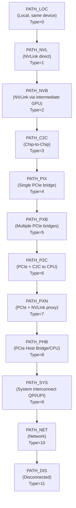
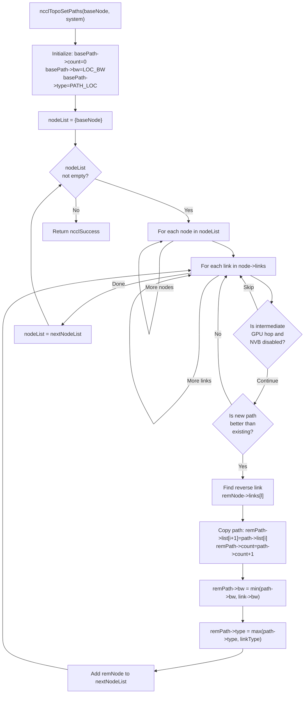
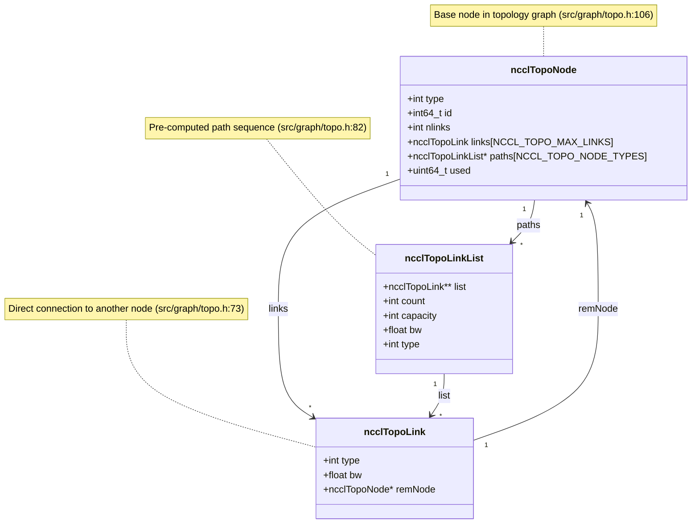
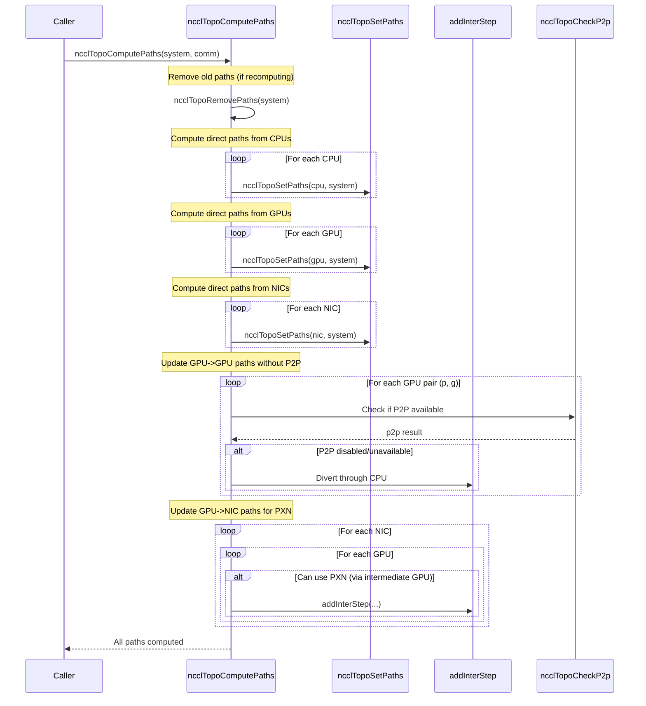
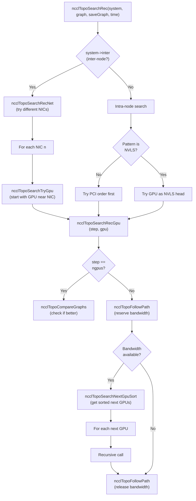
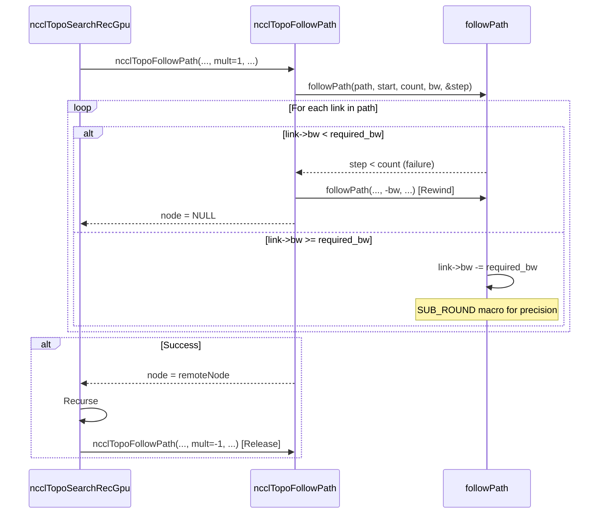
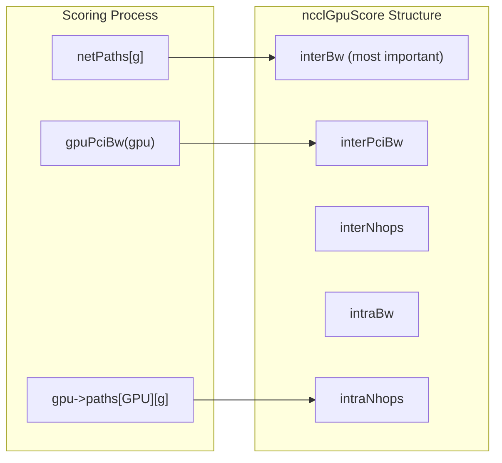

<!-- source: DeepWiki mcp.deepwiki.com · repo NVIDIA/nccl · page 3.2 Path Computation and Graph Search · fetched 2026-10-28 -->

# Path Computation and Graph Search

Relevant source files

The following files were used as context for generating this wiki page:

- [makefiles/version.mk](makefiles/version.mk)
- [src/graph/connect.cc](src/graph/connect.cc)
- [src/graph/paths.cc](src/graph/paths.cc)
- [src/graph/search.cc](src/graph/search.cc)
- [src/graph/topo.cc](src/graph/topo.cc)
- [src/graph/topo.h](src/graph/topo.h)
- [src/include/graph.h](src/include/graph.h)
- [src/transport/coll_net.cc](src/transport/coll_net.cc)
- [src/transport/net.cc](src/transport/net.cc)
- [src/transport/p2p.cc](src/transport/p2p.cc)

This document describes NCCL's path computation and graph search subsystems, which determine optimal communication routes between GPUs and NICs. After the topology is discovered (page 3.1), path computation runs a breadth-first search (BFS) from each node to pre-compute all paths with their bandwidths and types. Graph search then uses these paths to recursively find optimal communication patterns (rings, trees, NVLS) that maximize bandwidth utilization while respecting link capacities. For topology tuning and algorithm selection based on these computed paths, see page 3.3.

## Path Computation Overview

Path computation is implemented in [src/graph/paths.cc]() and operates in two phases:

1.  **BFS Path Discovery** ([src/graph/paths.cc:52-147]()): For each GPU, NIC, and CPU node, run breadth-first search to discover all reachable nodes, computing path bandwidth, hop count, and path type.
2.  **Path Storage** ([src/graph/paths.cc:645-771]()): Store pre-computed paths in `ncclTopoNode->paths[type]` arrays for fast lookup during graph search and connection setup.

Path types are defined in [src/include/graph.h:120-157]() and represent connection quality, from best (`PATH_LOC`) to worst (`PATH_DIS`).

**Sources:** [src/graph/paths.cc:1-147](), [src/include/graph.h:120-157]()

## Path Type Hierarchy

Path types are ordered by preference, with lower numeric values indicating faster, more direct connections. The `ncclTopoLinkList->type` field ([src/graph/topo.h:87]()) stores the maximum (worst) path type encountered along a path.

**Sources:** [src/include/graph.h:120-157](), [src/graph/topo.h:82-88]()

## BFS Path Computation

The `ncclTopoSetPaths` function implements breadth-first search from a base node to discover all paths:

Key features of the BFS algorithm ([src/graph/paths.cc:52-147]()):

| Feature | Implementation | Location |
| :--- | :--- | :--- |
| Queue Management | Two alternating `ncclTopoNodeList` structs | [src/graph/paths.cc:59-60]() |
| Bandwidth Calculation | `std::min(path->bw, link->bw)` at each hop | [src/graph/paths.cc:85]() |
| Path Type | `std::max(path->type, newType)` - worst link wins | [src/graph/paths.cc:108]() |
| NVB Routing | Restricted intermediate hops via `DEV` nodes | [src/graph/paths.cc:92-96]() |
| Reverse Link | Find link from `remNode` back to `node` | [src/graph/paths.cc:114-126]() |

**Sources:** [src/graph/paths.cc:52-147](), [src/graph/paths.cc:19-34]()

## Path Data Structures

The `paths` array is indexed as `node->paths[targetType][targetIndex]`, where:
*   `targetType`: GPU, NET, CPU, etc. ([src/graph/topo.h:44-53]())
*   `targetIndex`: Index within `system->nodes[targetType].nodes[]`

Example: `gpu->paths[NET][3]` contains the pre-computed path from this GPU to the 4th NIC in the system.

**Sources:** [src/graph/topo.h:73-157](), [src/graph/topo.h:82-88]()

## Path Computation Entry Point

The `ncclTopoComputePaths` function orchestrates path computation for all nodes:

The function handles special cases ([src/graph/paths.cc:645-771]()):

| Case | Action | Reason |
| :--- | :--- | :--- |
| GPU P2P disabled | Reroute through CPU | `ncclTopoCheckP2p` reports no P2P |
| Transport unavailable | Mark as `PATH_NET` | Neither P2P nor local transport works |
| GDR unavailable | Reroute through CPU | `ncclTopoCheckGdr` reports no GDR |
| PXN opportunity | Add intermediate GPU | Better bandwidth via NVLink proxy ([src/graph/paths.cc:740-752]()) |

**Sources:** [src/graph/paths.cc:645-771](), [src/graph/paths.cc:185-201]()

## Graph Search Overview

Graph search finds optimal communication patterns by recursively exploring GPU and NIC orderings. The search is implemented in [src/graph/search.cc]() and consists of three main functions:

| Function | Purpose | Lines |
| :--- | :--- | :--- |
| `ncclTopoSearchRec` | Entry point, dispatches to GPU or NET search | [src/graph/search.cc:784-812]() |
| `ncclTopoSearchRecNet` | Try different starting NICs for inter-node | [src/graph/search.cc:669-751]() |
| `ncclTopoSearchRecGpu` | Recursively try GPUs in order for a channel | [src/graph/search.cc:576-667]() |

**Sources:** [src/graph/search.cc:784-812](), [src/graph/search.cc:669-751](), [src/graph/search.cc:576-667]()

## Recursive Search Algorithm

The search maintains a `time` budget to prevent infinite loops ([src/graph/search.cc:315-318]()).

**Sources:** [src/graph/search.cc:784-812](), [src/graph/search.cc:576-667]()

## Bandwidth Reservation with `ncclTopoFollowPath`

The search uses bandwidth reservation to ensure links aren't over-subscribed:

Key aspects of bandwidth reservation ([src/graph/search.cc:81-172]()):

| Aspect | Implementation | Location |
| :--- | :--- | :--- |
| Float precision | `SUB_ROUND(a, b)` macro | [src/graph/search.cc:79]() |
| PCI overhead | Intel CPUs have 6/5 overhead for P2P | [src/graph/search.cc:88-91]() |
| GPU read overhead | Pre-Ampere GPUs: 1/8 reverse bandwidth | [src/graph/search.cc:101-104]() |
| POWER NVLink | Full reverse bandwidth on POWER CPUs | [src/graph/search.cc:105-108]() |

**Sources:** [src/graph/search.cc:79-172]()

## GPU Scoring and Search Order

The `ncclTopoSearchNextGpuSort` function scores GPUs to determine search order:

The `cmpScore` comparison function ([src/graph/search.cc:192-201]()) prioritizes `interBw` (highest), then `interPciBw`, `interNhops` (lowest), `intraBw`, and `intraNhops`.

**Sources:** [src/graph/search.cc:242-310](), [src/graph/search.cc:181-210]()

## Path Validation: P2P and GDR Checking

### P2P Validation
`ncclTopoCheckP2p` ([src/graph/paths.cc:272-388]()) validates GPU-to-GPU P2P connectivity, checking host hashes, `MNNVL` support ([src/graph/paths.cc:286-293]()), path distance vs. `NCCL_P2P_LEVEL`, and NVML P2P status.

### GDR Validation
`ncclTopoCheckGdr` ([src/graph/paths.cc:418-485]()) validates GPU Direct RDMA, checking NIC/GPU GDR support, read mode compatibility, and topological distance.

**Sources:** [src/graph/paths.cc:272-388](), [src/graph/paths.cc:418-485]()

## Graph Comparison and Selection

`ncclTopoCompareGraphs` ([src/graph/search.cc:419-438]()) determines if a newly found graph is better than the saved one, prioritizing total bandwidth (`nChannels * bwIntra`) and then minimizing hop count.

**Sources:** [src/graph/search.cc:419-438]()

---

