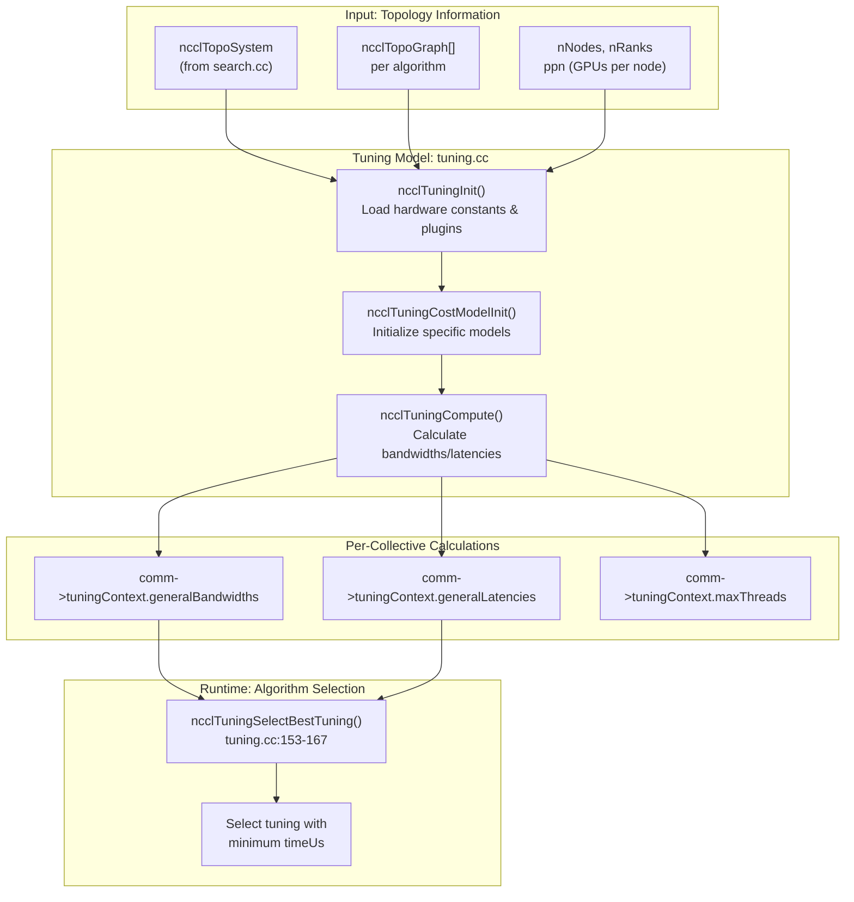
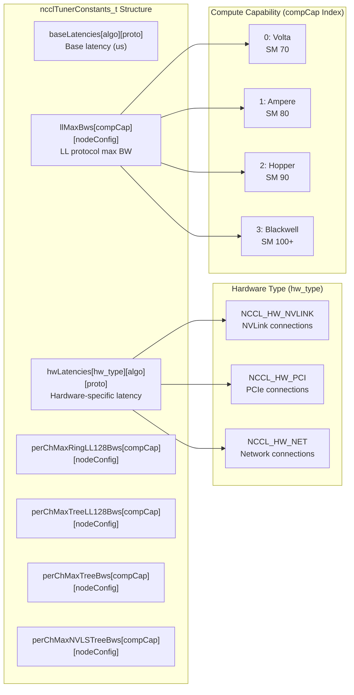

<!-- source: DeepWiki mcp.deepwiki.com · repo NVIDIA/nccl · page 3.3 Performance Tuning and Algorithm Selection · fetched 2026-10-28 -->

# Performance Tuning and Algorithm Selection

<details>
<summary>Relevant source files</summary>

The following files were used as context for generating this wiki page:

- [src/ce_coll.cc](src/ce_coll.cc)
- [src/config/CMakeLists.txt](src/config/CMakeLists.txt)
- [src/config/algorithm_parser.cc](src/config/algorithm_parser.cc)
- [src/config/algorithm_registry.cc](src/config/algorithm_registry.cc)
- [src/config/collconfig.cc](src/config/collconfig.cc)
- [src/enqueue/CMakeLists.txt](src/enqueue/CMakeLists.txt)
- [src/enqueue/enqueue.cc](src/enqueue/enqueue.cc)
- [src/enqueue/mgmt_task_enq.cc](src/enqueue/mgmt_task_enq.cc)
- [src/enqueue/task_prep/task_classify.cc](src/enqueue/task_prep/task_classify.cc)
- [src/enqueue/task_prep/task_posttuning.cc](src/enqueue/task_prep/task_posttuning.cc)
- [src/enqueue/task_prep/task_prep.cc](src/enqueue/task_prep/task_prep.cc)
- [src/enqueue/task_prep/task_pretuning.cc](src/enqueue/task_prep/task_pretuning.cc)
- [src/include/ce_coll.h](src/include/ce_coll.h)
- [src/include/config/algorithm_parser.h](src/include/config/algorithm_parser.h)
- [src/include/config/algorithm_registry.h](src/include/config/algorithm_registry.h)
- [src/include/config/collconfig.h](src/include/config/collconfig.h)
- [src/include/rma/rma_ce.h](src/include/rma/rma_ce.h)
- [src/include/tuning.h](src/include/tuning.h)
- [src/rma/rma_ce.cc](src/rma/rma_ce.cc)
- [src/tuning/CMakeLists.txt](src/tuning/CMakeLists.txt)
- [src/tuning/collnet.cc](src/tuning/collnet.cc)
- [src/tuning/cost_model.cc](src/tuning/cost_model.cc)
- [src/tuning/cost_model.h](src/tuning/cost_model.h)
- [src/tuning/nvls.cc](src/tuning/nvls.cc)
- [src/tuning/ring.cc](src/tuning/ring.cc)
- [src/tuning/tree.cc](src/tuning/tree.cc)
- [src/tuning/tuning.cc](src/tuning/tuning.cc)
- [src/tuning/tuning_general.cc](src/tuning/tuning_general.cc)

</details>


## Purpose and Scope

This page documents how NCCL selects optimal communication algorithms and protocols based on hardware topology and how it calculates performance parameters (bandwidth, latency) for different collective operations. The tuning model determines which algorithms (Ring, Tree, NVLS, CollNet, PAT) and protocols (LL, LL128, Simple) to use for various message sizes and system configurations.

For information about topology discovery and path computation that feeds into this tuning process, see [Hardware Discovery and XML Configuration](3.1) and [Path Computation and Graph Search](3.2). For information about how the selected algorithms are implemented in channels, see [Connection Setup and Channel Configuration](3.4).

## Overview

NCCL's performance tuning system operates in two phases:

1.  **Graph Search Phase**: Computes topology graphs with bandwidth and path information for each algorithm [src/graph/search.cc:39-53]().
2.  **Tuning Model Phase**: Calculates effective bandwidths and latencies for each collective/algorithm/protocol combination based on hardware characteristics [src/tuning/tuning.cc:44-105]().

The tuning model uses topology information (number of nodes, GPUs per node, NVLink topology, network bandwidth) combined with hardware-specific constants to predict performance. These predictions guide runtime algorithm selection during collective operations.

### Tuning Flow Architecture

The following diagram maps the logical tuning flow to the code entities in `tuning.cc`.



**Sources**: [src/tuning/tuning.cc:44-105](), [src/tuning/tuning.cc:153-167](), [src/tuning/tuning.cc:174-222]()

## Tuning Constants Architecture

NCCL maintains hardware-specific tuning constants for different GPU architectures (Volta, Ampere, Hopper, Blackwell) and system configurations. These constants are defined in the `ncclTunerConstants_t` structure [src/tuning/cost_model.h:46-63]().

### Hardware Constants Mapping

This diagram bridges the natural language hardware concepts to the indices and structures used in `cost_model.cc`.



The default tuning constants are defined in [src/tuning/cost_model.cc:141-204](). For example:

| Constant | Description | Example Value (Hopper) |
|----------|-------------|---------------|
| `baseLatencies[RING][SIMPLE]` | Base Ring/Simple latency | 8.4 us [src/tuning/cost_model.cc:145]() |
| `hwLatencies[NVLINK][RING][SIMPLE]` | NVLink Ring latency | 3.4 us [src/tuning/cost_model.cc:157]() |
| `llMaxBws[HOPPER][0]` | Hopper single-node LL max BW | 141.0 GB/s [src/tuning/cost_model.cc:189]() |
| `perChMaxTreeBws[HOPPER][1]` | Hopper 2-node Tree per-channel BW | 41.4 GB/s [src/tuning/cost_model.cc:202]() |

**Sources**: [src/tuning/cost_model.cc:141-204](), [src/tuning/cost_model.h:46-63]()

## Bandwidth Calculation Process

The tuning model calculates effective bandwidth for each collective/algorithm/protocol combination in algorithm-specific model files (e.g., `ring.cc`, `tree.cc`, `nvls.cc`).

### Key Bandwidth Refinements

*   **Ring Algorithm** [src/tuning/ring.cc:37-46]():
    *   **LL Protocol**: Limited to 50% efficiency due to 2x data transmission, capped at `llMaxBw`.
    *   **LL128 Protocol**: ~92% efficiency (120/128 payload ratio), per-channel limit applied.
    *   **Simple Protocol**: Uses `bwIntra` or `bwInter` from topology graphs.
*   **Tree Algorithm** [src/tuning/tree.cc:37-48]():
    *   **LL Protocol**: ~1/3.8 efficiency due to serialization.
    *   **LL128 Protocol**: 7/9 efficiency (single-node) or 120/128 (multi-node).
*   **NVLS Algorithm** [src/tuning/nvls.cc:63-74]():
    *   Efficiency factors: Hopper=0.85, Blackwell=0.74 [src/tuning/nvls.cc:12-17]().
    *   Accounts for `(nChannels-1)/nChannels` NVLS characteristic.
    *   For AllReduce, intra-node bandwidth is multiplied by 2.0.
*   **CollNet Direct** [src/tuning/collnet.cc:53-61]():
    *   GPU/NIC ratio adjustment: `factor = ppn / nChannels`.
    *   For AllGather/ReduceScatter: `busBw = ppn * min(bwIntra, bwInter * 0.9)`.

**Sources**: [src/tuning/ring.cc:34-46](), [src/tuning/nvls.cc:63-74](), [src/tuning/collnet.cc:53-61]()

## Latency Calculation Process

Latency combines base, hardware, and topology-specific components in algorithm-specific `ModelInit` functions.

### Algorithm-Specific Latency Logic

*   **Ring Algorithm** [src/tuning/ring.cc:52-87](): Latency depends on whether all steps go through the same hardware type. Multi-node adds inter-node overhead steps: `2*(nNodes-1)` for AllReduce.
*   **Tree Algorithm** [src/tuning/tree.cc:82](): Uses logarithmic scaling for multi-node: `2 * ((nRanks/nNodes - 1) * intraLat + log2i(nNodes) * interLat)`.
*   **Network Overhead** [src/tuning/ring.cc:14-19](): Includes network post overhead based on CPU architecture (Intel: 1.0 us, AMD: 2.0 us).
*   **NVLS Tree** [src/tuning/nvls.cc:121](): Calculates latency as `intraLat + 2 * log2i(nNodes) * interLat`.

**Sources**: [src/tuning/ring.cc:52-87](), [src/tuning/nvls.cc:108-123](), [src/tuning/ring.cc:14-19]()

## Thread and Channel Configuration

NCCL configures the number of CUDA threads and channels based on message size and protocol thresholds.

### Thread Thresholds

Thread thresholds determine when to increase thread count based on message size. These are stored in `comm->tuningContext.threadThresholds[algo][proto]` [src/tuning/tuning_general.cc:106-114]().

| Algorithm | Protocol | Default Threshold (bytes) |
|-----------|----------|---------------------------|
| Tree/Ring | LL       | 256 [src/tuning/tuning_general.cc:107]() |
| Tree/Ring | LL128    | 640 [src/tuning/tuning_general.cc:108]() |
| Tree/Ring | Simple   | 1024 [src/tuning/tuning_general.cc:109]() |
| CollNet   | Simple   | 512 [src/tuning/tuning_general.cc:112]() |

### Channel Selection

`ncclTuningGetChannels` determines the number of channels to use for a specific operation [src/tuning/tuning_general.cc:140-176](). For CollNet, it iteratively reduces the channel count if the message size is smaller than the product of `nc * nt * heads * threshold` [src/tuning/tuning_general.cc:148-154]().

**Sources**: [src/tuning/tuning_general.cc:106-114](), [src/tuning/tuning_general.cc:140-176]()

## Algorithm and Protocol Selection

At runtime, NCCL selects algorithms by computing expected time for each option using `ncclTuningGetTime` [src/tuning/tuning_general.cc:52-65]().

```c
// Calculation logic from src/tuning/tuning_general.cc:64
return (*lat * latCount + inputs->nBytes / (1000 * (*bw))) * precision_ratio;
```

### Tree Correction Factors

Tree algorithms use empirical correction factors `treeCorrectionFactor` for medium message sizes on specific CPU architectures [src/tuning/nvls.cc:159-165]().

**Sources**: [src/tuning/tuning_general.cc:52-65](), [src/tuning/nvls.cc:159-165]()

## Algorithm Enable/Disable Logic

Algorithms can be disabled based on topology or configuration:

*   **NVLS**: Disabled if `nvlsSupport` is false [src/tuning/nvls.cc:21]().
*   **CollNet**: Disabled if `ncclCollNet` is not initialized [src/tuning/collnet.cc:13]().
*   **LL128 Protocol**: The function `isLL128Enabled` checks for Hopper+ (SM90) compatibility and path types (typically `PATH_NVB` intra-node and `PATH_PXN` inter-node) [src/tuning/cost_model.cc:118-138]().

**Sources**: [src/tuning/nvls.cc:21-41](), [src/tuning/collnet.cc:13-35](), [src/tuning/cost_model.cc:118-138]()

## User Configuration and Overrides

Users can override tuning decisions via environment variables. The `parseList` function [src/tuning/cost_model.cc:32-114]() handles the complex prefix-element syntax for `NCCL_ALGO` and `NCCL_PROTO`.

### Environment Variables

*   `NCCL_ALGO`: Select algorithms (e.g., `ring`, `tree`, `nvls`).
*   `NCCL_PROTO`: Select protocols (e.g., `LL`, `LL128`, `Simple`).
*   `NCCL_NTHREADS`: Override default thread count [src/tuning/tuning_general.cc:12]().
*   `NCCL_LL128_NTHREADS`: Override LL128 thread count [src/tuning/tuning_general.cc:13]().
*   `NCCL_THREAD_THRESHOLDS`: Override default thread thresholds [src/tuning/tuning_general.cc:116]().

**Sources**: [src/tuning/cost_model.cc:32-114](), [src/tuning/tuning_general.cc:12-13](), [src/tuning/tuning_general.cc:116-126]()

## Tuner Plugin API

NCCL supports external tuning plugins via the `ncclTuner_t` interface.

*   **Loading**: NCCL loads the tuner plugin specified by `NCCL_TUNER_PLUGIN` via `ncclTunerPluginLoad` [src/tuning/tuning.cc:47]().
*   **Interaction**: Core NCCL calls `comm->tuner->init` to provide topology information (`nvlDomainInfo`) and hardware constants [src/tuning/tuning.cc:49-52]().

**Sources**: [src/tuning/tuning.cc:47-52](), [src/include/tuning.h:13]()

---

