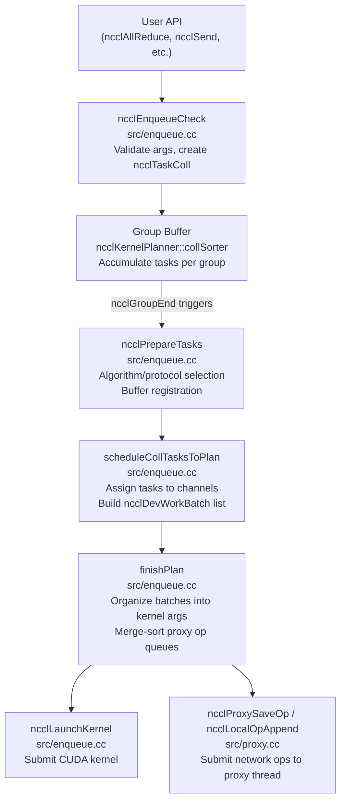
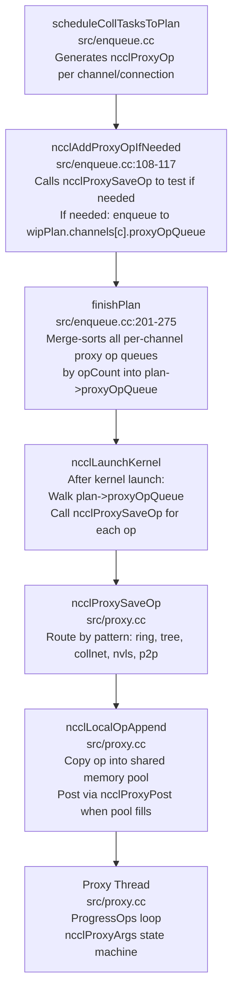

<!-- source: DeepWiki mcp.deepwiki.com · repo NVIDIA/nccl · page 4 Communication Pipeline · fetched 2026-10-28 -->

# Communication Pipeline

Relevant source files

The following files were used as context for generating this wiki page:

- [src/bootstrap.cc](src/bootstrap.cc)
- [src/ce_coll.cc](src/ce_coll.cc)
- [src/debug.cc](src/debug.cc)
- [src/enqueue/CMakeLists.txt](src/enqueue/CMakeLists.txt)
- [src/enqueue/enqueue.cc](src/enqueue/enqueue.cc)
- [src/enqueue/mgmt_task_enq.cc](src/enqueue/mgmt_task_enq.cc)
- [src/enqueue/task_prep/task_classify.cc](src/enqueue/task_prep/task_classify.cc)
- [src/enqueue/task_prep/task_posttuning.cc](src/enqueue/task_prep/task_posttuning.cc)
- [src/enqueue/task_prep/task_prep.cc](src/enqueue/task_prep/task_prep.cc)
- [src/enqueue/task_prep/task_pretuning.cc](src/enqueue/task_prep/task_pretuning.cc)
- [src/group.cc](src/group.cc)
- [src/include/ce_coll.h](src/include/ce_coll.h)
- [src/include/comm.h](src/include/comm.h)
- [src/include/enqueue.h](src/include/enqueue.h)
- [src/include/proxy.h](src/include/proxy.h)
- [src/include/rma/rma_ce.h](src/include/rma/rma_ce.h)
- [src/include/transport.h](src/include/transport.h)
- [src/init.cc](src/init.cc)
- [src/proxy.cc](src/proxy.cc)
- [src/rma/rma_ce.cc](src/rma/rma_ce.cc)
- [src/transport.cc](src/transport.cc)
- [src/tuning/tuning_general.cc](src/tuning/tuning_general.cc)

## Purpose and Scope

This page describes the host-side pipeline that carries a user collective call — for example, `ncclAllReduce` — from the public API boundary through task preparation, kernel plan assembly, and GPU launch. It covers the major stages and the data structures that cross those stage boundaries.

This page is intentionally introductory. Detailed coverage is split across:
- [Group Operations and Batching](#4.1) — `ncclGroupStart`/`ncclGroupEnd` and deferred execution.
- [Task Preparation and Scheduling](#4.2) — `ncclEnqueueCheck`, `ncclPrepareTasks`, and algorithm selection.
- [Kernel Planning and Execution](#4.3) — `ncclKernelPlan` assembly and `ncclLaunchKernel`.

For the proxy service that drives network-bound transfers after the GPU kernel launches, see [Proxy Service Architecture](#5.6). For how the communicator is initialized and how channels are configured, see [Communicator Management](#2).

---

## Pipeline Overview

A collective operation passes through conceptual stages before any GPU work begins. The process is heavily influenced by whether the call is part of a `ncclGroupStart`/`ncclGroupEnd` block, which enables multi-communicator and multi-GPU batching.

**Pipeline Stages: User Call to GPU Kernel**

Sources: [src/enqueue.cc:362-561](), [src/enqueue.cc:571-750](), [src/enqueue.cc:201-275](), [src/proxy.cc:233-276]()

---

## Key Data Structures

The pipeline is driven by a sequence of struct transformations. Each stage consumes one representation and produces a more specialized one.

**Data Structure Transformation Across Pipeline Stages**

```mermaid
flowchart LR
    A["ncclInfo\nnccl.h\nUser-facing parameters\n(count, datatype, op, sendbuff, recvbuff)"]
    B["ncclTaskColl\nsrc/include/comm.h\nAlgorithm, protocol, nWarps\ndevFuncId, trafficBytes"]
    C["ncclDevWorkColl / ncclDevWorkCollReg\nsrc/device/device.h\nDevice-side work descriptor\npointers, offsets, chunk params"]
    D["ncclDevWorkBatch\nsrc/device/device.h\nworkType, funcId, offsetBase\noffsetBitset, nextJump"]
    E["ncclDevKernelArgs\nsrc/device/device.h\ncommDevPtr, channelMask\nworkStorageType, inline batches+work"]
    F["ncclKernelPlan\nsrc/include/enqueue.h\nnWorkBatches, workBytes\nhasProxyOps, proxyOpQueue\nkernelArgs ptr"]

    A -->|"ncclEnqueueCheck"| B
    B -->|"ncclPrepareTasks\nncclTasksRegAndEnqueue"| C
    C -->|"scheduleCollTasksToPlan\nncclAddWorkBatchToPlan"| D
    D -->|"finishPlan"| E
    E --> F
```

Sources: [src/include/comm.h:199-245](), [src/enqueue.cc:121-158](), [src/enqueue.cc:201-275](), [src/enqueue.cc:362-561]()

---

## The `ncclKernelPlanner` and `ncclKernelPlan`

The `ncclComm` struct holds a `ncclKernelPlanner` (`comm->planner`) that accumulates in-progress work for the current group. Within the planner, the `wipPlan` (work-in-progress plan) holds per-channel queues.

| Field | Type | Purpose |
|---|---|---|
| `comm->planner.collSorter` | `ncclTaskCollSorter` | Accumulates collective tasks sorted by traffic bytes descending. |
| `comm->planner.collTaskQueue` | `ncclIntruQueue<ncclTaskColl>` | Final ordered list after algorithm selection. |
| `comm->planner.collWorkQueue` | `ncclIntruQueue<ncclWorkList>` | Parallel list of device work structs matching `collTaskQueue`. |
| `comm->planner.wipPlan.channels[c].workBatchQueue` | `ncclIntruQueue<ncclWorkBatchList>` | Per-channel batch queue accumulated during scheduling. |
| `comm->planner.wipPlan.channels[c].proxyOpQueue` | `ncclIntruQueue<ncclProxyOp>` | Per-channel proxy ops before final merge. |

A completed `ncclKernelPlan` is the final artifact submitted to the execution engine. It contains the `kernelArgs` and metadata required for `ncclLaunchKernel`.

Sources: [src/enqueue.cc:108-117](), [src/enqueue.cc:121-177](), [src/include/comm.h:174-184]()

---

## Work Storage Decision

When `finishPlan` runs, it decides where device work descriptors are stored based on available budget. `comm->workArgsBytes` is initialized as the minimum of `NCCL_WORK_ARGS_BYTES` and the architecture-specific maximum kernel args size.

| Storage Type | Location | When Used |
|---|---|---|
| `ncclDevWorkStorageTypeArgs` | Inline in kernel launch args | Fits within `workArgsBytes`. |
| `ncclDevWorkStorageTypeFifo` | Host-mapped FIFO (`comm->workFifoBuf`) | Overflow, non-branching non-graph. |
| `ncclDevWorkStorageTypePersistentBuf` | Persistent GPU buffer | CUDA graph capture. |

The work FIFO buffer size is controlled by `NCCL_WORK_FIFO_BYTES` (default 1 MiB).

Sources: [src/enqueue.cc:201-230](), [src/include/comm.h:165-166]()

---

## Work Batch Layout

`ncclAddWorkBatchToPlan` [src/enqueue.cc:121-177]() manages packing. Each `ncclDevWorkBatch` covers a contiguous region in the work buffer for one channel. The `offsetBitset` field is a 64-bit bitmask indicating which work slots within the batch are populated.

Conditions that force a new batch (rather than appending to the current one):
- Different `workType` or `funcId` [src/enqueue.cc:132-133]().
- For P2P: different epoch, same round already present, or different P2P group [src/enqueue.cc:139-150]().
- For collective: exceeding `NCCL_MAX_DEV_WORK_BATCH_BYTES` or `nBcasts` limit [src/enqueue.cc:152-157]().
- Offset exceeds 63 × element size (causes an extension batch with `nextExtends=1`) [src/enqueue.cc:160-162]().

Sources: [src/enqueue.cc:121-177]()

---

## Proxy Operation Generation

For transports that require the CPU proxy thread (network transports, CollNet, NVLS tree), each scheduled task also generates a `ncclProxyOp`.

**Proxy Operation Flow**

`ncclProxySaveOp` dispatches by `op->pattern` to activate specific proxy connections (e.g., `ring.prev` for recv, `ring.next` for send).

Sources: [src/enqueue.cc:108-117](), [src/enqueue.cc:201-275](), [src/include/proxy.h:72-120]()

---

## Algorithm and Protocol Selection

`ncclPrepareTasks` [src/enqueue.cc:362-561]() selects the algorithm and protocol for each task group. It bins tasks by function and datatype, then calls `ncclGetAlgoInfo` to select the best match based on topology tuning data.

Algorithms and protocols available [src/init.cc:55-58]():

| Algorithms | Protocols |
|---|---|
| Tree, Ring, CollNetDirect, CollNetChain, NVLS, NVLSTree, PAT | LL, LL128, Simple |

Sources: [src/enqueue.cc:362-561](), [src/init.cc:55-58]()

---

## Channel Assignment

`scheduleCollTasksToPlan` [src/enqueue.cc:571-750]() assigns tasks across channels. The scheduler load-balances by computing a `trafficPerChannel` target and dividing task data ranges across channels using a `cellSize` granularity.

Sources: [src/enqueue.cc:571-750]()

---

## Symmetric CE Collective Pipeline

NCCL supports offloading certain collectives (AllGather, Scatter, Gather, AlltoAll) to the Copy Engine (CE) when using symmetric memory. These bypass the standard GPU kernel launch and are handled via `ncclLaunchCeColl` [src/include/ce_coll.h:94]().

**CE Pipeline Components**

| Entity | Role |
|---|---|
| `ncclCeCollArgs` | Argument descriptor for CE collectives [src/include/ce_coll.h:45-58](). |
| `ncclMemOpSync` | Barrier synchronization for CE ranks [src/include/ce_coll.h:84](). |
| `ncclCeLaunchBatchOps` | Submission of batched memory copies to the CE stream [src/include/ce_coll.h:91-92](). |
| `ncclRmaCeCtx` | Context for RMA signals and acknowledgments used by CE [src/rma/rma_ce.cc:34-38](). |

Sources: [src/ce_coll.cc:53-74](), [src/rma/rma_ce.cc:161-175](), [src/include/ce_coll.h:45-58]()

---

## CUDA Graph Capture

When `comm->planner.persistent == true` (during CUDA graph capture), the pipeline adjusts:
- Work storage type shifts to `ncclDevWorkStorageTypePersistentBuf`.
- `ncclAddProxyOpIfNeeded` still registers ops, but they become part of the graph re-submission path.
- The `NCCL_GRAPH_REGISTER` parameters affect registration behavior.

Sources: [src/enqueue.cc:121-177](), [src/include/comm.h:178-183]()

---

## Summary of Environment Variables

| Variable | Parameter Name | Default | Purpose |
|---|---|---|---|
| `NCCL_P2P_EPOCH_ENABLE` | `ncclParamP2pEpochEnable` | 1 | P2P epoch enforcement in batches. |
| `NCCL_L1_SHARED_MEMORY_CARVEOUT` | `ncclParamL1SharedMemoryCarveout` | 0 | Preferred L1 shared memory carveout. |
| `NCCL_ALLGATHERV_ENABLE` | `ncclParamAllgathervEnable` | 1 | Enable optimized AllGatherV path. |
| `NCCL_CE_COLL_AG_MULTICAST_THRESHOLD` | `ncclParamCeCollAgMulticastThreshold` | -1 | Threshold for CE AllGather multicast. |

Sources: [src/enqueue.cc:29-31](), [src/ce_coll.cc:18]()

---

