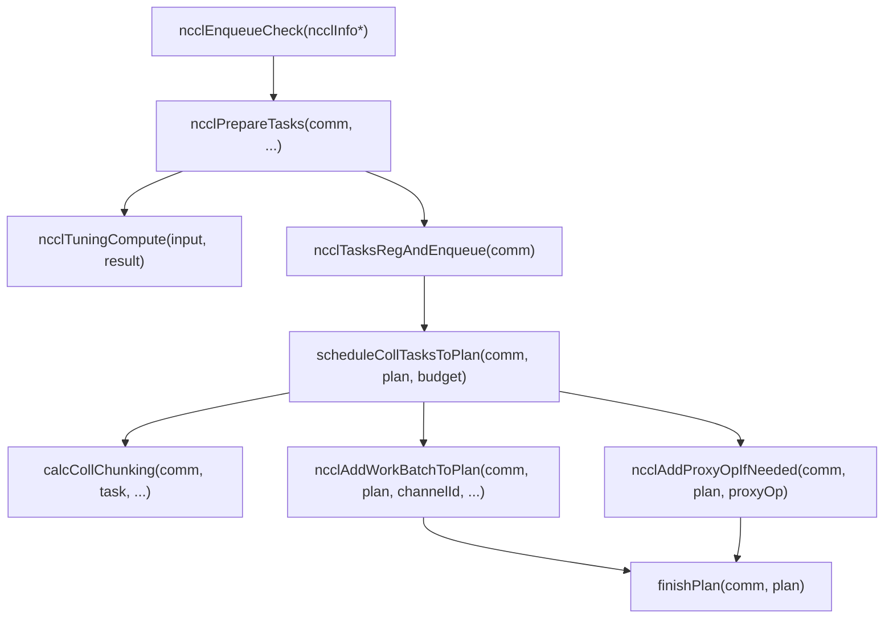
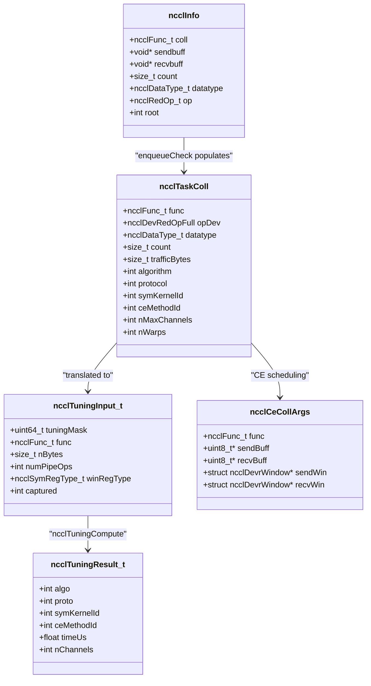

<!-- source: DeepWiki mcp.deepwiki.com · repo NVIDIA/nccl · page 4.2 Task Preparation and Scheduling · fetched 2026-10-28 -->

# Task Preparation and Scheduling

Relevant source files

The following files were used as context for generating this wiki page:

- [src/ce_coll.cc](src/ce_coll.cc)
- [src/config/CMakeLists.txt](src/config/CMakeLists.txt)
- [src/config/algorithm_parser.cc](src/config/algorithm_parser.cc)
- [src/config/algorithm_registry.cc](src/config/algorithm_registry.cc)
- [src/config/collconfig.cc](src/config/collconfig.cc)
- [src/enqueue/CMakeLists.txt](src/enqueue/CMakeLists.txt)
- [src/enqueue/enqueue.cc](src/enqueue/enqueue.cc)
- [src/enqueue/mgmt_task_enq.cc](src/enqueue/mgmt_task_enq.cc)
- [src/enqueue/task_prep/task_classify.cc](src/enqueue/task_prep/task_classify.cc)
- [src/enqueue/task_prep/task_posttuning.cc](src/enqueue/task_prep/task_posttuning.cc)
- [src/enqueue/task_prep/task_prep.cc](src/enqueue/task_prep/task_prep.cc)
- [src/enqueue/task_prep/task_pretuning.cc](src/enqueue/task_prep/task_pretuning.cc)
- [src/include/ce_coll.h](src/include/ce_coll.h)
- [src/include/config/algorithm_parser.h](src/include/config/algorithm_parser.h)
- [src/include/config/algorithm_registry.h](src/include/config/algorithm_registry.h)
- [src/include/config/collconfig.h](src/include/config/collconfig.h)
- [src/include/rma/rma_ce.h](src/include/rma/rma_ce.h)
- [src/include/tuning.h](src/include/tuning.h)
- [src/rma/rma_ce.cc](src/rma/rma_ce.cc)
- [src/tuning/cost_model.cc](src/tuning/cost_model.cc)
- [src/tuning/tuning.cc](src/tuning/tuning.cc)
- [src/tuning/tuning_general.cc](src/tuning/tuning_general.cc)

## Purpose and Scope

This page describes how NCCL translates a user-facing collective API call into an internal structured task, selects a communication algorithm, assigns work across channels, and inserts proxy operations before handing the plan to the kernel launch stage.

The pipeline covered here begins after a collective is submitted (via `ncclEnqueueCheck`) and ends when `ncclKernelPlan` is fully populated and ready for GPU submission. This stage includes specialized handling for **Compute Engine (CE) collectives** and **Symmetric Memory** tasks.

---

## System Overview

The preparation stage is implemented across `src/enqueue/` and `src/tuning/`, with core logic in `src/enqueue/task_prep/task_prep.cc` and `src/enqueue/enqueue.cc`.

**Stage pipeline:**

Sources: [src/enqueue/enqueue.cc:24-32](), [src/enqueue/enqueue.cc:140-150](), [src/tuning/tuning.cc:174-174](), [src/include/ce_coll.h:94-96]()

---

## Key Data Structures

**Diagram: Core types across the preparation stage**

Sources: [src/include/tuning.h:40-76](), [src/include/ce_coll.h:45-58](), [src/enqueue/enqueue.cc:140-150]()

---

## Entry Point: `ncclEnqueueCheck`

`ncclEnqueueCheck(ncclInfo*)` [src/enqueue/enqueue.cc:24]() is the single entry point for collective calls. It validates arguments and resolves the reduction operator.

### CE and Symmetric Thresholds
The enqueuer evaluates if a task should use Symmetric Memory or the Compute Engine (CE).
- **CE Threshold:** Controlled by `NCCL_SYM_CE_THRESHOLD` (default 8MB). For AllGather on Blackwell (minCompCap >= 100) using TMA, this threshold is quadrupled [src/enqueue/enqueue.cc:34-52]().
- **CE Implementation Check:** `ncclCeImplemented` checks if the collective and datatype are supported by the CE (CUDA 12.5+) [src/ce_coll.cc:146-155]().

Sources: [src/enqueue/enqueue.cc:24-52](), [src/ce_coll.cc:146-155]()

---

## Algorithm Selection and Tuning

Algorithm selection is handled by `ncclTuningCompute` [src/tuning/tuning.cc:174](), which simulates costs for different paths.

### Tuning Mask
The `tuningMask` determines which execution paths are considered [src/include/tuning.h:21-24]():
- `NCCL_TUNING_MASK_GENERAL_KERNELS`: Standard Ring/Tree kernels.
- `NCCL_TUNING_MASK_SYM_KERNELS`: Symmetric memory kernels.
- `NCCL_TUNING_MASK_CE`: Compute Engine collectives.

### Cost Modeling
`ncclTuningSelectBestTuning` [src/tuning/tuning.cc:153-167]() selects the tuning result with the lowest `timeUs`.
- **Latency/BW Constants:** Default latencies for Tree/Ring/NVLS are defined in `ncclTunerConstantsDefaults` [src/tuning/cost_model.cc:141-184]().
- **CE AllGather Multicast:** `ncclCeAllGatherUseMulticast` uses the cost model to decide between Unicast (UC) and Multicast (MC) CE methods, unless overridden by `NCCL_CE_COLL_AG_MULTICAST_THRESHOLD` [src/ce_coll.cc:53-74]().

Sources: [src/tuning/tuning.cc:153-174](), [src/tuning/cost_model.cc:141-184](), [src/ce_coll.cc:53-74]()

---

## Scheduling and Proxy Operations

### `scheduleCollTasksToPlan`
This function distributes the collective workload across channels.
- **Budget Testing:** `ncclTestBudget` [src/enqueue/enqueue.cc:289-297]() gates whether a task fits in the current `ncclKernelPlan` based on `inArgsBytes` (inline) or `outArgsBytes` (external FIFO).
- **Traffic Metrics:** `ncclFuncTrafficPerByte` scales element counts (e.g., AllReduce = 2, AllGather = nRanks) to calculate channel distribution [src/enqueue/enqueue.cc:123-134]().

### CE Collective Scheduling
If a CE path is selected, `scheduleCeCollTaskToPlan` [src/ce_coll.cc:96]() is invoked.
- **Batching:** CE operations are batched into `ncclCeBatchOpsParams` [src/include/ce_coll.h:60-71]().
- **Intra-Batch Sync:** For large messages (>512MB) or high frequency (every 8 ops), `intraBatchSync` is enabled to improve performance at scale [src/ce_coll.cc:23-28]().

### Proxy Op Insertion
`ncclAddProxyOpIfNeeded` [src/enqueue/enqueue.cc:140-150]() conditionally enqueues a `ncclProxyOp` to the plan's channel queue. This is essential for network (InfiniBand/TCP) or P2P transfers that require host-side coordination.

Sources: [src/enqueue/enqueue.cc:123-150](), [src/ce_coll.cc:23-28](), [src/ce_coll.cc:96-96]()

---

## RMA and CE Initialization

Task scheduling for RMA and CE requires pre-initialized device resources.

### CE Resource Setup
`ncclCeInit` [src/ce_coll.cc:76-109]():
- Allocates symmetric memory for synchronization flags (`baseUCSymReadyPtr`, `baseUCSymComplPtr`).
- Registers a `ncclDevrWindow` for LSA (Local Store Access) rank synchronization.
- Initializes sequence numbers (`ceSeqNum`) to track progress.

### RMA CE Contexts
`ncclRmaCeInit` [src/rma/rma_ce.cc:18-86]():
- Creates multiple RMA CE contexts based on `comm->config.numRmaCtx`.
- Allocates symmetric windows for signals and ACKs.
- Layout includes regions for non-graph signals, graph signals, and graph ACK flags [src/include/rma/rma_ce.h:35-55]().

Sources: [src/ce_coll.cc:76-109](), [src/rma/rma_ce.cc:18-86](), [src/include/rma/rma_ce.h:35-55]()

---

## `ncclAddWorkBatchToPlan`: Work Batch Packing

`ncclAddWorkBatchToPlan` [src/enqueue/enqueue.cc:153-200]() manages the packing of work into device-visible batches.

**Batch Reuse vs. New Batch:**
A new batch is started if:
1. The channel's `workBatchQueue` is empty [src/enqueue/enqueue.cc:159]().
2. The `workType` (Coll vs P2p) or `funcId` (kernel specialization) changes [src/enqueue/enqueue.cc:164-165]().
3. P2P Epochs change, or the batch reaches `NCCL_MAX_DEV_WORK_P2P_PER_BATCH` [src/enqueue/enqueue.cc:170-172]().
4. Collective work would exceed `NCCL_MAX_DEV_WORK_BATCH_BYTES` [src/enqueue/enqueue.cc:156]().

**Extension Batches:**
If a work item's offset is too far from the batch base or misaligned, `nextExtends` is set, and an extension batch is linked to logically fuse with the predecessor [src/enqueue/enqueue.cc:161-164]().

Sources: [src/enqueue/enqueue.cc:153-200]()

---

