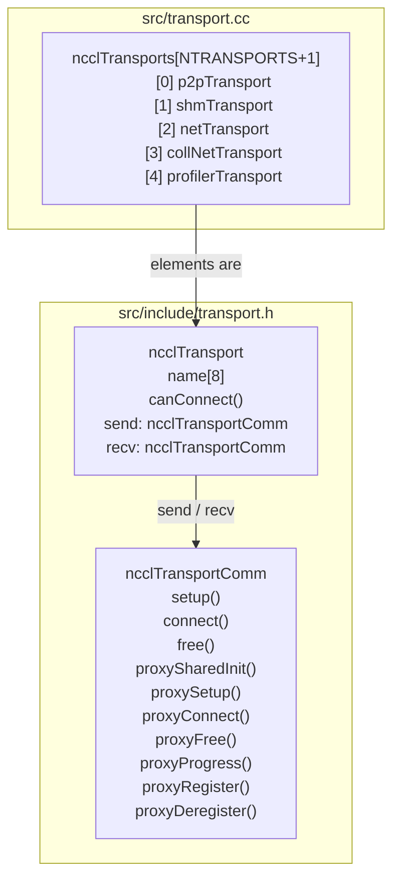
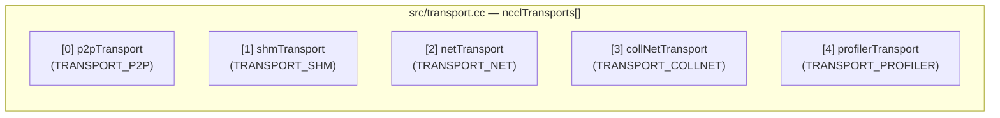
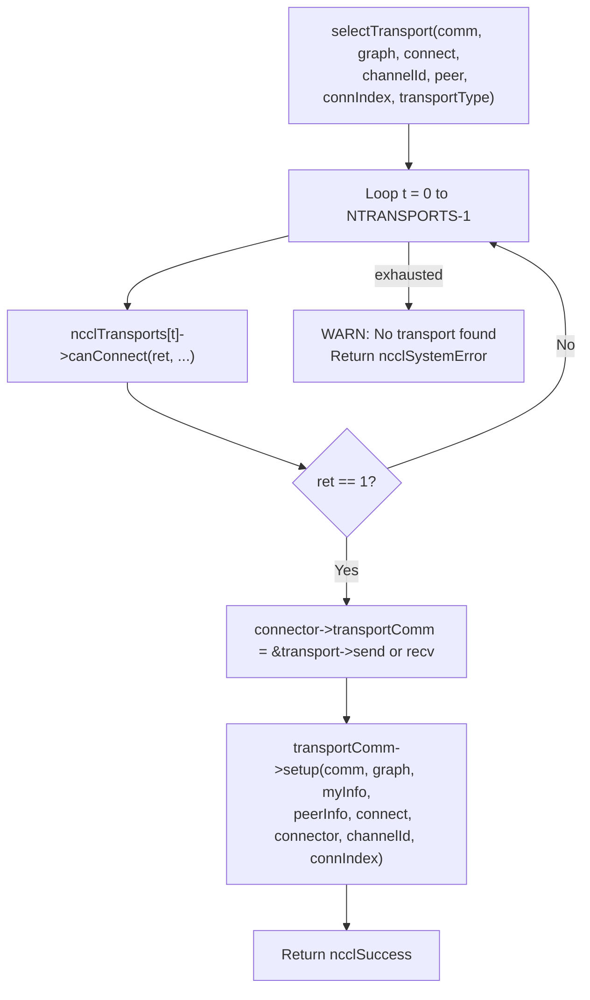
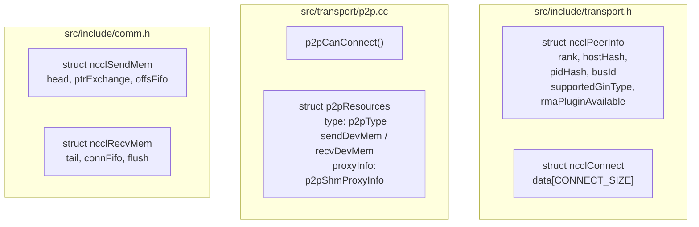
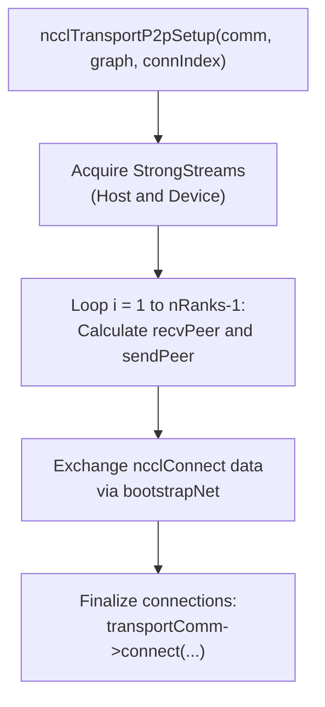
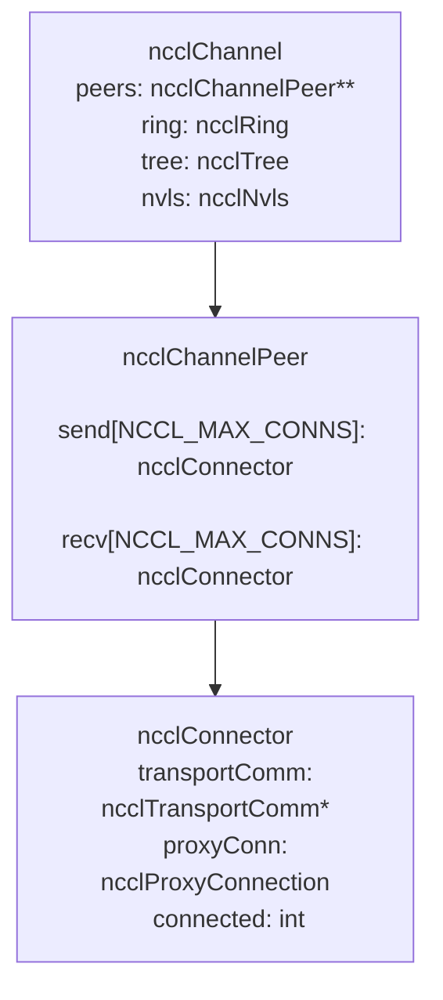

<!-- source: DeepWiki mcp.deepwiki.com · repo NVIDIA/nccl · page 5 Transport Layer · fetched 2026-10-28 -->

# Transport Layer

Relevant source files

The following files were used as context for generating this wiki page:

- [makefiles/version.mk](makefiles/version.mk)
- [src/bootstrap.cc](src/bootstrap.cc)
- [src/debug.cc](src/debug.cc)
- [src/graph/paths.cc](src/graph/paths.cc)
- [src/graph/search.cc](src/graph/search.cc)
- [src/graph/topo.cc](src/graph/topo.cc)
- [src/graph/topo.h](src/graph/topo.h)
- [src/group.cc](src/group.cc)
- [src/include/comm.h](src/include/comm.h)
- [src/include/enqueue.h](src/include/enqueue.h)
- [src/include/graph.h](src/include/graph.h)
- [src/include/proxy.h](src/include/proxy.h)
- [src/include/transport.h](src/include/transport.h)
- [src/init.cc](src/init.cc)
- [src/proxy.cc](src/proxy.cc)
- [src/transport.cc](src/transport.cc)
- [src/transport/coll_net.cc](src/transport/coll_net.cc)
- [src/transport/net.cc](src/transport/net.cc)
- [src/transport/p2p.cc](src/transport/p2p.cc)

## Purpose and Scope

The Transport Layer provides a modular abstraction for moving data between GPUs in a communicator. It handles both intra-node communication (GPU-to-GPU on the same host) and inter-node communication (across network interconnects). The layer selects the optimal transport mechanism based on hardware topology and establishes connections between peers.

The central abstraction is the `ncclTransport` struct, which defines a `canConnect` predicate and a pair of `ncclTransportComm` vtables (one for send, one for receive). Each channel endpoint holds an `ncclConnector`, which binds to one of the available transport implementations at initialization time. [src/include/transport.h:136-141]()

| Sub-page | Coverage |
|----------|----------|
| [Transport Selection and P2P Communication](#5.1) | `ncclTransport` interface, transport selection, P2P over NVLink/PCIe |
| [Bootstrap Communication](#5.2) | Bootstrap-only socket channel used during `ncclCommInit` |
| [InfiniBand and RDMA Transport](#5.3) | IB queue pairs, RDMA, GPUDirect, `ibvwrap.cc` |
| [Socket-Based Transport](#5.4) | TCP socket transport in `net_socket.cc` |
| [NVLS Multicast Transport](#5.5) | NVLink SHARP multicast in `nvls.cc` |
| [Proxy Service Architecture](#5.6) | Proxy thread, `ncclProxyOp`, `ncclProxyArgs` state machine |
| [CollNet and Buffer Registration](#5.7) | Switch-assisted collectives in `coll_net.cc` |
| [Network Plugin Interface](#5.8) | `ncclNet_t` / `ncclCollNet_t` plugin contract, dynamic loading |
| [GIN and RMA: Device-Initiated Networking](#5.9) | GPU-Initiated Networking and Remote Memory Access |

Sources: [src/init.cc:13-16](), [src/include/transport.h:1-131]()

---

## Transport Architecture

### Core Transport Interface

NCCL defines a modular transport interface. Each transport provides both send and receive capabilities through the `ncclTransport` struct in `src/include/transport.h`. [src/include/transport.h:136-141]()

**`ncclTransport` and `ncclTransportComm` struct layout**

Sources: [src/include/transport.h:117-141](), [src/transport.cc:15-18]()

The `ncclTransport` struct defines the contract all transport implementations must satisfy:

| Field | Type | Description |
|-------|------|-------------|
| `name` | `char[8]` | Transport identifier (e.g., `"P2P"`, `"NET"`) |
| `canConnect` | function pointer | Tests if two `ncclPeerInfo` peers can use this transport |
| `send` | `ncclTransportComm` | Send-side vtable |
| `recv` | `ncclTransportComm` | Receive-side vtable |

The `ncclTransportComm` vtable callbacks [src/include/transport.h:118-134]():

| Callback | Called by | Purpose |
|----------|-----------|---------|
| `setup` | `selectTransport` | Populate `ncclConnect` info for peer exchange |
| `connect` | `ncclTransportP2pSetup` | Finalize connection using peer's `ncclConnect` |
| `free` | Communicator teardown | Release transport resources |
| `proxySetup` | Proxy thread | Initialize proxy-side state |
| `proxyConnect` | Proxy thread | Connect proxy-side resources |
| `proxyProgress` | Proxy thread | Advance async network operations |
| `proxyRegister` | Buffer registration | Register memory with the network device |

Sources: [src/include/transport.h:117-141](), [src/transport.cc:15-18]()

### Available Transport Implementations

**Transport registry in `src/transport.cc`**

| Constant | Value | Source File | Purpose |
|----------|-------|-------------|---------|
| `TRANSPORT_P2P` | 0 | `src/transport/p2p.cc` | Intra-node: CUDA IPC, cuMem API, NVLink/PCIe direct |
| `TRANSPORT_SHM` | 1 | `src/transport/shm.cc` | Intra-node: host shared memory staging |
| `TRANSPORT_NET` | 2 | `src/transport/net.cc` | Inter-node: InfiniBand, RoCE, TCP via `ncclNet_t` plugin |
| `TRANSPORT_COLLNET` | 3 | `src/transport/coll_net.cc` | Switch-assisted collectives via `ncclCollNet_t` plugin |

Sources: [src/include/transport.h:16-22](), [src/transport.cc:15-18]()

---

## Transport Selection

### Selection Algorithm

Transport selection occurs during communicator channel setup. `selectTransport` (a template function in `src/transport.cc`) iterates `ncclTransports[]` in index order and picks the first transport whose `canConnect()` returns nonzero. [src/transport.cc:20-42]()

**`selectTransport` flow**

Sources: [src/transport.cc:20-42]()

**Transport selection order and `canConnect` criteria:**

| Priority | Transport | `canConnect` key conditions |
|----------|-----------|----------------------------|
| 1 | `p2pTransport` | Same host; CUDA P2P available; topology path within `NCCL_P2P_LEVEL`. [src/transport/p2p.cc:129-213]() |
| 2 | `shmTransport` | Same host; shared `/dev/shm` (between containers); fallback for intra-node. |
| 3 | `netTransport` | Any pair; intra-node NET not disabled by topology. [src/transport/net.cc:160-168]() |
| 4 | `collNetTransport` | Used for collective-specific network paths; returns 0 for P2P. [src/transport/coll_net.cc:143-148]() |

Sources: [src/transport.cc:20-42](), [src/transport/p2p.cc:129-213](), [src/transport/net.cc:160-168]()

---

## Transport Implementations at a Glance

The diagram below maps the transport subsystem to code entities.

**Transport subsystem — code entity map**

Sources: [src/include/transport.h:43-72](), [src/transport/p2p.cc:79-94](), [src/include/comm.h:59-83]()

### Peer-to-Peer (P2P) Transport Summary

The P2P transport (`p2pTransport`, `src/transport/p2p.cc`) handles intra-node communication via NVLink or PCIe. It supports direct CUDA IPC, the newer `cuMem` API, and intermediate staging if needed. [src/transport/p2p.cc:19-24]()

Key structures:
- `p2pResources`: Manages the type of P2P connection (Direct, IPC, CuMem) and associated device memory pointers. [src/transport/p2p.cc:79-94]()
- `ncclSendMem` / `ncclRecvMem`: Control structures used for flow control and buffer exchange between peers. [src/include/comm.h:59-83]()

### NVLS Transport Summary

NVLS (NVLink SHARP) provides multicast communication over NVLink fabrics. It is set up via dedicated functions in `nvls.cc`. Resources are held in `ncclNvlsSharedRes`, which tracks multicast (`mcBuff`) and unicast (`ucBuff`) buffer handles and their corresponding CUDA memory properties. [src/include/transport.h:77-102]()

Sources: [src/include/transport.h:77-102](), [src/include/comm.h:168]()

---

## Connection Establishment

### Overall Flow: `ncclTransportP2pSetup`

`ncclTransportP2pSetup` in `src/transport.cc` coordinates connection establishment across all peer ranks and channels. It handles the bootstrap exchange of `ncclConnect` structures. [src/transport.cc:123-233]()

**`ncclTransportP2pSetup` sequence**

Sources: [src/transport.cc:123-233]()

**Batching:** Connection setup is performed in rounds to avoid overwhelming the bootstrap network. The default round size is 128 peers, controlled by `NCCL_CONNECT_ROUND_MAX_PEERS`. [src/transport.cc:75-76]()

---

## Key Data Structures

**Connection state struct hierarchy**

Sources: [src/include/comm.h:156-178](), [src/include/transport.h:117-134]()

### Flow Control: `ncclSendMem` / `ncclRecvMem`

Flow-control structures shared between the GPU kernel and the host-side proxy thread. Both are aligned to `MEM_ALIGN` (4096 bytes) to ensure safe access across the PCIe/NVLink bus:

- `ncclSendMem.head`: Producer counter incremented by the sender. [src/include/comm.h:62]()
- `ncclRecvMem.tail`: Consumer counter incremented by the receiver. [src/include/comm.h:76]()
- `connFifo[NCCL_STEPS]`: Per-pipeline-step metadata used to synchronize progress between peers. [src/include/comm.h:78]()

Sources: [src/include/comm.h:59-83]()

---

