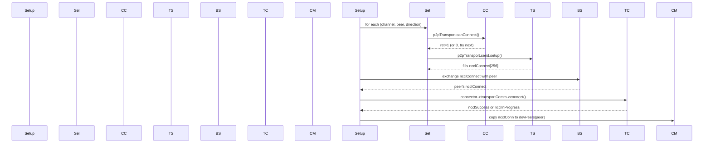
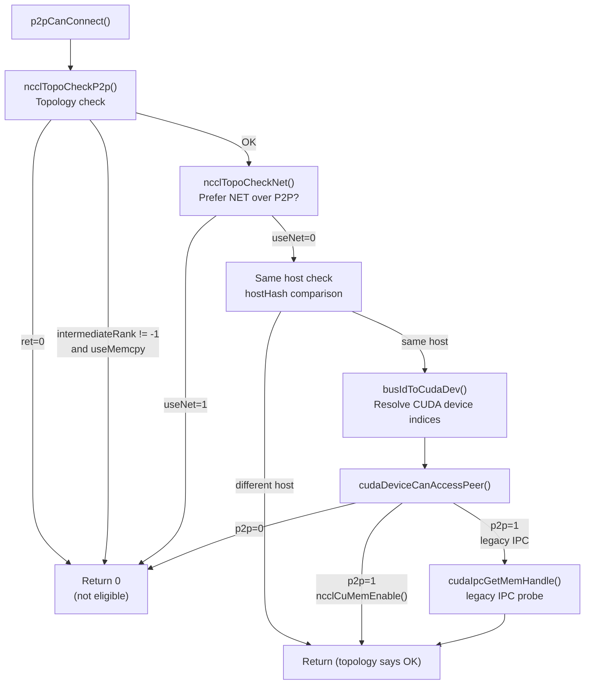
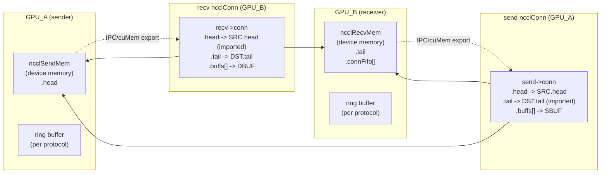
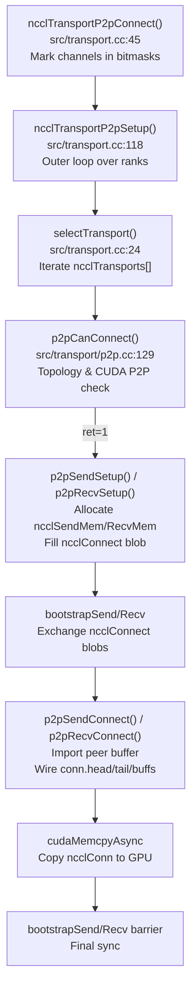

<!-- source: DeepWiki mcp.deepwiki.com · repo NVIDIA/nccl · page 5.1 Transport Selection and P2P Communication · fetched 2026-10-28 -->

# Transport Selection and P2P Communication

<details>
<summary>Relevant source files</summary>

The following files were used as context for generating this wiki page:

- [makefiles/version.mk](makefiles/version.mk)
- [src/graph/paths.cc](src/graph/paths.cc)
- [src/graph/search.cc](src/graph/search.cc)
- [src/graph/topo.cc](src/graph/topo.cc)
- [src/graph/topo.h](src/graph/topo.h)
- [src/include/graph.h](src/include/graph.h)
- [src/transport/coll_net.cc](src/transport/coll_net.cc)
- [src/transport/net.cc](src/transport/net.cc)
- [src/transport/p2p.cc](src/transport/p2p.cc)
- [src/transport/shm.cc](src/transport/shm.cc)

</details>


## Purpose and Scope

This page describes the `ncclTransport` interface and the mechanism by which NCCL selects a transport for each channel connection during communicator initialization. It details the P2P transport implementation in [src/transport/p2p.cc](), which handles intra-host GPU communication over NVLink and PCIe using CUDA shared memory (IPC or cuMem), and the SHM transport in [src/transport/shm.cc]() for CPU-mediated shared memory.

For network transport over InfiniBand or TCP sockets, see [InfiniBand and RDMA Transport](#5.3) and [Socket-Based Transport](#5.4). For the NVLink SHARP multicast transport, see [NVLS Multicast Transport](#5.5).

---

## The `ncclTransport` Interface

Every transport is represented by a statically-allocated `ncclTransport` struct defined in [src/include/transport.h:125-130]():

```cpp
struct ncclTransport {
  const char name[8];
  ncclResult_t (*canConnect)(int*, struct ncclComm* comm, struct ncclTopoGraph* graph, struct ncclPeerInfo*, struct ncclPeerInfo*);
  struct ncclTransportComm send;
  struct ncclTransportComm recv;
};
```

The `send` and `recv` fields are `ncclTransportComm` function tables [src/include/transport.h:112-123](), each with the following operations:

| Function pointer | Called by | Purpose |
|---|---|---|
| `setup` | Host, during init | Allocate local resources; produce `ncclConnect` info to send to peer |
| `connect` | Host, during init | Consume peer's `ncclConnect` info; finalize connection |
| `free` | Host, during teardown | Release connector resources |
| `proxySharedInit` | Proxy thread | Shared-buffer initialization |
| `proxySetup` | Proxy thread | Transport-side setup on the proxy |
| `proxyConnect` | Proxy thread | Transport-side connect on the proxy |
| `proxyFree` | Proxy thread | Free proxy-side resources |
| `proxyProgress` | Proxy thread | Drive send/recv completion (NET transports only) |
| `proxyRegister` / `proxyDeregister` | Proxy thread | Buffer registration for zero-copy |

The 256-byte `ncclConnect` struct [src/include/transport.h:67-69]() is the opaque blob each rank exchanges with its peer during `setup`/`connect`.

**Transport interface diagram**

```mermaid
classDiagram
    class "ncclTransport" {
        +char name[8]
        +canConnect(int* ret, ncclComm* comm, ...)
        +ncclTransportComm send
        +ncclTransportComm recv
    }
    class "ncclTransportComm" {
        +setup(ncclComm* comm, ncclTopoGraph* graph, ...)
        +connect(ncclComm* comm, ncclConnect* connect, ...)
        +free(ncclComm* comm, ncclConnector* connector)
        +proxyProgress(ncclProxyState* proxyState, ncclProxyArgs* args)
    }
    class "ncclConnect" {
        +char data[256]
    }
    class "ncclConnector" {
        +ncclTransportComm* transportComm
        +ncclProxyConnection proxyConn
        +ncclConn conn
    }
    "ncclTransport" --> "ncclTransportComm" : "send / recv"
    "ncclTransportComm" ..> "ncclConnect" : "produces / consumes"
    "ncclConnector" --> "ncclTransportComm" : "transportComm"
```

Sources: [src/include/transport.h:67-130]()

---

## Transport Registry and Priority Order

The global transport array is defined in [src/transport.cc:15-21]():

```c
struct ncclTransport* ncclTransports[NTRANSPORTS+1] = {
  &p2pTransport,       // TRANSPORT_P2P  = 0
  &shmTransport,       // TRANSPORT_SHM  = 1
  &netTransport,       // TRANSPORT_NET  = 2
  &collNetTransport,   // TRANSPORT_COLLNET = 3
  &profilerTransport   // Not really used for transport
};
```

Selection is first-match in this order: once `canConnect` returns nonzero for a transport, that transport is used for the channel/peer pair and no further transports are tried.

Sources: [src/transport.cc:15-21](), [src/include/transport.h:16-22]()

---

## Transport Selection Per Channel

**The `selectTransport` function**

`selectTransport<type>()` in [src/transport.cc:23-43]() iterates the transport array and selects the first eligible transport for a single (channel, peer, direction) triple:

```cpp
for (int t=0; t<NTRANSPORTS; t++) {
    struct ncclTransport *transport = ncclTransports[t];
    transport->canConnect(&ret, comm, graph, myInfo, peerInfo);
    if (ret) {
        connector->transportComm = type == 1 ? &transport->send : &transport->recv;
        transportComm->setup(comm, graph, myInfo, peerInfo, connect, connector, channelId, connIndex);
        return ncclSuccess;
    }
}
```

**The `ncclTransportP2pSetup` function**

`ncclTransportP2pSetup()` in [src/transport.cc:118-305]() is the top-level function that wires all peers across all channels. It executes in two phases:

**Phase 1 — Setup and exchange**:
1. Walk all channels, call `selectTransport<0>` (recv) and `selectTransport<1>` (send) for peers marked in `comm->connectRecv` and `comm->connectSend` [src/transport.cc:140-165]().
2. Exchange the produced `ncclConnect` structs with each peer using `bootstrapSend` / `bootstrapRecv` [src/transport.cc:200-218]().

**Phase 2 — Connect**:
3. Call `connector->transportComm->connect()` for each channel [src/transport.cc:245-255](). This may return `ncclInProgress` (async), requiring iteration until `done` [src/transport.cc:230-265]().
4. On success, `cudaMemcpyAsync` copies the finalized `ncclConn` into the `devPeers` struct so the GPU kernel can access it [src/transport.cc:269-281]().
5. A final round of `bootstrapSend/Recv` synchronizes all ranks before returning [src/transport.cc:290-300]().

**Transport selection and setup flow diagram**



Sources: [src/transport.cc:23-305]()

---

## P2P Transport: `canConnect`

`p2pCanConnect()` in [src/transport/p2p.cc:129-213]() determines whether two ranks can use the P2P transport.



Key conditions:
- `ncclTopoCheckP2p()` consults the topology graph [src/include/graph.h:42-43](). If the path is too long (beyond `NCCL_P2P_LEVEL`), it returns 0 [src/transport/p2p.cc:136-138]().
- If `ncclTopoCheckNet()` returns `useNet=1`, P2P yields to the NET transport [src/transport/p2p.cc:147-151]().
- `cudaDeviceCanAccessPeer()` is queried directly; on failure, P2P is disabled [src/transport/p2p.cc:178-183]().
- A one-time legacy IPC probe (`cudaIpcGetMemHandle`) checks if IPC is functional (e.g., WSL workaround) [src/transport/p2p.cc:195-202]().

Sources: [src/transport/p2p.cc:129-213](), [src/include/graph.h:42-43]()

---

## P2P Connection Modes

The enum `p2pType` in [src/transport/p2p.cc:19-24]() defines the following modes:

| Mode | Constant | Condition | Data path |
|---|---|---|---|
| Direct pointer | `P2P_DIRECT` | Same PID, same GPU | Pointer equality; no IPC needed |
| IPC (legacy) | `P2P_IPC` | Same host, different PID, `cudaIpc` enabled | `cudaIpcGetMemHandle` / `cudaIpcOpenMemHandle` |
| cuMem | `P2P_CUMEM` | Same host, `ncclCuMemEnable()` | `cuMemExportToShareableHandle` / `cuMemImportFromShareableHandle` |
| Intermediate | `P2P_INTERMEDIATE` | Requires relay rank | CE memcpy via a third GPU |

`ncclP2pAllocateShareableBuffer()` [src/transport/p2p.cc:223-253]() handles buffer allocation for the IPC and cuMem paths. `ncclShmImportShareableBuffer()` [src/transport/shm.cc:160-161]() and related functions handle mapping the exported buffer into the local process's address space.

Sources: [src/transport/p2p.cc:19-253](), [src/transport/shm.cc:160-161]()

---

## SHM Transport

The `shmTransport` [src/transport/shm.cc]() provides shared-memory communication between GPUs on the same host that may not have direct P2P access (e.g., across different PCIe root complexes without P2P support).

- **`shmCanConnect`**: Checks if ranks are on the same host (`hostHash`) and share the same `/dev/shm` [src/transport/shm.cc:73-78]().
- **Locality**: Controlled by `NCCL_SHM_LOCALITY`. `SHM_SEND_SIDE` (1) puts the buffer on the sender's side, while `SHM_RECV_SIDE` (2) puts it on the receiver's side [src/transport/shm.cc:55-56]().
- **Setup**: `shmSendSetup` and `shmRecvSetup` allocate shared memory via the proxy thread using `ncclProxyCallBlocking` with `ncclProxyMsgSetup` [src/transport/shm.cc:109-110](), [src/transport/shm.cc:142-143]().

Sources: [src/transport/shm.cc:53-150]()

---

## P2P Data Structures: `ncclSendMem` and `ncclRecvMem`

These structs form the control region between sender and receiver GPU kernels [src/include/comm.h:53-77]().

```cpp
struct ncclSendMem {
  union {
    struct {
      uint64_t head;                     // Sender's step counter
      char pad1[CACHE_LINE_SIZE - sizeof(uint64_t)];
      void* ptrExchange;                 // Pointer exchange for direct mode
      uint64_t redOpArgExchange[2];
      char pad2[CACHE_LINE_SIZE - sizeof(void*) - 2 * sizeof(uint64_t)];
      int offsFifo[NCCL_STEPS];          // Offset FIFO for Simple protocol
    };
    char pad3[MEM_ALIGN];
  };
};

struct ncclRecvMem {
  union {
    struct {
      uint64_t tail;                     // Receiver's step counter
      char pad1[CACHE_LINE_SIZE - sizeof(uint64_t)];
      struct ncclConnFifo connFifo[NCCL_STEPS]; // Step metadata (size, flags)
      int flush;                         // GDRCopy-based flush
    };
    char pad4[MEM_ALIGN];
  };
};
```

**P2P data structures and connections diagram**



Sources: [src/include/comm.h:53-77](), [src/transport/p2p.cc:79-94]()

---

## Summary: Full Selection and Setup Code Path



Sources: [src/transport.cc:23-305](), [src/transport/p2p.cc:129-213](), [src/include/transport.h:112-130]()

---

