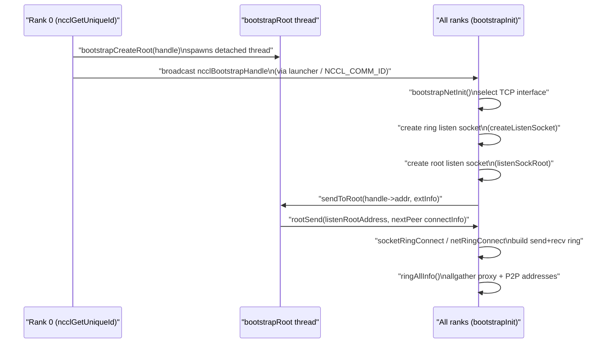
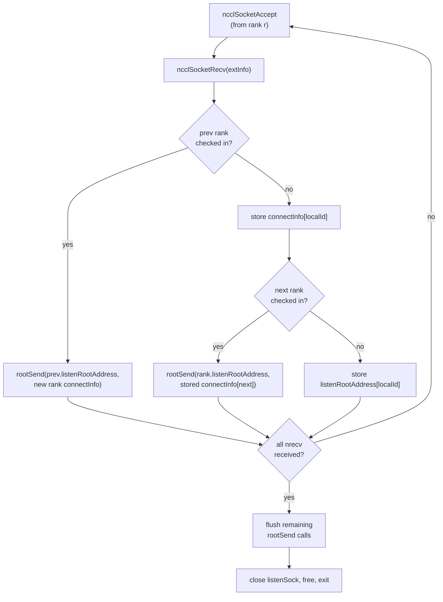
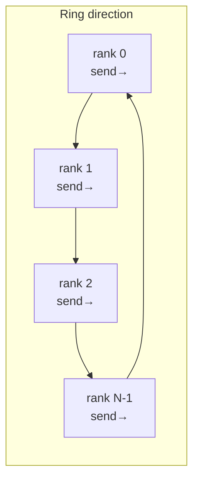
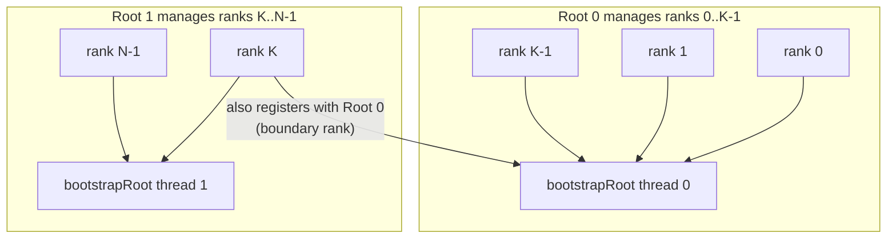
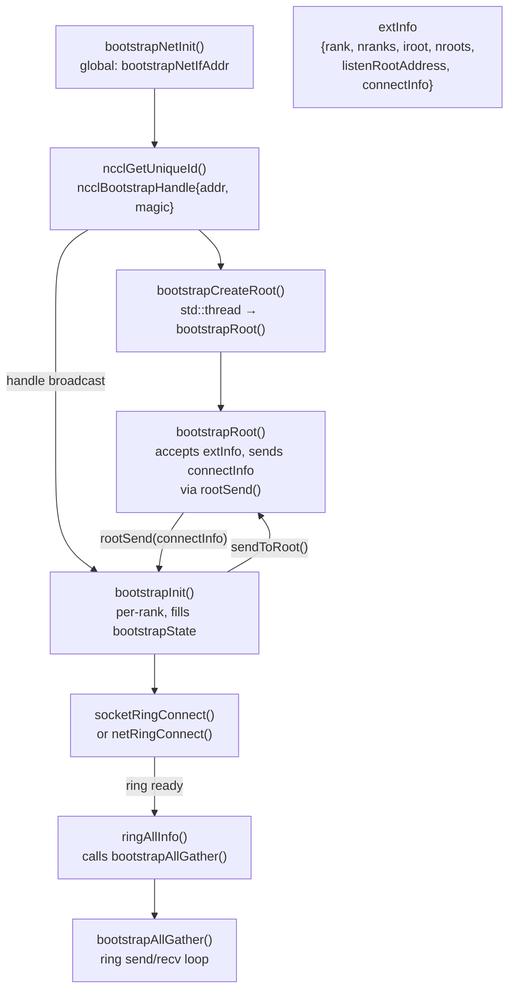

<!-- source: DeepWiki mcp.deepwiki.com · repo NVIDIA/nccl · page 5.2 Bootstrap Communication · fetched 2026-10-28 -->

# Bootstrap Communication

<details>
<summary>Relevant source files</summary>

The following files were used as context for generating this wiki page:

- [src/bootstrap.cc](src/bootstrap.cc)
- [src/debug.cc](src/debug.cc)
- [src/group.cc](src/group.cc)
- [src/include/bootstrap.h](src/include/bootstrap.h)
- [src/include/comm.h](src/include/comm.h)
- [src/include/core.h](src/include/core.h)
- [src/include/enqueue.h](src/include/enqueue.h)
- [src/include/proxy.h](src/include/proxy.h)
- [src/include/socket.h](src/include/socket.h)
- [src/include/transport.h](src/include/transport.h)
- [src/init.cc](src/init.cc)
- [src/misc/socket.cc](src/misc/socket.cc)
- [src/proxy.cc](src/proxy.cc)
- [src/transport.cc](src/transport.cc)
- [src/transport/net_socket.cc](src/transport/net_socket.cc)

</details>


## Purpose and Scope

This page describes the bootstrap communication system in NCCL, implemented in `src/bootstrap.cc` [src/bootstrap.cc:1-6](). The bootstrap channel is a temporary, CPU-side TCP socket network used **exclusively during communicator initialization** to exchange peer addresses, proxy socket addresses, and intra-node topology data [src/bootstrap.cc:686-864](). Once the main transport connections are established, the bootstrap ring is no longer used for data movement.

For the socket primitives the bootstrap builds on, see [6.3 Socket Abstraction Layer](). For the full communicator initialization sequence that calls into bootstrap, see [2.1 Initialization and Bootstrap Process](). For the proxy service that bootstrap helps bring up, see [5.6 Proxy Service Architecture]().

---

## Role in Initialization

The bootstrap system solves a chicken-and-egg problem: before any transport (NVLink, IB, etc.) is set up, all ranks must learn each other's network addresses. Bootstrap provides a lightweight rendezvous mechanism using only TCP sockets to accomplish this [src/bootstrap.cc:686-700](). After `bootstrapInit()` completes, all ranks have:

- A ring of TCP socket connections for all-gather operations [src/bootstrap.cc:792-814]().
- Each other's proxy socket addresses (`peerProxyAddresses`, `peerProxyAddressesUDS`) [src/bootstrap.cc:524-525]().
- Each other's P2P bootstrap socket addresses (`peerP2pAddresses`) [src/bootstrap.cc:526]().

**Bootstrap is completely torn down** via `bootstrapClose()` after transport setup is complete [src/bootstrap.cc:866-891]().

---

## Key Data Structures

### `bootstrapState`

The per-rank runtime state for the bootstrap system, stored as `ncclComm::bootstrap` [src/include/bootstrap.h:25]().

[src/bootstrap.cc:519-532]()

| Field | Type | Purpose |
|---|---|---|
| `ring` | `bootstrapRing_t` | Send/recv endpoints for the ring |
| `listen` | `bootstrapListen_t` | Listening sockets for ring and P2P |
| `net` | `ncclNet_t*` | OOB net plugin (if enabled) |
| `peerProxyAddresses` | `ncclSocketAddress*` | Proxy TCP addresses for all ranks |
| `peerProxyAddressesUDS` | `uint64_t*` | UDS identifiers for proxy IPC |
| `peerP2pAddresses` | `ncclSocketAddress*` | P2P direct socket addresses |
| `unexpectedConnections` | `unexConn*` | Out-of-order connection queue |
| `rank`, `nranks`, `magic` | `int`, `int`, `uint64_t` | Identity and safety check |
| `abortFlag` | `volatile uint32_t*` | Abort signaling |

### `bootstrapRing_t`

A union representing the ring communication transport — either socket-based or OOB net-based:

[src/bootstrap.cc:495-506]()

```
bootstrapRing_t
  ├── socket variant: { recv: ncclSocket, send: ncclSocket }
  └── net variant:    { sendComm, recvComm, sendDevHandle, recvDevHandle }
```

### `extInfo`

The message each rank sends to the root during rendezvous. Contains the rank's identity, root assignment, and how the root can reach back.

[src/bootstrap.cc:265-273]()

| Field | Purpose |
|---|---|
| `rank`, `nranks` | Rank identity |
| `iroot`, `nroots`, `offset` | Multi-root assignment for scalability |
| `listenRootAddress` | Address the root sends ring-next info back to |
| `connectInfo` | Address/handle for the next ring neighbor |

### `ncclBootstrapHandle`

The public `ncclUniqueId` representation, carrying the root's TCP address and a `magic` value used to identify connections [src/include/bootstrap.h:14-18]().

---

## Initialization Sequence

**Bootstrap initialization diagram (functions in `src/bootstrap.cc`)**



Sources: [src/bootstrap.cc:413-436](), [src/bootstrap.cc:438-468](), [src/bootstrap.cc:686-864]()

### Step 1 — Network Interface Selection (`bootstrapNetInit`)

`bootstrapNetInit()` runs once per process (protected by `bootstrapNetMutex`) to select the TCP network interface for bootstrap traffic [src/bootstrap.cc:106-108]().

- If `NCCL_COMM_ID` is set, `ncclFindInterfaceMatchSubnet()` finds a local interface on the same subnet as the remote address [src/bootstrap.cc:113-118]().
- Otherwise, `ncclFindInterfaces()` picks the first available interface [src/bootstrap.cc:124-125]().

The result is stored in process-global `bootstrapNetIfName` / `bootstrapNetIfAddr` [src/bootstrap.cc:98-99]().

### Step 2 — Unique ID Generation (`ncclGetUniqueId`)

`ncclGetUniqueId()` fills a `ncclBootstrapHandle` which is broadcast to all ranks out-of-band by the launcher [src/init.cc:202-211]():

- If `NCCL_COMM_ID` is set, the address is parsed from the environment [src/bootstrap.cc:440-452]().
- Otherwise, a random `magic` is generated, `handle->addr` is set to the local interface, and `bootstrapCreateRoot()` spawns a root thread [src/bootstrap.cc:453-467]().

### Step 3 — Root Thread (`bootstrapRoot`)

`bootstrapCreateRoot()` starts a detached `std::thread` running `bootstrapRoot()` [src/bootstrap.cc:413-436](). The root:

1. **Accepts** connections from all expected ranks [src/bootstrap.cc:328-332]().
2. For each incoming `extInfo`, determines the **ring neighbor** using `localIdFromRoot()` / `firstRankFromRoot()` [src/bootstrap.cc:344-347]().
3. Sends back the next ring neighbor's `connectInfo` to each rank's `listenRootAddress` via `rootSend()` [src/bootstrap.cc:358-361]().

The root exits and closes its listen socket when all ranks have checked in [src/bootstrap.cc:405-411]().

**Root state machine diagram**



Sources: [src/bootstrap.cc:299-411]()

### Step 4 — Per-Rank Initialization (`bootstrapInit`)

Each rank runs `bootstrapInit()` which:

1. Creates a `bootstrapState` and assigns it to `comm->bootstrap` [src/bootstrap.cc:702-715]().
2. Creates a **ring listen socket** (or net listen comm) for the ring neighbor to connect to [src/bootstrap.cc:732-742]().
3. Creates a **root listen socket** for the root to send back neighbor info [src/bootstrap.cc:744-750]().
4. Sends `extInfo` to its assigned root via `sendToRoot()` [src/bootstrap.cc:782-790]().
5. Accepts the root's reply containing the next rank's `connectInfo` [src/bootstrap.cc:792-794]().
6. Calls `socketRingConnect()` or `netRingConnect()` to complete the ring [src/bootstrap.cc:796-814]().
7. Calls `ringAllInfo()` to all-gather proxy/P2P addresses [src/bootstrap.cc:837-841]().

---

## The Bootstrap Ring

All ranks form a **unidirectional ring** of TCP socket connections (rank 0 → rank 1 → … → rank N-1 → rank 0). This ring is the substrate for `bootstrapAllGather()`.

**Ring data flow**



**Ring transport selection**

| Condition | Transport | Functions used |
|---|---|---|
| `NCCL_OOB_NET_ENABLE=0` (default) | TCP sockets | `socketRingConnect`, `ncclSocketSend`, `ncclSocketRecv` |
| `NCCL_OOB_NET_ENABLE=1` | Network plugin | `netRingConnect`, `netIsend`, `netIrecv` |

The OOB net path uses the `ncclNet_t` interface via `comm->ncclNet`, selected if the parameter `BootstrapNetEnable` is set [src/bootstrap.cc:103](), [src/bootstrap.cc:159-212]().

---

## Communication Operations

### `bootstrapAllGather`

Implements a ring-based all-gather. Each rank:
1. Sends its data chunk to `next` rank [src/bootstrap.cc:644-647]().
2. Receives from `prev` rank, then forwards the received chunk onward [src/bootstrap.cc:648-653]().
3. Repeats until all `nranks` chunks have been collected [src/bootstrap.cc:642-654]().

Tag used: `BOOTSTRAP_TAG_ALLGATHER` [src/bootstrap.cc:23]().

This is the mechanism used by `ringAllInfo()` to distribute proxy/P2P addresses to all ranks in a single pass [src/bootstrap.cc:534-554]().

### `bootstrapIntraNodeAllGather`

A faster variant that only gathers data within the same node [src/bootstrap.cc:1011-1025](). Uses `BOOTSTRAP_TAG_INTRANODE_ALLGATHER` [src/bootstrap.cc:25]().

### `bootstrapSend` / `bootstrapRecv`

Point-to-point message passing between arbitrary rank pairs. Each rank listens on `state->listen.peerSocket` [src/bootstrap.cc:752-760](). Connections are identified by `(tag, peer_rank)`.

**Unexpected connections**: because multiple send/recvs may arrive out of order, received connections that don't match the current `bootstrapRecv` call are stored in the `unexpectedConnections` linked list (`unexConn`) and matched later [src/bootstrap.cc:488-493](), [src/bootstrap.cc:952-972]().

**Message framing**: `ncclSocketSend` / `ncclSocketRecv` in `src/misc/socket.cc` manage the underlying TCP stream, while `bootstrapSend`/`bootstrapRecv` handle the tag-based multiplexing [src/bootstrap.cc:918-933](), [src/bootstrap.cc:944-972]().

---

## Message Tag System

Tags multiplex different logical channels over the same physical sockets:

| Constant | Bit | Usage |
|---|---|---|
| `BOOTSTRAP_TAG_CONNECT` | 31 | Initial ring connection info |
| `BOOTSTRAP_TAG_ALLGATHER` | 30 | Ring all-gather data |
| `BOOTSTRAP_TAG_COMMSPLIT` | 29 | `ncclCommSplit` coordination |
| `BOOTSTRAP_TAG_INTRANODE_ALLGATHER` | 28 | Intra-node all-gather |
| `BOOTSTRAP_TAG_GROW_BOUNDARY` | 27 | `ncclCommGrow` handle broadcast |

[src/bootstrap.cc:22-26]()

---

## Multi-Root Support

For large communicators, the root thread can become a bottleneck. NCCL supports splitting root responsibilities across multiple root processes (`nHandles > 1`). Each root manages a subset of ranks:

- `rootIdFromRank(rank, nRanks, nRoots, offset)` — assigns a root to each rank [src/bootstrap.cc:59-69]().
- `firstRankFromRoot(root, nRanks, nRoots, offset)` — first rank managed by root [src/bootstrap.cc:51-56]().
- `nRankFromRoot(root, nRanks, nRoots, offset)` — count of ranks per root [src/bootstrap.cc:71-78]().

The "boundary" ranks (first rank of each root's range) also register with the **previous root** so that the ring wraps correctly across root boundaries [src/bootstrap.cc:782-790]().



Sources: [src/bootstrap.cc:51-94](), [src/bootstrap.cc:782-790]()

---

## Grow Operation Support (`bcastGrowHandle`)

When a communicator is grown via `ncclCommGrow`, `bcastGrowHandle()` distributes the new `ncclBootstrapHandle` to all existing ranks using `bootstrapSend`/`bootstrapRecv` on the parent communicator's bootstrap channel [src/bootstrap.cc:470-486]().

The `offset` field in `extInfo` signals to the root thread that some ranks are "pre-existing" and should be excluded from the distribution [src/bootstrap.cc:269]().

---

## Teardown (`bootstrapClose`)

After the main transports are established, `bootstrapClose()` closes all bootstrap sockets, frees peer address arrays, and releases the `bootstrapState` [src/bootstrap.cc:866-891]().

---

## Full Data Flow Diagram

**bootstrap.cc entity map**



Sources: [src/bootstrap.cc:106-142](), [src/bootstrap.cc:413-468](), [src/bootstrap.cc:686-864]()

---

